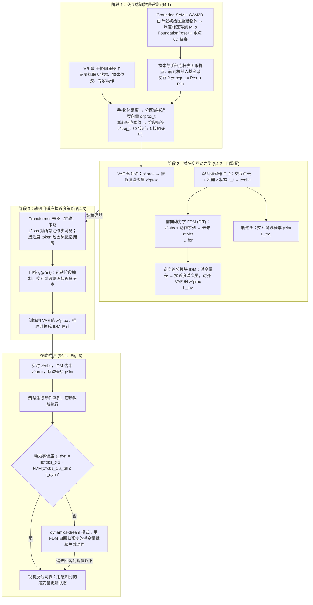

# ProxiDex（arXiv:2609.16586）

**ProxiDex**（*ProxiDex: Learning Dynamics-Guided Proximity Policy for Dexterous Manipulation*，[arXiv:2609.16586](https://arxiv.org/abs/2609.16586)，[项目页](https://proxidex.github.io/)）来自 [具身智能小站 12 篇盘点](../../sources/blogs/wechat_embodied_station_12_papers_vla_deploy_2026-09-16.md)。

## 一句话定义

**把手—物体接近关系转为硬件无关交互表征，学习动作条件下的接近动态，补视觉不可靠时的策略信号。**

## 英文缩写速查

| 缩写 | 英文全称 | 简要说明 |
|------|----------|----------|
| ProxiDex | Proximity-guided Dexterous policy | 本文接近动态策略 |
| Dex | Dexterous | 灵巧手操作 |
| IL | Imitation Learning | 模仿学习管线 |
| Sim2Real | Simulation to Real | 仿真到真机 |

## 为什么重要

- 灵巧手操作中手部遮挡与触觉硬件差异使接触状态难稳定观测。
- 开源结论：**待发布**（步骤 2.5，2026-09-16）。
- 与 [12 篇技术地图](../overview/vla-deploy-12-papers-technology-map.md) 中同类工作可横向对照。

## 流程总览

图依据：论文 §4.1–4.4 与 Fig. 2 / Fig. 3、式 2–5

## 核心机制

| 项 | 内容 |
|----|------|
| **arXiv** | [2609.16586](https://arxiv.org/abs/2609.16586) |
| **开源** | **待发布** |
| **要点** | 接近关系表征 + 动作条件接近动态；项目页入库日为占位模板，无有效 GitHub。 |
| **文内指标** | 以项目页与原文为准。 |

## 源码运行时序图

**不适用（待发布）** — 截至 2026-09-16 项目页未列可运行官方仓库。

## 实验与评测

- 以项目页与原文为准。
- **读法：** 清单摘要；逐项对照与 baseline 以原文 PDF 为准。

## 与其他工作对比

- 横向索引见 [12 篇技术地图](../overview/vla-deploy-12-papers-technology-map.md)。

## 结论

**ProxiDex 把「接近」当可迁移中间表征，适合跟踪视觉退化下的灵巧操作，但代码待发布。**

1. 开源边界：**待发布** — 以项目页实际链接为准（入库日 2026-09-16）。
2. 核心机制：接近关系表征 + 动作条件接近动态；项目页入库日为占位模板，无有效 GitHub。…
3. 部署前核对任务协议与硬件条件，勿直接横比公众号摘录数字。

## 关联页面

- [manipulation](../tasks/manipulation.md)
- [imitation-learning](../methods/imitation-learning.md)
- [tactile-sensing](../concepts/tactile-sensing.md)
- [paper-stereopatch](./paper-stereopatch.md)

## 参考来源

- [proxidex_arxiv_2609_16586.md](../../sources/papers/proxidex_arxiv_2609_16586.md)
- [wechat_embodied_station_12_papers_vla_deploy_2026-09-16.md](../../sources/blogs/wechat_embodied_station_12_papers_vla_deploy_2026-09-16.md)
- [arXiv:2609.16586](https://arxiv.org/abs/2609.16586)
- [arXiv PDF](https://arxiv.org/pdf/2609.16586)：已通读方法部分（实验与附录以略读为准）：§1–3，§4 方法（数据采集、潜在交互动力学、轨迹自适应策略、动力学一致性推理），§5 实验设定与部分结果

## 推荐继续阅读

- [arXiv PDF](https://arxiv.org/pdf/2609.16586)
- [项目页](https://proxidex.github.io/)

