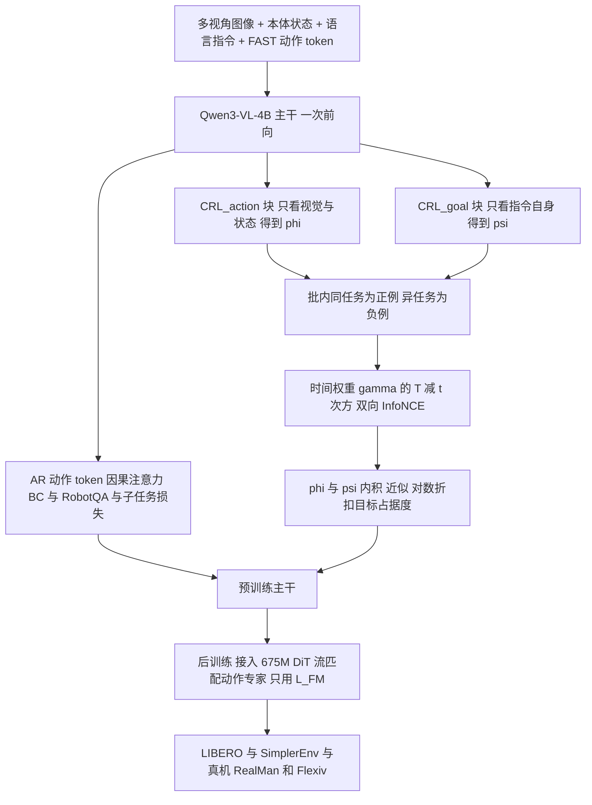

# PRTS（arXiv:2604.27472）

**PRTS**（*PRTS: A Primitive Reasoning and Tasking System via Contrastive Representations*，[arXiv:2604.27472](https://arxiv.org/abs/2604.27472)）来自中国电信 TeleAI 等。本页依据对 arXiv v1 全文的通读（核对范围见 [来源归档](../../sources/papers/prts-primitive-reasoning-tasking-system_arxiv_2604_27472.md)）。注意：它与 [SMART 论文](paper-gamma-art-smart.md)（共用 TeleHuman/PRTS 代码仓库）不是同一篇，SMART 不使用本文的对比预训练目标（见 [仓库归档](../../sources/repos/telehuman_prts_smart_vla.md)）。

## 一句话定义

**把 VLA 预训练从「只做行为克隆」改为「行为克隆 + 语言目标条件的对比式强化学习」：语言指令当目标，状态-动作嵌入与目标嵌入的内积近似对数折扣目标占据度（goal reachability 的代理量），无需奖励标注，也无需另训价值网络。**（§1、§3.2；作者自述）

## 英文缩写速查

| 缩写 | 英文全称 | 简要说明 |
|------|----------|----------|
| PRTS | Primitive Reasoning and Tasking System | 本文模型名 |
| VLA | Vision-Language-Action | 视觉-语言-动作策略 |
| VLM | Vision-Language Model | 视觉-语言模型，这里是 Qwen3-VL-4B-Instruct |
| GCRL | Goal-Conditioned Reinforcement Learning | 目标条件强化学习 |
| CRL | Contrastive Reinforcement Learning | 用 InfoNCE 分类估计目标条件价值（Eysenbach 等 2022） |
| InfoNCE | Noise-Contrastive Estimation 损失 | 正负样本对比的交叉熵 |
| BC | Behavior Cloning | 行为克隆 |
| AR | Auto-Regressive | 自回归（FAST 离散动作 token 预测） |
| FAST | Frequency-space Action Sequence Tokenization | 动作分块离散化方案 |
| DiT | Diffusion Transformer | 流匹配动作专家的骨架 |
| SR | Success Rate | 成功率 |

## 为什么重要

- 作者的出发点（§1）：机器人轨迹本质是朝目标推进的过程，而 VLM 只有静态语义匹配，缺少「当前状态-动作离语言目标还有多远」的量化感；现有 VLA 预训练几乎全是行为克隆。
- 与已有价值增强 VLA 的差别（§3.1、§5）：π0.6* 需要成败标签，VLAC 需要成对进度标注，二者价值模块与主干解耦；PRTS 的价值信号来自轨迹结构本身，且梯度直接进入共享 VLM 表示（作者自述）。
- 工程上：对比头与 BC 在同一次前向里算出，作者报告每层注意力前向仅为 FA3 基线的 1.18 倍（§6.7），使「在预训练里做 CRL」不至于翻倍成本。
- 结果上：在 LIBERO 家族的零样本扰动评测和真机任务指令重组上收益最集中（§6.2–6.4）；但这些收益的因果归属见下文「与清单说法的核对」和「局限」。

## 核心原理与流程总览

**预训练损失（式 15）：** L = L_BC + L_RobotQA + L_Subtask + λ_crl·L_{sa→l} + L_{l→sa}，λ_crl = 1.0，折扣 γ = 0.995（§6.1）。

**为什么要改造 CRL（§3.2）：** 标准 CRL 从同一条轨迹的未来按几何分布采样目标状态；而语言目标在整条轨迹所有时间步共享，一个 batch 里同任务样本都是「正例」。PRTS 因此：

1. 同任务样本互为正例，其他任务的语言目标为负例。
2. 用时间权重 q_ij ∝ γ^(T_j−t_j)（越接近任务结束权重越大）代替几何采样。
3. 两个方向的 InfoNCE：L_{sa→l} 只管任务判别（作者指出仅乘 γ^(T−t) 只改变损失量级、不带来时间进度信息）；L_{l→sa} 用软目标 q_ij 迫使 ψᵀφ 满足 (T−t)·log γ + C，从而编码进度。
4. 定理 1（附录 B）：在**确定性专家**假设下，L_{l→sa} 最优时 ψ(l)ᵀφ(s,a) = log Q(s,a) + C(l)。

**角色感知因果掩码（§3.3、图 1）：** 序列里有五种角色 token：视觉/状态、指令、AR 动作、<CRL_action>、<CRL_goal>。AR 动作 token 仍是标准因果，BC 损失与不加 CRL 时一致；<CRL_action> 只能看视觉与本体状态，因此 φ(s,a) 与语言目标无关；<CRL_goal> 只在自身块内自注意，因此 ψ(l) 只编码指令。

**两阶段训练（§3.3、§6.1）：** 预训练阶段无动作专家（只训离散动作 BC + 对比 + QA/子任务）；后训练阶段随机初始化 DiT 动作专家，仅用流匹配损失 L_FM（式 14、16），5 步去噪，主干梯度在两阶段都回传。

**数据（§4）：** 404M 样本、167.8B token。动作数据来自 AgiBotWorld、RoboMind、Open X-Embodiment 和自采的 RealMan/Agilex 双臂数据；视觉推理数据含 RefCOCO、Pixmo-Point、RoboPoint、RoboRefIt、RefSpatial、RoboAfford、Cosmos-Reason1、EgoPlanIT、RoboVQA、LLaVA-Instruct 子集。

## 工程实践

- **预训练规模（§6.1）：** 64×H100 约一周，全局 batch 256 个打包序列（长度 4096），约 220K 步；跨卡分片相似度计算使批内约有 2K 个负例（作者称对 CRL 关键）。
- **后训练预算（Table 1）：** LIBERO bs=32、30K 步、动作块 H=20；SimplerEnv bs=1024、20K 步、H=16；RealMan 全任务共享微调 bs=64、100K 步；Flexiv 单任务 bs=32、40K 步。
- **系统优化（§3.3、§6.7）：** 自定义 CuTe 融合内核把五角色掩码编码到块级，只算非屏蔽块；每层前向 0.531 ms，对比 FA3 BC-only 的 0.45 ms（1.18 倍），两种 FlexAttention 后端分别为 1.23 ms 与 3.95 ms（图 10a 读数，哪个对应 Triton 以原图为准）；吞吐扩展效率 32 卡 95.2%、64 卡 85.1%（以 2 卡为线性基准）。
- **复现入口：** 论文给出代码 https://github.com/TeleHuman/PRTS 与权重 PRTS-4B。仓库侧入口（训练、`serve_policy.py` 推理服务）与注意事项已有 [归档](../../sources/repos/telehuman_prts_smart_vla.md)，本页作者未运行任何代码。
- **读取价值信号（§6.6）：** 预训练后可直接算 φ(s,a)ᵀψ(l) 作为进度分数；论文只在一条留出的 Pick Shoes 轨迹上展示。

## 评测证据与清单说法的对比核对

清单（Glen Berseth 的 CoRL 2026 阅读清单，P1，VLAs & Generalist Policies，Spotlight，序号 046/101）对该论文的一句话摘要（作者说明是 LLM 据摘要起草）：*VLA pretraining as goal-conditioned contrastive RL: language goals and state-actions share an embedding approximating goal occupancy.*

| 清单说法 | 论文核对 | 判断 |
|----------|----------|------|
| VLA 预训练被表述为目标条件对比 RL | 摘要与 §1、§3.2 明确是「通过 GCRL 重新表述预训练」，用 CRL（InfoNCE）。但实际预训练损失是 BC + QA + 子任务 + CRL 之和（式 15），CRL 是**附加项**，并非替换 BC | 基本对，需补：不是纯 RL，BC 仍在 |
| 语言目标与状态-动作共享嵌入空间 | 对。φ(s,a) 与 ψ(l) 分别由 <CRL_action>/<CRL_goal> 块经 MLP 头得到，L2 归一化后内积（§3.3） | 对；二者来自同一主干但被掩码隔离 |
| 近似目标占据度 | 摘要写的是内积近似「对数折扣目标占据度」。严格说：定理 1 在确定性专家演示下成立，且 Q 被简化为 (1−γ)γ^(T−t)（附录 B）；也就是说学到的更接近「到轨迹结束还剩几步」的指数衰减，而非通用的占据概率 | 方向对，但「近似」依赖强假设（见局限） |
| （清单未提）仿真还是真机 | 两者都有：LIBERO 家族与 SimplerEnv（仿真）+ RealMan 双臂 11 任务与 Flexiv 单臂 3 任务（真机，每格 20 次试验） | 清单摘要无此限定，不算错 |
| （清单未提）是否一定优于基线 | LIBERO 平均 98.4%，作者自述「匹配」ABot-M0 的 98.6%（bs=64、40K 步），在同预算 97.9% 下领先 0.5 点（Table 2）；LIBERO-Plus 81.4% 对 π0.5 的 80.7%（Table 3）；LIBERO-Pro Object 轴 82.3%，低于 π0.5 的 96.0%（Table 4） | 摘要的领先主张不能推广到每个子项 |

**作者自述与我的判断分开：**

- 作者自述：CRL 预训练使表示「按进度排列」、改善长时程、零样本新指令与干预恢复（§6.3–6.6）。
- 论文自己的证据：同架构同数据的 λ_crl 0/1 消融（Table 6）是最干净的因果证据，增益主要在 LIBERO-Plus（+4.9）与 LIBERO-Pro（+5.0），标准 LIBERO 仅 +0.6；LIBERO-Pro Object 轴反而 −2.2；Table 7 中 Object-Task 子格 −1.2。该消融只在 LIBERO 家族做，真机没有对应的 w/o CRL 对照，因此真机上「CRL 带来的收益」不能严格归因（我的判断）。
- 价值可视化（图 9）只有一条轨迹，作者自述曲线「并非严格单调」；未见多轨迹统计、与进度真值的相关系数等量化指标。

## 结论

PRTS 把目标占据度式对比学习接入 VLA 预训练，但架构、数据规模与目标假设的贡献尚未完全分离。

- 复现时核对角色因果掩码、目标采样和折扣设置，不能只增加一个对比损失。
- 在同等预训练预算下做 CRL 消融，并区分常规成功率与指令重组泛化。
- 把干预恢复当定性压力测试，不能由少量案例推断可靠恢复能力。

## 局限

**论文自己承认的：**

- 真机任务指令重组泛化「仍是最难的形式之一」；RealMan 任务轴上 PRTS 平均 73.8%，其中 Place Block 仅 55%（Table 9）。
- 干预恢复实验每任务约 5 次试验，作者明说是定性压力测试而非完整基准，不报成功率表（§6.5）。
- LIBERO-Pro 未评 Environment 轴（官方资产未发布，§6.2.3 脚注）。
- 论文没有独立的局限章节。

**我看到的未验证之处（推测或核查所得）：**

- 定理 1 依赖「确定性专家」与 Q=(1−γ)γ^(T−t)；真实遥操作演示含噪声、停顿、失败重试，且 T 对同任务不同轨迹差异大，这一假设是否成立论文未检验（推测）。γ=0.995 与轨迹长度的关系也未做灵敏度分析。
- 消融只有一个预训练运行、一组 seed 的数字，未给方差或置信区间（Table 6）；差距较小的项（如 LIBERO +0.6）统计意义未知。
- 真机基线只有 π0 与 π0.5，且按作者自述在同一后训练数据上比较，但预训练数据与规模差异未被控制，所以「增益来自 CRL」与「来自 167.8B token 数据配方」无法分离。
- Table 5（SimplerEnv）中 π0-Fast 的平均 48.3 与其四个子项均值（约 32.1）对不上，原因论文未说明，可能是排版或引用错误；PRTS 自己的 77.1 与子项均值一致。
- 图 9 的分数只在预训练头上看相对趋势，没有校准到真实概率；该分数是否真能用于下游规划或奖励塑形，论文没有演示。
- 摘要对 14 项复杂任务的领先主张来自与 π0/π0.5 的比较，未与其他近期开源 VLA 在同一真机平台对比，不能推广为跨框架的普遍领先。

## 关联页面

- [VLA（Vision-Language-Action）](../methods/vla.md)：PRTS 属于「改预训练目标」路线
- [行为克隆](../methods/behavior-cloning.md)：BC 仍是 PRTS 预训练的一部分
- [模仿学习](../methods/imitation-learning.md)：整套数据是演示轨迹，没有在线交互
- [基于价值的强化学习](../methods/value-based-reinforcement-learning.md)：对比目标估计的是目标条件价值
- [广义价值函数](../concepts/generalized-value-functions.md)：目标条件价值的概念背景
- [流匹配具身策略](../concepts/flow-matching-embodied-policy.md)：PRTS 后训练阶段的动作专家
- [LIBERO 基准](libero-benchmark.md)：主要评测之一
- [RLinf-VLA](paper-rlinf-vla.md)：另一条 VLA+RL 路线（后训练阶段在线 RL），与 PRTS 的「预训练阶段离线对比 RL」形成对照
- [SMART（gamma-art）](paper-gamma-art-smart.md)：共用 TeleHuman/PRTS 代码仓库，但论文与目标不同

## 参考来源

- [prts-primitive-reasoning-tasking-system_arxiv_2604_27472.md](../../sources/papers/prts-primitive-reasoning-tasking-system_arxiv_2604_27472.md)
- [telehuman_prts_smart_vla.md](../../sources/repos/telehuman_prts_smart_vla.md)
- [arXiv:2604.27472](https://arxiv.org/abs/2604.27472)

## 继续阅读

- [arXiv PDF](https://arxiv.org/pdf/2604.27472v1)
- 项目页：<https://rhodes-team-prts.github.io/>
- 代码：<https://github.com/TeleHuman/PRTS>，权重：<https://huggingface.co/TeleEmbodied/PRTS-4B>
- 背景论文：Eysenbach 等 2022 Contrastive Learning as Goal-Conditioned RL；Wang 等 2025 1000-layer 网络的自监督 RL 扩展（均为 PRTS 引用，本页未通读）
- [VLA 方法页](../methods/vla.md)
