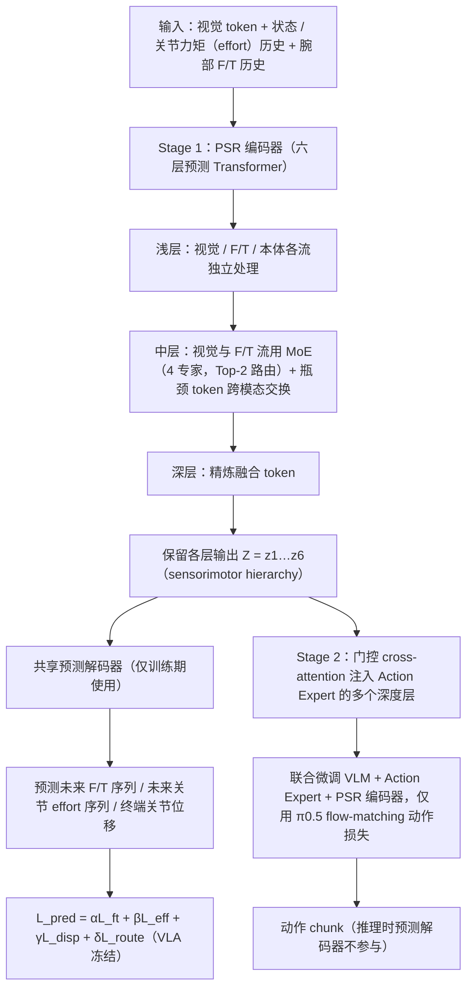

# PSR-VLA（arXiv:2609.21753）

**PSR-VLA**（*PSR: Predictive Sensorimotor Representation Learning for Contact-Rich Manipulation*，[arXiv:2609.21753](https://arxiv.org/abs/2609.21753)）来自 [具身智能小站 10 篇盘点](../../sources/blogs/wechat_embodied_station_contact_rich_sim_10_papers_2026-09-21.md)（策展最初标为扫读，现已复核 [arXiv v1 HTML 原文](https://arxiv.org/html/2609.21753v1) 的方法、实验与限制）。

## 一句话定义

**从视觉/力矩/本体感知历史预测未来接触动力学，六层 sensorimotor hierarchy 注入 VLA；6 真机接触任务总体 91.7%，相对力觉基线 +19.2–30.0 pp。**

## 英文缩写速查

| 缩写 | 英文全称 | 简要说明 |
|------|----------|----------|
| VLA | Vision-Language-Action | 视觉–语言–动作策略 |
| RL | Reinforcement Learning | 强化学习 |
| SR | Success Rate | 任务成功率 |
| Sim2Real | Simulation to Real | 仿真到真机迁移 |
| WAM | World-Action Model | 联合未来观测与动作的策略 |

## 为什么重要

- 公众号将本文归入「接触丰富操作为何总在仿真里失真」专题；扫读档位。
- **论文 v1 已列出 Shengbao Li 等作者**；开源结论：**待发布**（步骤 2.5，2026-09-21）。
- 接触丰富任务需提前感知接触如何演化；PSR 用预测式 sensorimotor 表征桥接物理历史与动作生成。

## 流程总览

图依据：论文 §III-B / §III-C / §III-D、Fig. 2 / Fig. 3。

## 核心机制

| 项 | 内容 |
|----|------|
| **arXiv** | [2609.21753](https://arxiv.org/abs/2609.21753) |
| **开源** | **待发布** |
| **策展摘要** | 从视觉/力矩/本体感知历史预测未来接触动力学，六层 sensorimotor hierarchy 注入 VLA；6 真机接触任务总体 91.7%，相对力觉基线 +19.2–30.0 pp。 |

## 源码运行时序图

**不适用**（截至 2026-09-21 项目页/arXiv 未发布可运行官方代码，或仓库尚无可辨识训练/推理入口）。

## 实验与评测

| 协议 | 论文报告 | 边界 |
|---|---|---|
| 6 类真机接触任务，共 120 次试验 | PSR 110/120 = **91.7%** | 包含装配、插入和擦拭等，非任意操作的泛化分数 |
| π0.5 对照 | 74/120 = **61.7%** | 同论文内可比，不能横比不同论文 |
| ForceVLA / ForceVLA2（适配） | 69.2% / 72.5% | 基线的传感输入与适配方式不同 |
| 推理开销 | 作者报告在 RTX 5080 上约增加 10 ms/请求 | 非真实机器人高速内环时延证明 |

**两阶段监督边界：** Stage 1 的未来 F/T、关节 effort、位移预测训练 PSR；Stage 2 的动作 flow matching 训练动作专家，预测 decoder **不参与在线动作生成**。

## 与其他工作对比

> 本页为清单级摘要，下表只做**定位对照**；数字未与下列各页核对同一评测协议，不可横比。

| 对照 | 差异读法 |
|------|----------|
| [RAPID](./paper-rapid-vlm-rl.md) | 同专辑 **深读** 档：并行仿真 + VLM 奖励管线，关注训练吞吐与 API 成本 |
| [CRISP](./paper-crisp.md) | 同专辑 **跟进** 档：接触仿真几何与求解器，关注 peg-in-hole/装配物理准确性 |
| [10 篇技术地图](../overview/contact-rich-sim-10-papers-technology-map.md) | 同批次横向对照入口：本文列 **扫读** 档位 |

## 工程实践

1. 校对腕部 F/T、关节 effort 与相机时间戳，并记录接触起止点及意外冲击；仅调视觉 backbone 无法替代力反馈。
2. 对照训练配置分别消融单层/多层 sensorimotor 特征及 force/effort/位移预测目标。
3. 同时报告动作请求耗时、力峰值、失败类型、任务成功率；高频安全阻抗/力矩控制由低层承担。

## 局限与风险

- 只在特定六类接触任务与数据预算评估；分布外材料、柔性物体、碰撞参数变化未得到普遍保证。
- 需要力/力矩、关节本体感知与视觉多传感器同步，对未具备该硬件接口的平台增加集成成本。
- 公开项目页的代码状态沿用 [项目站归档](../../sources/sites/psr-vla.md) 已核实的“待发布”；未见官方可运行入口时不虚构时序图。

## 结论

**PSR-VLA 代表「扫读」档位的 vla 方向样本——部署前以开源状态与评测协议为准绳。**

1. 开源状态：**待发布**；勿凭 PDF 臆断可复现性。
2. 与同专辑 [RAPID](./paper-rapid-vlm-rl.md) / [GALA](./paper-gala.md) / [CRISP](./paper-crisp.md) 形成「并行奖励 → 跨形态表征 → 接触仿真」阅读链。
3. 若做工程选型，先对齐传感器栈、仿真器与任务是否匹配文内设定。
4. 关注项目页/arXiv 版本更新与代码发布。

## 关联页面

- [Co-VLA 双臂协同](./paper-co-vla.md) — 对照结构协调与接触表征预测的不同作用。
- [接触丰富操作纵深](../../roadmap/depth-contact-manipulation.md) — 传感器、数据与力反馈工程入口。

- [contact-rich-sim-10-papers-technology-map](../overview/contact-rich-sim-10-papers-technology-map.md)
- [sim2real](../concepts/sim2real.md)
- [manipulation](../tasks/manipulation.md)
- [vla](../methods/vla.md)

## 参考来源

- [psr_vla_arxiv_2609_21753.md](../../sources/papers/psr_vla_arxiv_2609_21753.md)
- [wechat_embodied_station_contact_rich_sim_10_papers_2026-09-21.md](../../sources/blogs/wechat_embodied_station_contact_rich_sim_10_papers_2026-09-21.md)
- [arXiv:2609.21753](https://arxiv.org/abs/2609.21753)
- [arXiv v1 HTML](https://arxiv.org/html/2609.21753v1)：本次复核方法、六任务实验、消融、效率及局限/附录

## 推荐继续阅读

- [arXiv PDF](https://arxiv.org/pdf/2609.21753)
- [10 篇技术地图](../overview/contact-rich-sim-10-papers-technology-map.md)
