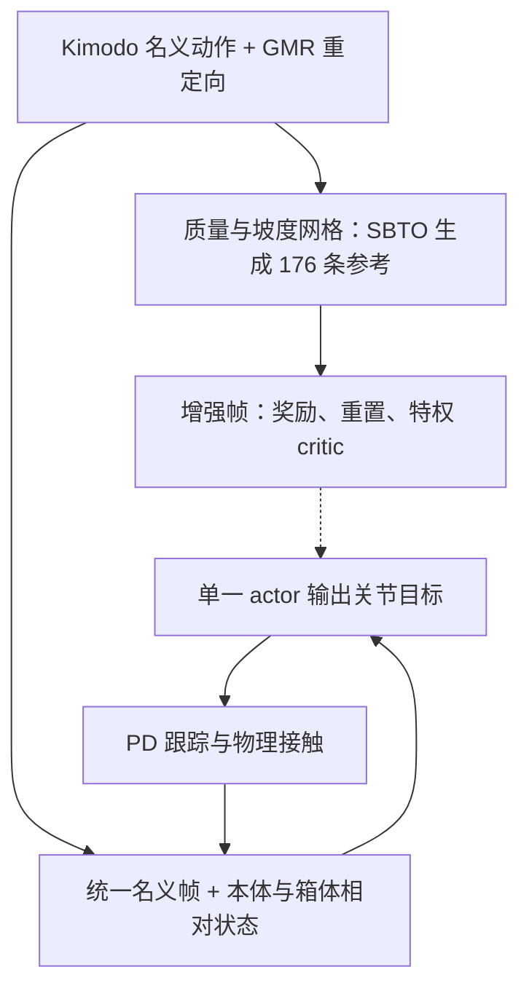
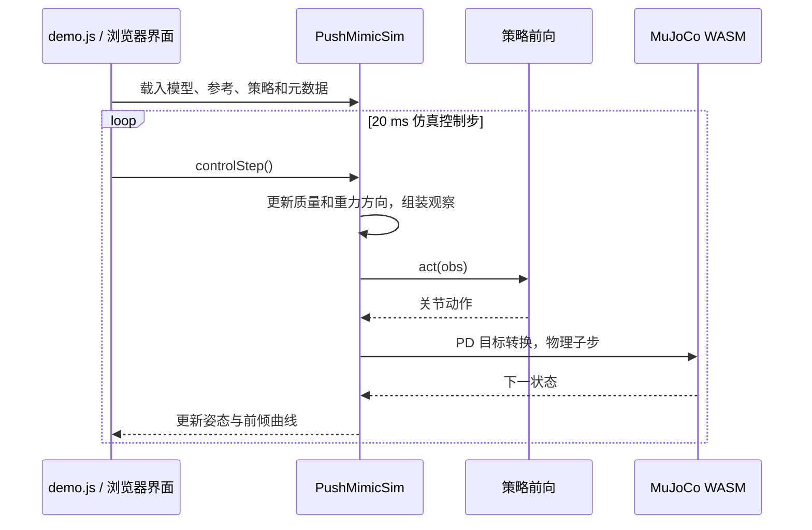

# PushMimic：以动态动作增强和参考蒸馏学习人形推箱 / Learning Adaptive Humanoid Box Pushing via Dynamic Motion Augmentation and Reference Distillation

## 一句话定义

用一条平地推箱参考生成不同质量和坡度的动力学可行轨迹，训练单一人形策略输出关节位置目标，即使执行时不直接输入箱重或坡度，也可按观测到的交互响应改变躯干和足位。

## 英文缩写速查

| 缩写 | 英文全称 | 对应机制 |
|---|---|---|
| SBTO | Sampling-Based Trajectory Optimization | 用带接触的物理 rollout 评价关节目标序列 |
| PPO | Proximal Policy Optimization | 单阶段训练非对称 actor–critic |
| CoP / CoM | Center of Pressure / Center of Mass | 准静态力矩平衡中的支撑与质心 |
| PD | Proportional–Derivative | 跟踪策略给出的关节位置目标 |
| GMR | General Motion Retargeting | 将名义人体运动重定向到 G1 |

## 为什么重要

把同一条运动平移或旋转到坡面，不会自动调整推力的作用线和足位。PushMimic 值得借鉴的不是让策略盲猜质量，而是提前生成对应姿态，再让同一个策略从重力方向和箱体运动反馈学会调用这些变化。

## 核心原理与方法

1. **从一条参考出发。** §IV-A 的人体参考由 Kimodo 生成，经 GMR 重定向，不是新采一条真人动捕。基准设定为平地、10 kg，参考时长 9 秒、推动 3 m；箱体位置由推进方向上领先手的位置构造。
2. **离线生成接触可行运动。** SBTO 用稀疏关节位置目标结点采样、PD 跟踪并滚动物理仿真，依据成本重拟合采样分布。坡越陡、箱越重，准静态模型给出更前倾的趋势；对足位设沿坡较宽的死区，避免将平地脚印硬锁住，同时在箱坐标系跟踪手位，避免用前臂替代手掌接触。
3. **用奖励传递不可见参考。** 每个环境按质量和坡度选择一条增强参考。Actor 只见统一名义帧、本体状态和躯干系箱体位姿/速度；增强帧用于奖励和重置，critic 额外看增强帧和任务条件。无需逐条件训练教师；推理仍需**箱体相对状态**，不能把“不直接提供质量和坡度”误读成纯本体控制。

## 实验与评测

| 实验 | 作者报告 | 怎么读 |
|---|---|---|
| MuJoCo sim2sim，5–15 kg、0–15° | PushMimic 88.8 ± 1.0%，Vanilla 57.8 ± 11.6%；拟合的 F50 为 91.8 vs 66.2 N | 三训练种子均值 ± 标准差；箱体终点误差 ≤0.1 m 为成功。F50 来自简化推力模型与逻辑拟合，不是实测最大手力 |
| 成功条件上的姿态与成本 | 坡度及质量适应系数 0.99、0.83，基线为 0.28、−0.20；手臂成本 3.62→2.81，约低 22% | 系数是回归斜率相对于增强参考之比；成本是 10 个手臂关节的积分力矩平方除以估算推力×位移，不是全机电耗 |
| 23 驱动关节 Unitree G1，连续跑台 | 固定 10°，箱 10→15→19 kg 时前倾 46.8°→48.4°→52.8°；固定 10 kg，坡 0→12.6° 时前倾 39.1°→48.3° | 两项为独立扰动，不是同测 19 kg / 12.6°。九次连续运行合计 8.5 min、皮带 307 m 无跌倒，不是机器人沿真实坡道行进 307 m |

公平对照的 Vanilla 与本方法输入相同，训练也使用同一任务参数网格；Vanilla 用旋转到坡面的名义参考评分和重置。176 条增强参考的参数网格与主要仿真评估重合，不应把表 I 写成全未见场景测评。每条 SBTO 约 9 分钟（i7-14700K）；PPO 每种子约 4 小时（RTX 4090、4096 并行环境），不含全部离线增强成本。

## 工程实践与源码运行时序

实际 G1 采用可贴箱面的被动铰链平掌；外部动捕提供躯干和箱体位姿，计算箱体相对状态。本体状态来自板载传感器；策略 50 Hz 输出关节位置给下游 PD。实际部署需要另行验证感知误差、接触材料及硬件限制。

作者[浏览器演示](../../sources/sites/pushmimic-project.md)可审读 `demo.js → sim.js`。这是网页仿真源码静态调用，不是训练或 G1 部署时序。

## 与其他工作对比

[AdaMimic](./paper-adamimic.md) 同样讨论单参考下的动作适应；PushMimic 的关键是对指定箱重与坡度预先优化接触参考，再用同一个 actor 跟踪。[SMPC-to-RL](./paper-smpc2rl-loco-manipulation.md) 也用优化产生监督，但其专家和后续强化学习接口不同，不用两篇的成功率直接排名。

## 局限与风险

- 网格维数随物体尺寸、路面、推距等变量增长，不能由现有 176 样本推断任意负载、地面或物体。
- 箱体相对位姿/速度依赖动捕，手掌改装及匀速跑台限制了外推。论文不能证明仅板载感知、真实装卸坡道或接触安全。
- 公开可读演示不等于公开 SBTO 训练、全部权重与可移植真机栈；未核实相关资产的再分发许可。

## 结论

将物理可行的动作变体写进训练监督，可让统一策略在不直接读取质量或坡度时调整推箱姿态；评估时必须分别记录适应范围、需要哪些传感器，以及仿真覆盖和真实部署之间的差别。

## 关联页面

- [移动操作](../tasks/loco-manipulation.md) · [移动操作纵深路线](../../roadmap/depth-loco-manipulation.md)
- [轨迹优化](../methods/trajectory-optimization.md) · [模仿学习](../methods/imitation-learning.md)
- [AdaMimic](./paper-adamimic.md) · [SMPC-to-RL](./paper-smpc2rl-loco-manipulation.md)

## 参考来源

- [arXiv v1 全文核对](../../sources/papers/pushmimic_arxiv_2611_30077.md)
- [作者项目页与交互源码核对](../../sources/sites/pushmimic-project.md)

## 推荐继续阅读

- [论文 §II–IV 与附录](https://arxiv.org/html/2611.30077v1)：对照增强成本、训练奖励和跑台条件。
