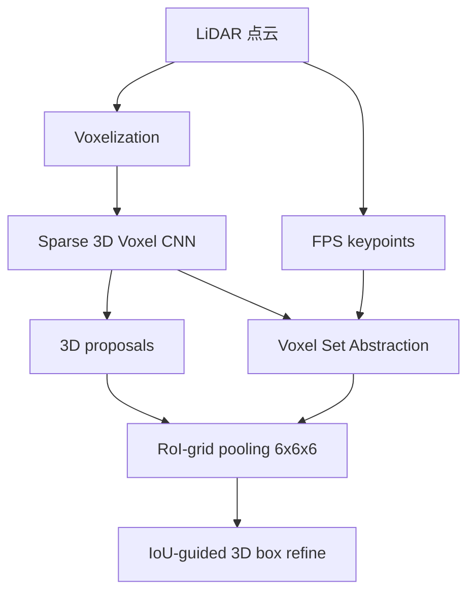
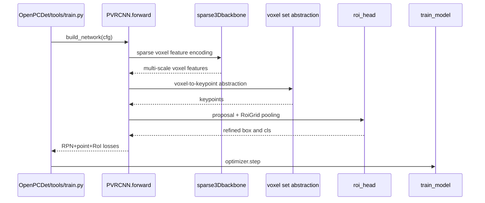

# PV-RCNN / Point-Voxel Feature Set Abstraction for 3D Object Detection

## 一句话定义

PV-RCNN 将稀疏体素 CNN、Voxel Set Abstraction（VSA）关键点聚合和 RoI-grid pooling 结合成高质量二阶段点云3D检测。

## 英文缩写速查

| 缩写 | 英文全称 | 简要说明 |
|---|---|---|
| CNN | Convolutional Neural Network | 卷积特征学习网络 |
| 3D | Three Dimensional | 三维空间中的数据表示 |
| IoU | Intersection over Union | 空间候选/标注框重叠程度 |
| VSA | Voxel Set Abstraction | 体素到关键点的特征聚合 |

## 为什么重要

PV-RCNN 将稀疏体素 CNN、Voxel Set Abstraction（VSA）关键点聚合和 RoI-grid pooling 结合成高质量二阶段点云3D检测。 对机器人视觉、点云感知和三维重建的意义在于清楚分离**测量数据、几何特征、网络预测与评价协议**；跨方法比较必须使用同类实验输入和指标。

## 核心原理与方法

由 3D sparse voxel CNN 提取多尺度体素特征并预测候选框；FPS 采样有限关键点，VSA 将多层非空体素相对坐标/语义特征用 PointNet 和 pooling 汇总为关键点特征。对每个候选框采样 6×6×6 个 RoI-grid 节点，以关键点特征集合聚合并输出 IoU-aware 分类与 box residual 精修。损失包含 RPN、关键点分割与 RCNN 三项。

## 流程总览（原论文方法）

## 源码运行时序图

**实际检查的入口：** OpenPCDet tools/train.py 装配 pcdet/models/detectors/pv_rcnn.py::PVRCNN.forward，其中 module_list 构建 sparse voxel backbone、VSA、point head 和 roi head；tools/cfgs/kitti_models/pv_rcnn.yaml 定义 voxel、RPN、RoI-grid 和各损失；训练调用 train_model，demo.py 推理。。以下 Mermaid 对照作者仓库与运行模块，未宣称 GPU 运行成功。

## 实验与评测

原论文 v2 KITTI test R40（Table1）Car easy/mod/hard AP **90.25/81.43/76.82**，KITTI val R40（Table3）**92.57/84.83/82.69**。Table7 KITTI val moderate 消融：只用体素 RPN 80.87、直接编码器池化 82.86、完整 VSA+RoI-grid 84.83。OpenPCDet README 的 val R11 83.61 属不同评估口径，不要混用。

## 与其他工作对比

PV-RCNN 把体素 CNN 的高效主干与点集抽象的灵活感受野合在一起；下表只引用论文自报或同一仓库同一口径的数字。

| 对照 | 差异 | 论文结果/说明 |
|---|---|---|
| [PointRCNN](./paper-pointrcnn.md) | PointRCNN 在原始点上做前景分割出 proposal、RoI 内用 PointNet++ 精修；PV-RCNN 的 proposal 来自稀疏体素 CNN，精修特征来自 VSA 关键点和 6×6×6 RoI-grid | [OpenPCDet](./openpcdet.md) README 同一口径（KITTI val Car moderate R11）：PointRCNN 78.70、PV-RCNN 83.61；PV-RCNN 原文为 R40，与 PointRCNN 原文数字口径不一致，不能直接相减 |
| 仅体素 RPN（本文消融，单阶段体素主干） | 去掉 VSA 与 RoI-grid，只保留体素 CNN 出框 | 本文 Table7 KITTI val moderate：80.87 → 直接编码器池化 82.86 → 完整 VSA+RoI-grid 84.83 |
| [PointNet++](./paper-pointnet2.md) | PV-RCNN 借用其 FPS 采样和 set abstraction 聚合，但聚合对象是多层体素特征而非原始点邻域 | 定性：点集抽象在这里是体素特征到关键点的汇聚器，不是主干 |

## 结论

**PV-RCNN 的价值在于明确的数据流与约束设计，而不是无条件提高所有场景的性能。**

1. 首先理解核心模块与原论文优化目标；
2. 比较结果时保留数据集、val/test、分辨率、是否带额外监督等条件；
3. 迁移到机器人平台应重新测量延迟、显存与传感器标定；
4. 原论文报告的结果不等于这里已独立复现。

## 工程实践

- 官方实现：[PV-RCNN](https://github.com/open-mmlab/OpenPCDet)。
- 训练/评测时遵循作者 README，核对依赖版本、数据路径、模型配置和 checkpoint。
- 生产/机器人部署前需要验证误差/延时/坐标系，而不是直接套用论文训练超参数。

## 局限与风险

需要 GPU sparse convolution 和自定义 IoU/RoI CUDA 算子；Voxel size、FPS 数量、RoI-grid 的空间范围均与 LiDAR 数据特征相关。与 PointRCNN 不同，PV-RCNN 的候选来自体素 CNN，不能仅凭同一 OpenPCDet 仓库认作同一项目。

## 关联页面

- [机器人视觉感知栈选型闭环](../queries/robot-perception-stack-selection-loop.md) — ③层：LiDAR 点云 3D 检测（点体素二阶段），精度换稀疏卷积算力与时延
- [OpenPCDet](./openpcdet.md)
- [FeatDepth](./paper-featdepth.md)
- [COLMAP](./colmap.md)

## 参考来源

- [作者原论文全文归档](../../sources/papers/vision3d_pv_rcnn_primary_paper_20261108.md)
- [arXiv 原始全文](https://arxiv.org/html/1912.13192)
- [作者代码](https://github.com/open-mmlab/OpenPCDet)

## 推荐继续阅读

- [完整原论文及引用](https://arxiv.org/html/1912.13192)
