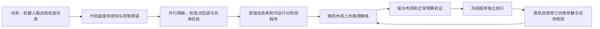

# PyRUA-Dex：编码智能体学习双臂灵巧操作程序 | PyRUA-Dex: Learning Programmatic Policies for Dexterous Bimanual Manipulation with Coding Agents

## 一句话定义

PyRUA-Dex 让编码智能体先在仿真中并行试出双手操作阶段，再在随机布局上逐段修正，最终由冻结的 Python 程序读取观测并控制机器人，不在部署回合里询问语言模型。

## 英文缩写速查

| 缩写 | 英文全称 | 简要说明 |
|---|---|---|
| DoF | Degrees of Freedom | 真机双手各控制 22 个关节 |
| SR | Success Rate | 完整回合成功率，与 Bench2Dex 综合分不同 |
| LSCR | Latched Stage Completion Rate | 锁存阶段完成率，即累计到达的阶段比例 |
| IK | Inverse Kinematics | 将手部目标位姿转成机械臂运动所用的逆运动学 |

## 为什么重要

传统示范的问题不是只缺视频，而是手指接触、施力和时序很难靠视频重定向或无力反馈遥操作记录。该工作重新分配成本：开发期用仿真和编码智能体做搜索、验证与回归，执行期只跑可读的阶段式代码；不需要把语言模型留在低层动作环内。

| 项目 | 核对信息 |
|---|---|
| 机构 | 北京大学、新加坡国立大学、英伟达、同济大学、芝加哥大学 |
| 论文 | arXiv:2611.33144v1，2026-11-24 |
| 真机 | 两台 Franka FR3、两只 22-DoF Sharpa Wave SE、头顶与腕部相机 |
| 开源状态 | 2026-11-27 核对：`dex` 分支仅项目说明和示意图，作者注明 harness 待发布 |

## 核心机制

程序由阶段函数和统一运行器组成。机器人描述生成手指运动、抓取与手部控制原语，校准相机与分割支持物体定位，指尖触觉和关节跟踪滞后提供接触线索，运动原语汇报不可达或碰撞原因。程序按当前观测计算目标，而非照搬一条固定关节轨迹。

探索阶段用八个编码智能体分头试验，使用仿真状态检查点降低重复执行前置步骤的成本，并共享代码与已到达阶段。蒸馏智能体将成功路径整理到任务库，选择整体程序或组合阶段。精炼阶段先量化各阶段条件成功率，优先修改瓶颈，用部分重跑降低测试成本，再以独立布局和正常动作预算接纳改版。真机反馈用来更新仿真标定和规则，而不是让语言模型现场直接控制机械臂。

## 源码运行时序图

**不适用**。官方 `dex` 分支注明尚未发布运行代码，不把论文流程图或其他分支的代码当作 PyRUA-Dex 的源码运行时序。

## 工程实践

- 把手部形状、接触判据、双臂运动与相机定位抽成可返回成功 / 失败理由的原语，并让任务程序只负责编排。
- 用「进入阶段后的完成比例」定位短板；只看终态成功率，会把前置失败和后来阶段的可靠性混在一起。
- 精炼期可用部分滚动和更高动作预算加速定位，但候选策略选型要回到正常预算与留出布局。
- 同时保留真机标定、代码版本和失败轨迹；论文提供了仿真辨识和真机反馈的做法，官方分支尚未提供可运行 harness。

## 实验与评测

| 设置 | 结果与口径 |
|---|---|
| Bench2Dex | 26 任务、12 个臂手组合；作者报告综合分 72.9、SR 60.6%、LSCR 82.3%。72.9 不是成功率；精炼前 SR 44.6%、综合分 59.1。 |
| 同模型在线基线 | Bench2Dex Full 通道、原有动作预算下，论文给出冻结程序 61.5%、在线模型 25.6%；比较对象和测试集合按 §4.4 的口径，不能推广成普遍成本比。 |
| DexJoCo | 11 个 Allegro 双手任务；物体随机化 88.5%，加入相机、光照和纹理等完整随机化后 81.0%；最佳已训练对照 π0.5 分别为 54.1%、40.3%。 |
| 真机与标定后仿真 | 真机演示包括双手钢琴、书写、抓放、堆叠、拉环开盒。119/192 到 168/192 是六项任务在标定仿真留出布局的总完成数，不是真机成功率。已有钢琴技能内新曲约 30–60 分钟迭代，不是从零学所有操作的耗时。 |

## 结论

PyRUA-Dex 证明逐阶段改程序与冻结部署在所测灵巧操作任务中有价值，仍未解决跨任务通用性和持续接触控制。

- 优先从可由几何、动作顺序与时序分解的任务开始。
- 把精炼耗费和部署耗费分开，部署零在线语言模型调用不等于开发零成本。
- 对装配、滑动和持续控力阶段单独做接触验证。
- 复用视觉标定、手型和系统辨识接口；把真机演示与重复真机统计分开列出。

## 局限与风险

高精度持续接触、摩擦和滑移仍是弱项，仿真触觉存在近似；精炼依赖某阶段已有过可用解，且大多数不同任务仍需分别开发。论文真机展示并未提供系统的重复硬件成功率，当前官方分支也不足以复现。

## 关联页面

- [双臂操作](../tasks/bimanual-manipulation.md)：看两只手如何分工、交接和协同。
- [Sim2Real 关节辨识实验设计](../methods/sim2real-joint-sysid-experiment-design.md)：对照论文附录 D 的独立辨识与留出动作检查。
- [域随机化](../concepts/domain-randomization.md)：区分训练布局、留出布局和测试扰动。
- [Bench2Dex](paper-bench2dex.md)：解释机器人、扰动通道及综合指标。
- [PyRUA-REAL](paper-pyrua-real.md)：同一项目族的另一篇论文，面向真机试错，不等同于 Dex。
- [接触丰富操作纵深路线](../../roadmap/depth-contact-manipulation.md)

## 参考来源

- [PyRUA-Dex 论文归档](../../sources/papers/pyrua_dex_arxiv_2611_33144.md)
- [官方项目页归档](../../sources/sites/pyrua-dex.md)
- [官方分支公开状态归档](../../sources/repos/pyrua-dex.md)

## 推荐继续阅读

- [DexJoCo 原论文](https://arxiv.org/abs/2605.16257)：对照双手联合操作基准的随机化与指标。
