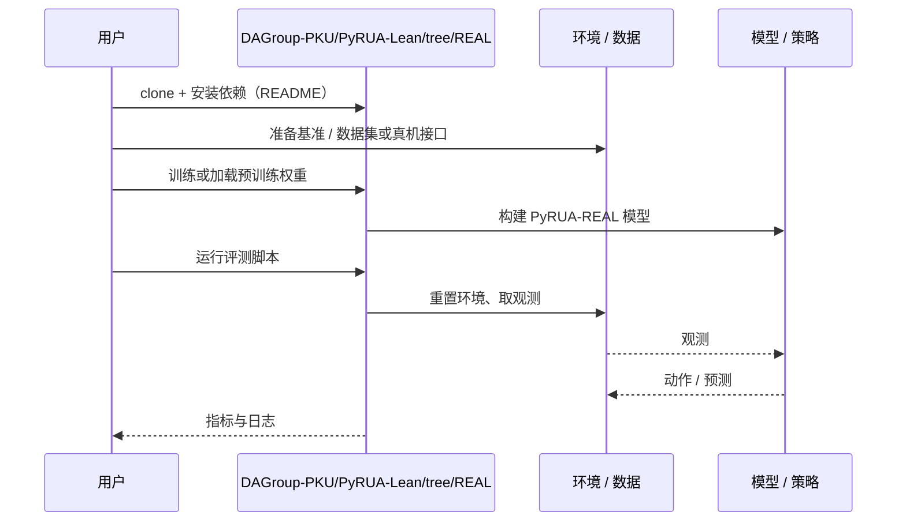

# PyRUA-REAL（arXiv:2611.06768）

**PyRUA-REAL**（*PyRUA-REAL: Robot Exploration and Adaptive Learning through RSI in the Real World*，[arXiv:2611.06768](https://arxiv.org/abs/2611.06768)，[项目页](https://dagroup-pku.github.io/PyRUA-Lean/real/)，[代码](https://github.com/DAGroup-PKU/PyRUA-Lean/tree/REAL)）来自 [具身智能小站 2026-11-06 盘点](../../sources/blogs/wechat_embodied_station_20_papers_curobov2_fast_halo_humanwam_2026-11-06.md)，属「操作策略与数据」组。

## 一句话定义

**两个智能体分工设计实验和改代码，把真机失误留作下次修改的依据。**

## 英文缩写速查

| 缩写 | 英文全称 | 简要说明 |
|------|----------|----------|
| PyRUA-REAL | PyRUA-REAL: Robot Exploration and Adaptive Learning through RSI in the Real World | 本文方法 / 基准的简称 |

## 为什么重要

- 让机器人把试错经验写成下次能用的程序。八项真机任务的 91.1% 是开发期间跨版本的平均成功率，冻结程序后的表现另行测试。
- 开源结论：**已开源**（步骤 2.5，2026-11-06）。仓库可达（git ls-remote）。项目页 HTTP 200。
- 同期同组工作见 [按路段调速的规划、虚拟房间到真机的人形动作与人类视频缩放：具身智能小站 11-06 期 20 篇阅读坐标](../overview/embodied-station-2026-11-06-20-papers-technology-map.md)。

## 核心机制

| 项 | 内容 |
|----|------|
| **arXiv** | [2611.06768](https://arxiv.org/abs/2611.06768) |
| **开源** | **已开源** |
| **要点** | 两个智能体分工设计实验和改代码，把真机失误留作下次修改的依据。 |
| **文内指标** | 公众号转述：八项真机任务的 91.1% 是开发期间跨版本的平均成功率，冻结程序后的表现另行测试。 |

## 源码运行时序图

以下为按仓库入口（`DAGroup-PKU/PyRUA-Lean/tree/REAL`）推断的通用运行链路；入库日仅核实仓库可达，未逐文件阅读，具体脚本名以 README 为准。

## 实验与评测

- 公众号转述：八项真机任务的 91.1% 是开发期间跨版本的平均成功率，冻结程序后的表现另行测试。
- **读法：** 本页为索引级摘要，依据公众号转述的官方摘要与仓库信息整理；逐项数字与 baseline 以原文 PDF 为准。

## 与其他工作对比

- 横向索引见 [按路段调速的规划、虚拟房间到真机的人形动作与人类视频缩放：具身智能小站 11-06 期 20 篇阅读坐标](../overview/embodied-station-2026-11-06-20-papers-technology-map.md)；同 arXiv 不重复造页。

## 结论

**让机器人把试错经验写成下次能用的程序：八项真机任务的 91.1% 是开发期间跨版本的平均成功率，冻结程序后的表现另行测试。**

1. 开源边界：**已开源** — 仓库可达（git ls-remote）。项目页 HTTP 200。
2. 核心机制：两个智能体分工设计实验和改代码，把真机失误留作下次修改的依据。
3. 复现与选型前核对任务协议、硬件与基准口径，勿直接横比公众号摘录数字。

## 关联页面

- [imitation-learning](../methods/imitation-learning.md)
- [manipulation](../tasks/manipulation.md)
- [vla](../methods/vla.md)
- [embodied-data-collection-four-layers-taxonomy](../concepts/embodied-data-collection-four-layers-taxonomy.md)
- [embodied-station-2026-11-06-20-papers-technology-map](../overview/embodied-station-2026-11-06-20-papers-technology-map.md)

## 参考来源

- [pyrua_real_arxiv_2611_06768.md](../../sources/papers/pyrua_real_arxiv_2611_06768.md)
- [wechat_embodied_station_20_papers_curobov2_fast_halo_humanwam_2026-11-06.md](../../sources/blogs/wechat_embodied_station_20_papers_curobov2_fast_halo_humanwam_2026-11-06.md)
- [arXiv:2611.06768](https://arxiv.org/abs/2611.06768)

## 推荐继续阅读

- [arXiv PDF](https://arxiv.org/pdf/2611.06768)
- [项目页](https://dagroup-pku.github.io/PyRUA-Lean/real/)
- [https://github.com/DAGroup-PKU/PyRUA-Lean/tree/REAL](https://github.com/DAGroup-PKU/PyRUA-Lean/tree/REAL)
