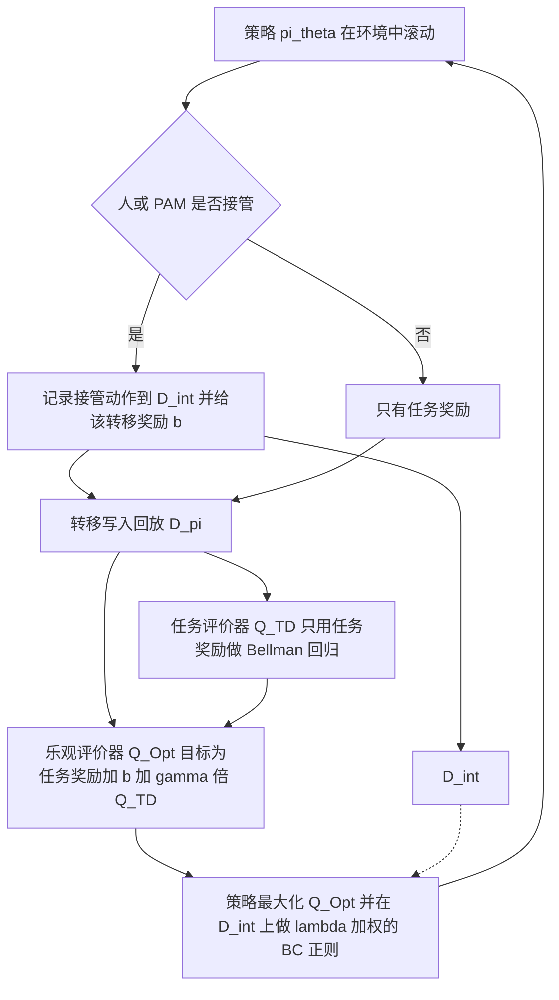

# Q-OIL：把人工接管当作探索线索（arXiv:2611.08576）

**Q-OIL**（*Q-OIL: Optimistic Exploration in Learning from Human Interventions*，[arXiv:2611.08576](https://arxiv.org/abs/2611.08576)，CoRL 2026）来自华盛顿大学，丰田研究院为第 6 作者单位。通读记录见 [来源归档](../../sources/papers/q-oil_arxiv_2611_08576.md)。

## 一句话定义

**一种在线离线策略 RL 方法：把人类接管当作「乐观探索的引导」而不是「最优监督」，只给接管转移加一个正奖励，并把乐观评价器与任务评价器解耦，使奖励不回传到接管前状态；同时提出基于「进度停滞」的合成人类接管模型 PAM 用于仿真评测。**

## 英文缩写速查

| 缩写 | 英文全称 | 简要说明 |
|------|----------|----------|
| Q-OIL | Q-Optimistic Intervention Learning | 本文方法：对接管转移加乐观奖励并解耦评价器 |
| PAM | Progress-Aware Model | 本文提出的合成人类接管门控模型：近 k 步价值进度低于阈值才可能接管 |
| HIL | Human-in-the-Loop（此处指 HIL-SERL 式做法） | 基线：把在线接管直接放入回放缓冲区，加速离线策略 RL |
| HG-DAgger | Human-Gated DAgger | 基线：把接管动作当作行为克隆目标 |
| RLIF | RL from Intervention Feedback | 基线：把接管前的状态视为负反馈（负奖励） |
| BC+RL | Behavior Cloning + RL | 基线与消融：对接管动作做 BC 正则的离线策略 RL（b=0 时 Q-OIL 退化为它） |
| RLPD | RL with Prior Data | 论文的基础算法，用于仿真与 Franka 实验，也用来训练参考价值函数 |
| EXPO-FT | EXPO fine-tuning | 双臂 VLA 实验采用的残差策略学习路线，见 [paper-expo-ft](./paper-expo-ft.md) |
| VLA | Vision-Language-Action | 视觉-语言-动作模型 |
| TD | Temporal Difference | 时序差分自举，Q_TD 即只用任务奖励训练的评价器 |
| UTD | Update-To-Data ratio | 每个环境步的梯度更新次数（真机 10，VLA 2） |
| ρ | Spearman rank correlation | 合成模型的算法排名与真人排名的一致性 |

## 为什么重要

- 人在环学习的算法大多先在「合成人类」上开发；论文（第 1、4 节）认为常见假设（接管只看当前动作是否次优、纠正近似最优）与其收集到的真人数据不符，因此仿真结论可能无法迁移。
- 接管是真实部署时自然出现的信号。论文给出一个简单配方：不强行模仿接管动作，而是用它引导探索，因此对质量参差的人类更稳健（作者自述，附录 H 的专家质量消融支持这一点）。
- 方法是现有离线策略 RL（RLPD、残差 SAC）上的小改动，已在 Franka 真机与双臂 VLA 残差微调上演示（第 6 节）。
- 相对本站已有「接管」类页面（如 [SimPT](./paper-simpt-intervention-based-vla-post-training.md)）它的侧重点是：先建模「人怎么接管」，再设计算法。

## 核心机制

### 真人接管的三个发现（第 4.1 节）

数据：8 名参与者，3 个 Robomimic 仿真任务，24 次运行，约 200k 转移，其中约 40k 为接管转移；参考价值函数 Q*、V* 与 π* 由 RLPD 在稀疏奖励下训练得到（第 4 节、附录 D.1）。

| 发现 | 论文证据 | 含义（作者自述） |
|------|----------|------------------|
| 1. 接管门控是非马尔可夫的 | 接管与非接管状态的 Q*(s,a_π)/Q*(s,a*) 几乎一致（图 2a）；接管多发生在 V* 平台期或下降之后（图 2b） | 人对「一段时间没进展」做反应，而不是对单步次优反应 |
| 2. 接管是次优示教 | 接管动作平均次优度 3.16，人类示教 1.91，π* 为 1.00；83.0% 的接管片段进度低于 1，30.1% 为负（附录 B） | 不能当最优监督 |
| 3. 纠正与收敛策略分歧 | Q*(s,a_final) ≥ Q*(s,a_human)，二者成功率都约 70-80% | 稀疏奖励有多种解，强监督会引入多模态冲突，应作为软引导 |

### PAM：进度感知的合成接管模型（第 4.2 节、附录 F）

接管概率 g = α（当 V*(s_t) − V*(s_{t−k}) < δ），否则 β。网格搜索得 k=9、δ=−0.158、α=0.599、β=0（附录表 2）；接管时的纠正动作来自一个成功率约 50-70% 的中间 RL 检查点（附录 F.4）。在留出的真人接管上，PAM 精确率 / 召回 0.1750 / 0.6059，动作次优度模型 0.1136 / 0.4489，随机模型 0.0837 / 0.0837（附录表 1）。算法排名与真人的 Spearman ρ，PAM 为 1.0（图 4，6 种算法，4 名参与者，Lift 与 Can）。

### Q-OIL 流程（第 5 节、算法 1）

- 乐观评价器 Q_Opt 的自举目标取自 Q_TD 而非自身，因此奖励 b 只落在接管转移本身，不会沿时间回传到「接管之前的失败状态」；Q_TD 保持对真实价值的无偏估计（第 5 节、附录 A）。
- 回放均匀采样，带奖励样本的占比随累计接管率下降，接管减少后 Q_Opt 趋向 Q_TD，乐观项隐式退火（作者自述，第 5.1 节）。
- BC 正则权重 λ≈0.1，仅作用于接管动作；b=0 时整个方法退化为 BC+RL（第 6.2 节）。
- 超参（附录表 2）：b=0.025，评价器集成各 10 个（TD 与 Opt），UTD=10，γ=0.99，3 层 256 宽 MLP。

### 扩展到预训练 VLA（附录 E.1、算法 2）

冻结的 VLA（25 条示教微调 20k 步）输出长度 32 的动作块，残差策略以长度 8 的短块做闭环修正：A_t = A_base + η·π_res(o, A_base)。Q-OIL 的两个评价器作用于实际执行动作，策略用 Q_Opt 更新并对接管动作做 BC，b=0.1，UTD=2，评价器集成 2 个（附录表 3）。

## 实验结果速览（第 6 节）

| 设置 | 论文数字 | 出处 |
|------|----------|------|
| Robomimic 仿真，PAM 作接管者 | Q-OIL 在各任务上以更少交互达到更高成功率（图 6 右，曲线） | 第 6.2 节 |
| 真人 + 仿真机器人 | 4 名参与者、2 任务、6 方法共 48 次运行；Q-OIL 高于所有基线，HIL/RLIF 在预算内学不动 | 第 6.2 节、附录 D.2 |
| Franka 真机 3 任务 | 成功率高 10-50%，人类介入约少 30%，每千步成功数平均高 90% | 第 6.2 节、图 8 |
| 双臂 Bag assembly | 完整任务 50% 对 BC+RL 的 0%（30 回合）；介入步占比 18.1% 对 25.2% | 图 9b、附录 E.1 |
| 双臂 Coffee pouring | 完整任务 70% 对 BC+RL 的 30%（10 回合）；介入步占比 10.7% 对 23.8% | 图 9b、附录 E.1 |
| 解耦消融 | b 在 [0.01, 0.5] 内带解耦稳定，无解耦在大 b 时退化 | 图 10 |

## 工程实践

- **基础栈：** JAX 实现，基于 RLPD；真机沿用 HIL-SERL 系统（Franka Panda，SpaceMouse 干预，手眼相机加可选侧视相机，动作为 3 自由度笛卡尔位置增量加二值夹爪，去掉旋转，学习器与执行器同步，UTD=10，上限 10k 环境步，附录 E）。
- **热启动：** Franka 任务用 10-20 条示教初始化；稀疏奖励，Pen-in-Bowl 的奖励由分类器判定（附录 G，沿用 HIL-SERL）。
- **双臂 YAM：** 主从式 leader-follower 遥操作，自主时 leader 臂跟随 follower，人可随时接管；关节空间控制，外部场景相机 RGB，每回合手动复位（附录 E.1）。
- **仿真人类实验：** SpaceMouse 控制 4 自由度（笛卡尔位置增量加夹爪），固定起始位姿与目标位置以加速收敛（附录 C、D.1）。
- **复现：** 论文给出算法 1、2 与超参表（附录 I）。截至 2026-11-09，项目页的 Code 按钮为禁用状态，未见代码链接；见 [来源归档](../../sources/papers/q-oil_arxiv_2611_08576.md)「开源状态」（只静态读了项目页 HTML）。
- 如果要把 Q-OIL 思路接到别的离线策略 RL 上，关键是为接管转移打标并维护两套评价器，不必改动策略网络结构（推测，论文只演示了 RLPD 与残差 SAC）。

## 与其他工作对比

论文的基线即对「接管信号怎么用」的几种主流假设，Q-OIL 与它们的差别都落在接管转移的处理方式上（第 2、6 节，英文缩写表）：

| 方法 | 接管信号的用法 | 与 Q-OIL 的差别 |
|------|----------------|------------------|
| HIL（HIL-SERL 式，见 [SERL](./paper-rcl-2401-16013-serl-a-software-suite-for-sample-efficient-robot.md)） | 接管转移直接放入回放缓冲区 | 不加乐观奖励；真人实验中在预算内学不动（第 6.2 节） |
| HG-DAgger（见 [DAgger](../methods/dagger.md)） | 接管动作当行为克隆目标 | 隐含「接管近似最优」，与发现 2（接管次优）冲突 |
| RLIF | 接管前状态视为负反馈 | 奖励落在接管前状态；Q-OIL 用解耦评价器让奖励只落在接管转移本身 |
| BC+RL | 对接管动作做 BC 正则的离线策略 RL | 即 Q-OIL 在 b=0 时的退化形式，是最直接的消融对照 |

与本站 [SimPT](./paper-simpt-intervention-based-vla-post-training.md) 同属「基于接管的后训练」，本页不做数值对比（两文任务与设置不同）；Q-OIL 的 VLA 部分沿用 [EXPO-FT](./paper-expo-ft.md) 的残差路线，差别在于评价器是否加接管乐观项。

## 结论

**Q-OIL 的价值在于先用真人数据纠正「合成接管者」的假设，再用一个对现有离线策略 RL 改动很小的乐观奖励 + 解耦评价器，把次优接管当探索线索用；真机证据方向一致但样本量小。**

1. 真正该看的指标是同等交互预算下的成功率与人类介入占比（第 6.2 节、图 8、图 9b），而不是单个百分比：真机 Franka 由单人完成，双臂任务仅 10 / 30 回合，未报告显著性。
2. 仿真评测时用 PAM 这类「进度停滞」门控代替「动作次优」门控，算法排名才与真人一致（图 4，ρ=1.0，但仅 6 种算法、2 个任务）。
3. 解耦评价器是必要组件：无解耦在大 b 时退化（图 10）；b 在 [0.01, 0.5] 内稳定，可作为调参起点。
4. 次要成本：两套评价器集成（各 10 个）与接管转移打标；PAM 依赖预训练的 V*，新任务上需要代理。
5. 部署读法：摘要「10-50% 更高成功率」对应 Franka 三任务，VLA 实验口径不同，不要混读；代码截至 2026-11-09 未公开。

## 局限与风险

**论文自述（第 7 节）：**
- 人类研究只有 8 名用户、仿真任务、24 次运行，更大更多样的真实人群会更有说服力。
- 只评估桌面操作，未涉及非结构化环境与长时程多样接管。
- 乐观奖励靠函数逼近扩散到相似转移，传播范围受限；作者提出用基础模型把传播扩展到语义空间，例如语言干预。

**本页作者读到的未验证之处（判断，非论文原话）：**
- 真机 Franka 三任务由单个人类完成，双臂任务评估回合很少（Coffee 为 10 回合、Bag 为 30 回合）；单次运行、少回合下，百分比差异的统计显著性论文未给出（第 6.2 节、图 9 图注）。
- 接管门控的三个发现和 PAM 校准都来自仿真 Robomimic 任务、固定起点和目标、4 自由度遥操作（附录 C、D.1），能否原样推广到真机多样任务尚未验证；PAM 对真人的 ρ=1.0 只基于 6 种算法在 Lift 与 Can 上的排名（附录 D.2）。
- PAM 与参考价值函数 V* 依赖预先训好的专家价值函数，真实新任务上没有这样的 V*，需要额外代理（论文未讨论，推测）。
- 留出接管预测的精确率只有 0.1750（附录表 1），模型对「何时接管」的刻画仍相当粗糙。
- 图 4 中另两种合成模型的具体 ρ 数值，本页未从正文文字读到，仅在图中给出。
- 摘要「10-50% 更高成功率」在第 6.2 节对应 Franka 三任务；VLA 实验的提升幅度更大（图 9b），二者口径不同，不要混读。
- 论文未提供公开代码（项目页未列）。

## 与「具身智能小站」说法的核对

- 「人常在机器人停滞后才接管，纠正动作并非最优」：与论文发现 1、2 相符（第 4.1 节）。
- 「乐观奖励和解耦评价器引导探索」：与第 5 节相符。
- 「评估覆盖仿真、真实用户及双臂 VLA 微调」：相符；注意「真实用户」实际是 4 名参与者操作仿真机器人（第 6.2 节），真机 Franka 实验为单个人类。
- 「用户研究规模仍有限」：与第 7 节自述相符（8 人，24 次运行）。

## 关联页面

- [强化学习](../methods/reinforcement-learning.md)
- [DAgger](../methods/dagger.md)：HG-DAgger 基线所属的交互式模仿路线
- [SAC](../methods/sac.md)：双臂实验的残差 SAC
- [模仿学习](../methods/imitation-learning.md)
- [残差策略学习](../methods/residual-policy-learning.md)
- [VLA](../methods/vla.md)
- [真实世界 RL 微调的安全问题](../concepts/safe-real-world-rl-fine-tuning.md)
- [EXPO-FT](./paper-expo-ft.md)：本文 VLA 残差微调所用路线
- [EXPO](./paper-expo.md)
- [SERL](./paper-rcl-2401-16013-serl-a-software-suite-for-sample-efficient-robot.md)：真机 RL 栈的前身
- [DAgger（Ross 等）](./paper-ross-dagger.md)
- [SimPT：基于接管的 VLA 后训练](./paper-simpt-intervention-based-vla-post-training.md)

## 参考来源

- [q-oil_arxiv_2611_08576.md](../../sources/papers/q-oil_arxiv_2611_08576.md)：论文通读归档
- [arXiv:2611.08576](https://arxiv.org/abs/2611.08576)
- 项目页 <https://weirdlabuw.github.io/qoil>（只读了静态 HTML，未看视频）

## 推荐继续阅读

- [arXiv PDF（v1）](https://arxiv.org/pdf/2611.08576v1)
- [EXPO-FT](./paper-expo-ft.md)、[SERL](./paper-rcl-2401-16013-serl-a-software-suite-for-sample-efficient-robot.md)、[SimPT](./paper-simpt-intervention-based-vla-post-training.md)
