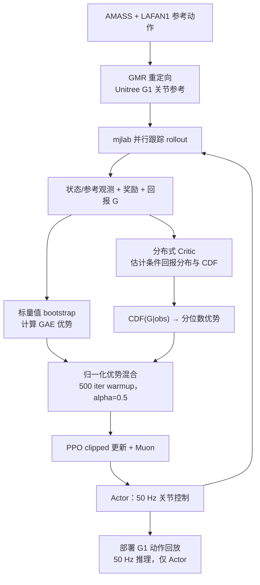

# QTOP：用分位数 Critic 扩展人形动作跟踪 / Scaling Humanoid Motion Tracking with Quantile Critics

## 一句话定义

**QTOP（Quantile Tracking Optimization）** 是高通人工智能研究院（Qualcomm AI Research）提出的 PPO 人形全身动作跟踪训练方法：把每个观测/参考命令条件下的**回报分位数**变成优势信号，缓解不同动作难度/回报尺度造成的学习干扰，在有限训练算力下提升未见动作的跟踪保真度（[arXiv:2611.20791v1](https://arxiv.org/abs/2611.20791)，2026-11-16）。

## 英文缩写速查

| 缩写 | 英文全称 | 简要说明 |
|------|----------|----------|
| QTOP | Quantile Tracking Optimization | 本文分位数优势驱动的人形跟踪训练方法 |
| PPO | Proximal Policy Optimization | 保留裁剪策略目标的 on-policy 更新骨架 |
| GAE | Generalized Advantage Estimation | 与分位数优势混合的标量优势基线 |
| CDF | Cumulative Distribution Function | 将回报映射为条件分位数的位置函数 |
| GMR | General Motion Retargeting | 将人体动作重定向为 G1 参考轨迹 |
| R-MPKPE | Root-relative Mean Per-Keybody Position Error | 根相对关键刚体位置跟踪误差（越低越好） |
| SAC | Soft Actor-Critic | 论文对比的 off-policy RL 基线 |
| GPUh | GPU Hours | 训练算力预算的 GPU 小时口径 |

## 为什么重要

- **多动作跟踪是连续多任务问题：** 同一策略同时模仿大量参考片段，接触/运动幅度/后续轨迹不同，单一标量 Critic 的梯度冲突会拖累更新；论文的 per-motion 梯度分析表明 Critic 比 Actor 更明显。
- **不依赖增加动作数据或部署复杂度：** 在保留 [PPO](../methods/ppo.md) 的 clip 更新与 50 Hz 控制接口下，改变训练时的优势估计；无需推断时部署 Critic。
- **便于研究 scaling 预算：** 论文以分开增加参考动作数据时长与 GPUh 的实验表明，**在本文限定数据和算力范围内**，往往优先算力而不是盲目扩数据。
- **与 [SONIC](./nvidia-sonic.md) / [ScaleBFM](./paper-scaling-bfm-humanoid.md) 互补：** 它们研究大规模数据/架构/动作覆盖，QTOP 主要改变 **PPO 的训练学习信号**，不应被误读为新的通用 BFM 预训练体系。

## 核心信息

| 项 | 原文事实 |
|----|----------|
| 论文 | *QTOP: Scaling Humanoid Motion Tracking with Quantile Critics*，arXiv:2611.20791v1 |
| 作者 / 机构 | Markus Peschl、Dana Kianfar、Daniel Dijkman；**高通人工智能研究院（Qualcomm AI Research）** |
| 机器人 | Unitree G1，29 DoF；Dex3-1 手指不显式建模 |
| 控制接口 | 50 Hz、每段 500 steps / 10 s；154 维 actor 观测；不观测全局根位置和线速度 |
| 动作 / 仿真 | AMASS + LAFAN1，经 GMR 重定向；mjlab 并行训练 |
| 算法 | PPO + categorical distributional Critic + quantile advantage / GAE 混合 + Muon |
| 原文开源状态 | v1 未列 QTOP 官方可运行代码或独立项目页；截至 2026-11-18 未核实到公开实现 |

## 核心原理

### 1. 参考条件化、多动作 Critic 干扰

沿用 [BeyondMimic](../methods/beyondmimic.md) 跟踪设置：actor 看到参考关节位置/速度、躯干相对参考的 6D 朝向偏差、基座角速度、相对默认的关节角、关节速度及上一 action。不同参考动作的未来接触与回报分布不同，即使即时观测相似，标量价值估计也容易互相干扰。

### 2. 从 Critic CDF 计算分位数优势

给定观测 \(\mathbf{o}_t\)，Critic 预测固定支持点 \(z_i\) 上的类别概率 \(p_\psi^i(\mathbf{o}_t)\)，其均值可用于 PPO 的 bootstrap。用**实际 rollout 回报** \(\hat G_t\) 在预测分布的 CDF 中的位置衡量这次尝试是否超出局部预期：

\[
u_t = F_\psi(\hat G_t \mid \mathbf{o}_t), \qquad
\hat A_t^{\mathrm{dist}} = 2(u_t-\tfrac12).
\]

- \(u_t>0.5\) 表示实际回报高于这个观测条件下的预测中位数，优势为正；低于则为负。
- 该信号比较**各自条件下的相对表现**，而非直接拿不同动作的回报绝对大小竞争；不是把 PPO 改成风险分位数目标，也不是直接改造每任务梯度方向。

### 3. 与标准 GAE 混合，保持 PPO 更新

\[
\hat A_t^{\mathrm{QTOP}}=(1-\alpha)\operatorname{Norm}(\hat A_t^{\mathrm{GAE}})
+\alpha\operatorname{Norm}(\hat A_t^{\mathrm{dist}}).
\]

默认 \(\alpha=0.5\)，先用纯 GAE 预热 **500 iterations** 后再启用分位数优势；按 rollout batch 归一化，继续使用标准 PPO clipped surrogate；Muon 用于优化。QTOP \(\alpha=0\) 消融仍使用分布式 Critic，但只用预测均值计算 GAE，是隔离分布 Critic 与分位数优势收益的关键对照。

## 流程总览

## 源码运行时序图

**不适用（截至 2026-11-18）**：论文 arXiv v1 未给出 QTOP 官方训练/部署仓库及可执行入口。论文使用的 [mjlab](./mjlab.md) 是通用仿真框架，不可将其 CLI 当作 QTOP 实际运行路径；官方代码公开后再阅读 README 与脚本并补充 `sequenceDiagram`。

## 工程实践

| 检查项 | 论文给出的实现/部署读法 |
|--------|-----------------------|
| 仿真与网络 | mjlab；4 隐层 MLP，约 11.5M 参数；比较时保持网络架构/训练预算一致 |
| 观测 | 154D、本体+局部参考；无全局根位置/线速度；全球末端位置误差可能随时间积累 |
| 策略频率 | 50 Hz，500-step 参考段；G1 真机推理由外置工作站执行 |
| 算法消融 | 对照 PPO(Adam)、PPO(Muon)、QTOP(alpha=0)、QTOP(alpha=0.5)；再参考 SAC/FastTD3 |
| 分位数优势 | 用回报在观测条件分布 CDF 下的分位数构造优势，和 GAE 各归一化后混合 |
| 真实复现 | 无官方 QTOP 训练入口，以下参数仅供**阅读和复现实验设计**，并非已跑通的命令 |

## 实验与评测

### 仿真：固定约 200 GPUh

8192 并行环境、两组训练随机种子，测试**未见动作**。下表摘自原文 Table I（单位 mm，数值越小越好）：

| 测试集 / R-MPKPE | QTOP alpha=0.5 | PPO (Adam) | PPO (Muon) |
|------------------|---------------:|-----------:|-----------:|
| MOSAIC 光学 MoCap（3.1h） | **38.12 ± 0.90** | 41.96 ± 0.55 | 41.70 ± 0.08 |
| 自采惯性 MoCap（1h） | **37.70 ± 1.55** | 43.59 ± 0.41 | 42.20 ± 0.00 |

对比需保留指标差异：QTOP(alpha=0.5) 的 MPKPE、R-MPKPE、末端朝向误差整体最优，但**全局末端位置误差**常由 alpha=0 变体取得更小值；不能说 QTOP 对每个指标都胜出。

### 动作贡献平衡

在 32 个动作、相同 rollout 和固定策略权重的比较中，QTOP 相对 GAE 将跨动作**优势幅度变异**降低约 **68%**，将**actor 梯度范数变异**降低约 **39%**。这是归一化学习信号贡献的结果，不是直接优化梯度 cosine 相似度。

### Scaling Law：数据与训练算力分离

使用约 **4、12、24 小时**的动作集，在至约 **1300 GPUh** 的试验预算下拟合：

\[
E(\mathcal C,\mathcal D)
=E_0+A\mathcal D^\gamma\mathcal C^{-\alpha}
+B\mathcal D^{-\beta}.
\]

拟合 \(R^2=0.981\)，参数 \(\alpha=0.592,\beta=0.0277,\gamma=0.0915\)；在至约 700 GPUh 的主要区域，**翻倍算力通常比翻倍动作数据更能降低预测跟踪误差**。数据维度仅 4–24h、算力维度跨度更大，不能拿此式直接预测大型 BFM。

### Unitree G1 真机

在 **32 个、每个 5–15s 的未见动作**上，每动作重复三次，对约 **1000 GPUh** 训练的策略开展 50 Hz 回放；QTOP 相比 PPO 的真机 R-MPKPE 约下降 **8%**，关节 MAE 也改善。论文讨论了武术动作中 PPO 倾向多走稳态补偿步导致全局位置漂移的现象。

## 结论

**QTOP 的实质贡献是改善多动作 PPO 训练的优势分配；论文的算力优先结论只成立于其检验过的中小数据与训练预算范围。**

1. **先比相同 GPUh/数据量**：与只扩大模型/数据的跟踪工作分开，QTOP 通过训练算法而非更多参考动作取得增益。
2. **区分分布 Critic 和分位数优势**：alpha=0 也是重要消融；alpha=0.5 总体效果更好，未必每项末端指标都最好。
3. **真机跟踪精度有工程意义**：约 8% 根相对位置误差降低在高动态全身回放中可能减少累积漂移；论文未给接触操作成功率的等量增益。
4. **量化任务干扰**：跨动作优势幅度/梯度范数分布是否更均衡，比只看平均 reward 更贴近方法机制。
5. **避免过度外推 Scaling Law**：只有 4–24h 数据与至约 1300 GPUh 的证据，不代表超大动作语料长期不需要扩充数据。
6. **等待官方实现再谈源码复现**：mjlab 能作为仿真底座，但尚无 QTOP 官方训练/部署脚本可核对。

## 与其他工作对比

| 方法 | 相对 QTOP 的核心差异 |
|------|----------------------|
| [PPO](../methods/ppo.md) / GAE | 标量 Critic 与标量优势；QTOP 加条件回报分布与混合分位数优势 |
| [BeyondMimic](../methods/beyondmimic.md) | QTOP 沿用其参考跟踪配方，重点改优化信号；不引入新的完整高层生成架构 |
| [SONIC](./nvidia-sonic.md) | 侧重大规模参考数据与训练规模；QTOP 研究有限算力下算法学习效率 |
| [ScaleBFM](./paper-scaling-bfm-humanoid.md) | 侧重全局运动跟踪、不同数据/架构/控制接口协同放大；QTOP 聚焦 Critic 与算力-数据边际效益 |
| [mjlab](./mjlab.md) | 是论文使用的仿真框架，不是 QTOP 已开源的专有实现 |

## 局限与风险

- **规模边界：** 约 4–24h 的动作语料及至 1300 GPUh；更大数据与预算上的 scaling 指数、算法优势未经验证。
- **算力收益不等于更多数据无用：** 论文明确指出算力充分后，扩大动作多样性可能再次重要。
- **无根部全局观测：** 世界系末端位置误差会沿长时跟踪积累，不能把局部 R-MPKPE 当作全局作业精度。
- **实验平台局限：** 真机聚焦 G1 已知硬件配置，未证明不同形态或更复杂接触任务中的相同收益。
- **官方代码未核验可运行：** 尚不能声称完成独立重训或验证实时部署控制栈；真机结果仅为论文作者报告。

## 关联页面

- [ScaleBFM：人形行为基础模型规模化](./paper-scaling-bfm-humanoid.md)
- [SONIC：规模化人形动作跟踪](./nvidia-sonic.md)
- [BeyondMimic](../methods/beyondmimic.md)
- [PPO](../methods/ppo.md)
- [mjlab](./mjlab.md)
- [Unitree G1](./unitree-g1.md)
- [BFM 纵深路线](../../roadmap/depth-bfm.md)
- [RL 运动控制纵深路线](../../roadmap/depth-rl-locomotion.md)

## 参考来源

- [QTOP 一手论文归档](../../sources/papers/qtop_arxiv_2611_20791.md) — arXiv v1 全文核对范围、方法实验与代码状态
- [QTOP arXiv v1](https://arxiv.org/abs/2611.20791)
- [QTOP HTML 全文](https://arxiv.org/html/2611.20791v1)

## 推荐继续阅读

- [QTOP 论文 PDF（2026-11-16 v1）](https://arxiv.org/pdf/2611.20791v1)
- [BeyondMimic（arXiv:2508.08241）](https://arxiv.org/abs/2508.08241)
- [Scaling Behavior Foundation Model（arXiv:2607.15163）](https://arxiv.org/abs/2607.15163)
