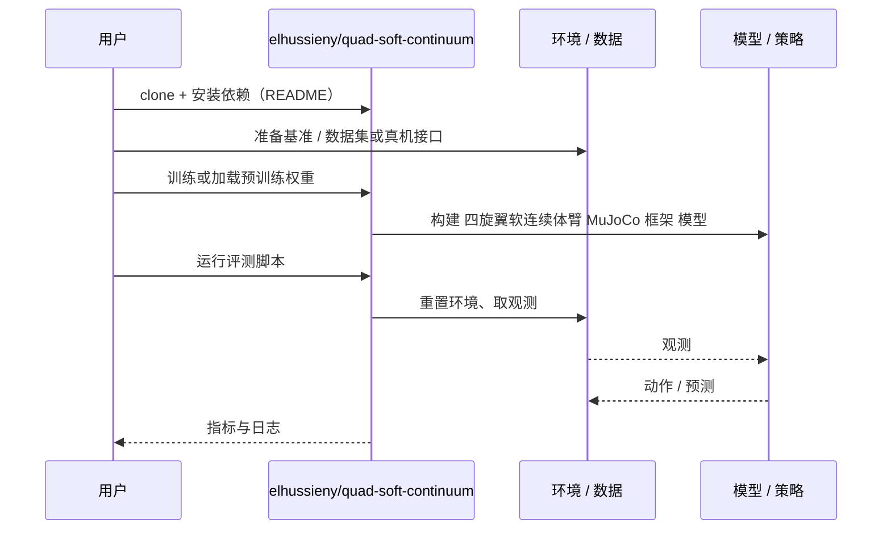

# 四旋翼软连续体臂 MuJoCo 框架（arXiv:2610.15308）

**四旋翼软连续体臂 MuJoCo 框架**（*An Open MuJoCo Simulation Framework for a Quadrotor Carrying a Tendon-Driven Soft Continuum Arm*，[arXiv:2610.15308](https://arxiv.org/abs/2610.15308)，[代码](https://github.com/elhussieny/quad-soft-continuum)）来自 [具身智能小站 2026-10-14 盘点](../../sources/blogs/wechat_embodied_station_41_papers_streamingwam_2026-10-14.md)，属「导航、足式与规划」组。

## 一句话定义

**把腱驱动连续体臂近似为柔性铰链连接的分段刚体链，与四旋翼控制联合仿真。**

## 英文缩写速查

| 缩写 | 英文全称 | 简要说明 |
|------|----------|----------|
| MuJoCo | Multi-Joint dynamics with Contact | 物理仿真器 |
| UAV | Unmanned Aerial Vehicle | 无人机 |
| PCC | Piecewise Constant Curvature | 软臂近似模型 |

## 为什么重要

- 空中柔性操作缺少开放仿真平台。
- 开源结论：**已开源**（步骤 2.5，2026-10-14）。仓库可达。
- 同期同组工作见 [流式动作块与世界模型记忆：具身智能小站 10-14 期 41 篇阅读坐标](../overview/embodied-station-2026-10-14-41-papers-technology-map.md)。

## 核心机制

| 项 | 内容 |
|----|------|
| **arXiv** | [2610.15308](https://arxiv.org/abs/2610.15308) |
| **开源** | **已开源** |
| **要点** | 轨迹、增益、工作空间与扰动实验均为仿真。 |
| **文内指标** | 以原文为准。 |

## 源码运行时序图

以下为按仓库入口（`elhussieny/quad-soft-continuum`）推断的通用运行链路；入库日仅核实仓库可达，未逐文件阅读，具体脚本名以 README 为准。

## 实验与评测

- 以原文为准。
- **读法：** 本页为索引级摘要，依据公众号转述的官方摘要与仓库信息整理；逐项数字与 baseline 以原文 PDF 为准。

## 与其他工作对比

- 横向索引见 [流式动作块与世界模型记忆：具身智能小站 10-14 期 41 篇阅读坐标](../overview/embodied-station-2026-10-14-41-papers-technology-map.md)；同 arXiv 不重复造页。

## 结论

**分段刚体近似是软臂进入 MuJoCo 的实用路径。**

1. 开源边界：**已开源** — 仓库可达。
2. 核心机制：轨迹、增益、工作空间与扰动实验均为仿真。
3. 复现与选型前核对任务协议、硬件与基准口径，勿直接横比公众号摘录数字。

## 关联页面

- [robot-simulation-three-layers](../concepts/robot-simulation-three-layers.md)
- [simulation-evaluation-infrastructure](../concepts/simulation-evaluation-infrastructure.md)
- [embodied-station-2026-10-14-41-papers-technology-map](../overview/embodied-station-2026-10-14-41-papers-technology-map.md)

## 参考来源

- [quadrotor_tendon_soft_continuum_arm_mujoco_arxiv_2610_15308.md](../../sources/papers/quadrotor_tendon_soft_continuum_arm_mujoco_arxiv_2610_15308.md)
- [wechat_embodied_station_41_papers_streamingwam_2026-10-14.md](../../sources/blogs/wechat_embodied_station_41_papers_streamingwam_2026-10-14.md)
- [arXiv:2610.15308](https://arxiv.org/abs/2610.15308)

## 推荐继续阅读

- [arXiv PDF](https://arxiv.org/pdf/2610.15308)
- [https://github.com/elhussieny/quad-soft-continuum](https://github.com/elhussieny/quad-soft-continuum)
