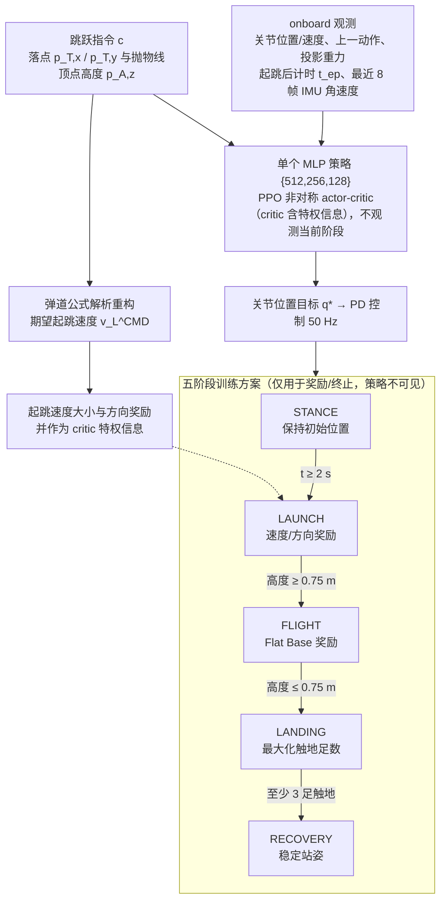

# 月球重力跳跃：面向月球重力四足跳跃的端到端强化学习

**月球重力跳跃**（*End-to-End Reinforcement Learning for Quadrupedal Jumping in Lunar Gravity*，[arXiv:2610.29586](https://arxiv.org/abs/2610.29586)）收录于 senlanke「具身运控lab」10-19–10-23 前沿论文动态（人形/四足）。本页依据**周报条目 + arXiv 摘要页**整理，流程图依据论文方法部分（见参考来源），未逐页核对实验数字；指标与结论以论文为准。

## 一句话定义

**月球重力跳跃：面向月球重力四足跳跃的端到端强化学习——通过多阶段训练得到单一端到端定点跳跃策略；分析控制冻结等极端故障，并在重力卸载硬件实验中验证垂直跳跃及力矩、功率可行性。**

## 英文缩写速查

| 缩写 | 英文全称 | 简要说明 |
|------|----------|----------|
| RL | Reinforcement Learning | 强化学习 |
| WBC | Whole-Body Control | 全身控制 |

## 为什么重要

- 周报所述待解决的问题：月球崎岖、断裂地形需要跳跃越过间隙，但策略必须依赖任务允许的机载传感器，并满足实际执行器功率限制。

## 流程总览

图依据：论文 §III-A / III-B / Fig. 2、Table II–III。

## 核心机制

| 项 | 内容 |
|----|------|
| **arXiv** | [2610.29586](https://arxiv.org/abs/2610.29586) · [PDF](https://arxiv.org/pdf/2610.29586) |
| **作者（arXiv）** | Levin Müller, Oliver Fischer, Marco Trentini, Yusuke Tanaka, Marco Hutter |
| **机构（周报所述，未逐条核实）** | 苏黎世联邦理工学院机器人系统实验室 |
| **arXiv 评论栏** | （无） |
| **开源** | arXiv 摘要页与评论未见代码或项目页链接（仅核对 arXiv 摘要页，不代表未发布）（2026-10-26） |
| **周报所述创新点** | 通过多阶段训练得到单一端到端定点跳跃策略；分析控制冻结等极端故障，并在重力卸载硬件实验中验证垂直跳跃及力矩、功率可行性。 |

### arXiv 摘要节选（英文原文）

> Legged robots can extend planetary exploration to rugged and discontinuous terrain that is inaccessible to conventional rovers. In lunar gravity, jumping further expands this mobility by enabling robots to cross obstacles and gaps that cannot be traversed by walking alone.

## 源码运行时序图

**不适用**：arXiv 摘要页与评论未见代码或项目页链接（仅核对 arXiv 摘要页，不代表未发布），无可对齐的官方代码流程。

## 实验与评测

- 周报与摘要给出的数字/场景已写入上表「创新点」与摘要节选；其余实验细节、基线与成功率定义请回到论文正文。
- 读法：先对齐任务设定、传感器与成功定义（仿真/真机），再解读 headline 数字，勿跨论文直接比较。

## 与其他工作对比

| 维度 | 读法 |
|------|------|
| **同周对照** | 见 [人形/四足周报技术地图](../overview/senlanke-weekly-2026-10-19-23-humanoid-quadruped-technology-map.md)，按方向浏览同期论文 |
| **开源状态** | arXiv 摘要页与评论未见代码或项目页链接（仅核对 arXiv 摘要页，不代表未发布） |

## 结论

**月球重力跳跃：面向月球重力四足跳跃的端到端强化学习。**

1. 本页是入库级摘要，复现前请核对论文正文、附录与代码仓库。
2. 指标须连同实验条件解读。
3. 关注 arXiv 版本更新与代码发布。

## 关联页面

- [senlanke-weekly-2026-10-19-23-humanoid-quadruped-technology-map](../overview/senlanke-weekly-2026-10-19-23-humanoid-quadruped-technology-map.md)
- [locomotion](../tasks/locomotion.md)
- [reinforcement-learning](../methods/reinforcement-learning.md)

## 参考来源

- [quadruped-jumping-lunar-gravity-rl_arxiv_2610_29586.md](../../sources/papers/quadruped-jumping-lunar-gravity-rl_arxiv_2610_29586.md)
- [wechat_senlanke_weekly_humanoid_quadruped_2026-10-19_23.md](../../sources/blogs/wechat_senlanke_weekly_humanoid_quadruped_2026-10-19_23.md)
- [arXiv:2610.29586](https://arxiv.org/abs/2610.29586)
- [arXiv PDF](https://arxiv.org/pdf/2610.29586)：已通读方法部分（实验与附录以略读为准）：§I–III（引言、相关工作、跳跃物理与任务表述、五阶段方案、仿真与硬件设置），§IV 略读

## 推荐继续阅读

- [arXiv PDF](https://arxiv.org/pdf/2610.29586)
