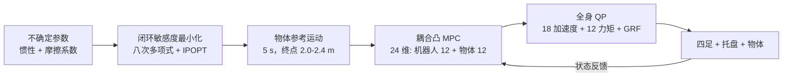

# 四足机器人鲁棒非抓取式物体运输

论文 *Robust Nonprehensile Object Transport with Quadruped Robots*（[arXiv:2610.07245](https://arxiv.org/abs/2610.07245)）由 **慕尼黑工业大学（TUM）**、坦佩雷大学、那不勒斯费德里科二世大学与 **穆罕默德·本·扎耶德人工智能大学（MBZUAI）** 的作者完成，研究四足机器人背上托盘上不被固定的物体在行走中如何不滑落。

## 一句话定义

**不是只让机器人更稳地走，而是先规划“对物体惯性与摩擦不确定性最不敏感”的物体运动，再用耦合机器人与物体动力学的凸 MPC 和全身 QP 去跟踪它。**

## 英文缩写速查

| 缩写 | 英文全称 | 简要说明 |
|------|----------|----------|
| MPC | Model Predictive Control | 此处为同时预测机器人质心与物体动力学的凸 MPC |
| QP | Quadratic Program | 全身控制层，施加反力与力矩约束 |
| CoM | Center of Mass | 机器人与物体质心，跟踪误差指标之一 |
| GRF | Ground Reaction Force | 地面反力，MPC 与 QP 的决策变量 |
| IPOPT | Interior Point OPTimizer | 轨迹优化所用非线性求解器 |

## 为什么重要

- 背部托盘上的无约束物体是最简单的“不抓取操作”，但失败代价高：摩擦系数与惯量一旦偏离，同一加速度就会让物体滑动。
- 它把“物体怎么动”当作被优化量，而不是固定直线轨迹，给 loco-manipulation 提供了与端到端 RL 并行的模型化路线。
- 同周的 [PAMORT](./paper-pamort-stacked-payload-quadruped-morl.md) 与 [Feeling Through the Load](./paper-feeling-through-the-load-compliant-quadruped.md) 都处理未固定载荷，三者分别代表 MPC+轨迹优化、多目标 RL 与柔顺 RL。

## 核心信息

| 项 | 内容 |
|----|------|
| **机构** | 慕尼黑工业大学（Munich Institute of Robotics & Machine Intelligence）；坦佩雷大学；那不勒斯费德里科二世大学（PRISMA Lab）；MBZUAI |
| **平台** | 背部平台 + 圆柱物体（质量 0.07 kg、半径 10 cm、高 20 cm）；四足型号原文未命名；MuJoCo 仿真 |
| **项目页** | [quadtransport.github.io/icra](https://quadtransport.github.io/icra/)（匿名补充站，归档见 [sources/sites](../../sources/sites/quadtransport_icra.md)） |
| **开源** | 项目页无代码或数据链接，论文亦未给仓库；截至 2026-10-12 未发布 |

## 方法栈 / 流程总览

## 方法

- **轨迹优化：** 代价是状态敏感度矩阵 Π(t) 的 Frobenius 范数平方的时间积分（沿用 Giordano 等的闭环敏感度方法）；决策变量为平移与旋转的八次多项式系数；不确定参数为物体惯性与物体-平台摩擦系数。约束包括首末端零速度/零加速度、不滑动条件 Λ − r_Λ ⪰ 0、物体质心高度 0.35–0.40 m、|v_x| ≤ 1.0 m/s、|v_y| ≤ 0.05 m/s、|v_z| ≤ 0.2 m/s。CasADi + IPOPT 求解，平均约 65 s（i9-10900K）。
- **耦合凸 MPC：** 单刚体机器人加物体，24 维状态；输入为地面反力与接触系数 Λ；机器人与物体用带松弛变量的加速度级软约束耦合；预测时域与采样率原文未报告。
- **全身 QP：** 变量为广义加速度（18）、关节力矩（12）与地面反力；约束为浮基动力学、支撑脚零接触加速度、摩擦锥、摆动脚零力和力矩限制。
- **接触模型：** 圆形物体周边四点接触，摩擦锥内接四棱锥近似（偏保守）；增益 K_p = diag(250,15)、K_d = diag(15,0.2)。

## 源码运行时序图

**不适用** — 论文与匿名项目页都没有代码仓库或可对齐的入口脚本；仅能依据论文公式描述数据流。

## 实验与评测

- **轨迹设置：** 起点 (0,0,0.38) m，终点 x = 2.0 / 2.2 / 2.4 m，时长 5 s；基线为固定姿态轨迹和直线轨迹（仿真），硬件仅直线基线。
- **仿真：** 30 次蒙特卡洛，惯性 ±10%；摩擦-质量研究 5 个摩擦系数 × 3 个距离 × 30 个质量实现 = 450 次，名义 μ = 0.52。
- **硬件：** 180 次 = 3 距离 × 2 轨迹类型 × 3 质量（名义与 ±10%）× 10 次重复。
- **指标：** 机器人质心 RMS 跟踪误差、物体平移/姿态 RMS 偏差、物体最终平面位移。
- **结果：** 摘要报告优化轨迹相对固定姿态基线滑动减少约 50%、相对直线基线约 30%，机器人质心跟踪误差也更低；其余数字仅在图中，原文正文未给表格数值。硬件上优化轨迹在轨迹中点附近滑动更多，但最终位移更小。

## 结论

**“选一条对不确定性不敏感的物体轨迹”比“把直线轨迹跟踪得更好”更能降低滑动，但目前证据只有一种圆柱物体和 ±10% 的扰动。**

1. 真正的收益指标是物体最终平面位移与滑动量（约 −50% / −30%），而非质心跟踪误差。
2. 优化轨迹更“动态”，物体姿态偏差仍较高，是次要代价。
3. 硬件试验使用机器人默认控制器，所提 MPC 与全身 QP 的真机验证并不完整，读结论时要区分仿真与硬件。
4. 轨迹优化约 65 s，是离线规划；在线重规划需要加速或近似。
5. 摩擦系数不确定性要在规划里显式建模，仅靠 ±10% 质量扰动不足以覆盖实际摩擦变化。
6. 若要借鉴，优先复用“敏感度作为轨迹代价”的思路，再接自己的 MPC。

## 与其他工作对比

| 对照 | 差异读法 |
|------|----------|
| [PAMORT](./paper-pamort-stacked-payload-quadruped-morl.md) | RL 策略在线折中运动与载荷稳定；本文用模型化规划降低敏感度 |
| [Feeling Through the Load](./paper-feeling-through-the-load-compliant-quadruped.md) | 后者关注人推载荷的力估计与柔顺；本文关注无外力时的无滑动运输 |
| [SRBD 凸 MPC + WBC](../concepts/srbd-convex-mpc-wbc.md) | 本文把载荷纳入 MPC 状态，是该范式的扩展 |
| [MPC-WBC 集成](../concepts/mpc-wbc-integration.md) | 本文的两层结构（MPC 到全身 QP）与之一致 |

## 局限与风险

- 仅一个圆柱物体与 ±10% 参数变化；一阶敏感度近似与保守接触模型。
- 硬件使用默认控制器；MPC/QP 的真机闭环表现原文未报告。
- 轨迹优化约 65 s，离线。
- 开源状态：截至 2026-10-12 无仓库、无数据；项目页匿名、无视频外链。

## 关联页面

- [人形与四足周报 2026-10-05 至 10-09](../overview/frontier-humanoid-quadruped-2026-10-05-10-09.md)
- [Locomotion 任务页](../tasks/locomotion.md)
- [Loco-manipulation 任务页](../tasks/loco-manipulation.md)
- [SRBD 凸 MPC + WBC](../concepts/srbd-convex-mpc-wbc.md)
- [全身控制](../concepts/whole-body-control.md)
- [PAMORT](./paper-pamort-stacked-payload-quadruped-morl.md)

## 参考来源

- [论文归档](../../sources/papers/quadruped_nonprehensile_transport_arxiv_2610_07245.md)
- [项目页归档](../../sources/sites/quadtransport_icra.md)
- [人形/四足周报来源](../../sources/blogs/frontier_humanoid_quadruped_2026_10_05_10_09.md)
- [arXiv:2610.07245](https://arxiv.org/abs/2610.07245)

## 推荐继续阅读

- [arXiv HTML 全文](https://arxiv.org/html/2610.07245v1)
- [项目页](https://quadtransport.github.io/icra/)
- [CasADi](https://web.casadi.org/)
