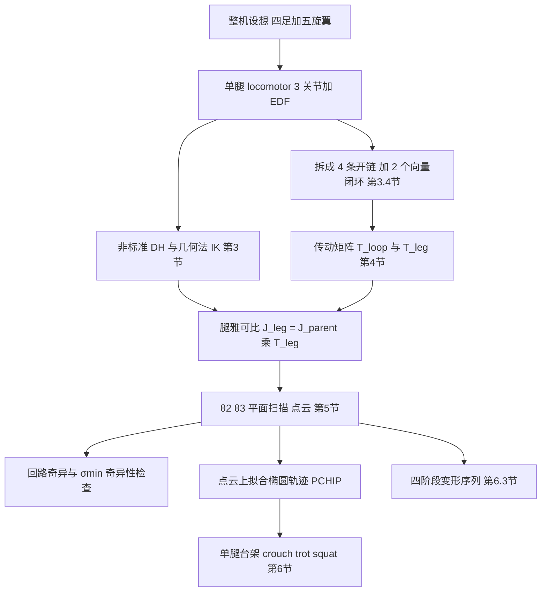

# Quadruped-Pentarotor 双闭环四杆腿（arXiv:2611.07470）

**论文：** *Kinematic analysis of a double-closed-loop four-bar chain-based leg for a multimodal quadruped-pentarotor robot*（[arXiv:2611.07470](https://arxiv.org/abs/2611.07470)，v1，2026-11-05，cs.RO）。作者 Prashant Raturi、Santhakumar Mohan，印度理工学院帕拉卡德分校（IIT Palakkad）机械工程系与机器人与控制中心。论文未给代码仓库。本页依据 [论文归档](../../sources/papers/quadruped-pentarotor-four-bar-leg_arxiv_2611_07470.md)，该归档已通读全文（附录 C、D 的长公式仅浏览）。

## 一句话定义

**一条 3 自由度、膝关节由两个四杆闭环远程驱动的“locomotor”腿：地面模式作四足腿，空中模式作旋翼臂；论文只做它的运动学建模、奇异性分析和单腿台架演示（第 1、7 节）。**

## 英文缩写速查

| 缩写 | 英文全称 | 简要说明 |
|------|----------|----------|
| DH | Denavit-Hartenberg | 串联链的参数化建模法，本文用非标准（改进）形式（第 3.1 节） |
| DoF | Degree of Freedom | 自由度；腿有 3 个，浮动基座有 6 个 |
| EDF | Electric Ducted Fan | 电动涵道风扇；每腿 90 mm，机身中央 120 mm（第 2 节） |
| FK / IK | Forward / Inverse Kinematics | 正 / 逆运动学 |
| SVD | Singular Value Decomposition | 奇异值分解，本文用最小奇异值 σmin 衡量腿雅可比的条件（第 5.3 节） |
| PCHIP | Piecewise Cubic Hermite Interpolating Polynomial | MATLAB 分段三次 Hermite 插值，用于平滑轨迹（第 6.2 节） |
| UGV | Unmanned Ground Vehicle | 无人地面车辆，引言中 M4 机器人的一种模式 |

## 为什么重要

- 地面 / 空中多模态机器人多为轮 + 旋翼，作者认为“腿 + 旋翼”工作较少（第 1 节）；这篇是在此方向上的第一阶段，先把腿做扎实。
- 腿的膝关节电机靠近机身，作者说明理由：减轻髋与大腿电机的负担，质量更集中于机身附近，有利于两种模式下稳定（第 3.4.1 节，作者自述，论文未用实验对比）。
- 对读强化学习的读者：这是一篇纯运动学与硬件论文，不含学习或控制；价值在于给出一条带闭环腿的闭式 IK、传动矩阵与奇异性判据，是后续在这类腿上做 RL 或控制时需要的“动作空间到关节空间”映射的参考。这是本页的判断，论文没有这样讲。

## 核心机制

### 流程总览

### 关键环节

| 环节 | 论文做法 | 出处 |
|------|----------|------|
| 腿几何 | 髋外展 θ1、大腿 θ2（s1 = 0.11 m）、膝 θ3（s2 = 0.14 m）；整机 l = 0.19 m、w = 0.14 m | 表 2 |
| 开链 IK | θ1 由 yz 平面三角关系得到（式 2 至 6，左右腿符号相反），再把足端旋回 θ1 后在 xz 平面求 θ2、θ3（式 7 至 14），闭式解 | 第 3.2 节 |
| 基座姿态 | 把滚转 / 俯仰 / 偏航折算到足端坐标，再套用同一 IK | 第 3.3 节 |
| 闭环约束 | 回路 ABCDA 与 EFGAE 的向量闭环；电机在 B 与 θ2，实际膝在 G；θ3 = a3 − θ2 + π | 式 20 至 24、36 |
| 速度映射 | q_act = [θ1, θ2, a6]；a_d = T_loop a_i，T_loop = −Jcd⁻¹ Jci；J_leg = J_parent T_leg | 式 25 至 43 |
| 奇异性 | 回路：a2 − a3 或 a7 − a8 为 π 的整数倍即 EF-FG 或 AD-DC 共线；整腿：σmin（0.03 至 0.1） | 式 45、图 21、22 |
| 步态 | 椭圆参数曲线 150 点，最近点 + PCHIP 贴到点云 | 式 46、47，第 6.2 节 |

## 实验与评测（全部为单腿台架，定性）

- **工作空间：** θ2 与 θ3 按 0.5° 分辨率扫描，A-B-C 段 θ2 为 170° 到 340°、θ3 为 114° 到 29°（图 18）。硬件上让足端走边界，图 26 的叠加轮廓为人工逐帧跟踪，作者承认含噪声（第 6.1 节）。
- **三种步态（第 6.2 节）：** crouch（a = 0.06 m、b = 0.014 m，中心 x = 0.008 m、z = −0.18 m）、trot（a = 0.08 m、b = 0.035 m，中心 x = 0.02 m、z = −0.21 m）、squat（z 在 −0.22 m 到 −0.14 m 之间按余弦变化，x 加 0.002 cos³(t) 扰动）。作者说 trot 中心不宜再下移，因下部 σmin 变小，舵机出现抖动。
- **变形：** 四阶段关节角序列（第 6.3 节），硬件上以时间序列照片展示（图 30）。
- **硬件：** PLA 与碳纤维复合丝 3D 打印、Dynamixel MX28T 舵机、U2D2 通信；滑动基座锁定，EDF 未通电（第 6 节）。

## 工程实践

- 若要复现：论文给出表 1 至表 6 的 DH、表 2 与附录 B 的全部杆长、式 24 与附录 A 的闭环闭式解，原则上可自行写 MATLAB 或 Python 复现，但未提供代码（推测：附录 C、D 的长表达式手抄易错，建议用符号工具生成）。
- 选择杆长时作者靠“非 Grashof + 曲柄驱动 + 几何限位”避免 toggle 锁死（第 5.3 节）；部署时应把轨迹中心放在 σmin 较大的区域，论文的 trot 抖动现象即是反例（第 6.2 节）。
- 做 RL 时若把关节空间当动作空间，需要处理 θ3 由 a6 与 θ2 经闭环耦合这一点（式 33、36 至 41）；这是本页的建议，论文没有涉及学习。

## 局限

**论文自己承认的：**

- 本文只做运动学；动力学、EDF 实际出力、地面接触与整机实现留给后续工作（第 3、7 节）。
- 滑动基座被锁死，没有承载或运动（第 3.4 节）；EDF 在实验中不工作（第 6 节）。
- 工作空间验证轮廓来自人工逐帧跟踪，有噪声（第 6.1 节）；执行器空间的工作空间未给出（第 5.2 节）。
- 近 θ2 = 235°、θ3 = 29° 的小块奇异区靠几何限位避开（第 5.3 节）。

**读者看到的未验证之处（推测）：**

- 没有定量指标：无足端跟踪误差、重复精度、速度、负载、耗电或与其他腿构型的对比；“膝电机靠近机身更稳定”只是设计论证。
- 空中模式只有一条四阶段关节序列，没有给出推力、姿态或整机在空中的运动学；第 6.3 节第四阶段目标位姿恰为 θ2 = 235°、θ3 = 29°，与上述近共线小区重合，论文未讨论。
- 雅可比标注为 R^{6×3}（式 25），σmin 的量纲（线速度与角速度混合）未说明。
- 硬件演示视频只以超链接给出，本页未打开核对；时间序列照片之外的运动质量（如抖动程度）无法从文字判断。

## 关联页面

- [混合运动（Hybrid Locomotion）](../tasks/hybrid-locomotion.md)
- [运动（Locomotion）](../tasks/locomotion.md)
- [步态生成](../concepts/gait-generation.md)
- [人形并联关节运动学](../concepts/humanoid-parallel-joint-kinematics.md)：同属闭链到开链的映射问题
- [运动学可行性与动力学可行性](../concepts/kinematic-vs-dynamic-feasibility.md)
- [Aerial Manipulator Nonlinear Control](../entities/paper-aerial-manipulator-nonlinear-control.md)：空中平台的另一篇论文
- [空水两栖仿生机器人论文页](../entities/paper-aerial-aquatic-remora-hitchhiking-robot.md)

## 参考来源

- [论文归档：quadruped-pentarotor-four-bar-leg_arxiv_2611_07470.md](../../sources/papers/quadruped-pentarotor-four-bar-leg_arxiv_2611_07470.md)
- [arXiv:2611.07470](https://arxiv.org/abs/2611.07470)

## 推荐继续阅读

- [arXiv PDF](https://arxiv.org/pdf/2611.07470)
- [步态生成](../concepts/gait-generation.md)
- [人形并联关节运动学](../concepts/humanoid-parallel-joint-kinematics.md)
