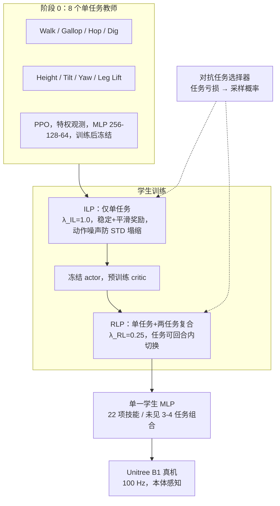

# 四足多技能：RL+模仿联合蒸馏与对抗任务选择

**论文：** *Teaching a Robot Dog New Tricks: Diverse Quadruped Skills via Combined Reinforcement and Imitation Learning with Adversarial Task Selection*（[arXiv:2610.10601](https://arxiv.org/abs/2610.10601)，cs.RO，2026-10-06）。作者 Foxmere、Furman、Du、Chang、Gilpin、McGuire；周报标注为加州大学圣克鲁兹分校（UCSC）团队（arXiv 页面未列机构）。

## 一句话定义

**先为 8 个差异很大的四足任务各训一个 PPO 教师，再用“PPO 损失 − λ·行为克隆损失”的联合目标把它们蒸馏进一个学生策略，并让对抗式任务选择器持续把采样概率倾斜给当前表现最差的任务，最终一个 MLP 同时执行 22 项（8 单任务 + 14 两任务复合）技能。**

## 英文缩写速查

| 缩写 | 英文全称 | 简要说明 |
|------|----------|----------|
| RL | Reinforcement Learning | 学生在 RLP 阶段用任务奖励继续优化 |
| IL / BC | Imitation Learning / Behavior Cloning | 学生动作均值对教师动作做 MSE 回归 |
| PPO | Proximal Policy Optimization | 教师训练与学生 RL 项的算法 |
| DAgger | Dataset Aggregation | 用学生自己的轨迹采集教师标注，缓解分布偏移 |
| ILP / RLP | Imitation-/Reinforcement-Learning Primary | 学生两阶段：λ_IL=1.0 模仿为主，λ_RL=0.25 强化为主 |
| DtF | Distill-then-Finetune | 对照基线：先纯蒸馏再 RL 微调 |
| SR | Survival Rate | 评测中不摔倒比例 |

## 为什么重要

- **多技能不是“更多命令维度”：** 挖掘、疾驰、跳跃、抬腿在步态、接触和奖励结构上差别很大，单阶段 PPO 容易出现样本效率低和梯度冲突；论文用 PPO 实测：22 任务下显式任务分仅 0.440，步态误差 0.478。
- **模仿与强化的取舍可调：** 联合目标让学生既贴近教师的自然动作（单任务动作 L2 误差 0.64–1.42，对比 DtF 的 1.45–4.20），又能在没有教师的复合任务上靠 RL 学出组合。
- **训练资源分配可自动化：** 对抗任务选择器以“相对教师水平的误差”为标尺，避免手工设计多任务课程。

## 核心信息

| 项 | 内容 |
|----|------|
| **机构** | 周报标注 UCSC；arXiv 页面未列机构 |
| **平台** | 仿真 NVIDIA Isaac Lab（平地）；真机 Unitree B1，机载 Raspberry Pi 4B，100 Hz 推理，仅本体感知 |
| **规模** | 8 教师、22 训练任务、学生 MLP 512-256-128；每方法 RL 段 12.29 亿转移；3 个种子 |
| **开源** | **未发布**：arXiv 页面只列补充视频 [YouTube](https://youtu.be/V9yX04EBcFA)，无项目页与仓库（截至 2026-10-12） |

## 方法栈与流程总览

## 方法

### 教师

- 任务：Walk、Gallop、Hop、Body Height、Body Tilt、Body Yaw、Leg Lift、Dig，各自 PPO；每个教师约 18–34 项奖励项（平均 26），追求“自然动作”而非完美跟踪。
- 教师可用特权信息（如足端接触力）；学生不能，因此蒸馏同时承担“去特权化”。

### 学生输入与命令

- 输入：本体感知 + 14 维命令向量（速度、角速度、俯仰、偏航、抬腿标志、足端目标、步态选择、挖掘力、站姿高度；未触发的项取默认，站姿高度默认 0.55 m）+ 4 个步态时钟项（1.7 Hz 与 3.4 Hz 两组正余弦；Walk、Hop 用 1.7 Hz，Gallop 用 3.4 Hz）。

### 联合目标

- L(θ) = L_PPO(θ) − λ·L_BC(θ)。L_BC 是学生动作均值与教师动作的 MSE，数据由 DAgger 采集，不作用于标准差；没有教师的复合命令不产生 BC 样本。
- ILP 只用单任务，奖励只留稳定与平滑项，并在动作上加零均值高斯噪声防止标准差塌缩；RLP 引入复合任务和回合内任务切换，先冻结 actor 预训练 critic，奖励面向跟踪（22 个任务共 32 项奖励项）。

### 对抗任务选择

- 每个任务激活一组误差通道，复合任务取并集；通道误差用 CNorm(e)=tanh(a·v_e/τ_e) 归一化（a=atanh(0.2)，τ_e 为教师在该通道的最终误差），因此“0.5 分”约等于教师水平。
- 任务亏损 Ē_i 为激活通道的均值；采样概率 p_i = κ·Ē_i^β / Σ_j Ē_j^β + (1−κ)/|𝒴|，κ=0.85、β=1.5，全程不变——即 85% 概率质量按亏损加权，15% 保持均匀。
- 训练只使用两任务复合，三/四任务组合（如 Walk+Tilt+Height、Lift+Tilt+Height+Yaw）留作泛化测试。

## 实验与评测

设置：对比 Teacher Router、单阶段 PPO（初始 STD 1.0）、DtF；3 种子；测试 1 为 22×22=484 个 A→B 序列，每序列 40 次（A 持续 10 s、B 持续 5 s），带观测噪声与 0–300 N、0.1–0.2 s 外力；测试 2 为 7 个 OOD 命令各 60 次。

| 方法（单任务） | 生存率 | 显式分 | 步态误差 | 站姿分 |
|---|---|---|---|---|
| 本文 | 99.14% | **0.608** | **0.147** | **0.927** |
| DtF | 96.99% | 0.474 | 0.383 | 0.895 |
| PPO | **99.72%** | 0.440 | 0.478 | 0.600 |
| Teacher Router | 80.34% | 0.500 | 0.118 | 0.809 |

- **复合任务：** 本文 99.23% / 0.605；DtF 96.96% / 0.496；PPO 99.42% / 0.471。
- **任务切换（A→B）：** 本文 99.05% / 0.558；DtF 97.66% / 0.395；Router 80.82% / 0.394。
- **任务规模：** 只训 9 个任务时本文与 DtF 接近（显式 0.694 vs 0.679）；扩到 22 个任务后在 22 任务集上 0.608 vs 0.474，说明优势随任务数增长而扩大。
- **OOD 组合：** 本文生存率 96.35%–100%；DtF 在 Tilt+Height+Gallop 上仅 83.02%（本文 99.44%）。但在 Dig+Height、Dig+Tilt+Yaw 上 DtF 隐式分更高，且 DtF 在 Dig、Hop 单任务分更高（Hop 0.676 vs 0.543），代价是动作与教师差距大得多。
- **敏感性：** 本文对初始动作 STD 稳健（1.0 STD 时显式 0.595），对初始学习率更敏感（1e-4 时显式 0.537，站姿 0.706）。
- **真机：** 平坦混凝土、草地、松土上演示钻低矮空间、开门、推电池、挖掘、疾驰、跳跃、俯仰、抬腿按按钮；**无量化指标、无试验次数**。

## 源码运行时序图

**不适用**：截至 2026-10-12 arXiv 页面无仓库或项目页，没有可对齐的官方目录/脚本；论文自述流程见上文“流程总览”。

## 工程实践

| 项 | 建议 |
|----|------|
| 多任务教师 | 先让每个教师追求“自然动作”，并记录各误差通道的最终误差 τ_e，后面对抗选择器依赖它归一化 |
| 蒸馏损失 | BC 只作用于动作均值；复合命令无教师就不产生 BC 样本，别用最近邻教师硬凑 |
| 阶段调度 | ILP 用小噪声防 STD 塌缩；进入 RLP 前先冻结 actor 单独预训练 critic |
| 超参 | 学习率 5e-5→5e-6；初始 STD 0.5（PPO 基线 1.0）；κ=0.85、β=1.5 |
| 部署 | B1 上 Raspberry Pi 4B 即可 100 Hz 跑 MLP；需加观测噪声/偏置、延迟与质心外力随机化 |

## 结论

**把“教师水平”当作统一标尺，让联合 RL+模仿目标和任务选择器共同驱动，才是多技能四足策略避免梯度冲突、也避免偏离教师风格的关键；但真机证据目前只是定性的。**

1. **联合目标优于 DtF 与单阶段 PPO** — 22 任务单任务显式分 0.608 对 0.474 / 0.440，步态误差 0.147 对 0.383 / 0.478。
2. **教师动作约束要保留到 RL 阶段** — 否则 DtF 式微调会让动作 L2 误差升到本文的 2–4 倍。
3. **任务越多优势越大** — 9 任务时差距小，22 任务时拉开。
4. **对抗选择以教师误差为标尺** — κ/β 固定即可，不需要手写课程；消融只在图中给出，没有数值行。
5. **复合泛化只测了少量命令** — 7 个 OOD 命令各 60 次，个别组合 DtF 仍更好，不要外推为任意组合。
6. **复现要补的缺口** — 并行环境数、墙钟时间、完整观测/奖励权重均未公布。

## 与其他工作对比

| 对照 | 差异读法 |
|------|----------|
| [Walk These Ways（MoB）](./paper-walk-these-ways-quadruped-mob.md) | MoB 用一个策略嵌入步态/风格参数供人调；本文处理的是任务类型差异更大的技能库与复合 |
| [教师-学生 DAgger 训练](../methods/teacher-student-dagger-training.md) | 本文把 DAgger 式 BC 项放进 PPO 目标，并用任务选择调度 |
| [多专家蒸馏](../methods/multi-expert-distillation.md) | 同属多教师合一；本文强调复合任务、无教师命令仍靠 RL 学习 |
| [DAgger 原论文](./paper-ross-dagger.md) | 提供 BC 数据采集的分布偏移处理依据 |

## 局限与风险

- **开源状态：** 无代码、无权重，仅补充视频；训练规模与奖励细节缺失。
- **适用边界：** 单一本体（Unitree B1）、平地训练、MLP、纯本体感知；地形/物体感知相关行为留作未来工作。
- **统计：** 3 个种子，只报均值和标准差；“0.5 = 教师水平”是归一化选择而非实测上限。
- **真机：** 没有量化成功率；隐式分与生存率可能被奖励投机抬高（论文用逐通道分析反驳）。

## 关联页面

- [人形/四足前沿周报（2026-10-05~10-09）](../overview/frontier-humanoid-quadruped-2026-10-05-10-09.md)
- [运动控制任务页](../tasks/locomotion.md)
- [教师-学生 DAgger 训练](../methods/teacher-student-dagger-training.md)
- [多专家蒸馏](../methods/multi-expert-distillation.md)
- [PPO](../methods/ppo.md)
- [Walk These Ways](./paper-walk-these-ways-quadruped-mob.md)
- [Isaac Lab](./isaac-lab.md)

## 参考来源

- [quadruped_skills_ats_arxiv_2610_10601.md](../../sources/papers/quadruped_skills_ats_arxiv_2610_10601.md) — 论文摘录与开源核查
- [周报来源归档](../../sources/blogs/frontier_humanoid_quadruped_2026_10_05_10_09.md)
- [arXiv:2610.10601](https://arxiv.org/abs/2610.10601) — 原文

## 推荐继续阅读

- [arXiv HTML 全文](https://arxiv.org/html/2610.10601v1)
- [补充视频](https://youtu.be/V9yX04EBcFA)
- [Walk These Ways 项目页](https://gmargo11.github.io/walk-these-ways/)
