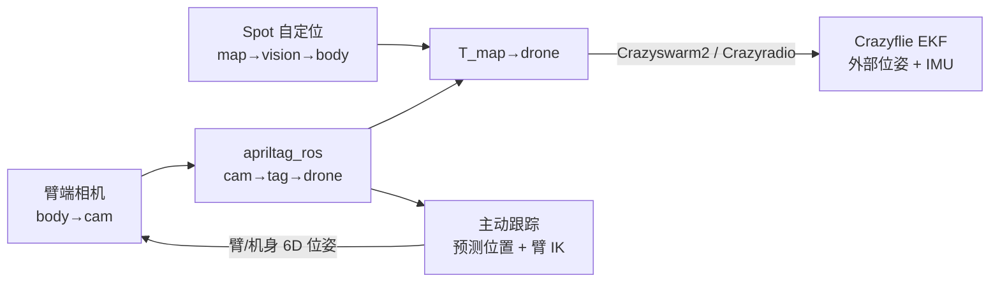

---

type: entity
tags: [paper, quadruped, uav, localization, apriltag, active-perception, boston-dynamics-spot, crazyflie, heterogeneous-robots, itu-copenhagen, novo-nordisk]
status: complete
updated: 2026-10-12
arxiv: "2610.06215"
project_id: quadruped-uav-localization-active-tracking
related:
  - ../overview/frontier-humanoid-quadruped-2026-10-05-10-09.md
  - ../tasks/locomotion.md
  - ./quadruped-robot.md
  - ./crazyflie-firmware.md
  - ../concepts/state-estimation.md
  - ./paper-spot-rl-distributional-sim2real.md
sources:
  - ../../sources/papers/quadruped_uav_localization_arxiv_2610_06215.md
  - ../../sources/blogs/frontier_humanoid_quadruped_2026_10_05_10_09.md
summary: "arXiv:2610.06215：哥本哈根信息技术大学等让带 7 自由度臂的 Spot 用臂端相机检测 Crazyflie 上的 AprilTag，把外部位姿喂给只带 IMU 的微型无人机；静止对齐后位置中位误差 12–16 mm，主动跟踪把飞行轨迹误差从 11.0 cm 降到 6.9 cm，代码未发布。"
---

# 四足机器人为微型无人机提供定位与主动跟踪

论文 *Towards Quadruped-Provided Localization and Active Tracking for Micro-UAVs*（[arXiv:2610.06215](https://arxiv.org/abs/2610.06215)）由 **哥本哈根信息技术大学（IT University of Copenhagen）**、**Helix Lab** 与 **诺和诺德（Novo Nordisk A/S）** 的作者完成，已被 CLAWAR 2026 接收（出版版标题改称 Nano-UAVs）。

## 一句话定义

**让地面四足机器人当“定位基站”：Spot 臂端相机看无人机上的 AprilTag，复合自身地图位姿后把无人机位姿发给它，并用机械臂主动转向保持无人机在视野内。**

## 英文缩写速查

| 缩写 | 英文全称 | 简要说明 |
|------|----------|----------|
| UAV | Unmanned Aerial Vehicle | 无人机，这里指 27 g 级 Crazyflie |
| EKF | Extended Kalman Filter | 无人机端融合外部位姿与 IMU |
| PnP | Perspective-n-Point | 由标签角点求相机-标签位姿，协方差用于选检测 |
| IK | Inverse Kinematics | Spot Arm 的逆运动学服务，用于对准预测位置 |
| MOCAP | Motion Capture | OptiTrack 真值与对照定位源 |

## 为什么重要

- 微型无人机无法携带完整定位传感器和算力；把定位放到能承载传感器的四足机器人上，可用于狭窄或无 GPS 空间。
- 四足既能行走到不同位置，又能用机械臂调整视角，比固定动捕或固定相机更灵活。
- 该文给出的是系统级量化：延迟、距离、检测间断与飞行误差，而非只给演示。

## 核心信息

| 项 | 内容 |
|----|------|
| **机构** | 哥本哈根信息技术大学；Helix Lab（Kalundborg）；诺和诺德 |
| **平台** | Boston Dynamics Spot + Spot Arm + Jetson AGX Orin；Crazyflie 2.1+（42 g 含机架） |
| **开源** | arXiv 页面与正文未列项目页或仓库，截至 2026-10-12 未发布 |

## 方法栈 / 流程总览

## 方法

- **标签与检测：** 四个 36h11 AprilTag（58.5 mm）贴在定制机架四个侧面。apriltag_ros 在 CPU 运行，多标签可见时先按决策裕度、再按 PnP 协方差迹选最强检测。
- **位姿链：** map→vision→body→cam→tag→drone 五个变换复合；无人机自身不发布位姿。
- **无人机端：** 机载 EKF 融合外部位姿与 IMU，检测间隙靠 IMU 外推；超时无位姿触发看门狗降落（动捕 300 ms，AprilTag 500 ms）。
- **主动跟踪：** 拟合近期速度外推下一位置，使光轴指向该点并保持约 0.9 m 距离；调用 Spot Arm IK，2 s 内到达目标 6D 位姿；设最小安全距离与最大可达球，2 s 无检测停止；机身可选择参与运动，落脚与平衡由 Spot 内置运动控制器负责。
- **软件：** ROS 2 Humble、Docker、spot_ros2；Crazyradio PA 2.4 GHz。

## 源码运行时序图

**不适用** — 论文未发布代码，仅链接 spot_ros2、Crazyswarm2 两个依赖，没有本工作的入口脚本可对齐。

## 实验与评测

- **实验 1（静止 Spot，29 次飞行，134.8k 样本）：** 原始位置误差约 50 mm（含约 46 mm 固定安装偏移）；刚性对齐后中位位置误差 12 mm（1280×720）/ 16 mm（640×480），姿态误差 3.4° / 8.8°，p95 为 30 / 45 mm。位姿速率约 17 Hz / 40 Hz，超过 100 ms 的间断占 15.7% / 1.1%，因此闭环用 640×480。
- **实验 2（动捕对 AprilTag 位姿，18 次飞行）：** 相对指令航点的轨迹误差，AprilTag 中位 7.8 cm（距离 1.5–2.0 m）、2.5–3.0 m 时 11.0 cm；动捕约 5.5 cm。位姿延迟 AprilTag 中位 72 ms（p95 约 105 ms），动捕 2 ms。
- **实验 3（主动跟踪，8 次飞行）：** 静止 11.0 cm，仅臂跟踪 7.1 cm，臂+机身 6.9 cm。
- 动捕真值：8 台 OptiTrack PrimeX 13W，120 Hz，室内 3×3×2 m 工作体积。

## 结论

**外部四足定位能让无人机在实验室内以厘米级误差自主飞行；主动跟踪的收益主要来自缩短相机距离，而不是机身是否参与。**

1. 精度读数应看“对齐后 12–16 mm”与“飞行轨迹误差 7.8–11.0 cm”两个层级，后者受延迟和距离影响更大。
2. 分辨率是延迟与间断的权衡：1280×720 精度略高但 15.7% 间断超 100 ms，不适合闭环。
3. 主动跟踪 11.0 → 7.1 / 6.9 cm 的对比混入了距离变化（静止约 2.7 m，跟踪约 0.9 m），不要把全部收益归于臂动作（原文自述）。
4. 位姿延迟 72 ms 中位明显高于动捕，想提速需 GPU 检测或无标签检测（作者未来工作）。
5. 本文只覆盖定位与跟踪，没有规划，尚不能直接用于穿越狭窄开口。

## 与其他工作对比

| 对照 | 差异读法 |
|------|----------|
| [Crazyflie Firmware](./crazyflie-firmware.md) | 无人机端固件与外部定位输入接口所在；本文给出外部位姿来源 |
| [Spot RL Sim2Real](./paper-spot-rl-distributional-sim2real.md) | 同属 Spot 平台，但那篇是步态强化学习，本文用其内置运动控制器 |
| 动捕定位 | 精度更高（约 5.5 cm 飞行误差、2 ms 延迟），但需固定基础设施 |

## 局限与风险

- 仅室内、动捕真值、已标定标签；未测户外、光照变化和真实狭窄开口。
- 标签在快速偏航、远距或斜视角下退化；穿越窄缝会丢失无人机。
- 电池约 7 分钟，2.4 GHz 通信在实验室外未测。
- 开源状态：未列仓库，截至 2026-10-12 未发布；复现依赖 Spot 与 Crazyflie 硬件。

## 关联页面

- [人形与四足周报 2026-10-05 至 10-09](../overview/frontier-humanoid-quadruped-2026-10-05-10-09.md)
- [四足机器人](./quadruped-robot.md)
- [Locomotion 任务页](../tasks/locomotion.md)
- [状态估计](../concepts/state-estimation.md)
- [Crazyflie Firmware](./crazyflie-firmware.md)
- [机器人视觉感知栈选型闭环](../queries/robot-perception-stack-selection-loop.md) — 本页对应其 ① 标定与 ④ 消费层：臂端相机检测 AprilTag 得外部位姿喂给只带 IMU 的无人机，静止对齐与主动跟踪决定定位误差

## 参考来源

- [论文归档](../../sources/papers/quadruped_uav_localization_arxiv_2610_06215.md)
- [人形/四足周报来源](../../sources/blogs/frontier_humanoid_quadruped_2026_10_05_10_09.md)
- [arXiv:2610.06215](https://arxiv.org/abs/2610.06215)

## 推荐继续阅读

- [arXiv HTML 全文](https://arxiv.org/html/2610.06215v1)
- [Crazyswarm2 文档](https://imrclab.github.io/crazyswarm2/)
- [spot_ros2](https://github.com/bdaiinstitute/spot_ros2)
