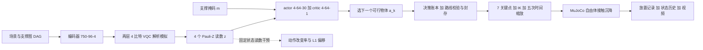

# Qubit-to-Motion（arXiv:2611.11580）

**Qubit-to-Motion**（*Qubit-to-Motion: Traceable Action Provenance in Hybrid QRL for Robotic Bin-Packing Sequencing*，[arXiv:2611.11580](https://arxiv.org/abs/2611.11580)，浙江大学机器人研究院 + University of New Brunswick）。本页依据 v1 全文 PDF 写成，归档见 [sources 归档](../../sources/papers/qubit-to-motion_arxiv_2611_11580.md)。

## 一句话定义

在「支撑约束下的装箱顺序选择」这一受限设定里，把混合量子强化学习（QRL）策略的每个动作，经读数干预、决策账本、路线封存和 SHA-256 校验，与后续路点、关节运动和 MuJoCo 接触结果逐步绑定，使「量子电路输出是否真的影响了物理动作」可以被检查；论文的核心贡献是可追溯性，不是任务性能或量子优势。

## 英文缩写速查

| 缩写 | 英文全称 | 简要说明 |
|------|----------|----------|
| QRL | Quantum Reinforcement Learning | 含量子电路组件的强化学习；此处为「经典编码器 + VQC + 经典 actor/critic」混合结构 |
| VQC | Variational Quantum Circuit | 可训练参数化量子电路；本文为两层、4 比特、解析态矢量模拟（III-B），并非真量子硬件 |
| Pauli-Z | Pauli-Z observable | 单比特 Z 可观测量；其期望值 z_{k,q} 是 actor/critic 仅有的学习输入（式 7） |
| MDP | Markov Decision Process | 有限时域，N=30（III-A） |
| BC | Behavior Cloning | 先用贪心动作标签做掩码交叉熵预训练（III-C） |
| PPO | Proximal Policy Optimization | BC 之后做 2 次更新（表 I） |
| GAE | Generalized Advantage Estimation | 优势估计，γ=0.985，λ=0.95（表 I、式 10-11） |
| IK | Inverse Kinematics | 阻尼位置 IK，求 Panda 七轴关节（III-F） |
| SHA-256 | Secure Hash Algorithm 256 | 逐文件摘要，用于校验文件引用未被改动（III-E，参考文献 [32]） |
| L1 shift | L1 probability shift | 干预前后掩码后动作分布的 L1 距离（式 14） |

## 为什么重要

- 作者指出：混合 QRL 评测常只报回报、成功率或收敛，没回答量子电路输出是否影响了受约束动作、并且能否一直追到机器人执行（摘要、I 节）。
- 价值在方法论：固定状态干预（只改读数，保持观测、掩码、actor、平局规则不变）+ 动作到接触的全链路 ID/摘要，可迁移到别的「学习策略 → 序列 → 运动」流水线。（作者自述的是装箱设定；迁移是我的判断，未经论文验证。）
- 边界必须看清：只有仿真、一个检查点、五个仅做几何微扰的场景、支撑拓扑固定，因此它是「可审计的流程演示」，不是性能或优势证据。

## 核心原理与流程总览

**设定（III-A）**：每个场景 15 个地面物体 + 15 个上层物体，上层物体 15+i 依赖地面物体 i；策略只决定「下一个放哪个可行物体」，源位姿、目标位姿、偏航、尺寸均预设。奖励（式 5）：r_k = 1 − 0.65·d_k(a_k) + 0.12·1[a_k=贪心动作] + 5·1[k=N−1]。

**网络（III-B）**：观测 o_k 由 30×12 物体特征、30×8 放置/支撑特征、14×10 已放高度图和 10 个全局特征拼成；750-96-4 编码器产生 e_k，角度 α_k=(π/2)e_k；两层 4 比特 VQC（数据 Ry、可训练 RxRyRz、CNOT 环 (0,1)(1,2)(2,3)(3,0)，24 个电路参数）输出 4 个 Pauli-Z 期望，同时送入 4-64-30 actor 与 4-64-1 critic；支撑掩码单独编码优先关系。评估取掩码后 argmax，平局取最小下标（式 9）。

**可追溯链（III-E/F，算法 1）**：决策账本 L_k 记录 (k, o_k, m_k, e_k, z_k, π_k, V_k, a_k, d_k, t_k)；路线校验后封存；每个物体展开为 7 个笛卡尔关键点（home/pregrasp/grasp/lift/preplace/place/retreat），每路线 210 个路点；Panda 关节按五次多项式时间缩放运动；传输阶段物体被确定性吸附，在目标上方 1.5 mm 释放，MuJoCo 3.11.0 自由体接触沉降；用 step/object ID 与逐文件 SHA-256 保证 ledger = route = motion = placement（式 16）。

**训练（III-C，表 I）**：seed 2025；18 个演示场景共 540 条决策；BC 15 epoch、学习率 2×10⁻³；PPO 2 次更新、每次 120 决策、3 遍优化、批大小 128、学习率 3×10⁻⁴、clip 0.2、熵/价值系数 0.01/0.5、梯度范数上限 0.7。

**干预（III-D）**：对读数做整体置零、单分量置零、分量顺序反转、取负，保持其余不变，报告动作改变率 D_all（150 个决策）、D_choice（145 个非强制决策）与平均 L1 偏移。

**主要结果（V，表 II/III）**

| 项 | 数值 | 出处 |
|----|------|------|
| 路线有效性 | 5 条路线均含 30 物体各一次并满足支撑图 | V-A |
| 宏观行程（越小越好） | 混合 34.537±0.206 m；最近邻贪心 34.437±0.119；规范顺序 34.523±0.186；随机有效（中位数）34.661±0.140 | V-A |
| 全零干预 | 每场景 27/30 改变，D_all = 90.0%，D_choice ≈ 93.1% | V-B，表 II |
| 取负干预 | 94.0%（D_all）、97.2%（D_choice），平均 L1 最大 0.198 | 表 III |
| 单分量置零 | D_all 36.0%–69.3% | V-B，表 III |
| IK 关键点残差 | 均值 0.166±0.002 mm，最大 0.300 mm | V-C |
| 放置 | 150/150 通过支撑、包含、位置、末速门限；平均位置误差 8.764±0.220 µm，最大 16.174 µm | V-C |
| 接触 | 最大穿透 0.356 mm，峰值法向力 1.79 N，平均沉降 0.162 s | V-C |
| 推理 | 每条 30 决策路线 8.60±1.27 ms | V-C |

## 工程实践

- **仿真配置（IV-B）**：MuJoCo 3.11.0 + CPython 3.13，implicit-fast 积分，步长 2 ms，椭圆摩擦锥，80 次求解迭代，每个箱子 85 g、高摩擦；沉降判据为连续 60 个安静样本（线速度 < 5 mm/s、角速度 < 0.05 rad/s）或最多 500 步；放置门限为位置误差 < 5 mm、末线速度 < 8 mm/s，并要求包含与支撑接触。
- **分阶段校验（V 节末、VI-A）**：规划时验场景与检查点引用，封存时验路线基数与优先关系，回放前验路点数与 IK 容差；失败阶段会停止并留下状态，便于定位。
- **双向查询（VI-A）**：从账本一条决策可追到路点、接触、状态历史、视频元数据；从放置记录可回溯动作、掩码、actor 分布与四个读数。
- **复现（VI-B）**：环境 / 策略 / 执行 / 验证四阶段，固定 CPython 与 MuJoCo 版本，验证阶段重算文件摘要。
- **匿名仓库（匿名评审，非 GitHub）**：[anonymous.4open.science 仓库](https://anonymous.4open.science/r/Qubit-to-Motion-Quantum-Reinforcement-Learning-F7DC)，README 经站点 API 读到，列出源码、五场景定义、MP4、检查点、测试和 `SHA256SUMS.txt`；源码未读、未运行，因此「能否复现」本页未验证。该仓库匿名，不写入 frontmatter 的 `code:`。

## 与文章说法的核对

对照公众号文章《机器人动作块太长，什么时候该重新规划？》第 53 条（claims 文件）：

| 文章说法 | 核对结果 |
|----------|----------|
| 把量子观测、动作选择与装箱执行串成可验证来源记录 | 属实，对应决策账本 + 封存 + SHA-256 + 步骤/物体 ID（III-E、VI-A）。注意「量子观测」实为经典模拟器中的 Pauli-Z 解析期望，不是硬件测量（III-B）。 |
| 检查策略输出如何影响物理动作 | 部分属实：干预发生在 actor 输入的读数处，度量的是「动作是否改变」（V-B）；物理动作是对封存顺序的预设模板回放，策略只决定顺序，运动由确定性 IK/运动学给出（III-F）。 |
| 验证基于确定性仿真场景 | 属实：MuJoCo 3.11.0，5 个确定性 30 物体场景，一个检查点（IV-A）。 |
| 尚无量子优势证据 | 与论文一致：I 节明说干预测的是「readout sensitivity, not quantum advantage」；且混合行程 34.537 m 比最近邻贪心 34.437 m 多 0.100 m（V-A）。论文没有专门的局限节，该判断主要来自结果本身。 |
| 尚无真机证据 | 与论文一致：摘要即写 simulated robotic placement，全文无真机实验。 |
| 核心贡献是可追溯性 | 属实，贡献列表三条均围绕干预诊断、来源记录与受控仿真评估（I 节）。 |
| 论文 / 代码链接 | 论文 ID 与题目与 v1 一致；代码为匿名仓库，README 可读（见上）。 |

文章未提到、值得补充的：90.0% 的「决策改变率」只说明 actor 对读数敏感（作者也限定为「实现的 actor 对其电路派生表示的状态特异敏感性」，V-B），不等于量子部分「更好」；150/150 放置通过是在运动学规定 + 吸附搬运下得到的，位置误差为微米级，反映的是仿真的确定性而不是抓取能力。

## 局限

**论文自己承认或明确限定的：**

- 设定刻意收窄：物体源/目标位姿、尺寸、抓取偏移和支撑前驱均预设，策略只选顺序（I 节）。
- 干预测的是读数敏感性，不是量子优势（I 节）；动作改变率与 L1 偏移衡量不同东西，关系依赖动作间隔与 actor 联合响应（V-B）。
- 评估范围只是一个检查点、五个场景、固定支撑拓扑（IV-A）。
- 机器人运动是运动学规定，传输阶段碰撞与物体接触被关闭、物体被吸附，接触只在释放后（III-F）。
- 对比贪心的行程并无优势：5 个场景中仅 scene 151 低 0.154 m，其余四个高 0.106–0.268 m（V-A）。

**我看到的未验证之处（我的判断）：**

- 论文没有专门的局限节，也无消融来证明「4 比特 VQC」相对同宽度经典瓶颈（4 维）的必要性；因此「依赖量子电路表示」只能读作「依赖这 4 维瓶颈特征」。（推测：把 VQC 换成同尺寸经典层，同样的干预也会改变大量动作，论文未做这一对照。）
- 解析态矢量模拟，无噪声、无测量采样、无量子硬件。
- 训练规模很小（BC 540 决策 + 2 次 PPO 更新，表 I），统计上只有 5 个几何微扰的同拓扑场景，泛化未知；也未报告多训练 seed。
- 宏观行程为 O(几十米) 的代理量，比较差异仅 0.1 m 量级，且无显著性检验。
- 复现性主张（SHA-256 与重建流程）依赖匿名仓库，本页只读了 README，未验证。图 1-5 的图像本页未逐图审阅。

## 关联页面

- [PPO](../methods/ppo.md)：BC 之后的 PPO 微调（表 I）
- [行为克隆](../methods/behavior-cloning.md)：用贪心动作做监督预训练（III-C）
- [模仿学习](../methods/imitation-learning.md)
- [奖励设计](../concepts/reward-design.md)：式 5 的行程惩罚 + 贪心一致项 + 终端奖励
- [仿真与真机评测差距](../concepts/sim-vs-real-eval-gap.md)：本文只有仿真证据
- [机制可解释性](../concepts/mechanistic-interpretability.md)：干预式诊断的相邻视角
- [MuJoCo](../entities/mujoco.md)：接触回放所用物理引擎

## 参考来源

- [sources 归档：qubit-to-motion_arxiv_2611_11580.md](../../sources/papers/qubit-to-motion_arxiv_2611_11580.md)
- [arXiv:2611.11580](https://arxiv.org/abs/2611.11580)（PDF v1）
- 公众号文章《机器人动作块太长，什么时候该重新规划？》（2026-11-11，53 篇论文速览）第 53 条

## 继续阅读

- [arXiv PDF v1](https://arxiv.org/pdf/2611.11580v1)
- [匿名评审仓库](https://anonymous.4open.science/r/Qubit-to-Motion-Quantum-Reinforcement-Learning-F7DC)（匿名，审稿期链接可能失效）
- [PPO](../methods/ppo.md)
