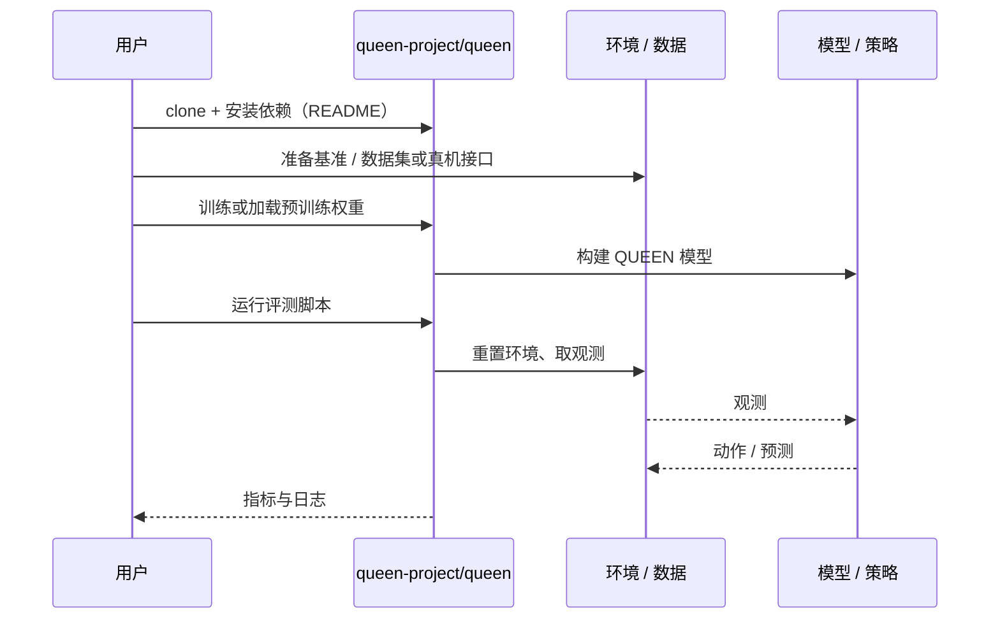

# QUEEN（arXiv:2610.03695）

**QUEEN**（*Language Models that Play Chess and Explain Their Moves*，[arXiv:2610.03695](https://arxiv.org/abs/2610.03695)，[项目页](https://queen-project.github.io/)，[代码](https://github.com/queen-project/queen)）来自 [具身智能小站 2026-10-13 盘点](../../sources/blogs/wechat_embodied_station_34_papers_mulligan_2026-10-13.md)，属「多机器人与评测」组。

## 一句话定义

**把棋类专家编码器接到语言模型并迭代蒸馏落子解释；国际象棋研究，未验证机器人部署。**

## 英文缩写速查

| 缩写 | 英文全称 | 简要说明 |
|------|----------|----------|
| LM | Language Model | 语言模型 |
| KD | Knowledge Distillation | 知识蒸馏 |
| Elo | Elo rating | 棋力评分 |

## 为什么重要

- 专家能力与语言表达结合的跨领域参考。
- 开源结论：**已开源**（步骤 2.5，2026-10-14）。仓库可达。
- 同期同组工作见 [失败导向采集与可组合世界动作模型：具身智能小站 10-13 期 34 篇阅读坐标](../overview/embodied-station-2026-10-13-34-papers-technology-map.md)。

## 核心机制

| 项 | 内容 |
|----|------|
| **arXiv** | [2610.03695](https://arxiv.org/abs/2610.03695) |
| **开源** | **已开源** |
| **要点** | 非机器人实验。 |
| **文内指标** | 以原文为准。 |

## 源码运行时序图

以下为按仓库入口（`queen-project/queen`）推断的通用运行链路；入库日仅核实仓库可达，未逐文件阅读，具体脚本名以 README 为准。

## 实验与评测

- 以原文为准。
- **读法：** 本页为索引级摘要，依据公众号转述的官方摘要与仓库信息整理；逐项数字与 baseline 以原文 PDF 为准。

## 与其他工作对比

- 横向索引见 [失败导向采集与可组合世界动作模型：具身智能小站 10-13 期 34 篇阅读坐标](../overview/embodied-station-2026-10-13-34-papers-technology-map.md)；同 arXiv 不重复造页。

## 结论

**作为「专家 + 解释」范式参考阅读，不作机器人结论引用。**

1. 开源边界：**已开源** — 仓库可达。
2. 核心机制：非机器人实验。
3. 复现与选型前核对任务协议、硬件与基准口径，勿直接横比公众号摘录数字。

## 关联页面

- [deep-rl-game-milestones](../concepts/deep-rl-game-milestones.md)
- [embodied-station-2026-10-13-34-papers-technology-map](../overview/embodied-station-2026-10-13-34-papers-technology-map.md)

## 参考来源

- [queen_chess_language_model_explanations_arxiv_2610_03695.md](../../sources/papers/queen_chess_language_model_explanations_arxiv_2610_03695.md)
- [wechat_embodied_station_34_papers_mulligan_2026-10-13.md](../../sources/blogs/wechat_embodied_station_34_papers_mulligan_2026-10-13.md)
- [arXiv:2610.03695](https://arxiv.org/abs/2610.03695)

## 推荐继续阅读

- [arXiv PDF](https://arxiv.org/pdf/2610.03695)
- [项目页](https://queen-project.github.io/)
- [https://github.com/queen-project/queen](https://github.com/queen-project/queen)
