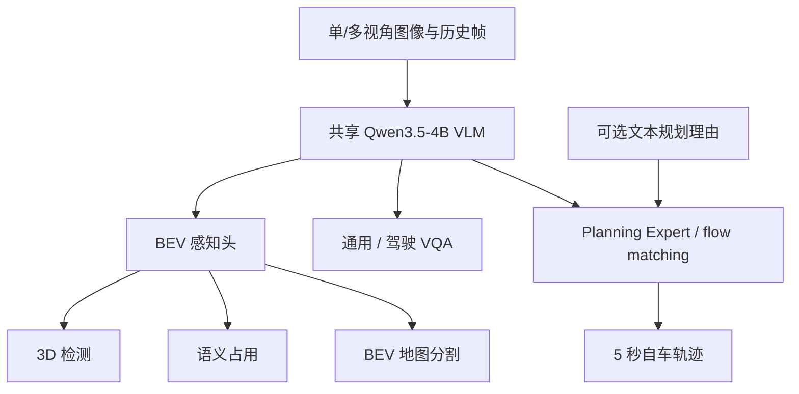
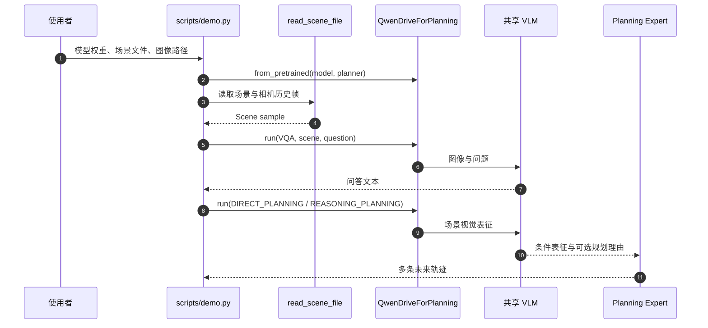

# Qwen-Drive-1.0：共享 VLM 的自动驾驶基础模型

**一句话定义：** Qwen-Drive-1.0 保持 Qwen3.5-4B 预训练视觉语言模型架构不变，以外接 BEV 感知头和规划专家统一 3D 感知、驾驶问答与自车轨迹预测。

## 英文缩写速查

| 缩写 | 英文全称 | 简要说明 |
|------|----------|----------|
| VLM | Vision-Language Model | 共享视觉与语言表征的基座模型 |
| BEV | Bird's-Eye View | 鸟瞰表征；显式承载 3D 场景结构 |
| SFT | Supervised Fine-Tuning | 监督微调；规划专家的模仿学习阶段 |
| PDMS | Predictive Driver Model Score | NAVSIM 的综合驾驶评分 |
| ADE | Average Displacement Error | 预测轨迹与真值的平均位移误差 |

## 为什么重要

Qwen-Drive 将同一共享视觉语言表征接到结构化 3D 感知和轨迹规划两侧：BEV 头提供可检查的场景输出，Planning Expert 直接产出轨迹，原始 VLM 解码器继续承担通用与驾驶问答。这让空间感知如何接入、通用能力如何保留、轨迹如何与语言推理协同，能在一个公开模型中联合观察。

## 核心原理

模型以原生多模态 Qwen3.5-4B 为共享主干，预训练架构保持不变，并增加两个模块：

- **BEV Perception Head：** 读取多视角单帧表征，联合做 3D 目标检测、语义占用预测和 BEV 地图分割，作为共享表征中 3D 信息的显式探针。
- **Planning Expert：** 面向 VLM 表征设计的扩散 Transformer，通过 flow matching 生成未来 5 秒自车轨迹；可使用文本规划理由作为条件。
- **VQA：** 共享 VLM 解码器处理驾驶场景问答与通用视觉语言任务。

### 分阶段训练与统一数据

官方博客称训练结合感知、语言与规划目标，并把不同数据集的感知标注映射到共享标签空间，整理驾驶 VQA 回答格式与事实一致性，统一多数据集的轨迹 waypoint 表示。博客报告规划训练使用 2.83M 公共样本，以 10 Hz 预测 5 秒轨迹。标签、回答和轨迹规范化本身也是数据工程工作，结果不能仅归因于模型结构。

## 源码运行时序图

scripts/demo.py 依次运行 VQA、直接规划、带理由规划；scripts/run_perception.py 是独立感知入口。README 的 demo 使用 data/demo/ 场景与帧数据，并可将规划结果与真值计算 ADE / FDE。

## 实验与评测

以下为官方博客 / README 报告值，各自遵循对应 benchmark 协议，不能跨指标直接排序。

| 任务 / 指标 | SFT | RL | 读法 |
|-------------|-----|----|------|
| NAVSIM v1.1 navtest，PDMS ↑ | 88.2（best-of-6 89.3） | 90.7（best-of-6 91.4） | RL 在该伪闭环指标更高 |
| Waymo Open Dataset E2E，RFS ↑ | 7.78 | 7.91 | 报告的测试集规划评分 |
| NVIDIA PhysicalAI，3 秒 minADE ↓ | **0.34 m** | 0.38 m | 此开环位移误差上 SFT 更低 |
| AlpaSim，at-fault score ↑ | 0.27 | 0.37 | 博客报告的闭环指标 |

官方博客报告 SFT 驾驶 QA 平均分为 69.43，并称通用 VLM 能力大体保留。驾驶问答分数受数据集和评审协议影响；README 对 LingoJudge 另列 LingoScore 79.4。

## 结论

**Qwen-Drive-1.0 以共享 VLM 为中心，把可检查 3D 感知与生成式规划接入同一驾驶模型；公开材料足以复现推理和评测路径，但不足以独立复建完整训练。**

1. **分开看三个接口：** VLM 负责共享表征与问答，BEV 头输出结构化感知，Planning Expert 输出自车轨迹。
2. **按任务解读指标：** NAVSIM / Waymo 的 RL 数字更高，而 NVIDIA PhysicalAI 3 秒 minADE 的 SFT 更低。
3. **先核算运行资源：** 官方建议 24 GB 以上 GPU；模型目录约含 9.1 GB VLM、2.1 GB SFT planner、2.1 GB RL planner 与 0.5 GB perception head。
4. **从 demo 开始验证：** 仓库提供场景样例、VQA / 规划 demo 和评测脚本。
5. **关注语言到轨迹一致性：** 官方把文本理由与生成轨迹的一致性列为待加强问题。

## 工程实践与开放状态

| 资源 | 核查结果 |
|------|----------|
| 项目页 | [Qwen 官方文章](https://qwen.ai/blog?id=qwen-drive-1.0)，另有 [Qwen Research 索引](https://qwen.ai/research) |
| 官方代码 | [QwenLM/Qwen-Drive-1.0](https://github.com/QwenLM/Qwen-Drive-1.0)，Apache-2.0 |
| 权重 | [ModelScope Qwen-Drive-1.0-4B](https://modelscope.cn/models/Qwen/Qwen-Drive-1.0-4B)；README 也列出 Hugging Face 镜像 |
| 源码范围 | **部分开源：** 推理、场景读取、可视化和评测脚本已公开；文件树中未见训练入口 |
| 快速运行 | Python 3.10；pip install -e . --no-build-isolation；建议 24 GB+ GPU |
| 推理模式 | VQA、direct planning、reasoning planning；planner-rl 仅用于 reasoning planning，planner-sft 支持两种规划模式 |

**局限：** 权重与推理脚本不能代替训练复现；闭环指标来自特定仿真协议，不能直接代表真实道路安全。多任务结果应按数据和评测协议分别复核。

## 关联页面

- [端到端自动驾驶：十大前沿算法技术地图](../overview/e2e-autonomous-driving-top10-algorithms.md) — 放入既有方法谱系
- [视觉–语言–动作（VLA）](../methods/vla.md) — VLM 与动作 / 轨迹输出接口
- [S²-VLA](./paper-s-squared-vla.md) — 驾驶 VLA 与 NAVSIM 对照
- [BIRDriver](./paper-birdriver.md) — BEV 输入与高层规划接口对照

## 参考来源

- [Qwen-Drive-1.0 arXiv 论文摘录](../../sources/papers/qwen_drive_1_0_arxiv_2609_00111.md)
- [Qwen 官方项目文章](../../sources/sites/qwen-drive-1-0.md)
- [Qwen-Drive 官方代码仓库](../../sources/repos/qwenlm_qwen_drive_1_0.md)

## 推荐继续阅读

- [论文：Qwen-Drive-1.0（arXiv:2609.00111）](https://arxiv.org/abs/2609.00111)
- [官方博客：Qwen-Drive-1.0](https://qwen.ai/blog?id=qwen-drive-1.0)
- [ModelScope 权重页](https://modelscope.cn/models/Qwen/Qwen-Drive-1.0-4B)
