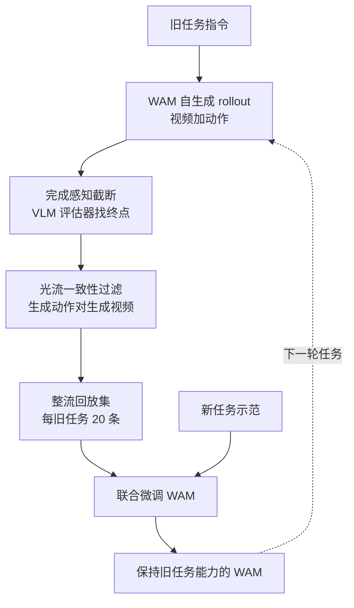

# R²-WAM：让世界动作模型靠整流后的自生成回放不忘旧任务

**R²-WAM 让世界动作模型（WAM）凭任务指令重新生成旧任务的 rollout 作为回放数据，并先做两步整流：用 VLM 评估器在任务完成处截断，再用光流一致性过滤动作与观测不一致的样本，从而在没有任何旧任务数据的条件下近似经验回放。**

论文 *Data-Free Continual Learning for World Action Model with Rectified Generative Replay*（[arXiv:2610.18038](https://arxiv.org/abs/2610.18038)，[项目页](https://kaipengfang.github.io/r2-wam/)）。

## 英文缩写速查

| 缩写 | 英文全称 | 简要说明 |
|------|----------|----------|
| WAM | World Action Model | 建在预训练视频生成模型上，联合生成未来观测与动作 |
| ER | Experience Replay | 用真实旧数据回放的上界基线 |
| NBT | 论文中的遗忘指标 | 数值越低遗忘越少；全称与算式本页未核实 |
| VLM | Vision-Language Model | 完成感知截断中的评估器 |
| SFT | Supervised Fine-Tuning | 顺序微调基线，遗忘最严重 |

## 为什么重要

- WAM 能快速学新任务，但顺序微调会把旧任务忘掉：LIBERO 平均成功率只剩 12.5%。
- 经验回放需要旧数据；而机器人策略常以权重形式发布，旧数据拿不到。
- 论文给出一个具体诊断：遗忘集中在逆动力学，视频预测仍能生成合理的旧任务画面，只是由画面得出的动作失败，所以回放内容必须保证动作与观测一致。

## 核心信息

| 项 | 内容 |
|----|------|
| **机构** | 电子科技大学（UESTC）；上海人工智能实验室（Shanghai AI Lab）；复旦大学；上海交通大学；同济大学；上海创智学院（Shanghai Innovation Institute），依据 arXiv HTML 与项目页 |
| **基座** | LingBot-VA，不额外训练整流模型 |
| **评测** | LIBERO 四个 suite；真机五个做三明治的任务 |
| **回放预算** | 每个旧任务 20 条整流 rollout（项目页） |
| **开源** | **宣称将开源**：项目页写 "Code (coming soon)"，截至 2026-10-17 未列 GitHub |

## 核心原理

### 流程总览

- **为何需要截断：** 原始自生成 rollout 里模型不识别任务完成，会继续产生无目的动作。
- **为何需要过滤：** 开环生成下，动作逐渐偏离生成的观测。过滤方法是把生成动作在纯机器人模拟器里得到的光流，与从生成视频估计的光流比较，保留一致性最高的 rollout。
- **无额外训练：** 整流所用评估器与模拟器均不需为本方法重新训练。
- **逆动力学视角：** 作者发现遗忘集中在由观测生成动作的部分，因此过滤把动作-观测一致性作为核心判据。

## 源码运行时序图

**不适用**：项目页 Code 标 "Coming soon"，截至 2026-10-17 无官方可运行仓库。

## 工程实践

| 项 | 建议 |
|----|------|
| 前提 | 一个具备自生成视频 + 动作能力的 WAM（论文用 LingBot-VA） |
| 评估器选择 | 截断精度随评估器不同：论文测得最好的 VLM 为 93.5%，Qwen3-VL 73.5%（评估器名称按抓取摘要转述，未逐字核实） |
| 回放规模 | 论文每旧任务 20 条整流 rollout；更大预算的影响本页未核实 |
| 光流过滤依赖 | 需要一个纯机器人模拟器把生成动作转成光流，换机型需重新搭 |
| 监控 | 同时看成功率与遗忘指标，且应区分视频质量与动作质量 |

## 实验与评测

- **LIBERO（四个 suite 平均）：** 顺序微调成功率 12.5%、NBT 80.19；**R²-WAM 92.7%、NBT 2.33**；经验回放（真实数据）94.6%；原始生成回放 70.4%。论文称遗忘比顺序微调降 90% 以上。
- **真机（五个做三明治任务）：** 顺序微调 28.5%；R²-WAM 89.5%；经验回放 91.8%。
- **消融（LIBERO-Spatial）：** 完整 94.0%；去过滤 80.8%；去截断 70.8%；未整流回放 76.1%。
- **遗忘诊断：** 遗忘集中在逆动力学，视频预测大体保留。

## 结论

**R²-WAM 说明无数据持续学习的关键是回放样本的质量而非数量：截断掉完成后的无效段、滤掉动作与观测不一致的样本后，自生成回放可逼近真实经验回放。**

1. **截断是最大单项** — 去截断降到 70.8%，比去过滤 80.8% 更低，完成后的无效运动伤害更大。
2. **未整流的自生成回放不可靠** — 76.1%（LIBERO-Spatial）/ 70.4%（平均）远低于整流版。
3. **仍有差距** — 与真实回放差约 1.9 个百分点（LIBERO 平均 92.7 对 94.6），作者称长时程任务差距最大。
4. **评估器是新的依赖** — 截断精度随评估器变化（93.5% 到 73.5%）。
5. **可塑性代价** — 作者指出回放类方法在真机实验中可塑性下降（具体幅度本页未核实）。

## 与其他工作对比

| 对照 | 差异读法 |
|------|----------|
| [世界动作模型](../concepts/world-action-models.md) | 本文是对 WAM 的持续学习补丁，不改变 WAM 结构 |
| [逆动力学模型](../concepts/inverse-dynamics-model.md) | 遗忘集中处；过滤直接度量动作与观测是否一致 |
| [LingBot-VA](../entities/paper-sa-2601-21998-lingbot-va-causal-video-action-world-model-for-g.md) | 被实验的基座 |
| 经验回放 | 上界基线，需要真实旧数据；R²-WAM 不需要 |

## 局限与风险

- **与上界仍有差距：** 长时程任务最明显。
- **评估器与模拟器依赖：** 截断用 VLM，过滤用纯机器人模拟器。
- **可塑性：** 回放类方法在真机实验中可塑性下降。
- **规模：** 真机仅五个相关的做三明治任务；跨领域任务序列未验证（推测）。
- **开源边界：** 无代码（2026-10-17 核查），整流步骤的实现细节只能依据论文文字。

## 关联页面

- [世界动作模型](../concepts/world-action-models.md) — 方法族
- [逆动力学模型](../concepts/inverse-dynamics-model.md) — 遗忘集中处
- [LIBERO 基准](../entities/libero-benchmark.md) — 评测基准
- [LingBot-VA](../entities/paper-sa-2601-21998-lingbot-va-causal-video-action-world-model-for-g.md) — 基座

## 参考来源

- [r2_wam_arxiv_2610_18038.md](../../sources/papers/r2_wam_arxiv_2610_18038.md) — 论文摘录与开源核查
- [r2-wam-project.md](../../sources/sites/r2-wam-project.md) — 项目页归档
- [arXiv:2610.18038](https://arxiv.org/abs/2610.18038) — 原文

## 推荐继续阅读

- [R²-WAM 项目页](https://kaipengfang.github.io/r2-wam/)
- [R²-WAM 论文 PDF](https://arxiv.org/pdf/2610.18038)
