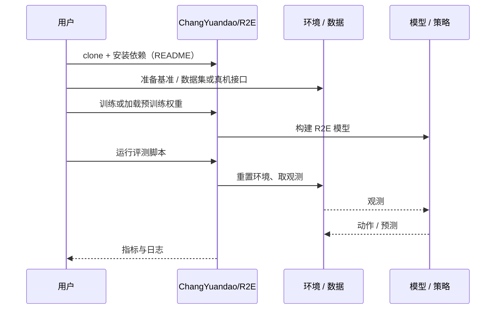

# R2E（arXiv:2610.32439）

**R2E**（*R2E: A Role-driven Reward Evolutionary Framework for Automated Reward Function Design*，[arXiv:2610.32439](https://arxiv.org/abs/2610.32439)，[代码](https://github.com/ChangYuandao/R2E)）来自 [具身智能小站 2026-10-29 盘点](../../sources/blogs/wechat_embodied_station_58_papers_diverse_demonstrations_2026-10-29.md)，属「人形运动与奖励设计」组。

## 一句话定义

**R2E让探索、保守改进和重组三种角色协作，并用精英池保存有效奖励；在仿真运动与双手任务中检验，启发是管理搜索过程而非只增加采样。**

## 英文缩写速查

| 缩写 | 英文全称 | 简要说明 |
|------|----------|----------|
| R2E | R2E: A Role-driven Reward Evolutionary Framework for Automated Reward Function Design | 本文方法 / 基准的简称 |

## 为什么重要

- 奖励函数搜索也需要分工与历史记忆。
- 开源结论：**已开源**（步骤 2.5，2026-10-29）。仓库可达（git ls-remote）。
- 同期同组工作见 [多样成功示范、触觉工具链与预见式感知：具身智能小站 10-29 期 58 篇阅读坐标](../overview/embodied-station-2026-10-29-58-papers-technology-map.md)。

## 核心机制

| 项 | 内容 |
|----|------|
| **arXiv** | [2610.32439](https://arxiv.org/abs/2610.32439) |
| **开源** | **已开源** |
| **要点** | R2E让探索、保守改进和重组三种角色协作，并用精英池保存有效奖励；在仿真运动与双手任务中检验，启发是管理搜索过程而非只增加采样。 |
| **文内指标** | 公众号未给具体数字，本页不引用。 |

## 源码运行时序图

以下为按仓库入口（`ChangYuandao/R2E`）推断的通用运行链路；入库日仅核实仓库可达，未逐文件阅读，具体脚本名以 README 为准。

## 实验与评测

- 公众号未给具体数字，本页不引用。
- **读法：** 本页为索引级摘要，依据公众号转述的官方摘要与仓库信息整理；逐项数字与 baseline 以原文 PDF 为准。

## 与其他工作对比

- 横向索引见 [多样成功示范、触觉工具链与预见式感知：具身智能小站 10-29 期 58 篇阅读坐标](../overview/embodied-station-2026-10-29-58-papers-technology-map.md)；同 arXiv 不重复造页。

## 结论

**奖励函数搜索也需要分工与历史记忆：R2E让探索、保守改进和重组三种角色协作，并用精英池保存有效奖励；在仿真运动与双手任务中检验，启发是管理搜索过程而非只增加采样。**

1. 开源边界：**已开源** — 仓库可达（git ls-remote）。
2. 核心机制：R2E让探索、保守改进和重组三种角色协作，并用精英池保存有效奖励；在仿真运动与双手任务中检验，启发是管理搜索过程而非只增加采样。
3. 复现与选型前核对任务协议、硬件与基准口径，勿直接横比公众号摘录数字。

## 关联页面

- [locomotion](../tasks/locomotion.md)
- [reinforcement-learning](../methods/reinforcement-learning.md)
- [sim2real](../concepts/sim2real.md)
- [embodied-station-2026-10-29-58-papers-technology-map](../overview/embodied-station-2026-10-29-58-papers-technology-map.md)

## 参考来源

- [r2e_arxiv_2610_32439.md](../../sources/papers/r2e_arxiv_2610_32439.md)
- [wechat_embodied_station_58_papers_diverse_demonstrations_2026-10-29.md](../../sources/blogs/wechat_embodied_station_58_papers_diverse_demonstrations_2026-10-29.md)
- [arXiv:2610.32439](https://arxiv.org/abs/2610.32439)

## 推荐继续阅读

- [arXiv PDF](https://arxiv.org/pdf/2610.32439)
- [https://github.com/ChangYuandao/R2E](https://github.com/ChangYuandao/R2E)
