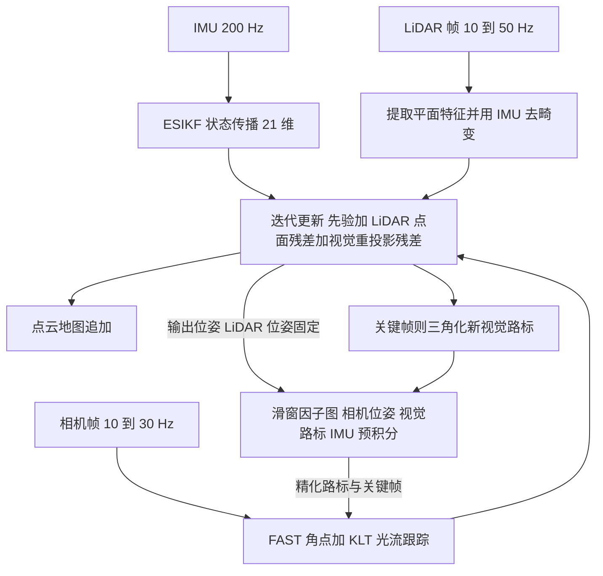

# R2LIVE：鲁棒实时的激光-惯性-视觉紧耦合状态估计与建图

## 一句话定义

**R2LIVE**（*R2LIVE: A Robust, Real-time, LiDAR-Inertial-Visual tightly-coupled state Estimator and mapping*，Jiarong Lin、Chunran Zheng、Wei Xu、Fu Zhang，香港大学机械工程系 HKU MARS，[arXiv:2102.12400](https://arxiv.org/abs/2102.12400)，IEEE RA-L 2021）：由**高频滤波里程计**（误差状态迭代卡尔曼滤波 ESIKF，同时消化 LiDAR 点面残差与相机重投影误差）和**低频因子图优化**（滑窗内优化相机关键帧位姿与视觉路标）组成的 LiDAR-惯性-视觉紧耦合系统（§III、§IV、§V）。

## 英文缩写速查

| 缩写 | 英文全称 | 简要说明 |
|------|----------|----------|
| LIVO / LIVE | LiDAR-Inertial-Visual Odometry / Estimator | 激光-惯性-视觉里程计 / 估计器；R2 推测取自标题 Robust 与 Real-time |
| ESIKF | Error-State Iterated Kalman Filter | 误差状态迭代卡尔曼滤波，R2LIVE 的核心估计器，迭代等价于高斯牛顿（修订稿 §IV-I） |
| LIO / VIO | LiDAR-Inertial / Visual-Inertial Odometry | 论文把两个子系统分别称 LI-Odom、VI-Odom |
| IMU | Inertial Measurement Unit | 200 Hz，用于状态传播与点云去畸变（Fig. 3） |
| FoV | Field of View | LiDAR 为 70.4°×77.2°，相机为 82.9°×66.5°（§VI-A） |
| KLT | Kanade-Lucas-Tomasi | 论文用 KLT 光流跟踪 FAST 角点（§IV-H） |
| FG-OPM | Factor Graph Optimization | Table II 中因子图优化耗时项的缩写 |
| D-GPS RTK | Differential GPS Real-Time Kinematic | Exp-4 的真值来源 |
| RRE / RTE | Relative Rotation / Translation Error | 修订稿 Table I 的相对位姿误差指标，单位 deg / % |
| MAP | Maximum A Posteriori | 滤波更新被写成先验加两类后验的最大后验问题（§IV-I） |

## 为什么重要

- **问题（作者自述，§I）：** 纯 LiDAR SLAM 在几何特征少的场景精度下降甚至失败，对小视场 LiDAR（如 Livox）更严重；加入视觉特征可提高鲁棒性与精度。
- **定位（作者自述，§II-C）：** “据我们所知，是第一个开源的紧耦合 LiDAR-惯性-视觉融合系统”（v1 原话 first open sourced tightly-coupled）；修订稿改为说既有 LIVO 系统均无开源实现。这一“首个”由作者自述，未经本页独立核实。
- **传承：** 它是 HKU MARS 从 FAST-LIO 到后续 R3LIVE、FAST-LIVO 系列的中间一环；README 明确写 LIO 子系统基于 [FAST-LIO](../entities/fast-lio.md)、VIO 子系统基于 VINS-Mono（对应本库 [VINS-Mono](../entities/paper-vins-mono.md) 页）。
- **读法提示：** 这是一篇“把两个已有系统用同一个滤波拼起来”的工程论文，创新点在融合框架与实证，不在新的残差形式。

## 核心原理

### 流程总览（论文 Fig. 2）

说明：图为论文系统框图的读后重绘。“精化路标与关键帧”这条反馈箭头依据 §V 开头“用因子图改善三角化低精度的视觉路标”及 Fig. 2 的箭头方向，具体回写时机以源码为准（本页未读源码）。

### 滤波里程计（§IV）

1. **状态：** 21 维误差状态，含 IMU 姿态 / 位置、IMU-相机外参、速度、陀螺 / 加速度计零偏；时间偏移预标定，LiDAR-IMU 外参已知，相机-IMU 外参**在线估计**（§IV-B）。
2. **传播：** IMU 200 Hz 前向传播状态与协方差，在收到下一个 LiDAR / 相机量测前反复进行（§IV-D、Fig. 3、4）。
3. **LiDAR 项：** 沿用 FAST-LIO 的平面特征与点到平面残差，IMU 反向传播去畸变（§IV-G）。
4. **视觉项：** FAST 角点 + KLT，与已三角化的视觉路标算重投影误差（§IV-H）。
5. **更新：** 先验 + LiDAR 后验 + 视觉后验联合 MAP，用 FAST-LIO 的卡尔曼增益写法，使计算量依赖状态维数而非量测数；迭代到收敛（§IV-I）。LiDAR 与相机不同时到达时，某类量测数可为零。

### 因子图优化（§V）

- 与 VINS-Mono 类似的滑窗，加 IMU 预积分，并**加入来自 ESIKF 的 LiDAR 位姿约束**（Fig. 5）。
- **LiDAR 位姿在图中固定，LiDAR 原始点不参与**，以保持后端轻量；作用对象是相机关键帧位姿与视觉路标，同时标定相机与 LiDAR-IMU 子系统间的时间偏移。
- 因子图在**独立线程**运行，速率低于滤波（§VI-F）。

## 实验与评测

设备（§VI-A）：手持 2.09 kg，DJI Manifold-2c（i7-8550U、8 GB），Livox AVIA，全局快门相机；真值只在 Exp-4 用 D-GPS RTK。数值取自 RA-L 修订稿，arXiv v1 与其有出入处见[来源归档](../../sources/papers/r2live_arxiv_2102_12400.md)。

| 实验 | 场景与条件 | 论文结论（作者自述） |
|------|-----------|--------------------|
| Exp-1（§VI-B） | 最大角速度约 300°/s，并故意遮挡相机 / LiDAR | 轨迹平滑、无明显退化（Fig. 7、8，定性，无真值对比） |
| Exp-2（§VI-C） | 港铁香港大学站，隧道最长 190 m，行人多，地面纹理重复 | 点云与街道图吻合；Vins-Mono 中途停止；R2LIVE 的 LIO / VIO 子系统单独运行明显漂移（Fig. 9） |
| Exp-3（§VI-D） | HKU 主楼室内外 | 无回环检测下 5 条轨迹约 900 m 后均闭合（Fig. 11；v1 为 876 m 一条） |
| Exp-4（§VI-E） | 两条快速旋转序列（130°/s、200°/s），D-GPS RTK 真值 | 见下表 |

**Exp-4 300 m 子序列相对误差（修订稿 Table I，RRE deg / RTE %）**

| 方法 | 序列 (a) | 序列 (b) |
|------|---------|---------|
| VINS-Mono | 0.44 / 3.76 | 0.47 / 2.77 |
| Fast-Lio | 0.60 / 0.33 | 0.09 / 0.37 |
| Camvox | 0.71 / 3.26 | 0.50 / 2.10 |
| R2LIVE-LIO | 0.56 / 2.19 | 0.16 / 0.14 |
| R2LIVE-VIO | 0.56 / 2.02 | 0.36 / 2.94 |
| R2LIVE | 0.40 / 0.24 | 0.09 / 0.12 |

**运行时间（修订稿 Table II，台式机 / 车载 ms）：** LI-Odom 8.81–14.91 / 15.98–30.64；VI-Odom 7.84–9.57 / 13.92–20.16；因子图 26.10–30.20 / 45.35–65.25（独立线程）。

## 与其他工作对比

| 对照 | 差异读法 |
|------|----------|
| [FAST-LIO](../entities/fast-lio.md) | R2LIVE 的 LIO 部分直接沿用，加相机与相机外参；逐格核对 Table I，两条序列各子序列长度上 R2LIVE 的 RTE 都低于 Fast-Lio；但子系统 R2LIVE-LIO 与 Fast-Lio 的差异见局限 |
| [VINS-Mono](../entities/paper-vins-mono.md) | VIO 与因子图部分基于它；R2LIVE 把 LiDAR 位姿作为图中固定约束 |
| [LVI-SAM](../entities/paper-lvi-sam.md) | LVI-SAM 用因子图作为主融合框架并以 LIS / VIS 双向辅助；R2LIVE 的主融合是滤波，因子图只做视觉侧精化（本页对两者定位的比较是读后判断，不是 R2LIVE 论文内容；R2LIVE 论文未与 LVI-SAM 对比） |
| [LIO-SAM](../entities/lio-sam.md) | 论文 §II-B 把它列为滑窗关键帧因子图的 LIO 工作，实验中未对比 |
| [FAST-LIVO2](../entities/paper-rcl-2408-14035-fast-livo2-fast-direct-lidar-inertial-visual-odo.md) | 同一团队后续的直接法 LIVO；对照时注意 R2LIVE 用的是稀疏角点重投影 |

## 工程实践

- **环境（README，未验证）：** Ubuntu 16.04 / 18.04，ROS Kinetic / Melodic，Ceres，livox_ros_driver；提供 Docker；`roslaunch r2live demo.launch` 后播放作者录制的 rosbag（indoor_aggressive.bag 对应 Exp-1，hku_main_building.bag 对应 Exp-3）。
- **自采数据：** README 要求用其改过时间戳的 livox 驱动，使 LiDAR/IMU 与图像时间对齐，对应论文“时间偏移预标定”的假设。
- **标定前提：** LiDAR-IMU 外参需已知，时间偏移需预标定；只有相机-IMU 外参在线估计（§IV-B）。
- **传感器：** 论文只在 Livox AVIA 小视场 LiDAR 加全局快门相机的手持设备上验证。
- **许可：** GPLv2，商用需联系作者（README）。
- **本页未读仓库源码，也未运行代码**，以上均为文档层面信息。

## 局限

**论文自己承认或隐含的：**

- 假设三传感器时间偏移预标定、LiDAR-IMU 外参已知（§IV-B）；因子图虽然标定相机与 LiDAR-IMU 的时间偏移，但滤波本身并未估计。
- 因子图固定 LiDAR 位姿且不用原始点，是为轻量而作的取舍（§V）；它不是对全局轨迹的联合优化，也没有回环检测（Exp-3 靠低漂移自闭环，作者自述）。
- 视觉部分是稀疏角点 + 重投影，论文未给 LiDAR 点云上色或光度模型。

**我读到的未验证 / 对不上之处（读后判断）：**

- Exp-1、Exp-2、Exp-3 为定性证据，没有 D-GPS 真值；定量对比只有 Exp-4 的两条序列，评测序列少，且作者未给多次运行方差。
- Table I 里 R2LIVE-LIO（LiDAR-惯性子系统）在序列 (a) 的 50 m RTE 为 16.22%，300 m 为 2.19%，明显差于 Fast-Lio（2.82% / 0.33%），论文没有解释为何基于 FAST-LIO 的子系统会比 FAST-LIO 本体差；序列 (b) 里 R2LIVE-LIO 的 300 m RTE（0.14%）反而低于 Fast-Lio（0.37%）。两个子系统与 FAST-LIO / VINS-Mono 的实现差异未说明，因此消融结论需谨慎。
- “R2LIVE-LC” 行在正文里没有定义（推测为 LiDAR-相机组合，属推测）。
- v1 与修订稿在 Exp-3、Exp-4 的数据与表述有改动（见来源归档“版本差异”），引用数字时要标明版本。
- 与 LIO-SAM、LVI-SAM 等因子图类 LIVO/LIO 系统没有直接对比（作者称这类 LIVO 系统当时无开源实现，§VI）。

## 与综述文章说法的核对

被引自《激光雷达 SLAM 算法最新综述》（刘铭哲等，公众号「新机器视觉」转载，2026-11-11）的原句：“香港大学Lin等提出的R2LIVE，使用误差状态迭代卡尔曼滤波融合三个传感器的测量值进行状态估计，并通过因子图进一步优化提高整体精度，但其视觉系统采用特征点法，时间开销大且在非结构化环境下易失效。”

| 综述说法 | 核对结果 |
|----------|---------|
| 香港大学 Lin 等 | 属实：HKU 机械工程系，Jiarong Lin 等，HKU MARS（作者署名页） |
| 误差状态迭代卡尔曼滤波融合三个传感器 | 属实（§IV） |
| 因子图进一步优化提高整体精度 | 基本属实但需限定：论文摘要写“further improve the overall precision”；实际只优化相机关键帧位姿与视觉路标，LiDAR 位姿固定（§V），不是全局图优化 |
| 视觉用特征点法 | 属实：FAST 角点 + KLT 光流（§IV-H）。注意这里已经用了光流做跟踪 |
| 时间开销大 | 论文中**找不到支撑**：视觉里程计 7.84–9.57 ms（台式机）、13.92–20.16 ms（车载），不高于 LiDAR 部分（Table II）；耗时最高的是因子图，但它在独立线程，论文称允许低频。R3LIVE v1 引言对 R2LIVE 的描述也没有这一条 |
| 非结构化环境下易失效 | 论文**未显示 R2LIVE 整体失效**：Exp-2 在重复纹理加行人的隧道中它可用，失效的是 Vins-Mono 与 R2LIVE 的单独子系统；“易失效”应是综述的转述或推断 |
| 隐含：R3LIVE 的“光流法代替特征点法” | 与 R2LIVE 对比不准确：R2LIVE 已用 KLT 光流跟踪，R3LIVE 的主要变化是 frame-to-map 光度误差与 RGB 地图渲染（据 R3LIVE v1 引言与图 2 浏览，非本页主体） |

## 结论

**R2LIVE 用一个 ESIKF 同时消化 LiDAR 点面残差与相机重投影误差，再以固定 LiDAR 位姿的滑窗因子图精化视觉侧，在 Livox 小视场与剧烈运动下比单独的 LIO / VIO 更稳。**

1. Exp-4 的 300 m 子序列上 RTE 0.24% / 0.12%，低于 Fast-Lio 的 0.33% / 0.37% 与 VINS-Mono 的 3.76% / 2.77%（修订稿 Table I）。
2. 在 190 m 地铁隧道与约 900 m 室内外闭环路线中保持可用，而 VINS-Mono 与单独子系统失效或漂移（Exp-2、Exp-3，定性）。
3. 机载 i7 上各模块数十毫秒内完成，因子图在独立线程低频运行（Table II）。
4. 局限：定量证据只有两条序列且无方差，需预标定时间偏移与 LiDAR-IMU 外参，无回环，子系统 R2LIVE-LIO 差于 FAST-LIO 的原因未解释。

## 关联页面

- [FAST-LIO](../entities/fast-lio.md)：R2LIVE 的 LIO 基础
- [VINS-Mono 论文页](../entities/paper-vins-mono.md)：VIO 与因子图基础
- [LVI-SAM](../entities/paper-lvi-sam.md)、[LIO-SAM](../entities/lio-sam.md)：因子图路线的 LIO / LIVO 对照
- [FAST-LIVO2](../entities/paper-rcl-2408-14035-fast-livo2-fast-direct-lidar-inertial-visual-odo.md)：同团队后续 LIVO
- [LeGO-LOAM](../entities/lego-loam.md)：论文 §II-A 提及的轻量 LOAM 变体
- [VINS-Fusion](../entities/vins-fusion.md)
- [状态估计](../concepts/state-estimation.md)、[传感器融合](../concepts/sensor-fusion.md)、[LiDAR 感知](../concepts/lidar-sensing.md)
- [LiDAR SLAM 的 LIO / VIO 选型对比](../comparisons/lidar-slam-lio-vio-selection.md)

## 参考来源

- [r2live_arxiv_2102_12400.md](../../sources/papers/r2live_arxiv_2102_12400.md)：论文通读归档（arXiv v1 与 RA-L 修订稿）
- [arXiv:2102.12400](https://arxiv.org/abs/2102.12400)
- [hku-mars/r2live（README）](https://github.com/hku-mars/r2live)

## 推荐继续阅读

- [arXiv PDF v1](https://arxiv.org/pdf/2102.12400v1)
- [RA-L 修订稿（仓库内）](https://github.com/hku-mars/r2live/blob/master/paper/r2live_ral_final.pdf)
- R3LIVE（arXiv:2109.07982）：同团队后续，把视觉改为 frame-to-map 光度误差并渲染 RGB 地图
- [FAST-LIO](../entities/fast-lio.md)、[LVI-SAM](../entities/paper-lvi-sam.md)
