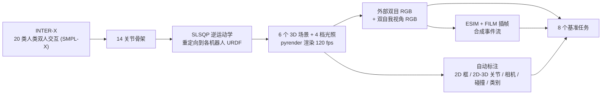
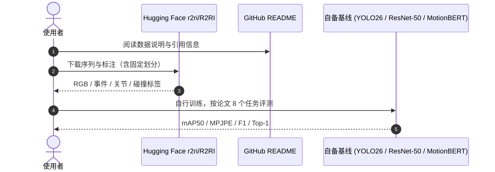

# R2RI：机器人间交互的多视角事件与 RGB 数据集

**R2RI**（[arXiv:2610.07117](https://arxiv.org/abs/2610.07117)，Magrini 等，意大利多所大学）是论文称之为 **首个面向机器人间交互（RRI）的数据集**：把 INTER-X 的 20 类人类双人交互重定向到 Atlas v5、Unitree G1、iCub、NAO 四种人形，在仿真里渲染 **外部（exocentric）双目 RGB + 每个机器人头部的自我视角（egocentric）RGB**，并从 120 fps RGB 合成事件流，共约 5,000 个序列、650 万帧，附 8 个基准任务。

## 英文缩写速查

| 缩写 | 英文全称 | 简要说明 |
|------|----------|----------|
| RRI | Robot-Robot Interaction | 机器人之间的社交/物理交互，本文研究对象 |
| ESIM | Event Camera Simulator | 从高帧率视频合成事件流的仿真器，配合 FILM 插帧 |
| INTER-X | Human interaction dataset | 提供 20 类双人交互的人体动作来源 |
| MPJPE | Mean Per-Joint Position Error | 3D 姿态误差（mm），P-MPJPE 为对齐后版本 |
| mAP50 | mean Average Precision @ IoU 0.5 | 检测基准指标 |
| AUROC | Area Under ROC Curve | 碰撞检测的排序指标 |

## 为什么重要

- **事件相机的多视角机器人数据稀缺**：现有数据多为单机器人或人类对象；R2RI 同时给出外部与自我视角，支持研究「一台机器人看另一台」。
- **事件 vs RGB 的取舍首次可系统比较**：弱光、未见机体、跨视角泛化下两种模态的强弱截然不同（见实验）。
- **多机协同感知的前置数据**：可作为 [人形多机协同](../concepts/humanoid-multi-robot-coordination.md) 的视觉感知基准，但注意数据全合成。

## 流程总览

## 方法

- **机器人与场景**：Atlas v5、Unitree G1、iCub、NAO 成对出现；4 室内 + 2 室外背景；光照为标准的 100%、50%、25%、5%。
- **相机**：外部固定的 RGB 双目对（位置绕两机器人中点动态设置），加每个机器人头部各一个自我视角相机；逐帧导出外参。未使用真实事件相机，因此没有相机型号或分辨率可报告。
- **标注**：自动给出 2D 边界框、含被遮挡关节的 2D/3D 关节、相机参数、物理碰撞管理器给出的碰撞接触和交互类别。
- **规模**：约 5,000 序列、650 万帧，片段 1.8–23.5 s（均值 5.8 s）；固定 train/val/test 划分已发布（划分规模原文未给）。
- **8 个任务**：机器人检测、2D 姿态、3D 姿态、2D/3D 姿态预测、碰撞检测、动作识别、sim-to-real 迁移。

## 源码运行时序图

不适用：官方 GitHub 仓库（2026-10-12 核查）只有 README 与 assets，没有可运行的训练/评测脚本；基线代码论文称录用后发布。下图只描述 **数据获取与使用路径**，对应 [Hugging Face 数据集](https://huggingface.co/datasets/r2ri/R2RI)：

## 工程实践

- **开源状态（2026-10-12 核查）**：数据集已在 Hugging Face 公开（可访问）；GitHub 仅 README + assets；基线代码待发布；论文与 README 均未写明数据集许可（论文页面为 CC BY 4.0，不等同数据集许可）。详见 [归档](../../sources/sites/r2ri-dataset.md)。
- **使用注意**：事件流是从 RGB 合成的，若要验证真实事件相机效果仍需真实数据；README 未描述文件结构，使用前先检查实际目录与标注格式。
- 论文训练使用单张 RTX 4090（24 GB），基线规模较轻。

## 实验与评测

事件 vs RGB（外部视角测试）：

| 任务 / 设置 | 事件 | RGB |
|------|------|------|
| 检测 YOLO26l mAP50 / mAP50:95 | 98.8 / 89.1 | 98.1 / 94.2 |
| 2D 姿态 YOLO26l-pose | 95.7 / 81.3 | 97.3 / 91.9 |
| 最低亮度检测 | 88.1 / 66.0 | 0.7 / 0.3 |
| 最低亮度姿态 | 86.7 / 66.5 | 1.9 / 0.5 |
| 留出 NAO 检测 mAP50 | 91.6 | 93.8 |
| 留出 Atlas 检测 mAP50 | 91.5 | 50.6 |
| 外→内视角跨域检测 mAP50 | 1.9 | 83.5 |
| 内→外视角跨域检测 mAP50 | 65.2 | 62.7 |
| 碰撞检测 ResNet-50 F1 / AUROC | 0.774 / 0.808 | 0.771 / 0.654 |
| 动作识别 ResNet-50 Top-1 / Macro-F1 | 25.0 / 20.7 | 5.0 / 7.0 |

其他基线：基于真值 3D 姿态的 Random Forest 碰撞检测 F1 0.949；3D 姿态（RGB 训练，MPJPE / P-MPJPE mm）MotionBERT 25.6 / 20.5、MotionAGFormer 29.4 / 23.2、PoseFormerV2 55.9 / 35.8，3D 预测中恒速基线很有竞争力；sim-to-real（DHRP，平均 AP50）DINO 55.4、RT-DETR 44.8、Faster R-CNN 29.6、YOLO26l 20.1。

## 结论

**R2RI 的价值是给出受控、可复现的事件/RGB 对照平台；结论强烈依赖合成数据，不能当作真实事件相机的性能证据。**

1. **弱光是事件的主场** — 最低亮度下检测 88.1 vs 0.7，姿态 86.7 vs 1.9。
2. **正常光下 RGB 定位更准** — 检测 mAP50:95 94.2 vs 89.1，姿态 91.9 vs 81.3。
3. **跨机体泛化因模态而异** — 留出 Atlas 时事件 91.5 vs RGB 50.6；留出 NAO 则 RGB 略优。
4. **跨视角迁移是硬骨头** — 外→内视角事件仅 1.9，RGB 83.5；视角不对称需单独设计。
5. **动作识别两种模态都低** — 事件 Top-1 25.0，RGB 5.0，20 类远未解决。
6. **别忽略合成差距** — sim-to-real 最佳仅 DINO 55.4 AP50。

## 与其他工作对比

| 对照 | 差异读法 |
|------|----------|
| [受微跳视启发的事件相机](./paper-microsaccade-inspired-event-camera.md) | 偏传感器/算法设计；R2RI 是数据与基准 |
| [DA4Event（事件相机 sim-to-real）](./paper-as-2103-12768-da4event-towards-bridging-the-sim-to-real-gap-fo.md) | 同样关心事件数据的 sim-to-real 差距；R2RI 增加多视角与机器人对象 |
| [人形多机协同](../concepts/humanoid-multi-robot-coordination.md) | 协同侧重控制与通信；R2RI 提供一个机器人感知另一个机器人的视觉数据 |

## 局限与风险

- **适用边界**：全合成、事件由 RGB 模拟；仅 4 种人形、以成对交互为主；不含意图或任务成功等高层语义；交互依赖人到机器人重定向。
- **使用风险**：划分规模、标注文件结构、许可均未明确。
- **开源状态**：数据已发布；基线代码截至 2026-10-12 未发布。

## 关联页面

- [人形/四足周报汇总（2026-10-05 至 10-09）](../overview/frontier-humanoid-quadruped-2026-10-05-10-09.md)
- [人形多机协同](../concepts/humanoid-multi-robot-coordination.md)
- [Sim2Real](../concepts/sim2real.md)
- [受微跳视启发的事件相机](./paper-microsaccade-inspired-event-camera.md)
- [具身大模型评测基准选型闭环](../queries/embodied-eval-benchmark-selection-loop.md) — 本页是感知数据集而非策略基准：为机器人间交互检测/姿态估计提供合成评测数据，只贴近①层感知侧，不测动作执行

## 参考来源

- [r2ri_arxiv_2610_07117.md](../../sources/papers/r2ri_arxiv_2610_07117.md) — 论文来源归档
- [r2ri-dataset.md](../../sources/sites/r2ri-dataset.md) — 数据集与仓库核查
- [frontier_humanoid_quadruped_2026_10_05_10_09.md](../../sources/blogs/frontier_humanoid_quadruped_2026_10_05_10_09.md) — 周报线索
- 论文：<https://arxiv.org/abs/2610.07117>

## 推荐继续阅读

- [Hugging Face 数据集](https://huggingface.co/datasets/r2ri/R2RI)
- [GitHub 仓库](https://github.com/MagriniGabriele/R2RI)
- [ESIM：事件相机仿真器（Rebecq 等，CoRL 2018）](https://rpg.ifi.uzh.ch/esim.html)
