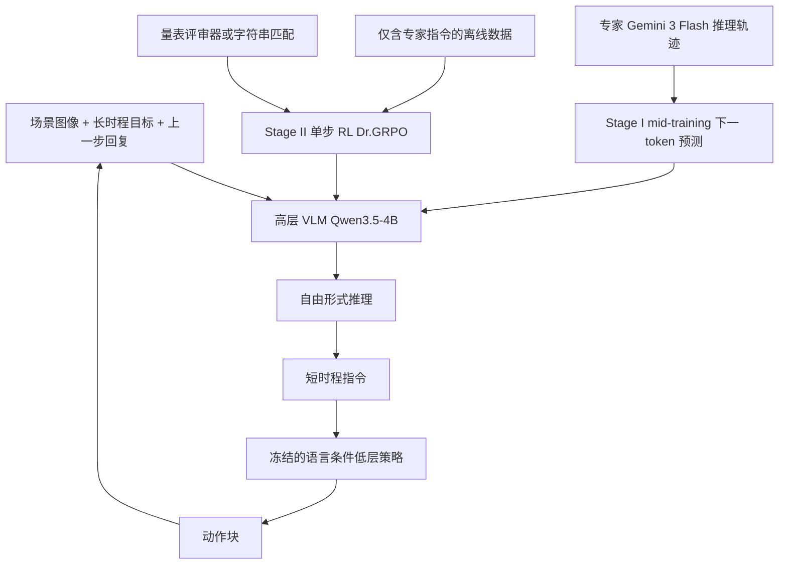

# R³

**R³: Training Robots to Reason in Natural Language via Reinforcement Learning**（[arXiv:2608.26053](https://arxiv.org/abs/2608.26053)，[项目页](https://robotic-reasoner.github.io/)）——卡内基梅隆大学（CMU），Lehong Wu、Aviral Kumar 等。

## 一句话定义

**R³ 把高层 VLM 训练成「先用自由形式自然语言推理、再输出短时程指令」的推理器去驱动一个冻结的低层策略：先在专家推理轨迹上 mid-train，再用只含专家指令的离线数据做单步量表 RL；作者主张语言推理因此可作为可加预算的测试时计算。**（作者自述见第 1 节与摘要）

## 英文缩写速查

| 缩写 | 英文全称 | 简要说明 |
|------|----------|----------|
| R³ | Robotic Reasoners via Reinforcement Learning | 本文后训练配方（第 3 节标题） |
| VLM | Vision-Language Model | 高层推理器，基座 Qwen3.5-4B |
| IL | Imitation Learning | 本文指「仅指令、不含推理」的 SFT 基线 |
| mid-training | 中期训练 | 在专家推理轨迹上做下一 token 预测，不直接优化奖励 |
| Dr.GRPO | GRPO 的一个变体 | Stage II 单步 RL 的算法，优势为组内均值中心化 |
| ECoT | Embodied Chain-of-Thought | 把坐标等结构化信息放入推理的基线思路 |
| OOD | Out-of-Distribution | 留出的 5 个 Language Table 任务 |
| YCB | Yale-CMU-Berkeley 物体集 | 杂货打包用的物体 |

## 为什么重要

- 针对一个常被争论的问题：推理链在机器人里是只当训练期辅助监督，还是推理时也真有用。作者用同一检查点截断推理的干预给出了支持后者的证据（第 4.2 节 Table 3）。
- 训练信号便宜：RL 阶段只要「历史 + 专家指令」，不需要多轮机器人 rollout，也不需要专家推理文本（第 3.3 节）。
- 纳入 [具身智能小站 2026-08-28 九篇盘点](../../sources/blogs/wechat_embodied_station_wam_vla_cross_embodiment_9_papers_2026-08-28.md)，也在 CoRL 2026 阅读清单中。
- 开源状态（入库日）：**待发布**。

## 核心原理与流程总览

**架构（第 3.1 节，Figure 2）：** 高层 VLM 看到 RGB、长时程目标 g 与上一步完整回复（作为历史），输出推理 z_t 和短时程指令 u_t；固定的语言条件低层策略按 u_t 执行一个固定长度动作块。Language Table 中低层是预训练语言条件策略（10 Hz，每 20 步下一次指令）；杂货打包中低层是由 π0.5 微调的 VLA（60 Hz，每 300 步下一次指令）（附录 A.3 Table 7）。

**Stage I（第 3.2 节）：** 对 (上下文, 推理, 指令) 做标准下一 token 预测，成功与失败轨迹都用；Language Table 每个 mid 任务 256 条（4 条 × 64 场景）。

**Stage II（第 3.3 节）：** 模型对每个上下文采样 K 组（推理，指令），奖励按指令与专家指令的语义一致度给出，用 Dr.GRPO 更新。奖励 R = R_acc + R_len：Language Table 由 Qwen3.5-35B-A3B 评审器按量表打 1.0 / 0.5 / 0.25 / 0，杂货打包用字符串精确匹配，另有对短于 80 词回复的惩罚（附录 A.4）。

**评测设置：** Language Table 14 个任务分为 6 个 mid 任务、3 个 RL 任务、5 个 OOD 留出任务；每任务 64 场景 × 16 次试验（第 4 节）。杂货打包 12 个留出任务，每任务 50 回合（第 5 节）。

## 工程实践

| 项 | 内容（出处） |
|----|------|
| **层级** | 高层 VLM 推理 + 冻结低层策略；Language Table 用预训练语言条件策略，打包任务微调 π0.5（第 3.1、5 节） |
| **专家数据** | Language Table 的推理轨迹由 Gemini 3 Flash 在加上一步回复历史的设定下生成；打包任务用人类遥操作并事后分段标指令，无推理标注（第 3.1 节） |
| **Stage I** | 2 epoch SFT，取最后检查点；杂货打包因基座已能推理且无推理标注而跳过（第 5 节、附录 A.6） |
| **Stage II** | verl 做 RL：学习率 2e-6、batch 32、每 prompt 12 次 rollout、温度 1.0、KL 与熵系数 0（Table 9）；SFT 用 LLaMA-Factory（Table 8） |
| **补全历史** | 因 RL 数据缺推理，用 mid 模型每步采样 48 个回复，若有回复得出与专家一致的指令则作为上一步上下文（第 3.3 节） |
| **过滤重复步** | 专家轨迹含大量重复指令，不过滤时模型会靠重复上一指令拿奖励（第 3.3 节） |
| **检查点选择** | RL 取验证集平均奖励最高者；IL 基线取验证损失最低者以求强基线（附录 A.6） |
| **评审器验证** | 100 对样本，Qwen3.5-35B-A3B 与人类多数票一致 90/100，κ=0.837（附录 B.3 Table 13） |

## 评测结果摘要

- **Language Table（Table 2，95% 置信区间）：** R³ 相对 IL 在 5 个 OOD 任务上 Δ 均为正且大于置信区间：diag_line +14.2、rect +3.9、mid +8.7、iL +9.9、clear_half +4.8；训练域 V +28.3、iV +18.6；但 gris −10.3、line −1.5。
- **推理起作用的证据（第 4.2 节，Table 3）：** 同一检查点把推理截到 50 token：V 69.2→26.6，gris 47.8→25.0；完全去掉推理：V 20.3，gris 22.1。IL 加推理数据预训练或共训只部分缩小差距。
- **ECoT 对比（Table 4）：** 加入末端与物体坐标等结构化成分略降平均表现；事后标注推理与采集时推理相当。
- **杂货打包（Table 5）：** 平均成功率 R³（仅 RL）47.9±3.3，IL 38.0±3.0，基座有推理 23.3±3.2，基座无推理 19.7±1.9；平均进度 73.1 / 65.4 / 56.6 / 55.0。
- **行为变化（第 4.3 节、附录 B.2）：** mid-training 修复格式与幻觉物体（30 个验证场景中格式合规 19/30→30/30，幻觉 3→0），RL 后推理更长、更多第一人称规划（计数 15→23）。

## 与清单说法的对比核对

清单（Glen Berseth 的 CoRL 2026 阅读清单第 27 条，作者说明是 LLM 据摘要起草）的一句话：「Trains VLMs to reason in natural language to guide low-level manipulation policies: reasoning-trace mid-training, then RL post-training.」逐项核对：

| 清单措辞 | 论文核对 |
|----------|----------|
| 训练 VLM 用自然语言推理来引导低层操作策略 | 属实。低层策略是**冻结**的，高层输出指令而非动作（第 3.1 节）；基座只有 4B 的 Qwen3.5-4B |
| 推理轨迹 mid-training | 属实，但仅用于 Language Table；**杂货打包没有 mid-training**，只做 RL（第 5 节） |
| 然后 RL 后训练 | 属实但需限定：是**单步、离线、量表或字符串奖励**的 RL，不是在机器人上的多轮 rollout RL，奖励衡量与专家指令的语义一致而不是任务成功（第 3.3 节、第 6 节） |
| （清单未提）环境 | 两个实验域**都是仿真**（Language Table 与 MuJoCo 双臂打包），无真机（第 6 节自述局限） |
| （清单未提）对比对象 | 主要对比的是「仅指令、不含推理」的 IL，而非别的推理式 VLA；ECoT 是在作者自己的设定下复现的变体（附录 A.7） |

结论：清单摘要作为一句话概括没有硬错，但漏了「冻结低层」「单步离线 RL」「仅仿真」三个限定词；读者若据此以为是真机上 RL 微调 VLA 会高估。排序是作者个人的兴趣打分，不是质量评价。

## 结论

R³ 支持高层推理模型在固定低层策略上进行量表 RL，但代理语义奖励与实际执行成功仍需区分。

- 同时验收指令可执行性、评审器一致性和最终任务成功率。
- 按任务比较有无推理与 IL，保留杂货打包等任务上的退化。
- 上真机前验证高低层接口与闭环恢复，两个仿真域不能证明实际部署优势。

## 局限

**论文自述（第 6 节）：**
- 只在两个仿真域验证，低层语言条件策略固定；上真机是未来工作。
- Stage I 仍依赖专家生成的推理，Stage II 依赖 VLM 评审器给语义奖励，优化的是代理目标而非最终任务成功率；多轮在线 RL 未做。
- 层级设计把高层意图与低层执行分开，可能带来不匹配；联合训练推理与动作留作未来。
- 第 4.4 节自认：事后推理与采集时推理相当可能只因标注与采集同为 Gemini，未系统验证。

**我看到的未验证之处（非论文结论）：**
- 效果并非处处占优：Language Table 的 gris 上 IL 58.1 高于 R³ 47.8（Table 2）；mid 任务上无推理基座 56.3 高于 R³ 51.0；杂货打包 Task 7 上 IL 44.0 远高于 R³ 10.7（Table 5）。
- 杂货打包只对比了「R³ 仅 RL」，没有给出 mid-training 的对照；其环境与数据来自作者引用的未公开稿件（引文为 Anonymous），外部无法复现。
- 评审器与被训模型同为 Qwen3.5 系列，评审器验证只在基座生成的 100 个样本上做（附录 B.3），对 RL 后分布的泛化未单独验证。
- 推理长度与任务难度的关系只是相关（Figure 5），论文用截断实验作因果论据。
- 代码未发布，无法核对实现细节。

## 关联页面

- [VLA](../methods/vla.md)
- [强化学习](../methods/reinforcement-learning.md)
- [GRPO](../methods/grpo.md)
- [分层强化学习](../methods/hierarchical-reinforcement-learning.md)
- [奖励设计](../concepts/reward-design.md)
- [Manipulation](../tasks/manipulation.md)
- [双臂操作](../tasks/bimanual-manipulation.md)
- [WAM / VLA / 跨本体 9 篇技术地图](../overview/wam-vla-cross-embodiment-9-papers-technology-map.md)
- [ECoT](./paper-ecot.md)：本文对比的结构化推理基线思路
- [MA-VLA](./paper-ma-vla.md)：一个解决推理预算，一个解决多臂角色组合（站内对比，非论文内容）
- [RLinf-VLA](./paper-rlinf-vla.md)：VLA 上的 RL 训练平台，可对照本文的单步离线 RL

## 参考来源

- [r3_robotic_reasoner_arxiv_2608_26053](../../sources/papers/r3_robotic_reasoner_arxiv_2608_26053.md)
- [r3-robotic-reasoner 项目页](../../sources/sites/r3-robotic-reasoner.md)
- [具身智能小站 9 篇盘点](../../sources/blogs/wechat_embodied_station_wam_vla_cross_embodiment_9_papers_2026-08-28.md)

## 继续阅读

- [arXiv:2608.26053](https://arxiv.org/abs/2608.26053)
- [R³ 项目页](https://robotic-reasoner.github.io/)
