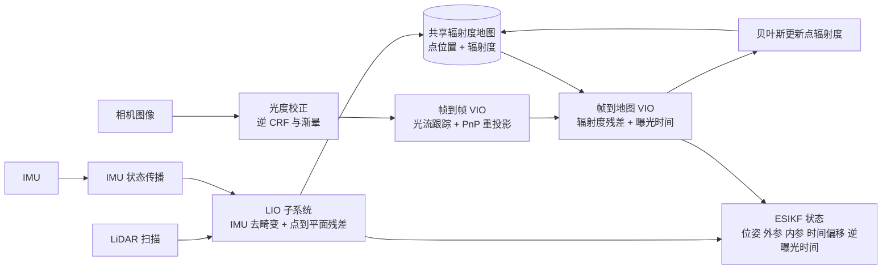

# R3LIVE++：紧耦合激光-惯性-视觉状态估计与辐射度地图重建

## 一句话定义

**R3LIVE++**（Jiarong Lin、Fu Zhang，香港大学 MARS 实验室，[arXiv:2209.03666](https://arxiv.org/abs/2209.03666)，2022-09）是一个紧耦合的 LiDAR-惯性-视觉（LIVO）状态估计与建图框架：LIO 子系统重建几何，VIO 子系统在同一张地图上恢复**辐射度**（radiance）；相对前作 R3LIVE，新增**相机光度标定**与**曝光时间在线估计**（论文 §1、§2.3）。

## 英文缩写速查

| 缩写 | 英文全称 | 简要说明 |
|------|----------|----------|
| LIVO | LiDAR-Inertial-Visual Odometry | 激光-惯性-视觉里程计 |
| LIO | LiDAR-Inertial Odometry | 激光-惯性里程计，本文基于 FAST-LIO2（§2.1） |
| VIO | Visual-Inertial Odometry | 视觉-惯性里程计，本文用光度式（直接法） |
| ESIKF | Error-State Iterated Kalman Filter | 误差状态迭代卡尔曼滤波，LIO 与 VIO 共用同一状态（§3.2） |
| CRF | Camera Response Function | 相机响应函数，累计辐照度到像素强度的非线性映射（§3.3） |
| APE | Absolute Position Error | 绝对位置误差，Table 3 的指标 |
| HDR | High Dynamic Range | 高动态范围成像，由不同曝光时间的渲染图合成（§7.1） |
| NCLT | North Campus Long-Term dataset | 密歇根大学北校区长期数据集，§6.1 的公开评测集 |
| GICP | Generalized ICP | 论文 §4 称 LIO 用此法迭代配准，残差实为点到平面（式 7） |
| ikd-tree | incremental k-d tree | 增量式 k-d 树，用于最近邻搜索（§4.1，引自 FAST-LIO2） |

## 为什么重要

- **同时做定位与上色建图：** 一张地图既供 LIO 配准几何、又供 VIO 做帧到地图对齐，而不是 LIO、VIO 各维护一张图（§2.3 对比 R2LIVE、LVI-SAM 等“两张图”的做法）。
- **点里存的是辐射度而不是像素颜色：** 通过 CRF、渐晕与曝光时间把像素反算为辐射度（式 4），对光照/曝光变化更稳定，因此可用不同曝光时间重新渲染并合成 HDR（§7.1）。
- **LiDAR 退化时可靠视觉兜底：** 论文在面对单面墙等退化场景下，纯 LIO 系统失败而 R3LIVE++ 回到起点（§6.5.1）。
- **纯 CPU 实时：** 作者自称首个无 GPU/硬件加速即可实时的辐射度地图重建框架（§1，自述）；Table 6/7 显示每秒处理耗时 426 ms 与 470 ms。

## 核心机制

### 流程总览

### 方法栈

1. **地图结构（§3.2.1–3.2.2）：** 点 P=(位置 3 维, 辐射度 RGB 3 维) 加协方差与时间戳；点放入固定大小体素（例 0.1 m），近期有新点的体素标为“激活”，只有激活体素内的点才会被新图像更新。
2. **光度模型（§3.3）：** I_i(ρ)=f_i(τ·V(ρ)·γ_i)。CRF f 与渐晕 V 离线标定（方法 [45]），曝光时间 τ 在线估计；在假设光源恒定与朗伯反射下辐射度 γ 与位姿无关，因此可以拿它做帧到地图对齐。
3. **状态（§3.4）：** 位姿、速度、陀螺/加计偏置、重力、相机外参、IMU-相机时间偏移、逆曝光时间 1/τ、相机内参，全部在同一 ESIKF 中估计。
4. **LIO（§4）：** 沿用 FAST-LIO2 思路——IMU 反向传播去畸变，原始点对 ikd-tree 里最近 5 点拟合平面的点到平面残差，迭代更新；新点以 1 cm 分辨率入图，辐射度初始为 0。
5. **VIO（§5）：** 先对图像做光度校正（式 13）。第一步“帧到帧”：Lucas-Kanade 光流跟踪上帧中的地图点，最小化 PnP 重投影误差得到粗估计；第二步“帧到地图”：最小化地图点辐射度与当前图像观测辐射度之差（式 19），残差建在稀疏的**单个像素**上（不用图像块），曝光时间通过该残差的雅可比被更新。随后对点辐射度做贝叶斯融合（式 24–26），光照缓变用随机游走建模（式 20）。
6. **跟踪点维护（§5.5）：** 重投影或辐射度误差过大的点、掉出视野的点被移除；每帧向 50 像素邻域内没有跟踪点的位置补充新点。

### 与前作的增量（论文 §2.3 明确列出）

| 增量 | 内容 | 对应实验 |
|------|------|----------|
| (1) 光度标定 | 校正 CRF 非线性与镜头渐晕 | Table 5 辐射度误差 |
| (2) 曝光时间在线估计 | 用于恢复真实辐射度 | Table 4 曝光时间误差 |
| (3) 更充分的评测 | NCLT 25 序列、自建 R3LIVE-dataset | Table 3、Table 5 |
| (4) 开源 | 代码、私有数据集、手持设备硬件 | — |

## 实验结果（论文原文数字）

| 实验 | 设置 | 结果 | 出处 |
|------|------|------|------|
| 定位精度 | NCLT 25 序列（总长约 138 km），对比 R2LIVE、LVI-SAM、FAST-LIO2、LIO-SAM、自身 LIO | 平均 APE：R3LIVE++ 8.51 m，R2LIVE 10.58，LVI-SAM 15.03，Our-LIO 10.75，FAST-LIO2 9.59，LIO-SAM 15.39 | §6.4，Table 3 |
| LiDAR 退化 | degenerate seq 00/01 | 三种仅 LiDAR 系统失败，R3LIVE++ 回起点，漂移 4.1 cm 与 4.6 cm | §6.5.1 |
| LiDAR 与视觉同时退化 | degenerate seq 02（白墙） | 终点漂移 1.62° 与 4.57 cm | §6.5.2 |
| 曝光时间 | 5 条序列，对比 Tum-cali | 平均误差 0.189–3.460 ms 对 0.341–7.082 ms | §6.6.1，Table 4 |
| 辐射度地图 | 14 条序列平均光度误差 | baseline 38.60，R3LIVE 23.58，R3LIVE++ 18.01 | §6.6.2，Table 5 |
| 耗时 | i7-9700K 纯 CPU | NCLT 每秒处理 426 ms，R3LIVE-dataset 470 ms | §6.7，Table 6/7 |

### 作者自述与本页判断

- **作者自述：** NCLT 上“精度最高”；对退化场景鲁棒；曝光时间估计更准；辐射度重建误差显著更小（§1、§8.1）。
- **本页判断（基于对 Table 3 的重新核对）：** 逐序列看，25 条中 R3LIVE++ 最优 10 条，FAST-LIO2 最优 9 条（我按表中数字自行统计）。表中平均值更接近按路程加权（推测：按长度加权得 8.52，与表 8.51 吻合；未加权为 8.28 对 FAST-LIO2 的 9.18）。所以结论“平均最优”成立，但优势主要来自若干长序列，并非处处领先。

## 工程实践

- **代码与许可：** [hku-mars/r3live](https://github.com/hku-mars/r3live)（ROS，需 OpenCV≥3.3、livox_ros_driver、可选 CGAL 与 pcl_viewer）；README 为 R3LIVE 时期文字，许可 GPLv2，仅允许个人与学术免费使用，商用需联系作者（静态读 README）。
- **传感器配置：** 作者手持设备为 Livox AVIA + FLIR 全局快门相机 + DJI Manifold-2C（§6.2.1）；仓库给了 `r3live_config.yaml` 与 `r3live_config_nclt.yaml` 两套配置（§6.3）。README 另指出对旋转式 LiDAR 需自行改前端，示例 Ouster 因缺标定文件关闭了 VIO。
- **前置标定：** 相机内参、外参、CRF、渐晕需事先提供（内参与外参可在线细化，CRF 与渐晕不能）；论文推荐方法 [45] 标定 CRF/渐晕。没有标定时可置 V=1、f=1（NCLT 的做法）。
- **输出：** 导出 pcd / ply / obj；离线用 CGAL + openMVS 建网格并贴点色纹理（§7.2）；可导入 Unreal Engine、AirSim（§7.3）。
- **没有回环：** 论文明确系统是无回环检测与修正的状态估计器（§6.4），长程闭环需自行外加。

## 局限

**论文自己承认的（§8.2）：**

- 地图是点云，当前 1 cm 间距，限制了可渲染图像的分辨率；加密点会增加耗时，也受 LiDAR 原始点密度限制；高分辨率图像尚未被充分利用。

**论文行文中可见的其他限制：**

- 无回环（§6.4）；NCLT 实验中还关闭了 LIO-SAM、LVI-SAM 的回环以求公平。
- 动态物体会损害 VIO：作者解释个别序列不及 LIO 子系统的原因是行人、自行车和车辆（§6.4）。
- 太阳直射使 LiDAR 产生噪点，影响 LIO 精度（§6.4）。
- 光度模型假设光源恒定与朗伯反射（§3.3 Remark），光照缓变用随机游走近似；强反光、阴影变化场景论文未专门验证。
- NCLT 没有光度标定，因此 NCLT 上的定位结果没有用到光度标定模块（V=1，f=1），Table 3 不能证明光度标定对定位的贡献。

**本页看到的未验证之处（判断，非论文原话）：**

- Table 3 没有 R3LIVE（非 ++）一列，相对前作的**定位**提升论文没有直接给数；只在辐射度误差上有 R3LIVE 对照（Table 5）。
- LIO-SAM、LVI-SAM 各有 5 条序列失败，其平均只是 20 条序列的均值，与其他列的 25 条均值不可直接比较。
- 辐射度误差（Table 5）未给量纲说明，且以“地图回投影到训练用的同一批图像”评估，没有留出视角的新视图评测。
- 对比的基线是特征点法 LIVO（R2LIVE、LVI-SAM）与 LIO，且实验平台为 Livox 小视场 LiDAR + 全局快门相机，滚动快门相机或旋转式 LiDAR 下的表现在论文中没有验证（README 说明旋转式 LiDAR 要改前端）。
- Table 2 汇总时长 7354 s（约 2.04 h），而摘要/正文写 2.4 h，二者不一致（作者数字，未能解释）。
- 本页是对论文与 README 的静态阅读，没有复现实验，也没有读核心源码。

## 与其他方法的关系

| 对照 | 差异读法 |
|------|----------|
| [FAST-LIO](../entities/fast-lio.md) / FAST-LIO2 | 本文 LIO 部分的基础（§2.1）；R3LIVE++ 在其上加 VIO 与辐射度地图 |
| [LVI-SAM](../entities/paper-lvi-sam.md) | 因子图 + 特征点法，LIS 与 VIS 可独立运行（§2.3）；R3LIVE++ 是滤波 + 直接法 + 共享地图 |
| [LIO-SAM](../entities/lio-sam.md) | 因子图 LIO，本文 Table 3 的基线之一 |
| [FAST-LIVO2](../entities/paper-rcl-2408-14035-fast-livo2-fast-direct-lidar-inertial-visual-odo.md) | 同组后续的直接法 LIVO，本页未读其正文，关系仅按同组与方法名判断（推测） |
| [Gaussian-LIC2](../entities/paper-gaussian-lic2.md) | 另一类以 LiDAR-惯性-相机构建可渲染地图的工作，本页未比较 |

## 关联页面

- [FAST-LIO](../entities/fast-lio.md)
- [LVI-SAM](../entities/paper-lvi-sam.md)
- [LIO-SAM](../entities/lio-sam.md)
- [LeGO-LOAM](../entities/lego-loam.md)
- [Point-LIO（UniLiDAR）](../entities/point-lio-unilidar.md)
- [FAST-LIVO2](../entities/paper-rcl-2408-14035-fast-livo2-fast-direct-lidar-inertial-visual-odo.md)
- [Gaussian-LIC2](../entities/paper-gaussian-lic2.md)
- [激光里程计融合方法](../methods/lidar-odometry-fusion.md)
- [状态估计](../concepts/state-estimation.md)
- [LiDAR 感知](../concepts/lidar-sensing.md)
- [传感器融合](../concepts/sensor-fusion.md)
- [卡尔曼滤波](../formalizations/kalman-filter.md)
- [激光 SLAM 的 LIO / VIO 选型](../comparisons/lidar-slam-lio-vio-selection.md)

## 参考来源

- [r3live-plus-plus_arxiv_2209_03666.md](../../sources/papers/r3live-plus-plus_arxiv_2209_03666.md)（本库原文归档与通读记录）
- Lin, J. and Zhang, F., *R3LIVE++: A Robust, Real-time, Radiance reconstruction package with a tightly-coupled LiDAR-Inertial-Visual state Estimator*, [arXiv:2209.03666](https://arxiv.org/abs/2209.03666)
- 代码仓库 [hku-mars/r3live](https://github.com/hku-mars/r3live)（README）

## 继续阅读

- [arXiv PDF](https://arxiv.org/pdf/2209.03666)
- [FAST-LIO](../entities/fast-lio.md)：本文 LIO 部分的来源
- [激光里程计融合方法](../methods/lidar-odometry-fusion.md)
- [LVI-SAM](../entities/paper-lvi-sam.md)：因子图路线的 LIVO 对照
