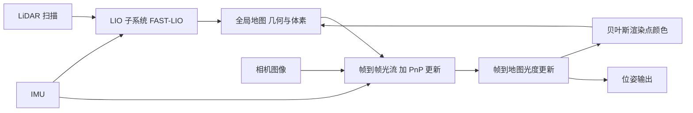

# R3LIVE（arXiv:2109.07982）

**R3LIVE**（*R3LIVE: A Robust, Real-time, RGB-colored, LiDAR-Inertial-Visual tightly-coupled state Estimation and mapping package*，Jiarong Lin、Fu Zhang，香港大学，[arXiv:2109.07982](https://arxiv.org/abs/2109.07982)）。arXiv 版标注投稿 RA-L，仓库 README 称已被 ICRA 2022 接收（未核对 IEEE 页面）。原文归档与核对范围见 [来源归档](../../sources/papers/r3live_arxiv_2109_07982.md)。

## 一句话定义

**LIO（沿用 FAST-LIO）负责几何，VIO 以「地图点自带的 RGB 颜色」为地图，最小化帧到地图光度误差并同时为点云上色，二者共用一个误差状态迭代卡尔曼滤波（ESIKF）状态。**

## 英文缩写速查

| 缩写 | 英文全称 | 简要说明 |
|------|----------|----------|
| LIO | LiDAR-Inertial Odometry | 激光-惯性里程计，本文用 FAST-LIO |
| VIO | Visual-Inertial Odometry | 视觉-惯性里程计，本文以光度误差实现 |
| ESIKF | Error-State Iterated Kalman Filter | 误差状态迭代卡尔曼滤波，论文称等价于高斯牛顿 |
| PnP | Perspective-n-Point | 由 3D 点与其像素位置求位姿的重投影误差 |
| RTK | Real-Time Kinematic | 差分 GPS 真值，用于实验 3 |
| RRE / RTE | Relative Rotation / Translation Error | 子序列相对旋转 / 平移误差（Table III） |

## 为什么重要

- 把「视觉」从稀疏特征点改成「直接用地图点颜色」，论文称无需特征检测提取，在无纹理环境更稳健（I 贡献 2）。
- 同时输出稠密 RGB 点云，并附网格重建与贴纹理工具，面向测绘与仿真（VII）。
- 是后续 LIVO 类工作（如 [FAST-LIVO2](./paper-rcl-2408-14035-fast-livo2-fast-direct-lidar-inertial-visual-odo.md)）常被引用的基线（本库多页将其列为对照，未逐页核对）。

## 核心原理

### 流程总览

### 方法栈

- **状态（III-A）：** 29 维，含 IMU 位姿速度、零偏、重力、相机-IMU 外参与时间偏移、相机内参。
- **LIO（IV）：** IMU 反向传播去畸变，ESIKF 最小化点到面残差，收敛后追加点并标记体素激活。
- **VIO 第一步（V-A）：** Lucas-Kanade 光流跟踪上一帧中已有的地图点，最小化 PnP 重投影误差；含在线时间偏移项。
- **VIO 第二步（V-B）：** 残差为 `o = c_s - γ_s`（地图颜色减当前图像插值颜色），再做一次 ESIKF 更新。
- **渲染（V-C）：** 贝叶斯融合新旧颜色，方差含随时间增长的随机游走项。
- **跟踪点维护（V-D）：** 剔除误差过大或出图点，在 50 像素半径内无跟踪点处补点。

## 工程实践

- 硬件（VI-A）：DJI Manifold-2C（i7-8550U、8 GB）、FLIR Blackfly 全局快门相机、Livox AVIA，整机 2.09 kg；GNSS 拒止场景用 ArUco 板求漂移。
- 配置（Table III 注）：HiRes 为 1280x1024、点距 0.01 m；RT 为 320x256、点距 0.10 m。
- 耗时（Table IV）：机载机上 VIO 单帧最低 15.00 ms、最高 166.08 ms，LIO 39.56 ms；分辨率越高越慢。
- 许可：GPLv2，商用需联系作者（README，未核对源码）。

## 实验结果（论文 VI）

- **实验 1：** 激光退化加视觉无纹理的白墙通道，终点漂移 1.62 度、4.57 cm。
- **实验 2：** 四条 1.2 至 1.5 km 校园轨迹，不用回环，平移漂移 0.093 至 0.164 m（Table II）。
- **实验 3（Table III）：** 与 LVI-SAM（作者修改了其 LiDAR 前端）、R2LIVE、VINS-Mono、FAST-LIO2 比较。以序列 a、300 m 子序列为例，R3LIVE-HiRes RRE/RTE 为 0.21 度 / 0.17 %，R2LIVE 0.34 / 0.21，FAST-LIO2 0.21 / 0.20，LVI-SAM 0.43 / 2.40，VINS-Mono 0.59 / 2.31。

## 关于「最先进」的依据与范围（核对）

- **论文原话：** 摘要称较「现有同类方法」更稳健、更准确；VI-D 称轨迹与真值吻合「最好」。**全文不含 "state-of-the-art" 表述。**
- **依据范围：** 仅 VI-D 一处定量对比，两条海滨序列、单一场地与单一传感器套件（Livox AVIA 加全局快门相机）；基线为 LVI-SAM、R2LIVE、VINS-Mono、FAST-LIO2，未含 LIC-Fusion、DV-LOAM 等引言所提系统，也未在公开数据集上比较。
- **判断（非论文结论）：** 对 LVI-SAM、VINS-Mono 优势明显；对 R2LIVE、FAST-LIO2 优势很小且逐项互有胜负，例如序列 a 的 100 m RTE 为 FAST-LIO2 0.82 低于 R3LIVE-HiRes 1.02。因此「目前最先进」应限定为「2021 年论文所比基线、其自采两序列上的表现」，不宜外推为通用结论。
- **VI-A 的 Fig. 7/8 与 Table II** 只给出自身漂移，没有同场景对比，不构成「最先进」证据。

## 局限

- **论文自述：** 正文未设独立局限节；仅在 VI-E 指出 VIO 耗时受图像分辨率与点云分辨率影响显著。
- **核对者观察（未验证之处）：**
  - 对比范围窄（两序列、同场地）；LVI-SAM 经作者改造，公平性依赖该改造质量。
  - 光度残差依赖地图点颜色的一致性；论文用随机游走噪声项处理光照变化（V-C），但未做曝光变化或强光照变化的专门实验（读到范围内未见）。
  - 摘要所称 "versatile" 的应用（VII）为演示，无定量评估。
  - 单目一台相机的 29 维在线标定（含内参）在退化场景下的可观性，论文未讨论（推测）。
- **性质：** 本文为论文本体加开源系统，不是综述或数据集。

## 与综述文章说法的核对

综述原句（《激光雷达 SLAM 算法最新综述》）：「对视觉系统重构，使用光流法代替原本的特征点法进行帧间跟踪，通过最小化帧到地图的光度误差融合视觉数据，并为地图渲染 RGB 颜色。实验证明，R3LIVE 实现目前最先进的多传感器融合算法精度和鲁棒性。」

| 综述说法 | 核对结果 |
|----------|----------|
| 用光流法代替特征点法做帧间跟踪 | 大体成立但需精确化：光流跟踪的是「地图中已有的点」而非图像特征点，且光流只作第一步 PnP 更新（V-A） |
| 最小化帧到地图光度误差 | 成立（V-B） |
| 为地图渲染 RGB 颜色 | 成立（V-C） |
| 实验证明最先进的精度与鲁棒性 | 论文未用此措辞，证据窄，见上节 |
| 视觉重构自 R2LIVE | 成立；论文称基于 R2LIVE 且 R2LIVE 用稀疏视觉特征（I） |

## 关联页面

- [FAST-LIO](./fast-lio.md)：R3LIVE 的 LIO 子系统来源
- [LVI-SAM](./paper-lvi-sam.md)：论文中的对比基线之一
- [LIO-SAM](./lio-sam.md)、[LeGO-LOAM](./lego-loam.md)：因子图 / 特征点路线的对照
- [Point-LIO](./point-lio-unilidar.md)：同属 FAST-LIO 谱系的逐点方法
- [VINS-Fusion](./vins-fusion.md)：视觉惯性对照（论文基线为 VINS-Mono）
- [FAST-LIVO2](./paper-rcl-2408-14035-fast-livo2-fast-direct-lidar-inertial-visual-odo.md)：后续 LIVO 工作
- [传感器融合](../concepts/sensor-fusion.md)、[状态估计](../concepts/state-estimation.md)、[激光感知](../concepts/lidar-sensing.md)

## 参考来源

- [sources/papers/r3live_arxiv_2109_07982.md](../../sources/papers/r3live_arxiv_2109_07982.md)
- 论文：<https://arxiv.org/abs/2109.07982>；代码：<https://github.com/hku-mars/r3live>

## 继续阅读

- 论文 V-A 至 V-C 的推导（式 3 至 34）与 VI-D 的 Table III。
- 前作 R2LIVE（论文参考文献 [12]）与 FAST-LIO2（[22]）。
