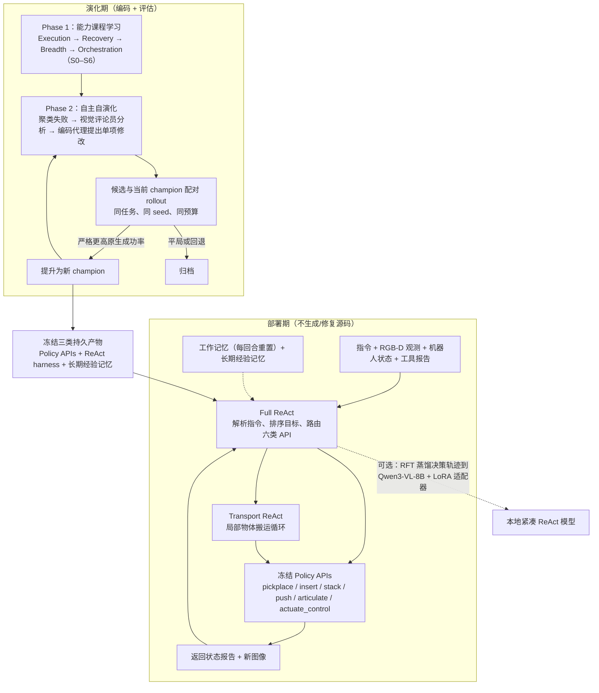

# RACaP: Agentic Reasoning, Acting, and Coding as Policies for Evolvable Robot Learning

RACaP把推理、行动和编码作为可演进机器人学习策略的一部分。

## 英文缩写速查

| 缩写 | 英文全称 | 简要说明 |
|---|---|---|
| VLA | Vision-Language-Action | 视觉与指令条件化的机器人动作策略。 |
| WM | World Model | 预测行动后的环境变化。 |
| WAM | World Action Model | 联合建模未来视觉和动作。 |

## 为什么重要

RACaP把推理、行动和编码作为可演进机器人学习策略的一部分。 评读时应将问题、观测条件与执行接口一并记录，避免从单个演示或指标外推能力。

## 流程总览

图依据：论文 §3.2–§3.6 / Fig.1、Fig.3（Appendix Fig.7 的角色级细节未读）。

## 方法栈

训练时根据失败日志修改类型化技能接口，并以成对任务回归筛选改动；部署时冻结代码，由代理调整技能顺序、参数与恢复方式。

## 实验与评测

文章报告LIBERO-90为54.4%、LIBERO-PRO为45.0%、LIBERO-Long为46.0%；蒸馏后单次决策快13.2倍。

## 与其他工作对比

它把代码更新限制在训练期，部署期维持冻结实现；类型化接口和回归测试是安全关键。

## 工程实践

当前归档仅核实到arXiv入口，未核实可运行官方代码。

## 源码运行时序图

**不适用**：当前没有核实到该论文的可运行官方训练、推理或部署入口。

## 结论

**一句话总判：** RACaP把推理、行动和编码作为可演进机器人学习策略的一部分。

1. 核对方法实际改变的是数据、表征、规划、控制还是评测。
2. 只把论文覆盖的任务、平台与扰动范围当作证据。
3. 复现前确认代码、权重、数据许可和硬件依赖状态。

## 局限与风险

它把代码更新限制在训练期，部署期维持冻结实现；类型化接口和回归测试是安全关键。 当前导读以用户提供的文章和预印本题录为索引；详细配置与结果应核对论文全文。

## 关联页面

- [Day 5 导读](../overview/humanoid-motion-intelligence-day5-world-models-decision.md)
- [生成式世界模型](../methods/generative-world-models.md)

## 参考来源

- [Day 5 原文归档](../../sources/blogs/humanoid_motion_intelligence_day5_world_models_decision_2026_10_06.md)
- [arXiv:2609.29394](https://arxiv.org/abs/2609.29394)
- [arXiv PDF](https://arxiv.org/pdf/2609.29394)：已通读方法部分（实验与附录以略读为准）：摘要、§1 引言、§3 方法（3.1–3.6）、§4.1 实验设定；附录未读

## 推荐继续阅读

- [Day 5 导读](../overview/humanoid-motion-intelligence-day5-world-models-decision.md)
