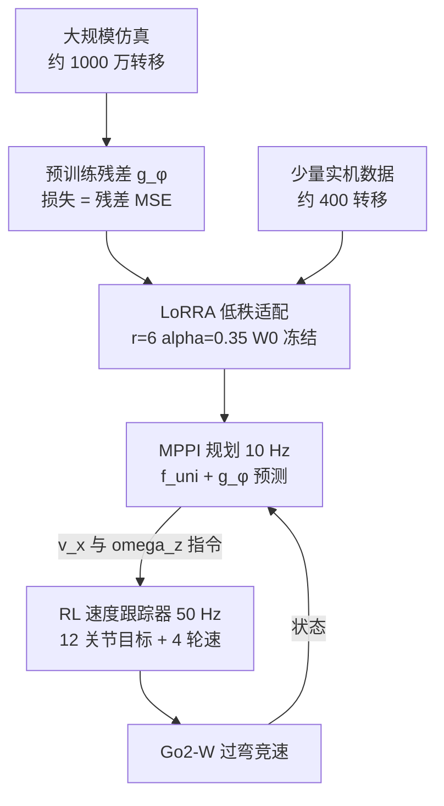

# RACER：用残差闭环模型让 MPPI 驾驭轮足高速过弯

**RACER**（*Residual-Adaptive Closed-Loop Estimation for Sampling-Based Planning in Wheeled-Quadruped Racing*，[arXiv:2610.07409](https://arxiv.org/abs/2610.07409)，Yuxiang Liu、Marla Eisman、Lizhi Yang、Aaron Ames、Francesco Borrelli）由加州大学伯克利分校与加州理工学院提出：在 **Unitree Go2-W** 轮足四足上，把 MPPI 规划器、一个对“RL 速度跟踪器闭环行为”的学习式残差模型，以及低秩的少样本实机适配（**LoRRA**）串成分层竞速系统。

## 一句话定义

**规划器用独轮车做名义模型，再叠加一个学出来的残差 g_φ 去预测下层 RL 跟踪器在打滑、延迟与饱和下的真实响应；残差先在仿真大数据上预训练，再用约 400 条实机转移做低秩适配。**

## 英文缩写速查

| 缩写 | 英文全称 | 简要说明 |
|------|----------|----------|
| RACER | Residual-Adaptive Closed-Loop Estimation | 论文方法/系统名 |
| LoRRA | Low-Rank Residual Adaptation | 对残差网络做冻结主权重 + 低秩增量的少样本适配 |
| MPPI | Model Predictive Path Integral | 采样式 MPC；这里用 DIAL-MPC 风格实现 |
| RL | Reinforcement Learning | 下层 PPO 速度跟踪器 |
| MLP | Multi-Layer Perceptron | 残差网络 g_φ（5 层） |
| Kp | Proportional gain | 关节 PD 增益；用作硬件域差来源之一 |
| Go2-W | Unitree Go2-W | 带 4 个轮电机的轮足四足 |

## 为什么重要

- **瓶颈在“规划模型 ≠ 下层闭环”：** 高速过弯时，独轮车假设的指令响应与 RL 跟踪器的实际响应偏差大，MPPI 滚动出的轨迹因此不可信；残差把这层偏差学进规划器。
- **少样本实机适配有实测收益：** 硬件上 ΔKp = 30 时 LoRRA 平均 2.33 圈无碰撞，Full-Tune 只有 1.00；ΔKp = 50 时 Full-Tune 为 0 圈。
- **可复用的范式：** “名义模型 + 残差 + 低秩适配”不依赖具体机器人，可迁移到其他由 RL 跟踪器封装的平台（推测）。

## 核心信息

| 项 | 内容 |
|----|------|
| **机构** | 加州大学伯克利分校（UC Berkeley）；加州理工学院（Caltech） |
| **平台** | Unitree Go2-W，12 个腿关节 + 4 个轮电机；L 形赛道（尺寸原文未给） |
| **训练栈** | 下层 PPO 在 IsaacLab 扩展 robot_lab 中训练；残差预训练约 1000 万条仿真转移，实机适配约 400 条 |
| **开源** | **无**：论文与 arXiv 页面均未列代码/数据 |

## 核心原理

### 方法栈

| 模块 | 设计 |
|------|------|
| 上层规划 | DIAL-MPC 式 MPPI，10 Hz 采样 [v_x^des, ω_z^des] 并 rollout |
| 名义模型 | 平面独轮车 f_uni，状态 [x, y, yaw, v_x, ω_z] |
| 残差模型 | s_{t+1} = f_uni + g_φ；g_φ 为 5 层 MLP，输入输出同 f_uni |
| 下层跟踪 | 50 Hz 前馈 PPO，输出 12 个腿关节位置目标 + 4 个轮速目标；奖励令其近似 f_uni |
| LoRRA | W = W⁰ + (α/r)BA，r = 6、α = 0.35，约 17.7% 参数可训练 |

### 流程总览

## 方法

- **输入/输出：** 规划器输入当前 5 维状态与采样动作，输出预测下一状态；动作为期望前向速度与偏航角速度。
- **关键设计：** 残差定义在名义模型的输入输出空间，使网络只需学习“独轮车没覆盖的闭环偏差”，而不是整个动力学。
- **LoRRA：** 冻结预训练权重，只训练低秩增量；论文报告在摩擦差和关节增益差增大时，比全量微调与从零训练更稳。
- **参考轨迹：** 由 CasADi 中的动力学自行车模型非线性规划离线计算。
- **指标：** 圈平均速度（出现不期望接触则该圈记 0）、与参考轨迹最大偏差、固定时间内无碰撞圈数。

## 源码运行时序图

**不适用**：截至 2026-10-12，论文与 arXiv 页面均未提供项目页、仓库或数据，无可对齐的官方入口脚本。仅可参考其训练栈所依赖的开源 [robot_lab](../entities/robot-lab.md)（论文使用，但并非本文的官方代码）。

## 实验与评测

**残差消融（硬件，3 次运行，每次 3 圈，均值±标准差）：**

| 速度上限 | 方法 | 无碰撞圈 | 平均速度 (m/s) | 最大偏差 (m) |
|----------|------|----------|----------------|--------------|
| 1.5 | RACER | 3.0 ± 0.0 | 1.21 | 0.42 |
| 1.5 | Naive 独轮车 | 2.3 ± 1.2 | 1.49 | 0.59 |
| 2.0 | RACER | 3.0 ± 0.0 | 1.41 | 0.45 |
| 2.0 | Naive 独轮车 | 0.0 | 0.00 | 0.83 |
| 3.2 | RACER | 3.0 ± 0.0 | 1.95 | 0.35 |
| 3.2 | Naive 独轮车 | 0.0 | 0.00 | 0.80 |

**LoRRA 消融（硬件，3 个种子）：**

| ΔKp | LoRRA 圈 / 速度 | Full-Tune 圈 / 速度 | From-Scratch 圈 / 速度 |
|-----|-----------------|---------------------|------------------------|
| 0 | 3.00 / 1.94 | 2.67 / 2.06 | 0.33 / 0.59 |
| 30 | 2.33 / 1.61 | 1.00 / 0.60 | 0.00 / 0.00 |
| 50 | 2.33 / 1.29 | 0.00 / 0.00 | 1.00 / 0.80 |

- **仿真：** 摩擦差实验中源域 μ_s = 0.85，目标 μ_t ∈ {0.30, …, 0.65}，每个 μ_t 每种方法 8 次；论文只给趋势图：LoRRA 相对 Full-Tune 的优势随摩擦差增大而增大；关节增益差结果更嘈杂。
- **读数提醒：** 1.5 m/s 下 Naive 的平均速度（1.49）高于 RACER（1.21），但无碰撞圈只有 2.3；ΔKp = 0 时 Full-Tune 速度更高（2.06 对 1.94）；每个条件只有 3 次运行/种子。

## 工程实践

- **数据预算：** 约 1000 万条仿真转移 + 约 400 条实机转移；r 在 {2,4,6,8,10,12} 扫描，最终取 6，说明低秩设定需要在 sim-to-sim 差上先调。
- **下层跟踪器要“好建模”：** 奖励被设计为让 RL 行为贴近 f_uni，残差因此小而可学；换成行为差异大的跟踪器，残差学习难度会上升（推测）。
- **安全适配：** 论文把“硬件上在线安全地适配残差”列为未来工作，当前流程是离线适配。
- **开源状态：** 无代码；下层训练用的 robot_lab 是公开框架，但本文的规划/残差/LoRRA 实现未公开。

## 结论

**RACER 的核心价值是把规划模型的失配直接建模为“RL 跟踪器的闭环残差”，并用低秩适配在极少实机数据下保持稳定；证据集中在 Go2-W 一个平台与小样本硬件试验。**

1. **看无碰撞圈而非速度：** 速度被不期望接触置 0，Naive 在 2.0/3.2 m/s 上限下为 0 圈。
2. **残差随速度上限变得必要：** 低速下 Naive 还能跑，高速过弯才拉开差距。
3. **低秩优于全量微调：** ΔKp = 30/50 时 LoRRA 2.33 圈对 Full-Tune 1.00/0 圈。
4. **预训练不可省：** From-Scratch 在 ΔKp = 0 仅 0.33 圈。
5. **别过度外推：** 3 次运行的方差大，ΔKp = 0 时 Full-Tune 速度更高。

## 与其他工作对比

| 对照 | 差异读法 |
|------|----------|
| [MPPI](../methods/mppi.md) | 本文不改采样算法，改的是其预测模型：独轮车 + 学习残差 |
| [LoRA](../concepts/lora.md) | LoRRA 把低秩增量思想用于动力学残差网络（而非大模型微调） |
| [轮足四足](../concepts/wheel-legged-quadruped.md) | 多数轮足工作关注技能/稳定性；本文面向高速竞速与规划闭环 |
| [MUJICA 轮足多技能](./paper-mujica-wheel-legged-multi-skill.md) | 都用 RL 做下层运动；本文强调上层规划如何适配下层 |
| From-Scratch（Sym2Real 思路） | 仅目标域数据训练；硬件上最差 |

## 局限与风险

- **适用边界：** 仅 Go2-W 与 L 形赛道，硬件每条件 3 次运行；仿真数值只给趋势图。
- **失效模式：** 关节增益失配会让下层策略直接失效（摔倒），导致该设置结果更嘈杂。
- **开源：** 无代码、无数据；赛道尺寸、网络宽度等关键细节原文未给，难以精确复现。
- **未验证：** 在线安全适配与非结构化环境。

## 关联页面

- [人形/四足前沿周报 2026-10-05~10-09](../overview/frontier-humanoid-quadruped-2026-10-05-10-09.md)
- [混合/轮足运动任务](../tasks/hybrid-locomotion.md)
- [轮足四足](../concepts/wheel-legged-quadruped.md)
- [MPPI](../methods/mppi.md)
- [LoRA](../concepts/lora.md)
- [Sim2Real](../concepts/sim2real.md)

## 参考来源

- [RACER 论文归档](../../sources/papers/racer_arxiv_2610_07409.md)
- [人形/四足周报来源](../../sources/blogs/frontier_humanoid_quadruped_2026_10_05_10_09.md)

## 推荐继续阅读

- [arXiv HTML 全文](https://arxiv.org/html/2610.07409v1)
- [DIAL-MPC 论文](https://arxiv.org/abs/2409.15610)
