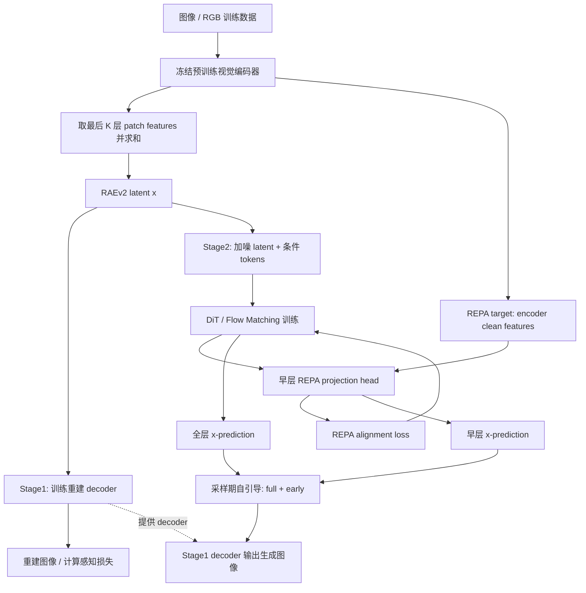
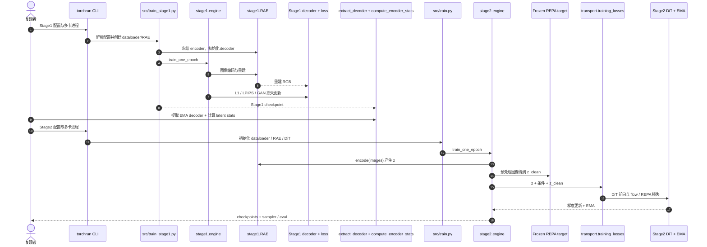

# RAEv2：改进表征自编码器基线（Improved Baselines with Representation Autoencoders）

## 一句话定义

**RAEv2**（Singh 等，[arXiv:2605.18324v2](https://arxiv.org/html/2605.18324v2)）将预训练视觉编码器的**最后 K 层表征求和**作为生成潜空间、用 **REPA** 约束扩散中间特征的空间结构，再把 REPA 早层预测头用作内部引导，兼顾重建质量、生成效率和无需单独弱模型的采样。

## 英文缩写速查

| 缩写 | 英文全称 | 简要说明 |
|---|---|---|
| RAE | Representation Autoencoder | 以预训练视觉 encoder 取代传统 VAE encoder |
| REPA | Representation Alignment for Generation | 使 DiT 中间特征与冻结表征目标对齐 |
| DiT | Diffusion Transformer | Stage2 图像/视频潜变量生成骨干 |
| MLS | Multi-Layer Sum | 将最后 K 层特征相加，不扩展 latent 形状 |
| CFG | Classifier-Free Guidance | 常见条件/无条件双前向引导；此处比较其额外开销 |
| AG | AutoGuidance | 额外训练弱 diffusion model 的引导基线 |
| gFID | Generative Fréchet Inception Distance | 图像生成质量，数值越低越好 |
| FVD | Fréchet Video Distance | RECON 自回归未来帧质量指标 |
| NWM | Navigation World Model | 以历史帧与动作预测未来图像，不等于运动控制策略 |

## 为什么重要

- **同一视觉表征服务理解与生成：** 不只保留视觉骨干最后一层的高语义特征，而通过最后 K 层恢复更多纹理/局部结构，且不重新训练 encoder。
- **RAE 并不取代 REPA：** 原文 27 个视觉编码器的相关性实验表明，两者改善的是不同属性：RAE 偏全局语义，REPA 偏中间层空间结构。
- **生成成本可以降低：** 在 RAE 潜空间内，REPA 的投影 head 本身可当作早退出的 x-prediction 弱预测，不需 AG 的第二个网络或 CFG 的额外前向。
- **机器人侧有真实但有限的关联：** 作者测试了动作条件的导航视频未来预测。它为 [WAM](../concepts/world-action-models.md) 的生成表征选型提供基线，**没有证明真机导航/控制成功率提升**。

## 核心信息

| 项 | 已核对内容 |
|---|---|
| 英文标题 | Improved Baselines with Representation Autoencoders |
| 中文标题 | 改进表征自编码器基线 |
| 作者 | Jaskirat Singh、Boyang Zheng、Zongze Wu、Richard Zhang、Eli Shechtman、Saining Xie |
| 机构 | Adobe Research；澳大利亚国立大学（ANU）；纽约大学（NYU） |
| 论文 | [arXiv:2605.18324v2](https://arxiv.org/abs/2605.18324v2)（2026-06-15 修订） |
| 项目 / 代码 | [项目主页](https://raev2.github.io/) · [官方 PyTorch](https://github.com/nanovisionx/RAEv2) |
| 权重 / 数据 | [RAEv2-models](https://huggingface.co/nyu-visionx/RAEv2-models) · [RAEv2-data](https://huggingface.co/datasets/nanovisionx/RAEv2-data) |
| 任务边界 | ImageNet-256 图像生成、T2I、RECON 动作条件导航未来帧生成 |

## 核心原理

### 1. Generalized RAE：不再只取最后一层（§2.1）

对 L 层冻结预训练视觉编码器，最后 K 个层输出皆为 N×d 的 patch 特征。作者的主要方案为：

\[
x = \sum_{\ell=L-K+1}^{L} z_\ell,\qquad x\in\mathbb{R}^{N\times d}
\]

K=1 恢复原 RAE；相比将 K 层 token/通道直接拼接，它**不增加 Stage2 latent 形状和学习参数**。论文比较多层求和 MLS 与固定随机投影 MLR，报告相同 K 下 MLS 的生成效果更好。DINOv3-L 的 K=7 在有引导生成上取得最佳 gFID 1.06；K=23 则更偏重重建质量，不应把 K 设成普适最优常数。

### 2. 同时采用 RAE 与 REPA：语义和空间结构互补（§2.2）

RAE 的冻结 encoder 建立语义较强的生成 latent。REPA 在 DiT 较早的中间层把特征投影到相同预训练表征目标，主要帮助 token-token **空间自相似性**。原文 27 种 encoder 的相关性分析（与 gFID 的 Pearson r）：RAE 单独的 LP 为 -0.81、LDS 为 -0.13；联合后 LP/LDS 平均指标为 -0.83。相关性不是因果定量证明，也不说明任意 encoder 必然提升同等幅度。

### 3. REPA head 自引导：两个 x-prediction 共享空间（§2.3）

冻结 encoder 产生 clean latent x；早层 REPA head 预测 x_hat_repa，完整 DiT 也输出 x_hat_full。二者在**同一 latent 坐标系**内组合为自引导预测（论文 §2.3）；与需要单独弱网络的 AG、双前向的 CFG 区分。该机制用于作者的生成采样设置，不意味着所有导航世界模型配置都启用了相同的 guidance。

### 流程总览

## 源码运行时序图

以下按官方 README 的 **Stage1 → Stage2 训练路径**绘制；与代码中 `src/train_stage1.py`、`src/stage1/engine.py`、`src/train.py`、`src/stage2/engine.py` 的实际调用对应。尚未在本次环境实际运行多卡训练。

可核对的最短训练入口：

- Stage1：`uv run torchrun --nproc_per_node=8 src/train_stage1.py --config configs/stage1/training/dinov3l-k7-imagenet.yaml`
- Stage2：`uv run torchrun --nproc_per_node=8 src/train.py --config configs/stage2/training/imagenet-dinov3l-k7.yaml`
- NWM 实验配置：`configs/stage2/training/nwm-dinov3l-k7.yaml`；其条件输入与训练路径以配置为准，不应凭通用结构图脑补动作规划器。

## 实验与评测

**以下均为论文作者结果，非本站重新训练或真机复现。**

| 评测与口径 | 基线 | RAEv2 | 原文 |
|---|---:|---:|---|
| ImageNet-256，80 epoch，有引导 gFID ↓ | RAE-XL（800 epoch）1.13 | **1.06** | 表 7 |
| EP_FID@2，达到无引导 gFID≤2 的 epoch ↓ | RAE-XL 177 | **35** | 表 7 |
| FDr6 多特征空间综合指标 ↓ | RAE-XL 3.26 | **2.17** | 表 7 |
| K=7、80 epoch，自引导 gFID ↓ | CFG 1.49 / AG 1.14 | **1.06** | 表 16 |
| T2I 微调后 GenEval ↑ | Flux-VAE 78.3 / RAE 81.5 | **82.7** | 表 8 |
| RECON 导航至 16 秒 FVD ↓ | NWM 200.97 / RAE 312.01 | **105.61** | 表 9 |

**口径提醒：** 论文叙述“超过 10× 收敛加速”，但单看 EP_FID@2 为 **177/35≈5.1×**。前者与不同训练预算/收敛过程比较有关；不要宣称 EP 指标也提速 10×。

### 导航预测特例（§4.2）

- 输入 **4 帧 256×256 图像**，各映射到 **16×16** patch；连同动作 token、rollout 时间 token，完成 **动作条件未来帧**生成。
- 训练数据 **RECON、4 FPS**；以 ground-truth action 逐帧滚动生成，在 1/2/4/8/16 秒预测跨度上评测 FVD/FID/LPIPS 等。
- **FVD 不等于导航任务成功率，更不是足式机器人闭环控制安全指标**；未展示机器人硬件部署的控制周期、轨迹跟踪误差或碰撞率。

## 与其他工作对比

| 方法 | 生成 latent / 训练目标 | 部署作用 | 与本论文关系 |
|---|---|---|---|
| 原始 RAE | 冻结视觉骨干最后一层，训练解码与生成模型 | 图像生成 | RAEv2 增加最后 K 层求和与 REPA 自引导 |
| **RAEv2** | 多层求和 RAE + REPA + 早层 x-prediction | Image/T2I/NWM 图像生成 | 本页主体 |
| [GAE](./paper-gae-geometry-native-autoencoder.md) | 几何多级特征压成 geometry-native latent | 多视角 RGB/深度/相机/点云 | 潜空间选型对照；不等同于导航动作模型 |
| [THAW-VLA](./paper-thaw-vla.md) | 世界模型特征监督学生 VLA | 输出机器人动作策略 | 同样研究 representation alignment，但 teacher、目标和部署接口均不同 |

## 结论

**RAEv2 的关键不是让 DiT 更大，而是让生成表征、空间对齐和采样引导更一致；其对机器人最直接的证据是导航视频预测，而不是策略闭环成功率。**

1. **先选 K、再调生成器：** K=7 在作者 ImageNet 引导生成最优；重建质量则可考虑更大 K，不能默认最后层唯一正确。
2. **RAE + REPA 是互补而非重复：** encoder 语义和中间层空间结构分工，可通过 LP/LDS 联合诊断。
3. **引导成本要纳入对比：** REPA 早层 head 的 x-prediction 能复用到生成自引导，省去 AG 弱网络或 CFG 额外模型前向。
4. **效率须统一定义：** ImageNet gFID、EP_FID@2、FDr6 及训练 epoch 不是可互换的“倍速”指标。
5. **机器人实验先做视频预测 A/B：** 以 RECON 等动作条件数据对齐帧质量/时序一致性，再由独立闭环 benchmark 判断价值。
6. **复现分两阶段：** 确认 decoder/checkpoint/stat 与 Stage2 配置一致；README 提供多 GPU 训练入口，但本次未实跑。

## 工程实践

- **开源已核实：** [官方训练与评测仓](https://github.com/nanovisionx/RAEv2) 含 Stage1/Stage2 代码，README 给出 `uv sync`、多卡 `torchrun`、模型数据与在线/离线评测入口，详见 [源码归档](../../sources/repos/raev2.md)。
- **Stage1：** 冻结 encoder，仅训练 decoder，重建损失包含 L1、LPIPS 和 GAN 路径；训练后需提取 EMA decoder 与 encoder mean/var。
- **Stage2：** ImageNet/T2I/NWM 使用不同条件配置；冻结 RAE 编码和 REPA target，训练 DiT flow / alignment loss。导航 YAML 的 `nwm` 条件不可与 T2I 配置混用。
- **实务检查：** 关注 K、token 数、decoder 重建 rFID/PSNR、生成 gFID、NWM FVD/LPIPS 与每次采样的实际开销，不凭 gFID 单独判断机器人可部署性。

## 局限与风险

- 论文附录 E 仅验证多层简单求和与随机矩阵投影，没有端到端学出最佳聚合器；编码器来自离散经验选型。
- 论文的图像生成与未来帧生成主要是 256×256 范围；长时间自回归会积累预测误差。
- NWM 实验输入是给定/真值动作，非学习机器人控制器；未报告真实机器人控制安全、长期导航成功率或 Sim2Real。
- 仓库存在实现和权重，但本次仅核查开放入口及代码，**未下载数据、权重或复现论文指标**；训练命令的多卡示例并非任意单卡环境可直接运行。

## 关联页面

- [模型架构纵深路线：Stage 2 感知表征](../../roadmap/depth-model-architecture.md)
- [视觉表征作为策略输入](../concepts/visual-representation-for-policy.md)
- [生成式世界模型](../methods/generative-world-models.md)
- [Diffusion Policy：扩散动作策略](../methods/diffusion-policy.md) — 与本文图像/导航未来帧去噪生成共享扩散建模思想，但输出为机器人动作轨迹，不能将两者的任务指标混同。
- [World Action Models](../concepts/world-action-models.md)
- [THAW-VLA：表征对齐用于动作学习](./paper-thaw-vla.md)
- [GAE：几何原生生成 latent](./paper-gae-geometry-native-autoencoder.md)

## 参考来源

- [论文原文通读记录](../../sources/papers/raev2_improved_baselines_arxiv_2605_18324.md)
- [官方项目页归档](../../sources/sites/raev2-github-io.md)
- [官方源码核读归档](../../sources/repos/raev2.md)
- [arXiv v2 HTML（含附录）](https://arxiv.org/html/2605.18324v2)

## 推荐继续阅读

- [RAEv2 官方项目页](https://raev2.github.io/)
- [原始 RAE（Representation Autoencoders）](https://rae-dit.github.io/)
- [REPA 原论文](https://arxiv.org/abs/2410.06940)
