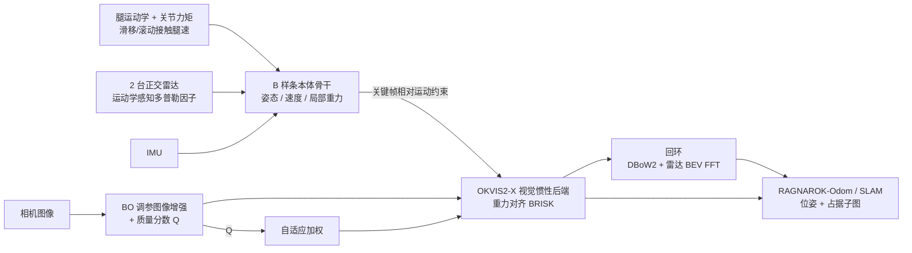
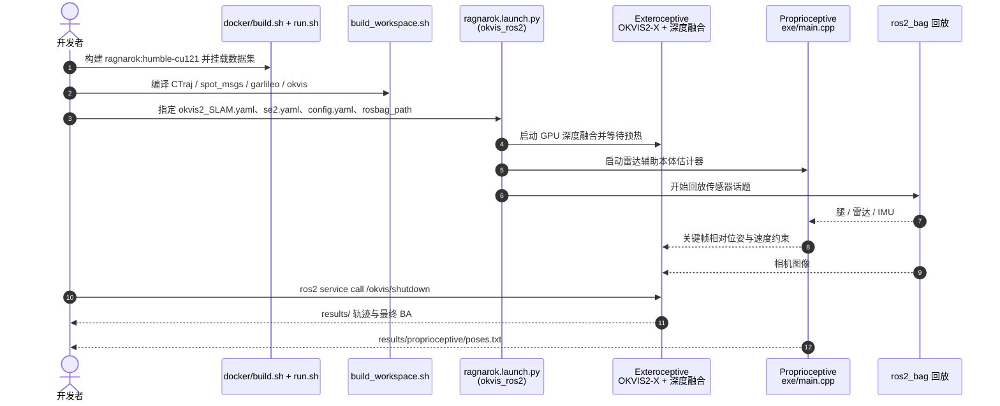

# RAGNAROK：四足的雷达–视觉–运动学–惯性 SLAM

**RAGNAROK**（*Radar-Aided Gravity-Normalized Alignment for Robust Open Keyframe-based Radar-Visual-Kinematic-Inertial SLAM*，[arXiv:2610.11531](https://arxiv.org/abs/2610.11531)，[项目页](https://ragnarok-rvki-slam.github.io/RAGNAROK/)，[代码](https://github.com/hanjun815/RAGNAROK)）由首尔大学（Ayoung Kim 组）、慕尼黑工业大学与苏黎世联邦理工合作提出，在 Boston Dynamics Spot 上把 **腿运动学、双毫米波雷达、相机和 IMU** 融合成一套能在打滑、陡楼梯、暗光、眩光下工作的 SLAM。

## 一句话定义

**用「雷达辅助的 B 样条本体估计器」给出连续时间的姿态/速度/局部重力，再把它作为相对运动约束喂给基于 OKVIS2-X 的视觉惯性后端，并按图像质量自适应地重分配各模态权重。**

## 英文缩写速查

| 缩写 | 英文全称 | 简要说明 |
|------|----------|----------|
| RVKI | Radar-Visual-Kinematic-Inertial | 雷达 + 视觉 + 腿运动学 + IMU 四模态融合 |
| RKI / VKI / RVI | Radar-Kinematic-Inertial 等 | 去掉相机 / 去掉雷达 / 去掉腿的变体 |
| APE | Absolute Pose Error | 绝对位姿误差，论文以 RMSE 报告 APEt（m）与 APEr（°） |
| OKVIS2-X | Open Keyframe-based Visual-Inertial SLAM | 外部感知后端所基于的开源 VI-SLAM |
| BO | Bayesian Optimization | 在线调图像增强参数 |
| AGCWD / CLAHE | Adaptive Gamma Correction with Weighting Distribution / Contrast Limited AHE | 两种图像增强，输出按熵与均值融合 |
| TLS | Terrestrial Laser Scanner | Leica RTC360，用于生成真值地图 |

## 为什么重要

- **腿式机器人的状态估计短板在“接触不是理想点接触”：** 足端是球、会滚会滑；RAGNAROK 把滚动接触几何与滑移偏置写进腿速因子，而不是假设支撑脚零速度。
- **雷达补偏航但不够：** 单个雷达多普勒偏航可观性弱，论文用两台正交安装的雷达并按载体运动与视轴不确定性加权，再与相机/重力对齐联合。
- **“传感器退化”被当作一等公民：** 图像增强、视觉质量分数、自适应加权这条链路在消融里贡献最大（去掉自适应加权平均 APEt 由 0.272 升到 2.220 m）。
- **开源可复现：** 与多数论文页只列“code will be released”不同，仓库已含完整 ROS 2 工作区、Docker 与数据集入口。

## 核心信息

| 项 | 内容 |
|----|------|
| **机构** | 首尔大学（SNU）机械工程系 RPM Lab；慕尼黑工业大学（TUM）MRL / MIRMI；苏黎世联邦理工（ETH Zürich）MRL |
| **平台** | Boston Dynamics Spot；2×DesignCore RS-1843AOPU 雷达、RealSense D455、2×FLIR Blackfly S、MicroStrain 3DM-GV7-AHRS IMU、腿运动学 150 Hz |
| **版本** | arXiv v1（2026-10-08）；IEEE RA-L 2026 录用（2026-10-07） |
| **开源** | **已开源**（BSD-3-Clause，2026-10-08 首发）；数据集需填表申请 |

## 核心原理

### 方法栈

| 模块 | 作用 | 论文中的具体设计 |
|------|------|------------------|
| 滑移/滚动接触腿速因子 | 本体速度观测 | 接触点 p_C = p_F − r·n，雅可比 J_c = J_p + ⌊r·n⌋× J_ω；协方差随支撑时长、关节力矩不连续、腿间不一致膨胀；切平面内 2D 滑移偏置 |
| 运动学感知雷达因子 | 多普勒速度约束 | 残差 r_R = −dᵀRᵀ(v+ω×p) − ṽ；方差含载体速度与视轴不确定项；Cauchy 核去动态点，无需 RANSAC |
| B 样条本体骨干 | 连续时间姿态、自速度、局部重力 | 在相机关键帧时刻被查询，提供相对位姿与速度因子 |
| 在线外参标定 | 雷达–IMU、机体–IMU | 带指示项的先验残差 |
| 空间特征感知图像增强 | 暗光/眩光下恢复特征 | AGCWD 与 CLAHE 融合，参数由 BO 在线优化（效用奖励梯度、熵、BRISK 数量、空间均匀性） |
| 重力对齐视觉前端 | BRISK 定向与匹配过滤 | 重力方向给描述子定向；本体相对位姿做对极一致性检验 |
| 自适应加权 | 视觉差时降低视觉、提升本体 | α_i = 1/max(Q_i, 0.1)，视觉回退标志额外缩放 |
| 回环 | 重访纠偏 | DBoW2 + 极坐标雷达 BEV 的 FFT 相关，3D-2D RANSAC 验证 |

### 流程总览

## 方法

- **输入：** 腿关节编码器/力矩、两台雷达的多普勒点、IMU、相机图像（Spot 上的 D455 双目与两台单目，15 Hz）。
- **本体子系统（`src/Proprioceptive`）：** 优化姿态、自速度和局部重力的 B 样条，因子包括腿速、雷达多普勒、IMU；在线标定外参。
- **视觉子系统（`src/Exteroceptive`）：** OKVIS2-X 后端加入本体相对位姿因子和速度因子；近静止区间抑制关键帧；预测深度融合进子图。
- **输出变体：** RAGNAROK-SLAM（含回环与最终 BA）、-Odom（无回环）、-RVI、-VKI、-RKI，用于拆各传感器贡献。
- **训练：** 无需训练，使用 OKVIS2-X 自带的 depth-model、fast-scnn、mvs-model 权重。

## 源码运行时序图

官方仓库 [hanjun815/RAGNAROK](https://github.com/hanjun815/RAGNAROK)（归档见 [sources/repos/ragnarok.md](../../sources/repos/ragnarok.md)）以 Docker + ROS 2 Humble 回放 rosbag 运行：

最短复现路径：`./docker/build.sh` → `./docker/run.sh <数据集根>` → `./build_workspace.sh` → `ros2 launch okvis ragnarok.launch.py ...`；仅雷达+腿的 RKI 用 `garlileo garlileo.launch.py`。

## 实验与评测

- **设置：** 自采 15 条序列（暗、昏暗、眩光、室外、室内、楼梯、自相似、高程变化）；公开 Co-RaL、GaRLILEO（无相机，只测 RKI）；真值为 TLS 地图 + PALoc + ICP。指标 APE RMSE，5 次运行中位数。
- **室外平均（APEt / APEr）：**

| 方法 | APEt (m) | APEr (°) |
|------|----------|----------|
| x-RIO | 6.915 | 11.884 |
| DRIFT | 5.909 | 7.909 |
| Holistic Fusion | 9.800 | 19.233 |
| Co-RaL | 2.624 | 4.708 |
| GaRLILEO | 1.445 | 3.089 |
| RAGNAROK-RKI | 1.079 | 2.216 |
| RAGNAROK-Odom | 0.481 | 1.550 |
| RAGNAROK-SLAM | **0.387** | **1.457** |

- **室内与混合：** RAGNAROK-Odom 0.276/2.547，-SLAM 0.265/2.589；表中最强基线平均 APEt 为 Pronto + Radar 的 2.931。
- **公开数据集（仅 RKI）：** Co-RaL 平均 APEt 1.541（GaRLILEO 2.828）；GaRLILEO 数据集 0.488（GaRLILEO 0.575）。
- **消融（TerraceLoop/Overpass/Atrium 平均 APEt）：** 完整 0.272；去滑移偏置 0.282；去图像增强 0.675；去重力对齐 BRISK 0.302；去运动不一致拒绝 0.329；**去自适应加权 2.220**；去双雷达 0.288；去在线标定 0.353。
- **时间：** 本体优化约 7–8 ms；整帧 SLAM 49.5–64.8 ms；回环优化 110.7–589.3 ms（异步）；Terrace 端到端延迟 105.5 ms。

## 工程实践

- **环境门槛：** Ubuntu 22.04、ROS 2 Humble、CUDA 12.1、LibTorch 2.4.0；默认编译 SM 86/89，其他显卡需设 `CUDA_ARCHITECTURES` 与 `TORCH_CUDA_ARCH_LIST`；首次构建要联网下载 279 MB 的 `mvs-model.pt`。
- **只测本体：** RKI 不需要相机，可在无 GPU 视觉流水线下评估雷达+腿的本体估计，适合只有 Spot 腿数据和雷达的用户。
- **开源状态（核查日 2026-10-12）：** 仓库已发布 ROS 2 工作区、Docker 与三套数据入口（RAGNAROK 自采、GaRLILEO、Co-RaL），许可 BSD-3-Clause；数据靠 Google Form 申请，不是直链下载。项目页文字仍写“录用后发布”，与仓库不一致，以仓库为准。
- **平台绑定：** 消息定义为 `spot_msgs`，换到其他四足需自行适配腿运动学接口与接触几何参数（推测）。

## 结论

**RAGNAROK 的主要价值不是单个新因子，而是把“腿速的接触建模 + 雷达多普勒 + 图像退化自适应”组合成可在 Spot 上运行并开源的四模态 SLAM，其中自适应加权与图像增强对精度最关键。**

1. **看自适应加权：** 消融里去掉它平均 APEt 从 0.272 m 升到 2.220 m，是各组件中最大的一项。
2. **本体骨干本身就强：** RKI 在公开数据集上优于 GaRLILEO 与 Co-RaL，说明雷达 + 腿 + 接触建模无相机也可用。
3. **视觉不总是加分：** RKI 在部分暗/眩光序列与 Odom 相当，视觉应作为可降权的模态。
4. **回环要付出时延：** 大场景回环优化达 589.3 ms，需异步运行。
5. **结果以 Spot 为准：** 只在单一平台、TLS 真值上评测，换本体需重验。

## 与其他工作对比

| 对照 | 差异读法 |
|------|----------|
| [激光雷达里程计融合](../methods/lidar-odometry-fusion.md) | 激光路线依赖 LiDAR 几何；RAGNAROK 用毫米波雷达多普勒，在烟尘/低光场景更稳，代价是点云稀疏、偏航弱 |
| [卡尔曼 vs 优化式估计](../comparisons/kalman-filter-vs-optimization-based-estimation.md) | RAGNAROK 属于优化式（B 样条 + 因子图），可在窗口内重线性化，但计算更重 |
| x-RIO / DRIFT / Holistic Fusion | 论文室外平均 APEt 分别为 6.915 / 5.909 / 9.800 m，对比 RAGNAROK-SLAM 的 0.387 m |
| GaRLILEO / Co-RaL | 同属雷达 + 腿运动学本体路线；RAGNAROK-RKI 在两套公开数据上更低 |

## 局限与风险

- **适用边界：** 单一 Spot 平台；真值依赖 TLS 先验地图；权重参数（w_τ、w_e、w_d、κ）为经验设定；部分基线表格存在缺项。
- **计算：** 大回环优化 589.3 ms；SLAM 变体需要 GPU 做深度融合。
- **开源：** 已开源但数据需申请；项目页发布状态文字滞后。
- **项目页汇总数字**（ATE 1.172 → 0.379 m，−67.7%）与论文表口径不同，选型引用请以论文表为准。

## 关联页面

- [人形/四足前沿周报 2026-10-05~10-09](../overview/frontier-humanoid-quadruped-2026-10-05-10-09.md)
- [状态估计](../concepts/state-estimation.md)
- [运动控制任务页](../tasks/locomotion.md)
- [四足机器人](../entities/quadruped-robot.md)
- [激光里程计融合](../methods/lidar-odometry-fusion.md)

## 参考来源

- [RAGNAROK 论文归档](../../sources/papers/ragnarok_arxiv_2610_11531.md)
- [RAGNAROK 项目页归档](../../sources/sites/ragnarok-rvki-slam.md)
- [RAGNAROK 仓库归档](../../sources/repos/ragnarok.md)
- [人形/四足周报来源](../../sources/blogs/frontier_humanoid_quadruped_2026_10_05_10_09.md)

## 推荐继续阅读

- [RAGNAROK 演示视频（README 链接）](https://www.youtube.com/watch?v=qD49Pis8DZ4)
- [RAGNAROK arXiv HTML](https://arxiv.org/html/2610.11531v1)
