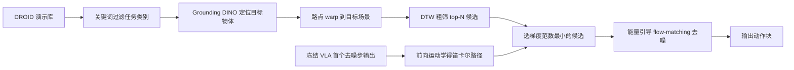

# RAGu：用检索到的轨迹零样本引导 VLA（arXiv:2611.10894）

**RAGu**（*Zero-Shot VLA Adaptation with Retrieved Guidance*，[arXiv:2611.10894](https://arxiv.org/abs/2611.10894)，University of Pennsylvania，Subin Kim / Anh-Quan Pham / Dinesh Jayaraman）。项目页 <https://raguvla.github.io/>，真机评测 rollout 记录在 HF 数据集 <https://huggingface.co/datasets/raguvla/real-world-evaluation>（数据集，非代码仓库；项目页与论文均未给出代码仓库，开源代码未核实到）。

## 一句话定义

**不更新 VLA 权重、不占用其上下文：从域不匹配的大型演示库中检索一条轨迹，用语义对应 warp 到目标场景，再作为能量引导场在 flow-matching 去噪过程中引导动作输出。**

## 英文缩写速查

| 缩写 | 英文全称 | 简要说明 |
|------|----------|----------|
| RAGu | Retrieval-Augmented Guidance | 本文方法 |
| RAG | Retrieval-Augmented Generation | 语言模型中的检索增强，本文的出发点（I 节） |
| VLA | Vision-Language-Action | 视觉-语言-动作策略 |
| DTW | Dynamic Time Warping | 动态时间规整，用于离线粗筛候选（IV 节） |
| EE SPARC | End-Effector SPectral ARC length | 末端轨迹平滑度，越高越平滑（V-A 节） |
| FK | Forward Kinematics | 前向运动学，把动作块映射成笛卡尔路径 |
| DROID | Distributed Robot Interaction Dataset | 大型真实世界操作数据集，作源演示库 |
| RICL / Omniguide / VLS | 对比基线 | 上下文检索基线 / VLM 目标点引导（真机）/ VLM 目标点引导（仿真） |

## 为什么重要

- 作者要解决的问题：VLA 对相机视角、背景、物体、机器人形态的小变化仍脆弱（摘要）；RAG 式方法此前多要求同形态、任务内数据或微调（I 节）。
- 作者主张：用笛卡尔轨迹作中间表示，可以让异形态、甚至仿真来源的演示作为空间先验，而不必做关节映射或轨迹重放（V-C 节）。
- 我的判断：这是「推理期引导」路线，部署成本低（权重冻结），但收益上限被基础 VLA 先验和示范库质量卡住（见局限）。

## 核心原理与流程总览

1. **离线 / 每 episode：** 语义关键词过滤（如 "pick"、"place"）、Grounding DINO 找目标物体、沿 Tether 的路点位移插值 warp；以任务类别内任取的一条（通常第一条）为参考做 DTW，保留 top-N（IV 节）。
2. **推理时：** 在第一个去噪步用 VLA 预测的动作块经 FK 得 X_t，选使 ||∇_{A0} C_i(X_t)||2 最小的 i*（式 3-4），此后固定；L_warp = C_{i*}(X_t)，v_guided = v − γ∇L（式 2、5）。作者解释：梯度范数估计「需要把 VLA 拉离原意图多少」，越小越贴合其先验。
3. **超参（表 IX）：** top-N 为 8（真机）/ 16（RoboLab）/ 3（GR-1），λ=1.0，γ 0.2-2.0 等。

## 实验结果（V 节、附录）

| 设置 | 基础策略 / 规模 | 结果 | 出处 |
|------|-----------------|------|------|
| 真机 real-to-real | π0.5-DROID，5 任务 × 10 次 | 平均成功率 π0.5 20%、RICL 0%、Omniguide 40%、RAGu 80%（柱状图读数） | 图 4 |
| RoboLab 3 任务 | GR00T-N1.7 / π0.5，每任务 25 次 | GR00T-N1.7 1.33%、π0.5 5.33%、RICL 1.33%、VLS 12%、RAGu 25.33% | 表 I |
| RoboLab 9 任务 | π0.5，按检索库条数 | π0.5 23.6% → RAGu 1 条 28.4%、100 条 36.4%（95% Wilson [30.4, 42.9]）；个别任务不升反降 | 表 IV、VII |
| 跨形态人形（仿真） | GR00T-N1.5 于 RoboCasa GR-1，5 任务 | 无微调 33.6% → 47.2%，有微调 36.8% → 48.8%（100 条） | 表 II |
| sim-to-real | MetaWorld Sawyer 演示 → 真机 DROID | Cabinet→Shelf：π0.5 与 Omniguide 0%，RAGu 60% | 图 6 |
| 次级检索消融 | min grad 对 min dist | 路径长度相近（5.67 / 5.79 m），min dist 更慢、更不平滑（EE SPARC −11.74 对 −10.30） | 表 III |

附录的失败模式分析显示 RoboLab 900 次 warp 尝试只有 65.1% 成功（图 8），这是 warp 成功率，不是任务成功率。

## 工程实践

- **基础策略：** 真机 π0.5-DROID，仿真 GR00T-N1.7 / π0.5，人形用 GR00T-N1.5 的预训练与后训练检查点（V-A 节）；真机为 DROID 硬件（Franka + Robotiq 2F-85 + ZED 相机，图 7）。
- **需要的前置：** 多相机标定后的三角化投影得到目标路点（附录失败模式提到 triangulation / 跨视角一致性）；人形实现里需要两个固定的 60 度 warp 相机、右手掌点的可微 FK（附录）。
- **开销：** 作者称每 episode 墙钟时间与无引导基线差在 6 s 内（表 VI 与正文）。
- **评测规模小：** 真机每任务仅 10 次 rollout，仿真 25 次；表 VII 附 95% Wilson 区间，9 任务均值 100 条为 36.4%（[30.4, 42.9]）。
- **复现：** 无代码仓库；HF 数据集仅供查看真机 rollout 视频与 action_history，我只读了文件清单（400 文件，ours / pi05 / ricl / vlm 四个方法 × 5 个任务）。

## 与文章说法的核对

文章（公众号《机器人动作块太长，什么时候该重新规划？》2026-11-11 的 53 篇速览，第 13 条）原话大意：检索相近示范，用语义与几何对应关系对齐，再在生成过程中加入动作引导；仿真和真机展示免权重更新的适配；效果仍依赖相关示范库与跨场景匹配质量。

| 文章说法 | 论文核对 |
|----------|----------|
| 检索相近示范 | 符合，但「相近」是任务类别层面（关键词过滤），论文明确不要求域匹配，目标场景与源演示在视角、外观、物体、目标位置上都不同（IV 节）。 |
| 语义与几何对应关系对齐 | 符合：Grounding DINO 语义对应 + 笛卡尔路点 warp（IV 节）。 |
| 生成过程中加入动作引导 | 符合：flow-matching 去噪中的能量引导（式 2、5）。 |
| 仿真和真机展示免权重更新的适配 | 符合：真机（图 4）、RoboLab（表 I、IV）、RoboCasa 人形（表 II）、sim-to-real（图 6），全部权重冻结。需注意人形跨形态实验是仿真，真机只有 Franka 平台。 |
| 依赖相关示范库与跨场景匹配质量 | 符合 VI 节局限：需任务类别近似匹配的库、对应失败会破坏引导；附录显示 warp 成功率仅 65.1%。 |
| 文章未提的限定 | 摘要「20% 到 80%」是 5 个真机任务、每任务 10 次、对 π0.5-DROID 的平均；基线 RICL 为已训练的检查点，在此设置下 0%。不能理解为任何 VLA 或任何场景都能提升：个别条件下反而下降（表 II 的 1 条轨迹 PlateToPlate −12；表 VII 个别任务）。 |

文章的说法与论文没有发现冲突；它没有给出数字和任务规模。

## 局限

- **论文自述（VI 节）：** 假设源库含类别近似匹配的演示；对相机位置与遮挡不具不变性；引导只能在 VLA 先验内重塑运动。
- **我看到的未验证之处：** 真机每任务仅 10 次；RoboLab 上自测 π0.5 为 14.0%，与 RoboLab 原文 28.0% 不一致（表 VIII，作者归因于原文样本少，我未独立核实）；表 I 的 3 任务均值（5.33% 到 25.33%）与 9 任务均值（23.6% 到 36.4%）口径不同，对比时需分清；跨形态人形只在仿真（RoboCasa）；次级检索为何有效的解释为作者「plausible explanation」，属推测；无公开代码，我没有运行验证；项目页署名为 Anonymous Authors。
- **性质：** 方法型论文，非数据集或硬件论文；HF 链接是评测 rollout 记录。

## 与其他工作对比

| 工作 | 关注点 | 与本文的区别 |
|------|--------|--------------|
| [机器人上下文学习](../concepts/robot-in-context-learning.md)（如 RICL） | 把检索到的示范放进模型上下文，部署时不更新权重 | RAGu 不占用上下文，而是把检索轨迹变成去噪过程中的能量引导；本文设置下 RICL 真机 0%（图 4） |
| [DreamSteer](./paper-dreamsteer-vla-deployment-steering.md) | 冻结 VLA 采样多候选，用潜变量世界模型预演、价值模型排序 | 同属部署期引导；DreamSteer 靠预演选候选，RAGu 靠外部演示库提供空间先验，不需要世界模型 |
| [RoboLab](./robolab.md) | Isaac Lab 高保真仿真评测，真机策略零样本进仿真 | 本文 real-to-sim 实验所用基准；作者自测 π0.5 为 14.0%，低于 RoboLab 原文 28.0%（表 VIII） |

## 结论

**RAGu 证明了「从域不匹配的演示库检索轨迹、warp 到目标场景后做 flow-matching 能量引导」能在不改权重的前提下明显提升 VLA 在新场景的成功率，但收益受示范库与语义对应质量限制。**

1. 真机 5 任务平均成功率从 20% 提到 80%，RoboLab 9 任务从 23.6% 提到 36.4%（图 4、表 VII）。
2. 笛卡尔轨迹作中间表示，使仿真来源与异形态演示也能作引导，人形与 sim-to-real 均有增益（表 II、图 6）。
3. 每 episode 额外墙钟时间在 6 s 以内，部署成本低（表 VI）。
4. 局限：需类别匹配的示范库，warp 成功率仅 65.1%，对相机位置与遮挡不鲁棒，真机每任务仅 10 次，无公开代码（VI 节、附录）。

## 关联页面

- [VLA 方法页](../methods/vla.md)
- [检索增强生成](../concepts/retrieval-augmented-generation.md)
- [机器人上下文学习](../concepts/robot-in-context-learning.md)
- [Flow Matching 具身策略](../concepts/flow-matching-embodied-policy.md)
- [动作分块](../methods/action-chunking.md)
- [Sim2Real](../concepts/sim2real.md)
- [DROID 策略学习](../entities/droid-policy-learning.md)
- [π0.5](../entities/paper-pi05-open-world-vla.md)
- [GR00T N1.5](../entities/paper-gr00t-n1-5.md)
- [GR00T N1.7](../entities/paper-gr00t-n1-7.md)

## 参考来源

- [来源归档：RAGu（arXiv:2611.10894）](../../sources/papers/ragu-retrieval-augmented-guidance_arxiv_2611_10894.md)
- 论文 PDF：<https://arxiv.org/pdf/2611.10894v1>
- 项目页：<https://raguvla.github.io/>
- HF 数据集：<https://huggingface.co/datasets/raguvla/real-world-evaluation>

## 继续阅读

- 论文引用的相邻工作：Omniguide（arXiv:2603.10052）、VLS（arXiv:2602.03973）、RICL（arXiv:2508.02062）、Tether（arXiv:2603.03278）、RoboLab（arXiv:2604.09860）（本页未读原文，仅据 RAGu 的引用）。
