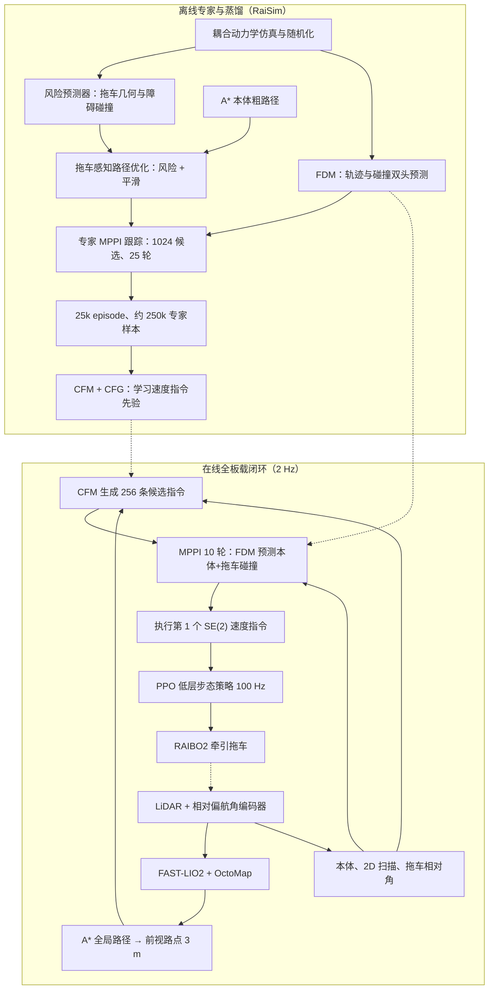

# RAIBO-Wagon：四足牵引拖车过窄道的耦合导航 / Real-Time Navigation for a Legged Robot Towing a Wagon

## 一句话定义

**RAIBO-Wagon** 以拖车感知的离线专家训练 CFM 生成**耦合可行的速度指令初值**，在线由学习前向动力学模型 FDM 预测本体与拖车未来姿态/碰撞，再用 MPPI 优化指令，帮助四足机器人拖车通过狭窄空间。论文为 [arXiv:2610.39267v1](https://arxiv.org/abs/2610.39267v1)（2026-10-29）。

## 英文缩写速查

| 缩写 | 英文全称 | 简要说明 |
|---|---|---|
| MPPI | Model Predictive Path Integral | 采样式预测控制，迭代给速度序列评分、加权更新 |
| CFM | Conditional Flow Matching | 基于条件学习专家速度序列分布，用于热启动 MPPI |
| FDM | Forward Dynamics Model | 学习本体与拖车耦合运动、预测碰撞的前向动力学模型 |
| CFG | Classifier-Free Guidance | 控制 CFM 采样对目标路点的方向性与多样性 |
| PPO | Proximal Policy Optimization | 训练拖车惯量鲁棒低层运动控制器 |
| LIO | LiDAR-Inertial Odometry | FAST-LIO2 提供在线定位 |
| GRU | Gated Recurrent Unit | FDM 与低层策略的递归时序编码结构 |

## 为什么重要

- **过窄道不能只规划狗的中心线：** 拖车轮沿车体朝向滚动，机器人横移或急转不能保证车轮也能沿同一空间路径通过；把四足与拖车合成一个保守大圆又可能错误拒绝窄道。
- **真正求解对象是耦合状态：** 拖车通过相对偏航角、尺寸、质量和惯性影响可行指令；本文**不直接控制每个车轮**，而是对本体速度指令序列做轨迹预测、碰撞评估和优化。
- **将离线重规划蒸馏成可部署先验：** 只用随机初始化 MPPI 很难在有限时间找到窄的可行指令区域，CFM 给出好的初值，MPPI 进一步探索偏离训练分布的安全指令。

## 核心信息与开源状态

| 属性 | 已核对内容 |
|---|---|
| 论文 | [RAIBO-Wagon](https://arxiv.org/html/2610.39267v1)；**arXiv v1 预印本**，2026-10-29 |
| 机构 | 韩国科学技术院（KAIST），Robotics and Artificial Intelligence Lab |
| 作者 | Insung Yang、Eunchae Kim、Jungwoo Hur、Seunghun Jeon、Donghyuk Choi、Jemin Hwangbo |
| 机器人 | RAIBO2 + 定制被动铰接 wagon；连接器编码器测相对 yaw |
| 项目 | [RAIBO-Wagon 官方页面](https://insungyang.github.io/raibo-wagon/)；演示视频和方法、实验结果 |
| 代码/数据 | **截至 2026-11-23 项目页未列官方可下载源码、权重或数据集入口**；不能当作已开源复现项目 |
| 原文核对 | 官方 arXiv HTML v1 §I–VII、附录 A/B、Algorithm 1/2、Table I–V 与项目页实验结果；未执行训练或真机测评 |

## 拖车轮轨迹究竟怎样规划？

**不是两套互相独立的几何轨迹。** 正文 §IV 采取两级表述：

1. **离线：拖车感知路径**。A* 先生成仅考虑四足本体的粗路径，再用节点配置 `(x,y,θ_robot,θ_wagon)` 的碰撞风险预测器评估拖车在转弯时的空间占用，联合最小化路径风险和平滑度：`C_total = C_risk + C_smooth`（Eq.10–12）。用有限差分求梯度、优化 25 轮。路径节点直接含车体和拖车的朝向。
2. **在线：耦合指令预测与避障**。局部规划的输入是 LiDAR、本体状态、连接角与 A* 的 3 m 前视路点；输出为 6 个 `(v_x,v_y,ω)` SE(2) 速度指令（3 s 时域）。FDM 每步预测本体位姿增量及**相对拖车角增量**，由此恢复拖车位置、姿态及每步碰撞 logit。在线目标 `R = exp(-L_way) + exp(-L_coll/15)`（Eq.22）；拖车风险进入 **L_coll**，无须另给一个拖车参考路径。

车轮的几何扫掠约束以拖车车体运动及其碰撞预测体现，**本文没有公开逐轮独立轨迹求解器**。这一点是区分「四足经过了窄门」与「后方拖车也确实经过」的关键。

## 流程总览

图依据论文 §IV-A–E、Fig.2、Algorithms 1/2 与 §V；**虚线表示训练/部署模型或传感器反馈**，非源码 trace。

## 学习模型与在线参数（原文 §IV、§V）

| 模块 | 原文设定 | 职责 |
|---|---|---|
| 拖车低层 PPO | RaiSim 200 并行环境；GRU+MLP；100 Hz | 利用本体感觉和惯量随机化稳健跟踪速度；**不输入拖车状态** |
| FDM | `o∈R^133`；6 步、每步 3 维指令；state/cmd encoder + GRU + trajectory/collision heads | 预测 4 维本体/相对角增量与碰撞 logit；约 500k 仿真 episode 训练 |
| 离线专家追踪 | 1024 候选、25 轮 MPPI、6 步 | 取得拖车感知可行速度序列，不要求在线实时 |
| CFM 训练 | 25k 仿真 episode / 约 250k 样本；CFG drop 0.1 | 从拖车感知专家的成功解蒸馏先验 |
| CFM 推理 | 10 Euler 积分步，CFG 权重 3，256 个样本 | 在 A* 路点限定走廊内高质量初始化 |
| 在线 MPPI | 10 轮、6 步/3 s；约 0.15 s CFM + 0.15 s MPPI | 通过 FDM 对拖车碰撞与目标距离评分；约 0.3 s 每周期 |
| 感知与路径 | FAST-LIO2/OctoMap 10 Hz；A* 2 Hz；前视 3 m | 无先验地图持续更新障碍与路点，处理行人堵路 |

**多峰陷阱：** 直接平均左右绕障两类 CFM 样本可能得到居中的碰撞指令。论文用 A* 的局部路点先选定走廊，令生成分布接近单峰，再由 MPPI 细化；被行人堵住时 A* 重规划路点，局部规划同步改道（§IV-E）。

## 源码运行时序图

**不适用（截至 2026-11-23）**：已检查官方项目页的顶栏、方法/结果与尾部资源，**没有可验证的官方可运行代码仓库、README 运行入口或模型下载**。以上 Mermaid 是根据论文描述归纳的**算法流程图**，不是假定存在的源码调用时序或实机运行记录。

## 实验与评测（论文 §VI、项目页）

| 项目 | 作者报告 | 说明 |
|---|---|---|
| 室外真机 | **34/40 = 85%** | 15 m、无先验地图、8 类布局 × 5 次；6 静态、2 含行人 |
| 最窄的 Terrain F | **5/5** | 同场景 Hybrid A* **0/5**、waypoint RL **0/5**；是具体基线配置，不作跨场景推广 |
| 加载鲁棒性 | **5/5、5/5、5/5** | Terrain F，额外载荷 5/10/15 kg；拖车自重约 25 kg，最大**总拖曳质量 40 kg** |
| 仿真 Hard Slalom | **96.5% vs 45.5%** | 本方法 vs vanilla MPPI；同采样数/迭代数，Table V |
| 仿真 Hard Corridor | **72.5% vs 29.5%** | 本方法 vs vanilla MPPI，Table V |

**失败机制必须同时读：** 6 次真机失败中，3 次为急转时 LiDAR 后方遮挡掩蔽丢掉真正的侧向障碍，3 次为 MID-360 原始非重复扫描存在过期/缺失回波，使局部规划与训练的完整瞬时 2D 扫描不一致。实际发生了拖车撞障/擦碰，而非“100% 避障”（§VI-A2）。

## 工程实践

- **整车碰撞体而非本体单圆：** 在几何地图里同时考虑拖车的长宽及当前相对 yaw，尤其检查转角处内轮差、车尾扫掠和走廊最窄段。
- **感知不能一刀切抹掉车后方：** 论文采用后 180° 掩蔽避免拖车自障碍，却导致侧摆时掩蔽真实侧向障碍；应把随连接角变化的车体 mask 与真实障碍保留分开验收。
- **时间预算必须实测：** 在线 2 Hz，CFM+MPPI 作者报告约 0.3 s/周期。轨迹控制按实际端到端观测时间戳、定位延迟、推理与执行周期进行留裕量验证。
- **复现界限：** RaiSim/PPO/MPPI/CFM/FDM 架构与参数来自论文，而非公开仓库；当前仅能按论文自主实现或等待官方代码，不可伪称已有官方可运行入口。

## 局限与风险

- **真机安全性仍有限：** 40 次测试发生 6 次失败，其中遮挡地图漏障和 LiDAR 回波不完整各占 3 次；窄通道可能确实碰撞拖车。
- **未覆盖倒车腾挪和不同轮地通行性：** 论文明确承认不适合需反复前后微调的狭窄对齐任务，尚未把轮式拖车相对腿式本体的地形约束纳入导航。
- **对定制平台的泛化未证实：** CFM/FDM 在指定 wagon 上训练，改动轮距、轴距、拖车形状和载荷分布后需重新评估；基线结果仅限论文的实验条件。

## 结论

**该论文验证了「离线拖车感知专家蒸馏 + 在线 CFM 热启动 MPPI + 耦合 FDM 碰撞预测」可以在约 0.3 s 的板载规划时间内，让四足拖车在部分受限通道中实现无先验地图导航；并非求解器直接输出逐轮轨迹。**

1. 规划时必须同时检查**本体和后车**的预测姿态与碰撞，机器人中心线无碰撞不足以保证拖车安全。
2. CFM 解决难以搜索到狭窄可行解的初始化问题；MPPI 负责动态修正并可越过纯模仿分布边界。
3. 用前视 waypoint 统一约束候选走廊，避免多模态平均使动作落入障碍。
4. 部署重点验收后方/侧方感知遮挡、相对 yaw 测量、拖车扫掠空间及传感器时效性。
5. 当前未覆盖**倒车/反复腾挪对齐**、拖车轮与地面分离的通行性判断和跨车型泛化；也未提供可复现官方源码（论文 §VII）。

## 关联页面

- [导航纵深路线：Stage 3 学习型导航](../../roadmap/depth-navigation.md)
- [分层四足导航栈](../concepts/hierarchical-quadruped-navigation-stack.md)
- [HiPAN：学习型四足局部导航](../methods/hipan.md)
- [Locomotion 任务](../tasks/locomotion.md)
- [收录该论文的原始周报技术地图](../overview/senlanke-weekly-2026-10-26-30-humanoid-quadruped-technology-map.md)

## 参考来源

- [arXiv:2610.39267v1 官方 HTML 全文](https://arxiv.org/html/2610.39267v1)（§I–VII、附录 A/B、Algorithms 1/2、Tables I–V）
- [论文原始资料精读归档](../../sources/papers/raibo-wagon-legged-towing-navigation_arxiv_2610_39267.md)
- [RAIBO-Wagon 官方项目页归档](../../sources/sites/raibo-wagon.md)
- [senlanke 周报策展记录（二手来源，保留出处）](../../sources/blogs/wechat_senlanke_weekly_humanoid_quadruped_2026-10-26_30.md)

## 推荐继续阅读

- [RAIBO-Wagon 作者项目页（视频和真机结果）](https://insungyang.github.io/raibo-wagon/)
- [arXiv PDF：方法/消融/附录图表](https://arxiv.org/pdf/2610.39267)
