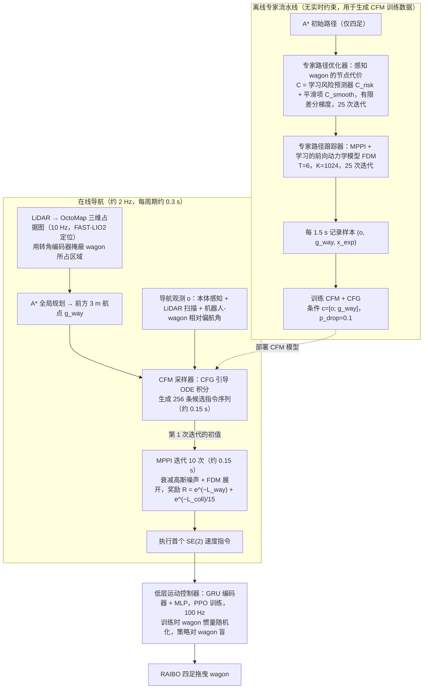

# RAIBO-Wagon：四足机器人牵引货车的实时导航系统

**RAIBO-Wagon**（*RAIBO-Wagon: Real-Time Navigation System for a Legged Robot Towing a Wagon*，[arXiv:2610.39267](https://arxiv.org/abs/2610.39267)）收录于 senlanke「具身运控lab」10-26–10-30 前沿论文动态（人形/四足）。本页依据**周报条目 + arXiv 摘要页**整理，流程图依据论文方法部分（见参考来源），未逐页核对实验数字；指标与结论以论文为准。

## 一句话定义

**RAIBO-Wagon：四足机器人牵引货车的实时导航系统——条件流匹配模型为 MPPI 提供初始轨迹，再由基于学习前向动力学模型的 MPPI 迭代修正；全板载系统可牵引接近机器人自重的 40 kg 负载。**

## 英文缩写速查

| 缩写 | 英文全称 | 简要说明 |
|------|----------|----------|
| RL | Reinforcement Learning | 强化学习 |
| WBC | Whole-Body Control | 全身控制 |

## 为什么重要

- 周报所述待解决的问题：四足机器人牵引欠驱动货车时，组合系统动力学复杂，在狭窄空间中可行路径范围很小。

## 流程总览

图依据：论文 §IV 方法（IV-A 至 IV-E）、Fig. 2、Algorithm 1/2、§V 实现细节（模块频率与耗时）。

## 核心机制

| 项 | 内容 |
|----|------|
| **arXiv** | [2610.39267](https://arxiv.org/abs/2610.39267) · [PDF](https://arxiv.org/pdf/2610.39267) |
| **作者（arXiv）** | Yang, Insung, Kim, Eunchae, Hur, Jungwoo, Jeon, Seunghun, Choi, Donghyuk, Hwangbo, Jemin |
| **机构（周报所述，未逐条核实）** | 韩国科学技术院机器人与人工智能实验室 |
| **arXiv 评论栏** | （无） |
| **开源** | arXiv 摘要页与评论未见代码或项目页链接（仅核对 arXiv 摘要页，不代表未发布）（2026-11-02） |
| **周报所述创新点** | 条件流匹配模型为 MPPI 提供初始轨迹，再由基于学习前向动力学模型的 MPPI 迭代修正；全板载系统可牵引接近机器人自重的 40 kg 负载。 |

### arXiv 摘要节选（英文原文）

> Legged robots have demonstrated advanced capabilities across a wide range of real-world tasks, yet much of this progress concerns the robot controlling only itself. Once the robot is coupled to an external object -- particularly an underactuated one -- the dynamics of the combined assembly become more complex.

## 源码运行时序图

**不适用**：arXiv 摘要页与评论未见代码或项目页链接（仅核对 arXiv 摘要页，不代表未发布），无可对齐的官方代码流程。

## 实验与评测

- 周报与摘要给出的数字/场景已写入上表「创新点」与摘要节选；其余实验细节、基线与成功率定义请回到论文正文。
- 读法：先对齐任务设定、传感器与成功定义（仿真/真机），再解读 headline 数字，勿跨论文直接比较。

## 与其他工作对比

| 维度 | 读法 |
|------|------|
| **同周对照** | 见 [人形/四足周报技术地图](../overview/senlanke-weekly-2026-10-26-30-humanoid-quadruped-technology-map.md)，按方向浏览同期论文 |
| **开源状态** | arXiv 摘要页与评论未见代码或项目页链接（仅核对 arXiv 摘要页，不代表未发布） |

## 结论

**RAIBO-Wagon：四足机器人牵引货车的实时导航系统。**

1. 本页是入库级摘要，复现前请核对论文正文、附录与代码仓库。
2. 指标须连同实验条件解读。
3. 关注 arXiv 版本更新与代码发布。

## 关联页面

- [senlanke-weekly-2026-10-26-30-humanoid-quadruped-technology-map](../overview/senlanke-weekly-2026-10-26-30-humanoid-quadruped-technology-map.md)
- [locomotion](../tasks/locomotion.md)
- [reinforcement-learning](../methods/reinforcement-learning.md)

## 参考来源

- [raibo-wagon-legged-towing-navigation_arxiv_2610_39267.md](../../sources/papers/raibo-wagon-legged-towing-navigation_arxiv_2610_39267.md)
- [wechat_senlanke_weekly_humanoid_quadruped_2026-10-26_30.md](../../sources/blogs/wechat_senlanke_weekly_humanoid_quadruped_2026-10-26_30.md)
- [arXiv:2610.39267](https://arxiv.org/abs/2610.39267)
- [arXiv PDF](https://arxiv.org/pdf/2610.39267)：已通读方法部分（实验与附录以略读为准）：§III 预备知识（MPPI、CFM+CFG）、§IV 方法（低层控制器、专家路径优化器/跟踪器、FDM、CFM 蒸馏、CFM 热启动 MPPI）、§V 实现细节；§VI 实验结果仅浏览

## 推荐继续阅读

- [arXiv PDF](https://arxiv.org/pdf/2610.39267)
