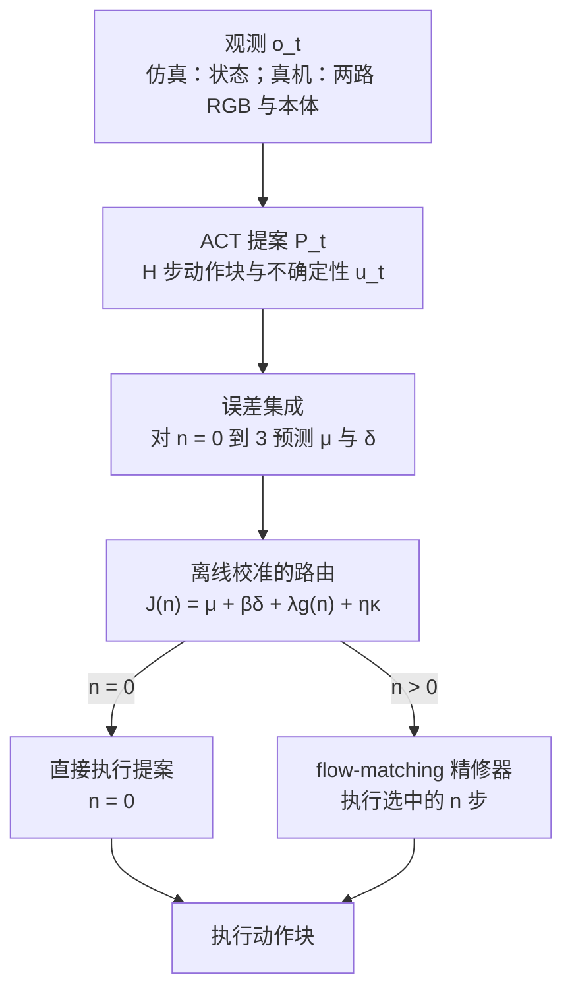
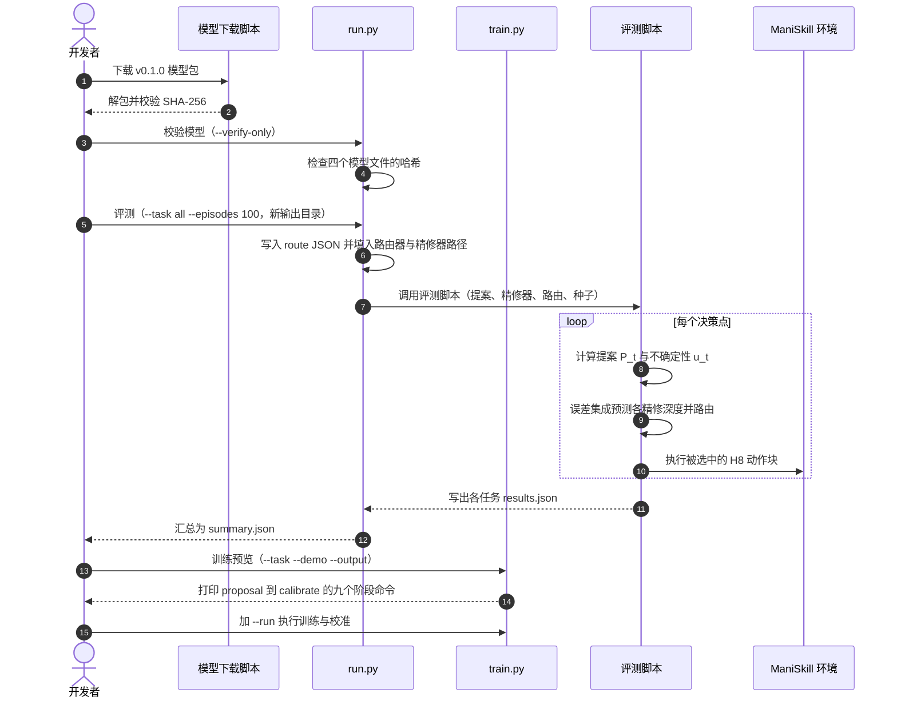

# RAIN：只在需要时精修动作块

**RAIN（Refine Actions If Needed）** 是一种自适应动作块精修框架：轻量策略先给出可直接执行的动作块，一个在演示数据上训练的误差集成先预测“不精修、精修 1 到 3 步”各自的动作误差，再决定是否调用 flow-matching 精修器以及精修几步，只执行被选中的那一种候选。

## 英文缩写速查

| 缩写 | 英文全称 | 简要说明 |
|------|----------|----------|
| RAIN | Refine Actions If Needed | 本文框架：按状态决定是否精修以及精修几步 |
| ACT | Action Chunking with Transformers | 单次前向输出动作块的轻量提案策略，RAIN 的起点 |
| FM | Flow Matching | 从提案出发积分速度场的生成式精修器；“FM-k”表示 k 次网络评估 |
| DP | Diffusion Policy | 迭代去噪的生成式策略，论文中的高成功率但高延迟对照 |
| ms/action | milliseconds per action | 论文报告的摊销策略延迟，按每个动作计算 |
| H8 | Horizon 8 action block | 仓库中每次决策执行 8 个动作的配置 |

## 为什么重要

- **成功率与延迟的折中：** 迭代生成式策略（DP、FM）能提升成功率，但每次决策要多次网络评估；ACT 类策略快，却有预测误差。RAIN 试图两者兼得。
- **精修量是状态相关的：** 固定精修步数对某些状态不够、对另一些状态浪费。论文用匹配对照表明，动态路由在同等成功率下降低了精修评估次数。
- **可复现入口较完整：** 仓库同时提供仿真训练、评测和预训练权重，便于在 ManiSkill 任务上直接验证路由思路。

## 核心信息

| 项 | 内容 |
|----|------|
| **机构** | 香港科技大学（广州）；北京理工大学；上海交通大学；牛津大学；南洋理工大学 |
| **平台 / 数据** | 仿真：ManiSkill3 八个任务（状态观测）；真机：6 自由度 ARX 机械臂加夹爪，两路 RGB 与本体状态 |
| **数据规模** | 仿真每任务 500 条成功演示，按 400 / 50 / 50 划分训练、校准与留出；真机每任务 50 条演示（30 Hz） |
| **开源** | **已开源**（MIT）：仓库 `rain-policy/RAIN` 提供仿真训练、评测与 v0.1.0 预训练模型；真机代码未在仓库中出现 |

## 核心原理

### 提案、误差预测与路由

1. **提案：** ACT 提案 P_t（H 步动作块）加标量不确定性 u_t；提案与精修器联合训练后冻结。
2. **候选误差预测：** 在离线演示上，比较不精修与各精修深度的候选与专家动作块的加权误差，作为连续目标训练一个 M 成员的集成，预测每个候选的均值与方差。
3. **路由：** 校准后的目标 J_t(n) = μ_t(n) + β·δ_t(n) + λ·g(n) + η·κ_t(n) 综合预测误差、集成不确定性、计算成本与时间一致性；选择分数最低的 n。
4. **执行：** 在线只构造被选中的候选；n = 0 时直接执行提案，不调用精修器。

## 源码运行时序图

以下时序对齐官方仓库 `rain-policy/RAIN`（核查版本 `b1aa6fa`）的入口：`tools/download_models.py` 下载并校验权重，`run.py` 校验四个模型文件、写入路由 JSON 后调用 `scripts/evaluate_rain.py`；`train.py` 默认只打印九个训练阶段的命令，加 `--run` 才执行。

- **最短复现路径（仓库 README）：** 安装依赖（Linux、Python 3.10、NVIDIA GPU，见 `docs/installation.md`）→ `tools/download_models.py --task pickcube` → `run.py --task pickcube --verify-only` → `run.py --task pickcube --episodes 1`。
- **仓库结构：** 入口见 `run.py`、`train.py`；方法实现见 `src/policies/`（`maniskill_uact_*` 命名为兼容既有检查点而保留）。

## 工程实践

| 项 | 建议 |
|----|------|
| 环境 | 仓库要求 Linux、Python 3.10、NVIDIA GPU，并配置 Vulkan；按 `docs/installation.md` 固定依赖版本 |
| 评测 | 每次评测用新输出目录（`run.py` 对已存在目录直接报错）；默认 CUDA Graph 后端，FP32 |
| 训练数据 | HDF5 状态演示，仿真端按 400 / 50 / 50 划分训练、校准与留出；论文中路由的拟合与校准使用独立的校准划分 |
| 延迟读法 | 仿真表中的 ms/action 是隔离的 FP32 CUDA Graph 推理摊销值；真机看平均成功完成时间 |
| 迁移到真机 | 论文真机结果来自 ARX 平台，仓库未包含真机控制代码；复现需自行接入相机与控制栈 |
| 调试指标 | 精修次数分布、各候选的预测误差与路由选择比例、FM 评测次数 |

## 实验与评测

- **仿真 8 任务（Table I）：** 总成功率 RAIN 66.6%（延迟 0.322 ms/action）；ACT 41.4%（0.222 ms）；DP-5 67.9%（1.839 ms）；DP-10 67.5%（3.120 ms）；FM-10 64.1%（3.074 ms）。RAIN 在 PegInsertionSide（59%）与 StackPyramid（63%）上高于同类单一迭代策略。
- **匹配对照（Table III）：** 与固定 3 次精修相比，RAIN 成功率 66.6% 对 66.4%，策略延迟降低 15.7%，精修评测次数降低 26.6%。
- **真机 4 任务（Table II，每任务 20 次）：** RAIN 72.5%，ACT 55.0%，DP 61.25%；平均成功完成时间 RAIN 17.57 s、ACT 17.17 s、DP 21.49 s。
- **仓库参考结果：** README 报告的 100 集逐任务结果与论文表格一致，但 README 也注明完整的 800 集评测与全量重训未在打包时重复。

## 结论

**RAIN 的主要价值是把“要不要精修、精修几步”变成一次离线校准的路由决策，而不是固定的生成步数。**

1. **先保留直接执行路径：** 对于不需要精修的状态，RAIN 直接执行提案，这是其延迟优势的来源。
2. **精修信号来自专家偏差而非环境回报：** 候选与专家动作的偏差作为连续目标，不需要 rollout 奖励或精修需求标签。
3. **动态路由比固定精修更划算：** 论文的匹配对照显示，在相近成功率下，动态路由减少了精修评测次数与策略延迟。
4. **仿真收益比真机收益更容易复现：** 仓库只覆盖八个 ManiSkill 任务的训练与评测；真机 72.5% 的结果目前无法从仓库独立复现。
5. **路由目标与任务成功之间仍有距离：** 作者在局限中指出，路由基于动作误差，未必反映精修对任务成功的影响，尤其是在演示分布之外。

## 与其他工作对比

| 对照 | 差异读法 |
|------|----------|
| [Diffusion Policy](../methods/diffusion-policy.md) | 迭代生成的高成功率基线；RAIN 在更低的摊销延迟下接近其仿真成功率，但未超过最高的 DP-5 |
| [ACT 类动作块策略](../methods/action-chunking.md) | RAIN 以 ACT 提案为起点；差异在于是否精修以及精修几步 |
| [flow-matching 具身策略](../concepts/flow-matching-embodied-policy.md) | RAIN 把 FM 当作可选的精修器，而不是每步都要运行的唯一生成器 |
| A2A、ProbeFlow | 论文中的相关路线：A2A 用动作历史构造 flow 源，ProbeFlow 用探测速度做自适应求解；RAIN 的区别在于先比较精修与否再决定 |
| [residual-policy-learning](../methods/residual-policy-learning.md) | 同样对基础策略做修正，但残差策略靠环境交互学习；RAIN 只用离线演示 |

## 局限与风险

- **监督目标是专家偏差：** 路由学习的是动作误差，不直接优化任务成功；演示分布之外的状态风险更高。
- **真机证据的可复现性：** 真机 4 任务的结果来自论文，仓库未提供真机代码与数据，无法在本页直接核对。
- **同名缩写：** 与 [RAIN（region-aware interaction networks）](./paper-rain-region-aware-interaction-networks.md) 不是同一工作，检索时需要按 arXiv 编号区分。
- **README 与 arXiv 状态不一致：** 仓库 README 写 arXiv 尚未公布，而 arXiv 2610.19765 已存在；引用时以 arXiv 编号为准。

## 关联页面

- [Action Chunking](../methods/action-chunking.md) — 提案动作块的基础范式
- [Diffusion Policy](../methods/diffusion-policy.md) — 迭代生成式策略的代表对照
- [Flow Matching 具身策略](../concepts/flow-matching-embodied-policy.md) — 精修器所用的生成方式
- [Residual Policy Learning](../methods/residual-policy-learning.md) — 对已有策略做残差修正的相关路线
- [Manipulation](../tasks/manipulation.md) — 任务范畴
- [RAIN（region-aware interaction networks）](./paper-rain-region-aware-interaction-networks.md) — 同名缩写的另一篇工作

## 参考来源

- [rain_arxiv_2610_19765.md](../../sources/papers/rain_arxiv_2610_19765.md) — 论文摘录与开源核查（2026-10-15）
- [wechat_embodied_station_robot_31_papers_2026-10-15.md](../../sources/raw/wechat_embodied_station_robot_31_papers_2026-10-15.md) — 文章摘要与链接
- [arXiv:2610.19765](https://arxiv.org/abs/2610.19765) — 原文（提交日期 2026-10-14）

## 推荐继续阅读

- [RAIN 代码仓库（MIT）](https://github.com/rain-policy/RAIN) — 训练、评测与 v0.1.0 权重
- [RAIN 项目页](https://rain-policy.github.io/) — 方法与视频
