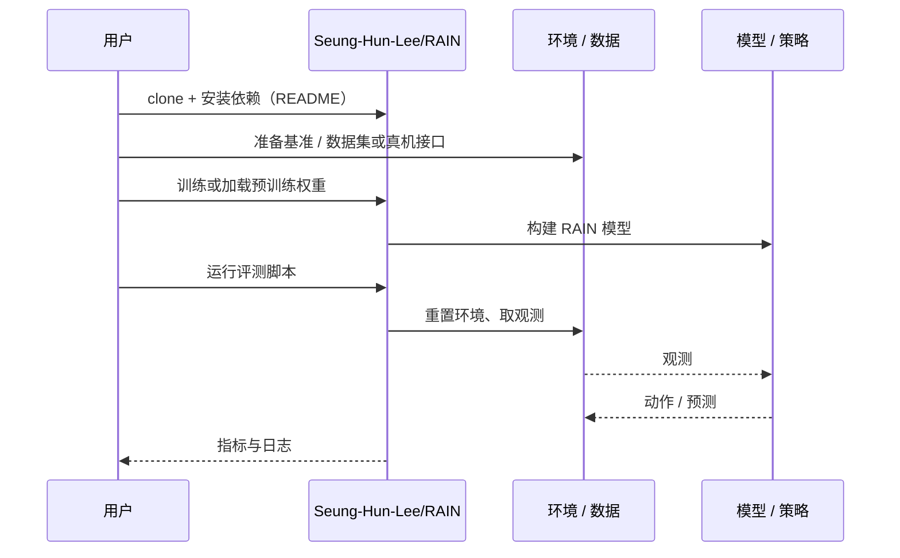

# RAIN（arXiv:2610.14039）

**RAIN**（*RAIN: Robotic Task Generalization with Region-Aware Interaction Networks*，[arXiv:2610.14039](https://arxiv.org/abs/2610.14039)，[项目页](https://seung-hun-lee.github.io/projects/RAIN/)，[代码](https://github.com/Seung-Hun-Lee/RAIN)）来自 [具身智能小站 2026-10-14 盘点](../../sources/blogs/wechat_embodied_station_41_papers_streamingwam_2026-10-14.md)，属「操作与柔顺控制」组。

## 一句话定义

**用动作类型 + 目标区域掩码表示子任务，结合跨视角编码、轨迹预测与完成判断；参考轨迹重定向合成新目标交互。**

## 英文缩写速查

| 缩写 | 英文全称 | 简要说明 |
|------|----------|----------|
| RAIN | Region-Aware Interaction Network | 本文方法 |
| LIBERO | Lifelong Robot Learning Benchmark | 操作基准 |
| IL | Imitation Learning | 模仿学习 |

## 为什么重要

- 技能绑定到目标区域后才能跨任务组合。
- 开源结论：**已开源**（步骤 2.5，2026-10-14）。项目页链接的 GitHub 仓库可达。
- 同期同组工作见 [流式动作块与世界模型记忆：具身智能小站 10-14 期 41 篇阅读坐标](../overview/embodied-station-2026-10-14-41-papers-technology-map.md)。

## 核心机制

| 项 | 内容 |
|----|------|
| **arXiv** | [2610.14039](https://arxiv.org/abs/2610.14039) |
| **开源** | **已开源** |
| **要点** | LIBERO-Analogy 与真机桌面任务。 |
| **文内指标** | 以原文为准。 |

## 源码运行时序图

以下为按仓库入口（`Seung-Hun-Lee/RAIN`）推断的通用运行链路；入库日仅核实仓库可达，未逐文件阅读，具体脚本名以 README 为准。

## 实验与评测

- 以原文为准。
- **读法：** 本页为索引级摘要，依据公众号转述的官方摘要与仓库信息整理；逐项数字与 baseline 以原文 PDF 为准。

## 与其他工作对比

- 横向索引见 [流式动作块与世界模型记忆：具身智能小站 10-14 期 41 篇阅读坐标](../overview/embodied-station-2026-10-14-41-papers-technology-map.md)；同 arXiv 不重复造页。

## 结论

**子任务的「动作 × 区域」表示是组合泛化的实用中间层。**

1. 开源边界：**已开源** — 项目页链接的 GitHub 仓库可达。
2. 核心机制：LIBERO-Analogy 与真机桌面任务。
3. 复现与选型前核对任务协议、硬件与基准口径，勿直接横比公众号摘录数字。

## 关联页面

- [manipulation](../tasks/manipulation.md)
- [imitation-learning](../methods/imitation-learning.md)
- [paper-robocombine-combinatorial-generalization](./paper-robocombine-combinatorial-generalization.md)
- [embodied-station-2026-10-14-41-papers-technology-map](../overview/embodied-station-2026-10-14-41-papers-technology-map.md)

## 参考来源

- [rain_region_aware_interaction_networks_arxiv_2610_14039.md](../../sources/papers/rain_region_aware_interaction_networks_arxiv_2610_14039.md)
- [wechat_embodied_station_41_papers_streamingwam_2026-10-14.md](../../sources/blogs/wechat_embodied_station_41_papers_streamingwam_2026-10-14.md)
- [arXiv:2610.14039](https://arxiv.org/abs/2610.14039)

## 推荐继续阅读

- [arXiv PDF](https://arxiv.org/pdf/2610.14039)
- [项目页](https://seung-hun-lee.github.io/projects/RAIN/)
- [https://github.com/Seung-Hun-Lee/RAIN](https://github.com/Seung-Hun-Lee/RAIN)
