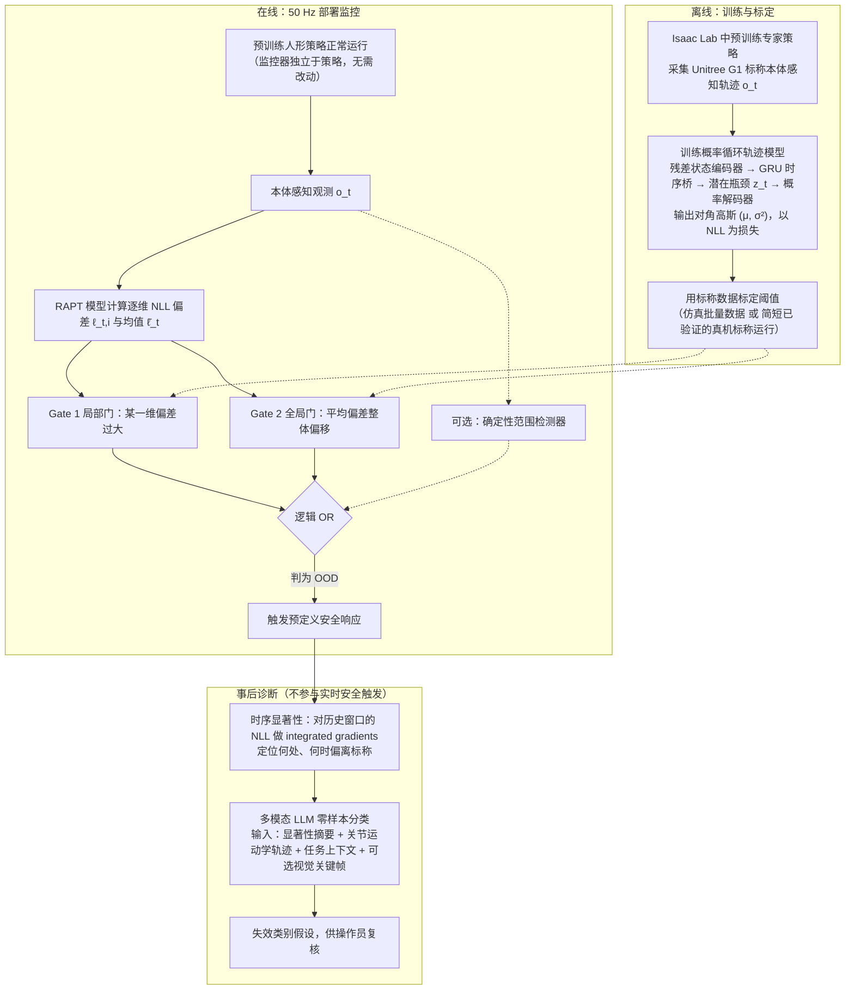

# RAPT: model-predictive out-of-distribution detection and failure diagnosis for sim-to-real humanoid deployment

**RAPT: model-predictive out-of-distribution detection and failure diagnosis for sim-to-real humanoid deployment**（[arXiv:2602.01515](https://arxiv.org/abs/2602.01515)）收录于 [自由度FreeDof · Sim2Real 四条路线梳理](../../sources/blogs/wechat_freedof_sim2real_four_routes_dr_to_residual_2026-08-23.md) 参考文献 **[37/44]**，归类 **监控与评测**。

## 一句话定义

仿真学习标称执行流形，部署时用预测偏差做 OOD 检测与 sim2real 失配诊断。

## 英文缩写速查

| 缩写 | 英文全称 | 简要说明 |
|------|----------|----------|
| RAPT | Recurrent Anomaly Probabilistic Trajectory Model（依据 arXiv:2602.01515 摘要） | 文内部署监控框架 |
| OOD | Out-of-Distribution | 分布外检测 |
| Sim2Real | Simulation to Real | 仿真到真机 |

## 为什么重要

- 文内部署期监控完整方案；89% TPR（实机 78 次试验，RAPT+Range 混合 88.9%；纯 RAPT 85.7%，Table 2）与诊断准确率两组数字出处。
- 诊断口径（依据 arXiv:2602.01515v2 摘要、§5.4、Table 3）：16 条实机失效日志、21 个预定义类别；**仅本体感知 Top-1 75.0%（12/16）**——即摘要所写「21 类语义诊断 75%」；**加一帧视觉关键帧 Top-1 87.5%（14/16）**，Top-3 为 87.5%（仅本体）/ 100%（加视觉）。87.5% 并非摘要所报数字，二者是不同设置。
- 在 [44 篇技术地图](../overview/freedof-sim2real-44-papers-technology-map.md) 与 [四条路线对比](../comparisons/sim2real-four-routes-identifiability.md) 中作为 **监控与评测** 节点。
- 开源结论：**待核实**（步骤 2.5，2026-09-20）。

## 流程总览

图依据：论文 §3.1-3.6（Methodology）、Fig.2。

## 核心机制

| 项 | 内容 |
|----|------|
| **出处** | arXiv 2026 |
| **文内章节** | 监控与评测 |
| **要点** | 模型预测 + 失配度量 +（可选）LLM 根因推理。 |
| **开源** | **待核实** |

## 源码运行时序图

**不适用（待核实）** — 截至 2026-09-20 以项目页/论文 Code availability 为准；入库未核验可运行入口。

## 实验与评测

- **本页为索引级节点**（FreeDof 44 篇梳理 [37/44]）：正文固化文内角色与机制要点，**未转存原文实验表**。
- **回原文须核对的证据**：本页「为什么重要」已录 89% TPR 与诊断准确率数字，诊断数字的设置见上（Table 3）；TPR 须回原文核对其**判异阈值与误报率口径**（Table 2：RAPT+Range FPR 6.7%）——本页未转存完整实验表。
- **读法：** 先对齐平台、任务、指标定义与成功阈值，再读任何数字；勿从公众号摘录外推。

## 与其他工作对比

| 维度 | 读法 |
|------|------|
| **文内路线** | 归类 **监控与评测**；同路线其他节点见 [44 篇技术地图](../overview/freedof-sim2real-44-papers-technology-map.md) 与 [四条路线对比](../comparisons/sim2real-four-routes-identifiability.md) |
| **横比口径** | TPR 随判异阈值移动，必须连同 FPR 一起读；只报 TPR 的单点数字无法与其他监控方案横比。 |
| **开源状态** | **待核实** — 部署 / 复现前以项目页或原文 Code availability 为准 |

## 结论

**策略无自我评判机制，监控应作为部署标配而非附加项。**

1. 文内角色：监控与评测 路线上的参考节点，非重复 arXiv 页面。
2. 机制要点：模型预测 + 失配度量 +（可选）LLM 根因推理。…
3. 部署/复现前请对照原文与项目页，勿直接外推公众号数字。

## 关联页面

- [Sim2Real 四条路线（可辨识性）](../comparisons/sim2real-four-routes-identifiability.md)
- [44 篇技术地图](../overview/freedof-sim2real-44-papers-technology-map.md)
- [Sim2Real](../concepts/sim2real.md)
- [分布外（OOD）泛化与 OOD 指标怎么读](../concepts/out-of-distribution-generalization.md) — 本页属其「② 部署监控」一义：参考分布是仿真标称执行流形，失败形态是漏报/误报而非任务失败

## 参考来源

- [freedof_sim2real_37_rapt-sim2real-ood-detection.md](../../sources/papers/freedof_sim2real_37_rapt-sim2real-ood-detection.md)
- [wechat_freedof_sim2real_four_routes_dr_to_residual_2026-08-23.md](../../sources/blogs/wechat_freedof_sim2real_four_routes_dr_to_residual_2026-08-23.md)
- [freedof_sim2real_44_catalog.md](../../sources/papers/freedof_sim2real_44_catalog.md)
- [arXiv PDF](https://arxiv.org/pdf/2602.01515)：已通读方法部分（实验与附录以略读为准）：摘要、§1 引言、§3 Methodology（3.1-3.6）、§4 实验设定。
- 核对（2026-11-02）：对照 arXiv:2602.01515v2 摘要、Table 2、Table 3、§5.4；87.5% Top-1 对应「RAPT+视觉关键帧」，摘要的 75%/21 类对应仅本体感知，已在「为什么重要」写明口径。

## 推荐继续阅读

- [arXiv PDF](https://arxiv.org/pdf/2602.01515)
- [44 篇 Sim2Real 技术地图](../overview/freedof-sim2real-44-papers-technology-map.md)
