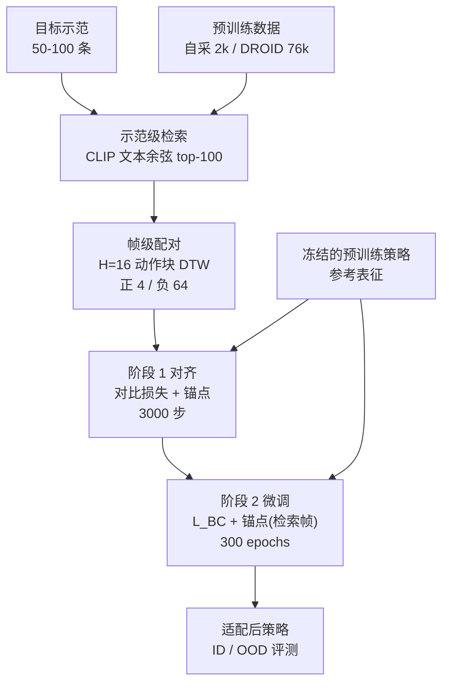
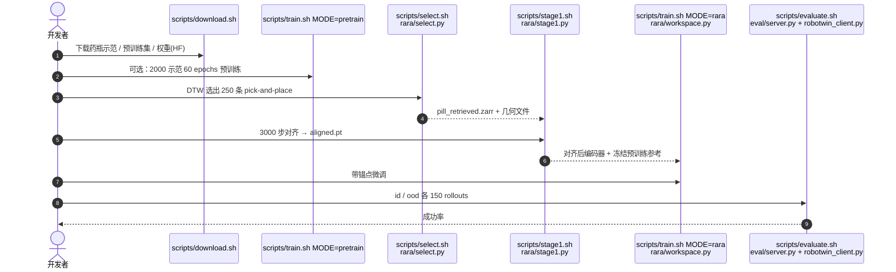

---

type: entity
tags: [paper, manipulation, vla, diffusion-policy, fine-tuning, representation-learning, retrieval, generalization, robotwin, robocasa, franka, uva-virginia]
status: complete
updated: 2026-10-12
arxiv: "2610.13578"
project_id: rara-retrieval-anchored-alignment
project: https://shua-kang.github.io/RARA_robot/
code: https://github.com/Shua-Kang/RARA
related:
  - ../overview/embodied-station-34-papers-spatial-grounding-technology-map.md
  - ../tasks/manipulation.md
  - ../methods/imitation-learning.md
  - ../methods/diffusion-policy.md
  - ./paper-diffusion-policy.md
  - ./robotwin.md
  - ./robocasa.md
sources:
  - ../../sources/blogs/wechat_embodied_station_34_papers_spatial_grounding_2026-10-12.md
  - ../../sources/papers/rara_arxiv_2610_13578.md
  - ../../sources/sites/rara-github-io.md
  - ../../sources/repos/rara.md
summary: "RARA（arXiv:2610.13578，UVA）：少量示范微调前，先按任务指令与动作块 DTW 检索相近预训练示范并对比对齐视觉表征，微调时再对检索帧锚定冻结参考表征；Diffusion Policy / GR00T N1.7 共 13 任务相对 FT 平均 ID +9.5、OOD +13.6 点；仓库仅覆盖 RoboTwin 药瓶流程。"
---

# RARA：检索锚定的表征对齐微调

**RARA**（*Retrieval-Anchored Representation Alignment*；[arXiv:2610.13578](https://arxiv.org/abs/2610.13578)，[项目页](https://shua-kang.github.io/RARA_robot/)，[代码](https://github.com/Shua-Kang/RARA)）来自 University of Virginia（Xuhui Kang、Yen-Ling Kuo 等）：用少量目标示范微调预训练操作策略时，先从预训练数据里**检索与目标意图、运动相近的示范**，把策略对新示范的视觉表征对齐过去，再在微调中**约束这些检索帧的表征不要漂移**，以保住分布外（OOD）泛化。

## 一句话定义

**微调前先让新示范的表征“靠近”相近的预训练示范，微调中再用冻结的预训练策略作参照，锚住检索帧的表征，从而在不牺牲域内成功率的同时少丢泛化。**

## 英文缩写速查

| 缩写 | 英文全称 | 简要说明 |
|------|----------|----------|
| RARA | Retrieval-Anchored Representation Alignment | 本文两阶段微调方法 |
| FT | Fine-Tuning | 只用目标示范的标准微调基线 |
| Co-FT | Co-Fine-Tuning | 目标示范加检索示范一起做行为克隆的基线 |
| ID / OOD | In-Distribution / Out-of-Distribution | 示范配置内 / 分布外（如物体位置更宽）评测 |
| DTW | Dynamic Time Warping | 帧级检索中比较动作块的距离 |
| CKA | Centered Kernel Alignment | 衡量微调前后表征相似度的诊断指标 |
| VLA | Vision-Language-Action | 本文适配对象之一（GR00T N1.7） |

## 为什么重要

- **问题常见：** 预训练策略 + 几十条目标示范是当前主流适配路径，但域内成功率上升常以 OOD 变差为代价；论文把“同时看 ID 与 OOD”作为评估要求。
- **不依赖额外标注：** 锚点作用于**无动作标签**的检索帧，只需保留预训练数据与冻结参考模型。
- **可诊断：** 论文用特征畸变与 CKA 直接量化“漂移”，说明 OOD 收益与表征保持有关（相关性证据，非因果证明）。

## 核心信息

| 项 | 内容 |
|----|------|
| **机构** | 弗吉尼亚大学（University of Virginia）；致谢 Delta Electronics、Toyota Research Institute |
| **基座策略** | Diffusion Policy（ResNet-18 + 1-D UNet）；GR00T N1.7 |
| **基准** | RoboTwin 2.0（4 任务）、RoboCasa（5 任务）、真机 Franka（4 任务，第 4 个任务名原文抽取未读到） |
| **开源** | 部分：GitHub（MIT）只含 RoboTwin 药瓶任务的 DP 流程与 HF 数据/权重（截至 2026-10-12） |

## 方法栈 / 流程总览

## 方法

**输入 / 输出：** 输入预训练策略、预训练示范集、少量目标示范；输出适配后的策略（推理时结构不变，无额外检索开销）。

1. **示范级检索：** 冻结 CLIP 文本编码器编码指令，目标任务取均值，按余弦相似度取预训练示范 top-K=100。
2. **帧级配对：** 把示范切成 H=16 的重叠动作块，配对块首步观测；块间用 DTW（夹爪维度单独缩放）。每个目标块取最近 4 个为正样本，负样本取距离高于中位数的块（每步 64 个）。
3. **阶段 1（表征对齐）：** 多正样本对比损失（τ=0.07）加锚点项（λ1=1）；只训练产生锚点表征的编码器层和一个 2 层 MLP 投影头（1024→512→256，阶段后丢弃）；3,000 步，每步 32 目标帧 + 32 预训练帧。
4. **阶段 2（受限微调）：** L_BC + λ2·L_anchor（λ2=1）；锚点是当前策略对检索帧的表征与冻结预训练策略表征的距离。DP 用 MSE；GR00T 用按参考表征批方差归一化的平方误差。
5. **锚点位置：** DP 取双相机 ResNet-18 池化输出；GR00T 取视觉塔输出 token。

## 实验与评测

成功率（%，ID / OOD，种子均值）：

| 设置 | FT | Co-FT | STRAP | BlindVLA | RARA |
|------|----|-------|-------|----------|------|
| RoboTwin（DP，4 任务均值） | 67.4 / 47.3 | 64.4 / 47.6 | 72.6 / 52.4 | 67.9 / 47.2 | **76.0 / 58.3** |
| RoboCasa（GR00T N1.7，5 任务均值） | 69.2 / 44.3 | 67.1 / 43.7 | 66.1 / 48.1 | 68.5 / 46.8 | **74.0 / 55.5** |

- RoboTwin 另含 RETAIN（权重插值）基线，均值 47.0 / 34.2；RoboCasa 表中无该基线。
- **真机：** 文字报告相对 FT 平均 +16.4（ID）/ +19.2（OOD）；逐任务数字仅在图中，未读到。
- **总计：** 13 项任务相对 FT 平均 +9.5（ID）/ +13.6（OOD）。
- **消融（RoboTwin 均值）：** 随机预训练数据 50.3 / 34.9；随机阶段 1 配对 65.3 / 40.6；阶段 2 换 Co-FT 65.8 / 48.1；仅阶段 1 66.6 / 43.2；仅阶段 2 73.0 / 46.2——两阶段与检索质量缺一不可。
- **表征诊断：** Move Pill Bottle 目标帧特征畸变（ID/OOD）FT 0.50 / 0.49，RARA 0.23 / 0.23；预训练帧 CKA，RARA 0.92 / 0.91（Place Container 与 Move Pill Bottle），FT 为 0.68 / 0.87。
- 附录（含 G 节）与 HTML 末尾约 1.3 万字符未读到；锚点位置分析：八个位置均优于 FT。

## 源码运行时序图

官方仓库 [Shua-Kang/RARA](https://github.com/Shua-Kang/RARA) 提供 RoboTwin 药瓶任务的完整 DP 流程（归档见 [sources/repos/rara.md](../../sources/repos/rara.md)）：

## 工程实践

- **开源核查（2026-10-12）：** 项目页实际链接了 GitHub，仓库存在（MIT，约 25 个文件，最新提交 2026-10-11），属**部分开源**：仅 RoboTwin 药瓶 + Diffusion Policy；GR00T / RoboCasa / 真机实现未见于 README。
- **资源：** 预训练需 4 GPU、约 160 GB 主机内存；`download.sh small` 可跳过 77 GB 预训练数据，直接使用发布的权重与已选 250 条。
- **复现读点：** README 预期值（药瓶 ID：FT 44.0、Co-FT 44.7、RARA 59.3）与论文表内数字不同（论文该任务 ID：FT 32.9、RARA 51.6），差异原因未核实，复现时以自己的评测协议为准。
- **迁移前提：** 预训练集必须含同类任务，否则检索无益。

## 结论

**RARA 把“保住预训练表征”从正则化口号落成可执行的两阶段流程：检索决定锚什么，对齐决定起点，锚点决定漂移上限。**

1. 适配后除域内成功率外，**必须同时报 OOD**；本文 FT 在 RoboTwin 上 ID 67.4 而 OOD 仅 47.3。
2. **检索质量是关键：** 随机预训练数据把 RoboTwin 均值拉到 50.3 / 34.9，低于 FT。
3. **两阶段缺一不可：** 单做阶段 1 或阶段 2 均低于完整 RARA（OOD 43.2 / 46.2 对 58.3）。
4. **Co-FT 不等价于锚点：** 阶段 2 换 Co-FT 后 OOD 回落到 48.1。
5. **推理零额外成本**，代价在训练期（额外检索、参考前向、预训练数据存储）。
6. **前提受限：** 预训练集需含同类技能，附录 G 报告不同技能时锚点可能有害。
7. 开源版本只能复现 DP + RoboTwin 一个任务，不能据此复现 GR00T 与真机结果。

## 局限与风险

- 作者自述：依赖预训练数据含同类任务；实验以视觉变化为主，同机器人同动作空间；换本体/动作空间未验证。
- 真机逐任务结果在图中，本页未能核对；只有 3 个真机任务名可见。
- 仓库覆盖范围窄；预期值与论文表不一致。

## 与其他工作对比

- **相对 FT / Co-FT：** FT 无约束；Co-FT 在动作上共训，不直接约束表征。
- **STRAP：** 同样检索，但用于共训（DTW 子轨迹检索）；RoboTwin OOD 52.4 对 RARA 58.3。
- **BlindVLA：** 向冻结 DINOv2 蒸馏，不依赖检索；OOD 47.2。
- **RETAIN：** 权重插值，RoboTwin 上明显低于 FT。
- 基座背景见 [Diffusion Policy](./paper-diffusion-policy.md)、[RoboTwin](./robotwin.md)、[RoboCasa](./robocasa.md)。

## 关联页面

- [34 篇空间落地技术地图（汇总页）](../overview/embodied-station-34-papers-spatial-grounding-technology-map.md)
- [操作任务](../tasks/manipulation.md)
- [模仿学习](../methods/imitation-learning.md)
- [Diffusion Policy 方法](../methods/diffusion-policy.md)
- [RoboTwin](./robotwin.md)、[RoboCasa](./robocasa.md)

## 参考来源

- [具身智能小站 34 篇盘点（2026-10-12）](../../sources/blogs/wechat_embodied_station_34_papers_spatial_grounding_2026-10-12.md)
- [RARA 论文来源归档](../../sources/papers/rara_arxiv_2610_13578.md)
- [RARA 项目页核查](../../sources/sites/rara-github-io.md)
- [RARA 官方仓库归档](../../sources/repos/rara.md)

## 推荐继续阅读

- [RARA arXiv 原文](https://arxiv.org/abs/2610.13578)
- [RARA 官方仓库](https://github.com/Shua-Kang/RARA)
- [RoboTwin 2.0](https://github.com/RoboTwin-Platform/RoboTwin)
