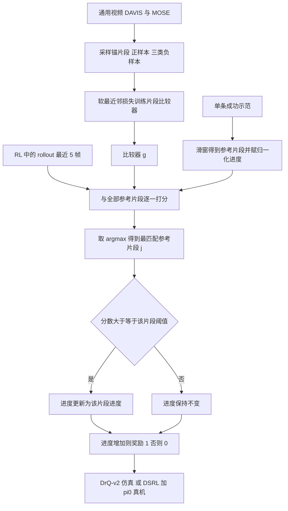

# RARM：置信门控的进度奖励模型（arXiv:2606.22027）

**RARM**（*Reference-Anchored Reward Model*，*RARM: Confidence-Gated Progress Reward Modeling for RL in Manipulation*，[arXiv:2606.22027](https://arxiv.org/abs/2606.22027)，NUS Human-Centered Robotic Lab 等，项目页自称 CoRL 2026 接收）把一条成功示范变成稠密的进度奖励：先用比较器找到当前 rollout 片段最像示范中的哪一段，再只在「匹配置信度达标且进度向前推进」时给奖励。

## 一句话定义

**用一个在通用视频上自监督训练的片段比较器，把单条成功示范当作「进度锚」，只对高置信度的前向进度发 1 的稠密奖励，低置信匹配和重复进度一律给 0，以压制假阳性奖励与奖励利用。**

## 英文缩写速查

| 缩写 | 英文全称 | 简要说明 |
|------|----------|----------|
| RARM | Reference-Anchored Reward Model | 本文方法：以参考示范为锚的奖励模型 |
| RL | Reinforcement Learning | 强化学习 |
| IL | Imitation Learning | 模仿学习 |
| VLA | Vision-Language-Action | 视觉-语言-动作策略，本文真机用 π0 |
| VLM | Vision-Language Model | 视觉-语言模型，GVL、Robometer、RoboDopamine 等基线属此类 |
| SNN | Soft Nearest Neighbours | 软最近邻损失，训练比较器的目标（式 1） |
| DINOv3 | self-DIstillation with NO labels v3 | 帧编码器，加 LoRA 适配 |
| LoRA | Low-Rank Adaptation | 低秩适配器 |
| DrQ-v2 | Data-regularized Q v2 | 仿真从零训练用的像素 off-policy RL |
| DSRL | Diffusion Steering RL | 真机用：RL 学习给冻结的扩散/流策略注入初始噪声 |
| SAC | Soft Actor-Critic | DSRL 里学噪声的 RL 智能体 |
| BinR | Binary Reward | 真机对照：DSRL 配稀疏二值成功奖励 |

## 为什么重要

- 机器人操作 RL 的核心障碍是奖励：稀疏成功奖励在长程任务里几乎收不到信号，手工稠密奖励难写难泛化（摘要、§1）。
- 作者指出进度类奖励的关键痛点是「视觉上看着快完成、实际错了」的失败会被智能体利用，所以奖励模型需要知道何时不该信自己（§1）。RARM 把这一点做成显式的置信门，而且置信度来自比较器自身的相似度，不另训不确定性模型（§1，作者自述）。
- 数据要求低：比较器在 DAVIS/MOSE 通用视频上一次训练完（附录 C.2），每个新任务只要一条成功示范（§3.3）。
- 推理开销低：每帧 <10 ms、5100 MB，对比 VLM 类基线 13200~19000 MB（附录 D.3、Table 6）。

## 核心原理与流程总览

**方法栈（均出自 §3，作者自述）**

1. 训练数据与损失（§3.1）：片段 T=5 帧；负样本三类（同视频不相交区域、锚区域时间反转、其他视频）；软最近邻损失，τ=0.1；增强在片段内保持一致。时间反转负样本让比较器必须理解运动方向，而不只是外观。
2. 结构（§3.2）：DINOv3+LoRA 逐帧编码，空间池化，时间旋转位置编码，帧间自注意力；孪生共享；交叉注意力比较器（rollout 作 query，参考作 key/value），所以比较有方向性；轻量头输出标量。
3. 奖励（§3.3）：参考片段按归一化时间位置赋进度 π_j；当前片段与所有参考片段打分取 argmax（不要求与参考同步，可慢可停可回退）；每个参考片段有来自参考自身匹配分数统计的离线阈值 δ_j；达标则取 π_j，否则进度不变；奖励是进度变量严格增大的指示函数（式 3）。作者的动机是原始相似度分数会抖动，且静态高相似状态会诱发奖励利用，故奖励「进度变化」而非「相似度」。
4. 接入 RL（§3.3、附录 E）：DrQ-v2 从零训练（仿真）；真机在冻结 π0 上用 DSRL（SAC 学注入噪声），RARM 取代 DSRL 默认的 −1 奖励。

## 工程实践

- **训练配置：** 比较器输入真机 384×384；奖励每 4 个环境步算一次，约 5 Hz（附录 B）。训练视频先剔除近静态序列（相邻帧掩码 IoU 均值超阈，附录 C.2；阈值数值文中未给）。
- **仿真 RL 设置：** DrQ-v2，Adam 学习率 1e-4，批大小 256，γ=0.99，3 步回报，探索噪声从 1.0 线性降到 0.1（500k 步），3 帧堆叠；MetaWorld 用 agentview RGB，LIBERO 加手腕相机；LIBERO 训练回合从示范中间状态初始化以覆盖后期进度（附录 C、E.1）。
- **真机：** AIRBOT Play 双臂，三台 RealSense（顶置加双腕），π0 每次预测 50 步动作块、每 25 步重推理，控制约 20 Hz；DSRL 的前 10 条 rollout 用随机噪声填充缓冲（附录 B、E.2、E.3）。
- **开源：** 项目页链接 GitHub 与 Hugging Face。仓库 main 分支 README 说明含奖励模型训练与片段相似度推理，需要另下 DINOv3 ViT-B/16 官方权重加 RARM 检查点，DrQ-v2 策略训练在 `policy_training_RARM` 分支（本次只读了 README，未读代码，未核对权重）。
- **复现提示（推测）：** 阈值 δ_j 的具体标定公式（分位数还是均值减标准差）正文未写明，复现需读代码。

## 与清单说法的核对

清单对该论文的一句话摘要（作者说由 LLM 据摘要起草）：「Reference-anchored, confidence-gated progress reward model from a single demonstration, robust to failures and reward hacking.」逐项核对：

| 清单措辞 | 论文里的情况 |
|----------|--------------|
| 参考锚定（reference-anchored） | 属实，§3.3：示范只当进度定位的锚，不是逐帧模仿目标 |
| 置信门控（confidence-gated） | 属实，式 (3) 与每片段阈值 δ_j |
| 来自单条示范 | 属实，但还需要一个额外的预训练比较器（DAVIS/MOSE 通用视频训练，附录 C.2）；「单条示范」指每个新任务的数据量，不是整个系统只靠一条示范 |
| 对失败与奖励利用「鲁棒」 | 证据较窄且多为定性：图 5 只有叠衣的一对成功/失败 rollout（失败累计到成功的 0.50，且是论文自己选的展示）；附录 D.2 为数字扰动的定性曲线，无量化指标。论文没有专门的奖励利用对抗评测。表述的限定词应是「在所示实验中抑制了假阳性」，而不是普遍鲁棒 |
| 仿真还是真机 | 清单未说，论文两者都有：9 个仿真任务（MetaWorld 4 加 LIBERO-10 5，DrQ-v2 从零训练）与 4 个真机任务（π0+DSRL） |
| 结果规模 | 真机每格仅 10 条评测 rollout、无重复种子或置信区间（Table 1）；仿真为 5 种子曲线（图 3），正文没有汇总数值表 |

另外，论文宣称「best overall success rates」，但基线的复现细节（各基线用的权重、提示词、阈值）在正文与附录均未详述（我的观察，非作者承认）。

## 局限

**论文自己承认（§5、§6）：**
- 视觉片段比较而非语义推理，遇到大的本体、视角或场景变化时可能退化。
- 纯 RGB 难以判断细粒度接触、抓取稳定性、力交互与细微形变。
- 参考轨迹式进度使重复/循环任务困难（相似状态在不同进度重复出现）；多参考与显式记忆留作未来工作。
- 假设能拿到有代表性的成功示范（§5）。

**我看到的未验证之处（非作者自述）：**
- 真机 Table 1 每格 10 条 rollout、单次训练，差 1~2 条的对比（如 Hand-over 90 条时 5 对 6）在统计上不足以下结论；叠衣 8/10 对 2/10 差距大，但也只是一个任务。
- 对 π0 基础策略的提升叠加了 DSRL，论文没有设「DSRL+其他稠密奖励」的真机对照，真机只比 BinR，因此「RARM 优于 VLM 奖励」的证据只来自仿真与图 5 的单对 rollout。
- 仿真结果以曲线呈现，正文没有最终成功率数值表；MetaWorld 上几个基线最终也能学会（§4.1）。
- 合成参考（SeeDance 2.0）与不同物体参考只测了 MetaWorld pull 一个任务（附录 D.1）。
- 文内不一致：真机回合超时附录 B（Hand-over 600、叠衣 1200 步）与附录 E.3 表（300、1000）不同；图 3 的 AblationSim 与正文的 Similarity Reward 命名不一；VIP 出现在图 5 与表 6 却不在 §4.1 基线列表。

## 关联页面

- [进度奖励建模（概念页）](../concepts/progress-reward-modeling.md)
- [奖励设计](../concepts/reward-design.md)
- [进度奖励建模综述](../entities/paper-progress-reward-modeling-survey.md)
- [Robometer](../entities/paper-robometer.md)（本文 VLM 类基线之一）
- [SARM：阶段感知奖励模型](../entities/paper-sarm.md)（论文引用 [16]，需子任务标注的对照路线）
- [TOPReward](../entities/paper-topreward.md)（论文引用 [31]）
- [π0](../entities/paper-pi0.md)（真机基础策略）
- [LIBERO 基准](../entities/libero-benchmark.md)
- [强化学习](../methods/reinforcement-learning.md)
- [SAC](../methods/sac.md)（DSRL 中学噪声的智能体）

## 参考来源

- [sources/papers/rarm-confidence-gated-progress-reward_arxiv_2606_22027.md](../../sources/papers/rarm-confidence-gated-progress-reward_arxiv_2606_22027.md)
- [arXiv:2606.22027](https://arxiv.org/abs/2606.22027)（本页据 v1 PDF 全文）
- 项目页：<https://rarm-robotics.github.io/>

## 继续阅读

- [arXiv PDF](https://arxiv.org/pdf/2606.22027v1)
- 代码：<https://github.com/pengzhi1998/rarm>；权重：<https://huggingface.co/pengzhi1998/RARM>
- 论文参考的 DSRL [58]、DrQ-v2 [57]、GVL [12]、RoboCLIP [59]、TemporalOT [33]（本仓库暂无对应页面）
