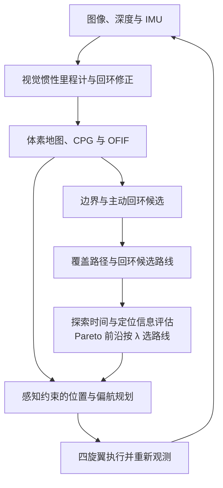

# RAVEN：定位不确定性下的无人机主动 SLAM 与快速视觉探索

**RAVEN: A Unified Active SLAM System for Rapid Autonomous Visual Exploration with Aerial Robots under Localization Uncertainty** 是香港科技大学提出的四旋翼主动 SLAM 框架：规划探索与主动回环，并在执行过程中考虑视觉定位信息。

## 英文缩写速查

| 缩写 | 英文全称 | 简要说明 |
|------|----------|----------|
| SLAM | Simultaneous Localization and Mapping | 同时定位与建图 |
| ALC | Active Loop Closure | 主动回环 |
| CPG | Condensed Pose Graph | 稀疏化的位姿图 |
| OFIF | Online Fisher Information Field | 在线 Fisher 信息场 |
| ATE | Absolute Trajectory Error | 绝对轨迹误差 |

## 核心信息

| 字段 | 内容 |
|------|------|
| 机构 | 香港科技大学（The Hong Kong University of Science and Technology） |
| 论文 | [arXiv:2610.37111v1](https://arxiv.org/abs/2610.37111)；作者 Xinyi Chen、Yichen Zhang、Chenxing Jiang、Shaojie Shen |
| 原文核查 | 系统、主要方法及实验已核对；其余章节尚待逐节复核，当前为草稿 |
| 平台 | 自定义四旋翼，RealSense D435i、Intel i7-1260P，起飞重量 1.3 kg |

## 项目流程

## 核心机制

1. **目标生成：** CPG 对高频位姿进行稀疏表示；通过特征共视聚类和 NetVLAD / Faiss 检索筛选有望成功回环的历史视点。覆盖规划先生成多条基础路线，再插入至多一个待执行的主动回环。
2. **双目标选择：** 探索代价是预估完成时间；定位效用用回环成功与失败两种虚拟位姿图的 D-opt 信息量，按预测成功概率加权。保留非支配路线，按 λ 在 Pareto 前沿选择；λ 接近 0 更重效率，接近 1 更重定位精度。
3. **执行规划：** OFIF 增量缓存视觉特征信息以支持常数时间查询；信息感知 A* 和 B 样条用于位置规划，偏航规划兼顾可观测性和平滑性。其信息场采用近似，不能等同真实定位精度保证。

## 实验与局限

- 仿真基准覆盖四个场景，每个方法每场景 10 次；例如 Warehouse 中 λ 为 0、0.5、1 时，平均探索时间分别为 89.2、107.4、136.2 秒，平均 ATE 为 0.36、0.17、0.09 米。结果依赖实验设置；SRE 和 REAL 由作者按论文重新实现。
- 三个真实场景中，规划、建图与定位均在机载运行。Flight Arena 用动捕真值算 ATE；走廊和停车场用手持激光点云计算地图最近邻距离（NND），不能将 NND 当作轨迹 ATE。每个参数分别运行 5 次和 3 次。
- 论文承诺后续发布源码，目前未找到官方可运行实现。回环成功概率使用高斯漂移及经验阈值建模，迁移到其他传感器和环境需重新验证。

## 结论

RAVEN 的价值是把全局探索、回环机会和视觉感知质量放进同一规划链，并允许任务选择效率与精度的折中。

- 若更重快速覆盖，可从较低 λ 开始；若地图一致性更重要，可评估较高 λ 带来的额外时间。
- 同时报告探索时间和定位误差；不同场景的 ATE 与地图 NND 不应直接比较。
- 迁移前应检查视觉纹理、回环成功率和机载算力，并等待实现开放后复现。

## 源码运行时序图

不适用：论文称源码将发布，尚未找到官方可运行实现。

## 关联页面

- [RoboAtlas：主动 SLAM](./paper-sa-2606-19378-roboatlas-contextual-active-slam.md)
- [同名 RAVEN：人形导航](./paper-raven-rl-adaptive-visibility-graph-mpc.md) — 不同项目。

## 参考来源

- [论文来源归档](../../sources/papers/raven_active_slam_arxiv_2610_37111.md)
- [论文 PDF v1](https://arxiv.org/pdf/2610.37111v1)
