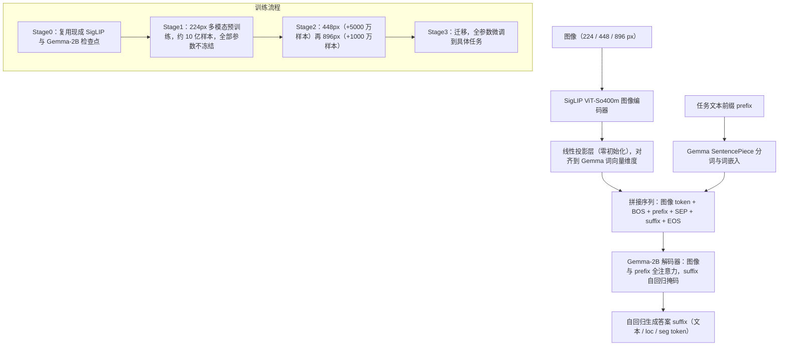

# PaliGemma

**PaliGemma: A versatile 3B VLM for transfer**（[arXiv:2407.07726](https://arxiv.org/abs/2407.07726)，Google DeepMind，2024-07）是一个开放的基座视觉-语言模型。本页按论文全文改写（2026-11-07 通读）；它同时收录于 [Awesome World-Action Models (RCL)](https://github.com/rcl-robotics/Awesome-World-Action-Models) 第 **082/564** 篇、分组 **Components of WAMs**（语言与 VLM 骨干）。

## 一句话定义

**PaliGemma = SigLIP-So400m 图像编码器 + 零初始化线性连接层 + Gemma-2B 解码器，约 3B 参数；不做指令微调，目标是一个"迁移后很强"的基座，输出统一为"图像 + 文本前缀进、文本后缀出"。**

## 英文缩写速查

| 缩写 | 英文全称 | 简要说明 |
|------|----------|----------|
| VLM | Vision-Language Model | 视觉-语言模型 |
| SigLIP | Sigmoid-loss Language-Image Pre-training | 用 sigmoid 损失做对比预训练的图像编码器；本文用 So400m 形状优化 ViT |
| Gemma | — | Google 开放解码器语言模型家族；本文用 2B v1.0 原始预训练检查点 |
| prefix-LM | Prefix Language Model | 对输入部分（图像 + 前缀）全注意力、对输出部分自回归的掩码方式 |
| WAM | World Action Model | RCL 清单把本文归入 WAM 组件（VLM 骨干），本文本身不含动作/世界模型 |
| MFU | Model FLOPs Utilization | 论文报告预训练 MFU 为 55% |

## 为什么重要

- 说明"小而全"的路线可行：不到 3B 的 VLM 在近 40 个任务上达到与 PaLI-X / PaLM-E / PaLI-3 同量级的结果。
- 给出一套可复用的 VLM 训练配方与大量消融（冻结与否、连接器、分辨率、掩码），工程上能直接指导"换骨干 / 调 VLA 前几层"的决策。
- 机器人侧的关联：π₀ 等 VLA 以 PaliGemma 作 VLM 骨干（见 [π₀ 论文页](./paper-pi0.md)，**该结论来自 π₀ 页面，本文自身不含机器人实验**）。

## 核心信息

| 字段 | 内容 |
|------|------|
| 论文 | [arXiv:2407.07726](https://arxiv.org/abs/2407.07726)（v2，2024-10） |
| 机构 | Google DeepMind |
| 清单坐标 | RCL Awesome WAM 082/564 · Components of WAMs |
| 参数规模 | SigLIP 约 400M + Gemma 约 2B，合计 < 3B |
| 开放内容 | 论文称模型为开放基座 VLM；训练基于开源 big_vision（部分预训练数据未公开）；本次**未**核对权重发布页与许可 |

## 核心原理

### 架构与序列格式

三个部件：SigLIP So400m 图像编码器、Gemma-2B 解码器、把 SigLIP 输出映射到 Gemma 词向量维度的线性层（零初始化；论文试过 MLP，平均迁移分 77.1 vs 线性 77.2，线性不逊）。图像固定缩放为 224 / 448 / 896 方形，分别得到 256 / 1024 / 4096 个图像 token。序列为：

`[图像 token…, BOS, prefix…, SEP(\n), suffix…, EOS, PAD…]`

图像与 prefix 之间是**全（双向）注意力**，让图像 token 能"看到"任务；suffix 才用自回归掩码并只在 suffix 上计算损失。新增 1024 个位置 token `<loc0000>`–`<loc1023>`（归一化坐标分箱）和 128 个 VQ-VAE 分割 token `<seg000>`–`<seg127>`，把检测、指代、分割都写成文本。

### 流程总览

图依据：论文 §3.1 Architecture（Fig.2）与 §3.2 Pretraining（Stage0 至 Stage3）。

### 训练配方

- **Stage1：** 224px、文本序列 128；图像编码器学习率做慢线性热身，避免被尚未对齐的语言模型"带坏"；"infinite"（rsqrt）学习率调度贯穿所有阶段，迁移阶段当作退火。
- **预训练任务混合：** 多语言 caption（WebLI 等）、OCR、生成式 VQA / VQG（CC3M-35L）、物体存在/计数问答（OpenImages）、检测、实例分割、带框的 grounded caption；每个任务带独有前缀以避免信号冲突。**不使用任何迁移评测集，并去除与其近重复的图像。**
- **Stage2：** 混合同 Stage1，但提高需要高分辨率的任务（OCR、检测、分割）采样；文本序列增到 512。
- **迁移：** 全参数微调；论文建议依次探索分辨率、epoch（1–100）、学习率（3e-5/1e-5/3e-6）、label smoothing、dropout、weight decay、是否冻结 ViT。

## 工程实践

| 项 | 论文给出的信息 |
|----|----------------|
| 训练设施 | TPUv5e-256；Stage1 不到 3 天、每个 Stage2 约 15 小时；Stage1 约 3500 亿 token；JAX + GSPMD 的 FSDP 式分片，MFU 55%，5189 token/s/设备 |
| 精度 | 参数与优化器状态 float32 训练；论文验证推理用 bfloat16 同样可行 |
| 迁移成本 | 单任务迁移在 TPUv3-32 上 20 分钟–10 小时 |
| 推荐起手超参 | lr 1e-5、batch 256、无 dropout / label smoothing / weight decay、不冻结；仅 epoch 数按任务选（上限 10）：多数任务相对逐任务搜索的遗憾 <2.5%（37 个任务），SciCap 等个别任务例外（60.5%） |
| 少样本迁移 | 4k 迁移样本时多数任务可达全量成绩的 90% 以内，256 样本约 80%，64 样本可用于原型 |
| 图像预处理 | 直接缩放为方形即可（含 RefCOCO 分割），论文未发现数据增强的显著收益；随机化 resize 方式 / JPEG 编码以减小跨框架脆弱性 |
| 推理（附录 Table 5） | TPUv3×8（4 芯片）上，预填 512 token、cache 640：Megatron 式分片、bfloat16、batch 1 的预填约 17 ms，单步扩展约 5.3 ms |
| 源码运行时序图 | **本次未通读 big_vision / 官方权重加载代码，故不绘制**（待补）；上方流程图只依据论文 |

## 实验与评测（论文 Table 1 摘录，224 / 448 / 896px）

| 任务 | 224 | 448 | 896 |
|------|-----|-----|-----|
| COCOcap (CIDEr) | 141.9 | 144.6 | — |
| VQAv2 | 83.2 | 85.6 | — |
| TextVQA | 55.5 | 73.2 | 76.5 |
| DocVQA | 43.7 | 78.0 | 84.8 |
| InfoVQA | 28.5 | 40.5 | 47.8 |
| ChartQA (aug) | 74.2 | 88.5 | — |
| RefCOCO testA (mIoU) | 75.7 | 77.9 | 78.7 |
| MMVP（配对准确率） | 47.3 | 45.3 | — |

论文称其 MMVP 224px 结果 47.3%，高于 GPT-4V（38.7%）与 Gemini（40.7%）；Objaverse 3D 渲染物体识别无需微调即可（ScoreAgg 58.4–60.4，PaLI-3 为 64.3）。分辨率敏感任务（文本/文档/图表/分割）随分辨率显著提升，其余任务基本不变。

### 关键消融（论文 §5）

- **预训练时长：** 越长越好，完全跳过 Stage1 最差；100M 样本是消融的折中点。
- **掩码与损失：** prefix-LM + 仅 suffix 损失优于把自回归掩码扩到前缀 / 图像。
- **冻结：** 迁移后冻结与否差别不大，但不冻结的预训练显著改善空间理解类任务的困惑度；冻结语言模型更差；"重置"（重新初始化）任何部件都大幅变差，说明 Stage0 复用预训练部件很关键。
- **新 token 初始化：** 标准小高斯（σ=0.02）比"平均嵌入"初始化在 Stage1 末和分割迁移上更好。
- **有无图像编码器：** 去掉 SigLIP、把原始 patch 直接线性投影给 Gemma（Fuyu 式）可训，但样本效率明显更低。
- **分辨率：** 增益约一半来自信息量、一半来自更长序列；仅提供一个分辨率的检查点不够，原生高分辨率 Stage2 优于"分窗"或迁移时再放大。
- **多任务迁移（附录 H）：** 27 个任务混合训练的平均成绩比逐任务调参低约 2.0%（有前缀）/ 3.5%（无前缀）。

## 与其他工作对比

| 对比对象 | 论文口径 |
|----------|----------|
| PaLI / PaLI-X / PaLM-E / PaLI-3 | PaliGemma 以 <3B 参数达到相近水平（PaLI-3 为 2B 视觉 + 3B 语言） |
| LLaVA 类（冻结骨干 + 小规模指令数据） | LLaVA 类预训练约 100 万样本，PaliGemma Stage1 约 10 亿样本、且全部不冻结 |
| 连接器：Flamingo / Q-Former / MLP | 本文只验证线性 vs MLP，无差异或线性略好 |
| Fuyu / EVE（无编码器） | 可行但样本效率低 |
| 数据来源 | 预训练任务均非更大商用 VLM 的输出（区别于使用 GPT-4 生成指令数据的 LLaVA 类） |

## 结论

**把 PaliGemma 读成"一个全参数联合预训练、可迁移的 3B 基座"，而不是现成的对话助手；对 VLA 工程而言最可迁移的是它的配方与消融。**

1. 小模型 + 长预训练 + 不冻结，优于大模型 + 冻结 + 少量指令数据的思路（论文口径）。
2. 线性连接器足够；分辨率要靠专属检查点，不是推理时硬拉。
3. 任务前缀、prefix-LM 与"只监督 suffix"是便宜而有效的设计。
4. 迁移稳定：标准差多数 <0.5，推荐超参覆盖大多数任务，几千样本就能适配。
5. 本文不含机器人实验：把它当作 VLA 的视觉-语言先验时，动作能力来自下游（如 π₀）的训练，不要把 VLM 指标当策略成功率。

## 局限与风险

- 论文自述：基座未经指令微调，不是开箱即用的"0-shot"助手；预训练混合旨在可迁移而非易用。
- 图像统一缩成方形，对长宽比极端的图像（文档、长图）的信息损失需要靠更高分辨率补；896px 需要 4096 个图像 token，推理开销大。
- 论文只研究静态图像 + 短视频（16 帧），不涉及机器人观测序列、动作输出或实时控制延迟。
- 部分预训练数据集未公开，完全复现预训练不现实；评测集已做去重，但仍需注意各基准的已知问题（论文附录 E 指出 WidgetCaps 上多篇工作的数字不可比）。
- 具体到 VLA：用 PaliGemma 初始化后在机器人数据上微调是否会遗忘 VLM 能力，本文不讨论（见 [π₀](./paper-pi0.md) 等下游论文）。

## 关联页面

- 列表实体：[Awesome World-Action Models（RCL）](paper-rcl-wam-robot-learning-control-survey.md)
- 技术地图：[RCL Awesome WAM 技术地图](../overview/rcl-awesome-wam-technology-map.md)
- 下游 VLA：[π₀ 论文](./paper-pi0.md)、[VLA 方法页](../methods/vla.md)
- 同组骨干对照：[Gemma 3 技术报告](./paper-rcl-2503-19786-gemma-3-technical-report.md)
- 方法/任务：[generative-world-models.md](../methods/generative-world-models.md)、[manipulation.md](../tasks/manipulation.md)

## 参考来源

- **原文通读：** [`sources/papers/paligemma_arxiv_2407_07726.md`](../../sources/papers/paligemma_arxiv_2407_07726.md) — arXiv v2 全文核对记录（2026-11-07）
- [`sources/papers/rcl_awesome_wam_2407_07726_paligemma-a-versatile-3b-vlm-for-transfe.md`](../../sources/papers/rcl_awesome_wam_2407_07726_paligemma-a-versatile-3b-vlm-for-transfe.md) — 清单策展摘录
- [`sources/papers/rcl_awesome_wam_catalog.md`](../../sources/papers/rcl_awesome_wam_catalog.md) — 列表总表
- [`sources/repos/awesome-world-action-models-rcl.md`](../../sources/repos/awesome-world-action-models-rcl.md)
- 论文：<https://arxiv.org/abs/2407.07726>

## 推荐继续阅读

- [PaliGemma 论文 PDF](https://arxiv.org/pdf/2407.07726)
- [big_vision 代码库](https://github.com/google-research/big_vision) — 论文声明的训练与迁移代码
- [Awesome World-Action Models (RCL) 仓库](https://github.com/rcl-robotics/Awesome-World-Action-Models)
