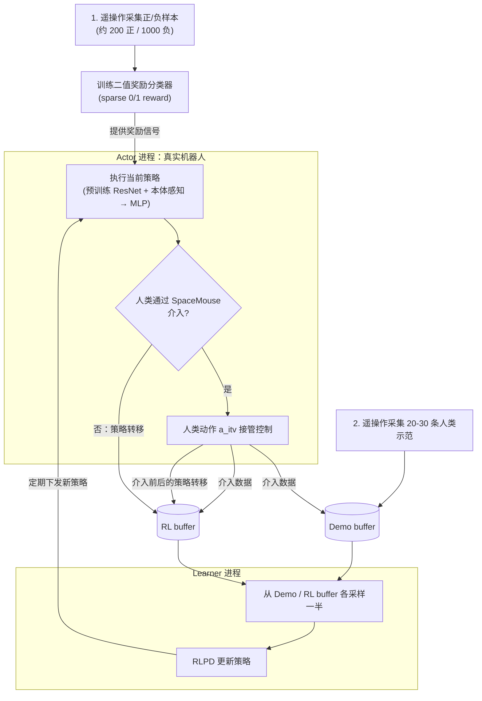
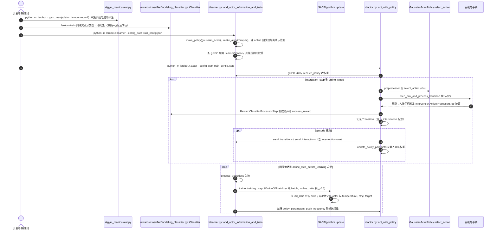

# Precise and Dexterous Robotic Manipulation via Human-in-the-Loop Reinforcemen...

**Precise and Dexterous Robotic Manipulation via Human-in-the-Loop Reinforcement Learning** 收录于 [Awesome World-Action Models (RCL)](https://github.com/rcl-robotics/Awesome-World-Action-Models) **第 173/564** 篇，分组 **Foundational work**。本页是 **清单索引**：给出它在清单中的位置与原文入口，方法细节和量化结果请看原文。

## 一句话定义

RCL Awesome WAM 清单收录（Foundational work）；细节以原文 PDF / 项目页为准。

## 英文缩写速查

| 缩写 | 英文全称 | 简要说明 |
|------|----------|----------|
| WAM | World Action Model | 世界预测与动作生成耦合 |
| VLA | Vision-Language-Action | 视觉–语言–动作策略 |
| IDM | Inverse Dynamics Model | 先预测未来再反推动作 |
| WM | World Model | 环境前向预测模型 |

## 为什么重要

- RCL Awesome WAM 清单收录（Foundational work）；细节以原文 PDF / 项目页为准。
- 想横向对照同一分组的其他工作，可以从 [RCL Awesome WAM 技术地图](../overview/rcl-awesome-wam-technology-map.md) 逐条展开。
- 顺着列表实体 [Awesome World-Action Models](paper-rcl-wam-robot-learning-control-survey.md) 与站内 WAM / VLA 方法页，可以接回对应的学习主线。

## 流程总览

图依据：论文 §3.2 System Overview / §3.4 / §3.5（Fig. 2 系统架构、Fig. 3 训练流程）。

## 核心信息

| 字段 | 内容 |
|------|------|
| 编号 | 173/564 |
| 分组 | Foundational work |
| 出处 | Science Robotics |
| 论文 | <https://www.science.org/doi/10.1126/scirobotics.ads5033> |
| 代码/项目 | <https://github.com/rail-berkeley/hil-serl> |
| 子类 / 象限 | 动作策略基础 · 训练优化与蒸馏 · 不适用 |

## 核心机制（归纳）

### 策展导读要点

RCL Awesome WAM 清单收录（Foundational work）；细节以原文 PDF / 项目页为准。

本页不复述论文公式与完整实验表；若需工程落地，请回到原文并对照站内 [World Action Models（WAM）](../concepts/world-action-models.md) 等概念页。

## 评测与指标

- 本页 **没有搬运** 原文的量化 benchmark 与实机指标。
- 评测口径与具体数值以 [原文 / 项目页](https://www.science.org/doi/10.1126/scirobotics.ads5033) 为准。
- 横向对照请回到 [技术地图](../overview/rcl-awesome-wam-technology-map.md) 同分组条目。

## 与其他工作对比

- 本页 **不做** 与具体基线的逐项数值对比；同分组的横向对照请回到 [技术地图](../overview/rcl-awesome-wam-technology-map.md) 的 **Foundational work** 分组逐条展开。
- 如果站内已经有这篇的深读页（含机构、实验表与源码运行时序图），请以那一页为准；本页只保留清单要点。
- 与清单内相邻条目孰优孰劣，本页不下结论：清单 Contribution 可能滞后于论文最新版本，差异应以各自原文的问题设定与评测口径为准。

## 结论

**这一页能给你的是「Precise and Dexterous Robotic Manipulation via Human-in-the-Loop Reinforcemen...」在策展清单里的坐标与要点：够你判断要不要去读原文，但不能替代原文。**

- 可确证的只有清单坐标：分组 **Foundational work**，以及 Contribution 点出的问题设定；本页不自行推导新结论。
- 适用边界：本页不能替代原文 PDF；开源状态以项目页实际链接为准（清单可能滞后）。
- 要深读这篇，建议直接从原文入手，再回到下方关联的方法 / 任务页对照。

## 源码运行时序图

以下为 LeRobot 固定提交 `9e5ee98` 的 HIL-SERL 实现（路径相对 `src/lerobot/`），已对照 `rl/actor.py`、`rl/learner.py`、`rl/trainer.py`、`rl/algorithms/sac/sac_algorithm.py`、`rl/gym_manipulator.py`、`processor/hil_processor.py`、`policies/gaussian_actor/modeling_gaussian_actor.py` 与文档 `docs/source/hilserl.mdx`。官方原仓库 `rail-berkeley/hil-serl` 的源码本次未读，不另画。

## LeRobot 实现要点

- **身份核对：** LeRobot 文档 `docs/source/hilserl.mdx` 图注写「HIL-SERL workflow, Luo et al. 2024」，即本页论文（arXiv:2410.21845，Luo、Xu、Wu、Levine，arXiv 摘要页核对）。**同名区分：** SERL 软件套件（arXiv:2401.16013）是另一篇，库内见 [SERL 条目](paper-rcl-2401-16013-serl-a-software-suite-for-sample-efficient-robot.md)。
- **策略不是单独的 `hilserl` 模型：** 文档要求配置里 `policy.type="gaussian_actor"`、`algorithm.type="sac"`；HIL-SERL 是一整套「环境处理管线 + actor/learner + SAC」流程，而不是 `policies/` 下的单个网络。`GaussianActorPolicy` 的 `predict_action_chunk` 明确不支持动作分块，只返回单步动作。
- **与论文的对应（读到的部分）：** 论文以 RLPD 为底层算法，每步在示范池与在线池之间对半采样，抓取用 DQN 训练的 grasp critic，视觉用 ImageNet 预训练 ResNet-10（论文 §3）。LeRobot 对应为 `OnlineOfflineMixer`（`online_ratio=0.5`）、`SACAlgorithm`（含可选 `discrete_critic`，由 `num_discrete_actions` 开启）、`GaussianActorConfig.vision_encoder_name`（默认 `None`，可指定预训练编码器）。LeRobot 的 SAC 默认 `num_critics=2`、`utd_ratio=1`；论文中的 critic 集成规模与 UTD 设置本次未逐项对照，不能据此认定二者一致。
- **人类介入：** 操作员按手柄右上扳机或键盘空格接管（文档）；`InterventionActionProcessorStep` 把介入动作写入 transition，actor 记录 `is_intervention` 并上报 `Intervention rate`。
- **奖励分类器可选：** 文档称训练分类器是可选的，可先用手柄/键盘手动标注成功；采集分类器数据时需 `terminate_on_success=false` 以获得足够正样本。
- **进程结构：** 学习器与 actor 是两个独立命令，经 gRPC 通信；权重推送间隔默认 4 秒（`policy_parameters_push_frequency`，文档）。
- **依赖与硬件：** 需 `pip install -e ".[hilserl]"`，需要 Nvidia GPU、机器人 URDF（运动学）以及手柄（文档推荐）。
- **文档中的实验图：** 文档称有人类介入时达到最大奖励所需步数约减少四分之一（orange 无介入对比，文档表述，未复现）。

## 常见误区

1. 不要把 Awesome 条目的 Contribution 当成完整方法证明——它只是策展导读。
2. 若站内已有这篇的深读页，以那一页为准——本页只是清单入口，不含实验数据。

## 关联页面

- 列表实体：[Awesome World-Action Models（RCL）](paper-rcl-wam-robot-learning-control-survey.md)
- 技术地图：[RCL Awesome WAM 技术地图](../overview/rcl-awesome-wam-technology-map.md)
- 框架：[LeRobot](./lerobot.md)；同系列：[SERL](paper-rcl-2401-16013-serl-a-software-suite-for-sample-efficient-robot.md)
- 方法/任务：[generative-world-models.md](../methods/generative-world-models.md)、[manipulation.md](../tasks/manipulation.md)

## 参考来源

- [`sources/papers/rcl_awesome_wam_2410_21845_precise-and-dexterous-robotic-manipulati.md`](../../sources/papers/rcl_awesome_wam_2410_21845_precise-and-dexterous-robotic-manipulati.md) — 本条目策展摘录
- [`sources/papers/rcl_awesome_wam_catalog.md`](../../sources/papers/rcl_awesome_wam_catalog.md) — 列表总表
- [`sources/repos/awesome-world-action-models-rcl.md`](../../sources/repos/awesome-world-action-models-rcl.md)
- [`sources/repos/lerobot.md`](../../sources/repos/lerobot.md) — 固定提交 9e5ee98 的 `rl/` 与 `docs/source/hilserl.mdx`
- [`docs/PAPERS.md`](https://github.com/RCL-Robotics/Awesome-World-Action-Models/blob/main/docs/PAPERS.md) — 上游论文目录
- 论文：<https://www.science.org/doi/10.1126/scirobotics.ads5033>
- [arXiv PDF](https://arxiv.org/pdf/2410.21845)：已通读方法部分（实验与附录以略读为准）：§3.2 System Overview、§3.3 System Design Choices、§3.4 Human-in-the-Loop RL、§3.5 Training Process。

## 推荐继续阅读

- [Awesome World-Action Models (RCL) 仓库](https://github.com/rcl-robotics/Awesome-World-Action-Models)
- [原文](https://www.science.org/doi/10.1126/scirobotics.ads5033)
