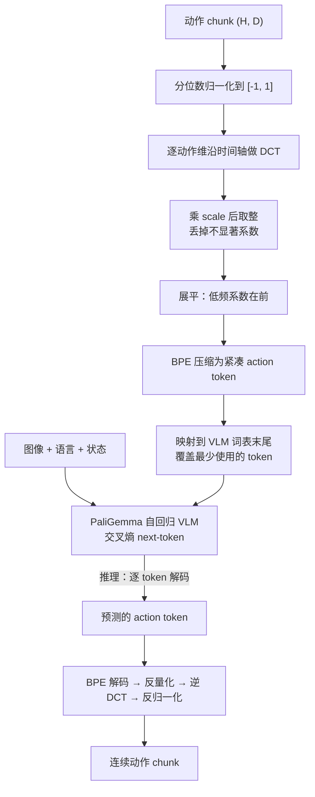
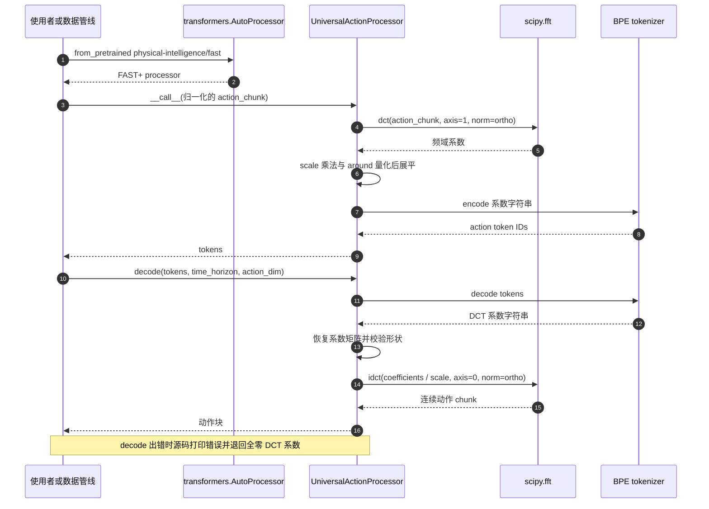
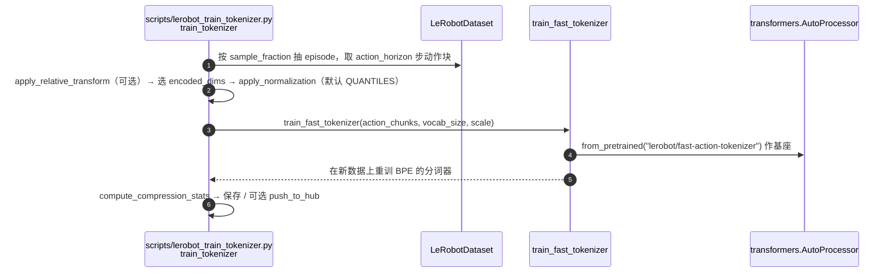
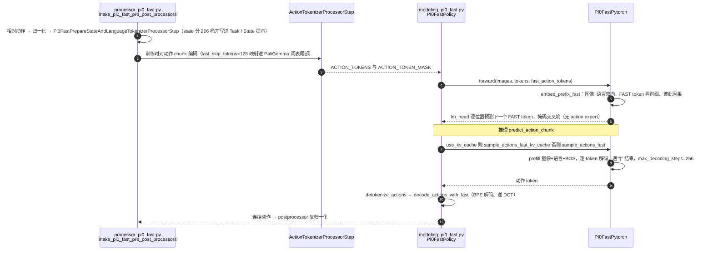
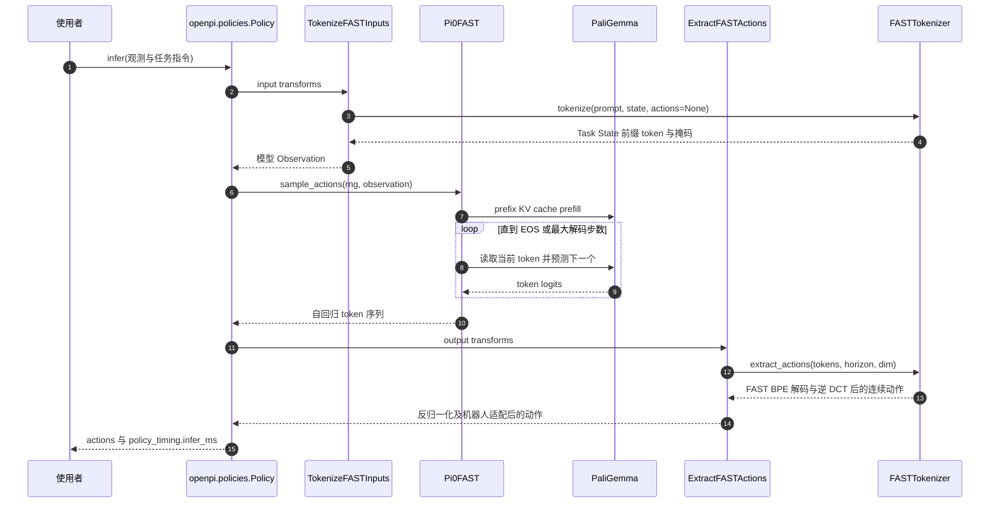

# FAST: Efficient Action Tokenization for Vision-Language-Action Models｜FAST：高效动作分词

## 一句话定义

FAST 用时间轴离散余弦变换、量化和字节对编码压缩连续动作块，使自回归 VLA 能高效学习高频动作序列。

## 英文缩写速查

| 缩写 | 英文全称 | 简要说明 |
| --- | --- | --- |
| VLA | Vision-Language-Action | 视觉和语言条件下生成动作 |
| DCT | Discrete Cosine Transform | 把时序动作转为频域系数 |
| BPE | Byte Pair Encoding | 合并高频符号序列的分词方式 |

## 为什么重要

- 逐时间步独立离散化会产生很长的 token 序列；时间相关性可以直接用于压缩。
- tokenizer 是可复用的动作表示组件，适合比较自回归动作头与连续 flow 动作头。

## 流程总览

图依据：论文 §V（DCT、scale、BPE、低频优先）、§VI-A（1 秒动作块；覆盖 VLM 词表中最少使用的 token）；token 映射细节对照 LeRobot `ActionTokenizerProcessorStep`。

## 核心原理

连续动作 chunk → 沿时间轴 DCT → 系数量化 → BPE token → 自回归预测 → 逆变换恢复动作。低频系数聚集平滑运动信息，BPE 再利用符号重复；压缩率与误差取决于动作归一化、采样率和量化配置。

**FAST+** 提供跨机器人数据训练的通用 tokenizer。tokenizer 的泛化不等于策略在新本体上即插即用，控制输出仍须匹配动作维度和语义。

## 源码运行时序图

### A. 官方 FAST+ 分词器（Hugging Face `processing_action_tokenizer.py`）

已核对官方 `UniversalActionProcessor` 的 `__call__`、`decode` 和 `fit`。此处只表示 tokenizer 函数调用，不将其误画成策略训练入口。

训练自己的 tokenizer 可调用 `UniversalActionProcessor.fit(action_data)`：源码对动作块沿时间轴做 DCT 与量化，使用 `BpeTrainer` 训练新词表后返回 processor；与模型训练是两条不同的流程。

### B. LeRobot 的 Pi0Fast（`policy.type=pi0_fast`，固定提交 `9e5ee98…`）

已通读 `policies/pi0_fast/{modeling,processor,configuration}_pi0_fast.py`、`processor/tokenizer_processor.py` 中的 `ActionTokenizerProcessorStep` 与 `scripts/lerobot_train_tokenizer.py` 的结构。

**1) 训练分词器（可选，`lerobot-train-tokenizer`）**

**2) 策略训练与推理**

### C. Physical Intelligence 的 `openpi` 官方 π₀-FAST（JAX）

另核实官方 `openpi/src/openpi/models/{pi0_fast.py,tokenizer.py}`、`training/config.py`、`policies/policy.py` 与 `policy_config.py` 的实际调用关系；下图是 **推理** 链路，与上面的 LeRobot 实现区分。

源码边界：`Pi0FAST.compute_loss` 用 next-token 交叉熵训练；`sample_actions` 执行上述自回归推理。当前 `openpi` README 公开 `pi0_fast_base` / `pi0_fast_droid` checkpoint 入口，但不等于论文全部训练数据都公开。源码核对记录见 [FAST 官方实现归档](../../sources/repos/fast-action-tokenizer.md)。

## Pi0-FAST 与 LeRobot 实现要点

- **身份：** Pi0-FAST = 用 FAST 分词器训练的 π0 自回归版本。论文（[arXiv:2501.09747](https://arxiv.org/abs/2501.09747)，Pertsch、Stachowicz、Ichter、Driess、Nair、Vuong、Mees、Finn、Levine，2025-01-16）摘要称：与 π0 VLA 结合可扩展到 10k 小时机器人数据，匹配扩散式 VLA 的性能，同时训练时间最多减少 5 倍；**本库对 FAST 与 Pi0-FAST 只保留这一个 canonical 节点**，π0 本体见 [π0](./paper-pi0.md)。
- **论文实验口径（正文已读）：** 主要骨干 π0（PaliGemma-3B），另测 OpenVLA（Prismatic 7B）；训练时对 1 秒动作块分词，并覆盖 VLM 词表中最少使用的 token；默认超参 scale=10、BPE 词表 1024；FAST+ 在 1M 条真机动作序列上训练。表 I：每个动作块的平均 token 数，朴素分箱 vs FAST 为 BridgeV2 35 vs 20、DROID 105 vs 29、Bussing 140 vs 28、Shirt Fold 700 vs 53（压缩比 1.75 / 3.6 / 5.0 / 13.2）。
- **LeRobot 文档与论文的对照：** `docs/source/pi0fast.mdx` 写「typically 10x compression」「up to 5x faster than diffusion-based approaches like π0」。5x 与论文摘要一致；「10x」是文档的概括，论文表 I 的范围是 1.75~13.2 倍，且随控制频率而变，引用时请用论文数字。
- **默认配置（`configuration_pi0_fast.py`）：** `paligemma_variant=gemma_2b`、`chunk_size=n_action_steps=50`、`max_action_tokens=256`、`max_decoding_steps=256`、`temperature=0.0`（贪心）、`action_tokenizer_name=lerobot/fast-action-tokenizer`、`fast_skip_tokens=128`、`use_kv_cache=True`、`validate_action_token_prefix=True`。
- **与 π0 的结构差异：** `configuration_pi0_fast.py` 里仍保留 `action_expert_variant=gemma_300m` 字段，但 `PI0FastPytorch.forward` 只送 `[prefix, None]`（注释写明「No suffix/action expert」），即 LeRobot 的 Pi0Fast 是纯 PaliGemma 自回归，不含 flow 动作专家。
- **实现细节：** 动作 token 与 PaliGemma 词表的映射为 `vocab_size - 1 - fast_skip_tokens - token`（`_paligemma_tokens_to_act_tokens` 为其逆）；解码按首个 `|` 截断，贪心模式下全部序列出现 `|` 即提前停止。`decode_actions_with_fast` 的 `relaxed_decoding` 默认为 True，会把过长/过短的 DCT 系数序列截断/补零；解码异常时该函数对该条回退为全零 DCT 系数（只打 warning），部署时应监控该警告（`detokenize_actions` 是否显式传入该参数本次未逐行核对）。
- **相对动作：** 处理顺序「relative → normalize → tokenize」，注释写明此时分词器看到的是 delta 值，必须使用相对动作的统计量。
- **复现（文档自述，未重跑）：** 从 `lerobot/pi0fast-base` 在 HuggingFace LIBERO 数据上再微调 40k 步（bfloat16、batch 256、8×H100），产物 `lerobot/pi0fast-libero`，评测时 `n_action_steps=10`（文档称与 OpenPI 一致）。文档结果表：Spatial 70.0 / Object 100.0 / Goal 100.0 / LIBERO-10 60.0，平均 82.5（%）。评测命令为 `--eval.batch_size=1 --eval.n_episodes=1`，各套件分数都是 10 的倍数，推测每套件只跑了 10 个 episode（每任务 1 个），统计置信度很低，且明显低于 `pi05.mdx` 里 π0.5 的 97.5 平均（两份文档口径不同，仅作量级参照）；不要把它当作 π0-FAST 的能力上限。
- **限制：** RTC 在 `select_action` 中不可用；`PI0FastPolicy.predict_action_chunk` 的 `action_horizon` 取 `n_action_steps`，若 `n_action_steps` 与训练时的 `chunk_size` 不一致，解码 reshape 可能出错或被补零（推测，未跑过）；文档的训练/评测示例都把二者设为 10，与配置默认值 50 不同。

## 官方代码与开源边界（2026-11-08）

- **官网：** [Physical Intelligence FAST 研究页](https://www.pi.website/research/fast) 是技术介绍，不是 GitHub 代码仓。
- **可直接使用的 FAST+：** [官方 Hugging Face tokenizer](https://huggingface.co/physical-intelligence/fast/tree/main) 开放 `processing_action_tokenizer.py`、词表、配置与自定义 `.fit()`；入口是 `AutoProcessor.from_pretrained(..., trust_remote_code=True)`，不是将 tokenizer 误用成通用 `AutoModel`。
- **官方策略实现：** [Physical-Intelligence/openpi](https://github.com/Physical-Intelligence/openpi) 提供 π₀-FAST 自回归 VLA 的训练/推理代码和 checkpoint 入口；[LeRobot](../../sources/repos/lerobot.md) 的 Pi0Fast 则是另一个可用实现，二者实现细节不应混为一谈。
- **训练与实时性须分别评估：** 论文 §VI-E 在 RTX 4090 的测试条件下报告 π₀-FAST 生成一个动作块约 **750 ms**，而 flow π₀ 约 **100 ms**；最多 5× 是训练计算开销降低，不能当成控制回路的推理加速。这个数值不是本次复现测得。

## 工程实践

1. 从官方 HF 模型卡加载 tokenizer，先验证自己的动作 chunk 编码→解码重建。
2. 对齐采样率、chunk 长度、归一化与动作顺序，检查重建误差和每个 chunk 的 token 数。
3. 比较闭环成功率与真实时延：训练序列缩短不保证逐 token 生成满足控制预算。
4. 已有 tokenizer 实现与资产；全套策略/机器人接口须另查 [openpi](../methods/π0-policy.md)。
5. 针对真实机器人增加 **解码失败/零动作降级告警**：官方 HF `decode` 遇到损坏 token 或形状不匹配会退回全零频域系数；`openpi.FASTTokenizer.extract_actions` 未检测到 `Action: ` 标志时也返回零动作。需区分“策略意图停止”和“解析失败”。
6. 对于自定义 action horizon / action dim，调用 `decode` 时显式指定形状；`trust_remote_code=True` 加载前审核代码并固定可信 revision。

## 评测与指标

对比动作离散化方案时，至少同时记录 **token 数、解码误差、训练收敛与策略成功率、在线生成时延**。这些指标依赖机器人动作频率与任务，本页不把 tokenizer 压缩比当成整机性能提升比例。

## 结论

**FAST 的可操作价值是压缩动作序列，并提供可独立验证的 tokenizer。**

1. 先做动作重建检查，再接自回归策略。
2. 把训练效率与实时执行效率分开评测。
3. 高频灵巧任务须关注量化误差，而非只追求短序列。

## 与其他工作对比

与连续 flow 动作头相比，FAST 优化的是自回归动作序列长度，仍须承担逐 token 生成成本。与 [RTC](paper-real-time-chunking.md) 相比，FAST 处理动作表示，RTC 处理执行中新旧 chunk 的调度；二者可以组合，不能用一项收益替代另一项评测。

## 局限与风险

- 高频接触动作的细节可能受量化与频域截断影响；应检查末端速度、夹爪事件和任务成功率。
- 动作压缩与 [RTC](paper-real-time-chunking.md) 的推理调度处理不同问题。

## 关联页面

- [π₀ / openpi](../methods/π0-policy.md)
- [RTC](./paper-real-time-chunking.md)
- [VLA](../methods/vla.md)

## 参考来源

- [FAST 论文原文全文归档（含实验与附录）](../../sources/papers/fast_action_tokenization_arxiv_2501_09747.md)
- [FAST 官网研究页核查](../../sources/sites/fast-action-tokenization.md)
- [FAST+ / openpi 官方源码逐函数核对](../../sources/repos/fast-action-tokenizer.md)
- [openpi 官方仓库归档](../../sources/repos/openpi.md)

- [PI 一手资料补核](../../sources/sites/pi-memory-rlt-fast.md)
- [LeRobot 仓库归档](../../sources/repos/lerobot.md)：固定提交 `9e5ee98…` 的 `policies/pi0_fast/`、`docs/source/pi0fast.mdx`、`scripts/lerobot_train_tokenizer.py`
- [arXiv PDF](https://arxiv.org/pdf/2501.09747)：2026-11-05 重读摘要、§V、§VI-A/B、表 I

## 推荐继续阅读

- [官方 tokenizer](https://huggingface.co/physical-intelligence/fast)
- [FAST 论文](https://arxiv.org/abs/2501.09747)
