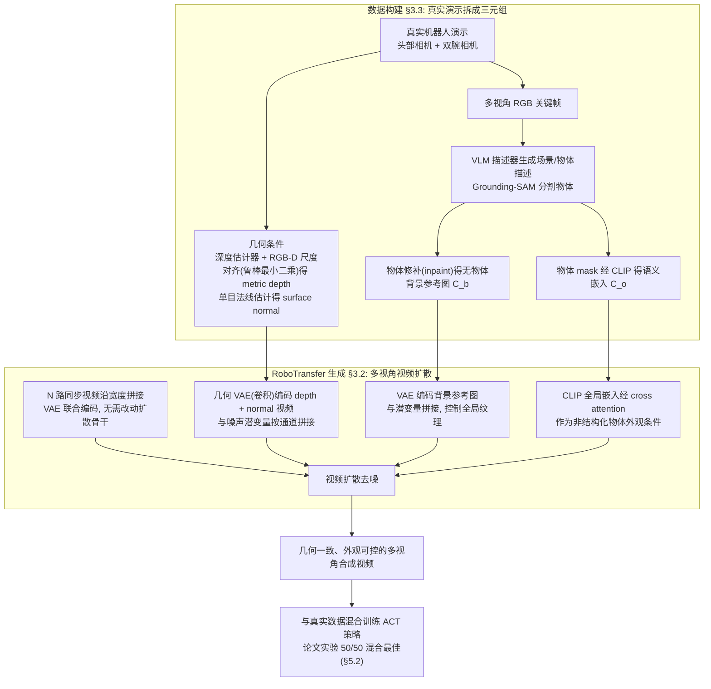
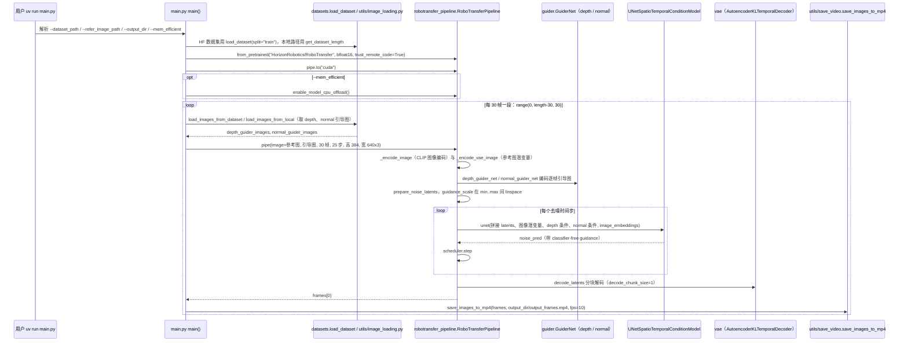

# RoboTransfer

**RoboTransfer: Controllable Geometry-Consistent Video Diffusion for Manipulation Policy Transfer**（[arXiv:2505.23171](https://arxiv.org/abs/2505.23171)，[GitHub](https://github.com/HorizonRobotics/RoboTransfer)）由**地平线（Horizon Robotics）**公开，既收录于 [Awesome World-Action Models (RCL)](https://github.com/rcl-robotics/Awesome-World-Action-Models) **第 119/564** 篇（分组 **Datasets**），也作为 [国内具身智能开源全景（76 家 · 424 项）](../overview/china-domestic-embodied-opensource-76-companies-technology-map.md) 第四层「世界模型」代表开源项目归档。本页合并论文机制拆解与官方源码时序。

## 一句话定义

**RoboTransfer 以真实演示的度量深度（metric depth）与表面法线维持几何一致性，用可替换的背景修补图与物体语义条件驱动多视角视频扩散生成，以合成轨迹与真实数据混合提升操作策略迁移。**

## 英文缩写速查

| 缩写 | 英文全称 | 简要说明 |
|------|----------|----------|
| WAM | World Action Model | 世界预测与动作生成耦合 |
| VLA | Vision-Language-Action | 视觉–语言–动作策略 |
| IDM | Inverse Dynamics Model | 先预测未来再反推动作 |
| WM | World Model | 环境前向预测模型 |
| VAE | Variational Autoencoder | 联合编码多视角图像与几何引导图的潜空间编解码器 |

## 为什么重要

- RoboTransfer augments robot demonstrations by changing their visual appearance while conditioning video diffusion on the demonstrated geometry. Jointly encoded camera views, metric depth, normals and separate background/object references support multi-view synthesis. A separately trained ACT policy benefits from the generated data.
- 想横向对照同一分组的其他工作，可以从 [RCL Awesome WAM 技术地图](../overview/rcl-awesome-wam-technology-map.md) 逐条展开，并通过 [国内具身开源全景技术地图](../overview/china-domestic-embodied-opensource-76-companies-technology-map.md) 查看地平线同生态其它仿真/世界模型项目。
- 顺着列表实体 [Awesome World-Action Models](paper-rcl-wam-robot-learning-control-survey.md)、[Humanoid Motion Intelligence](../entities/humanoid-motion-intelligence.md) 与站内 WAM / VLA 方法页，可以接回对应的学习主线。

## 流程总览

图依据：论文 §3.2 RoboTransfer Framework、§3.3 Dataset Construction / Fig.2–3、§5 Real Robot Experiments。

## 核心信息

| 字段 | 内容 |
|------|------|
| 机构 | 地平线（Horizon Robotics） |
| 编号 / 分组 | RCL WAM #119/564（Datasets · 合成数据与数据生成）；国内具身开源全景第四层（世界模型） |
| 出处 | arXiv preprint |
| 论文 | <https://arxiv.org/abs/2505.23171> |
| 代码 | <https://github.com/HorizonRobotics/RoboTransfer> |
| 官方组织 | <https://github.com/HorizonRobotics> |

## 核心机制（归纳）

### 策展导读要点

RoboTransfer augments robot demonstrations by changing their visual appearance while conditioning video diffusion on the demonstrated geometry. Jointly encoded camera views, metric depth, normals and separate background/object references support multi-view synthesis. A separately trained ACT policy benefits from the generated data.

若需工程落地，请结合下方源码运行时序图，并对照站内 [World Action Models（WAM）](../concepts/world-action-models.md) 等概念页与官方仓库 README。

## 源码运行时序图

入口：`uv run main.py`（显存较小的 4090 加 `--mem_efficient`；默认 `--dataset_path HorizonRobotics/RoboTransfer-RealData`、`--refer_image_path assets/example_ref_image/gray_grid_desk.png`）

图依据：HorizonRobotics/RoboTransfer@3698fee，读过 `README.md`、`main.py`、`robotransfer/models/robotransfer_pipeline.py`（`__init__` 与 `__call__`，去噪循环后段未逐行读）、`robotransfer/models/guider.py`（仅类与方法签名）、`robotransfer/utils/` 下文件名与函数签名。

## 工程实践

- **官方仓库运行**：从 [HorizonRobotics/RoboTransfer](https://github.com/HorizonRobotics/RoboTransfer) 核对 README 许可、Hugging Face 模型权重要求与显存选项（如 24GB 显卡使用 `--mem_efficient` 开启 `enable_model_cpu_offload`）。
- **同生态对照**：通过 [424 项覆盖索引](../queries/china-domestic-opensource-424-coverage.md) 对照地平线同组织下的仿真器与世界模型工具链。

## 评测与指标

- 本页 **没有搬运** 原文的量化 benchmark 与实机指标。
- 评测口径与具体数值以 [原文 PDF](https://arxiv.org/abs/2505.23171) 为准（论文 §5.2 关注合成视频与真实数据 50/50 混合训练 ACT 策略的真机迁移增益）。
- 横向对照请回到 [技术地图](../overview/rcl-awesome-wam-technology-map.md) 同分组条目。

## 与其他工作对比

- 本页 **不做** 与具体基线的逐项数值对比；同分组的横向对照请回到 [技术地图](../overview/rcl-awesome-wam-technology-map.md) 的 **Datasets** 分组逐条展开。
- 本页已合并论文框架拆解与 [HorizonRobotics/RoboTransfer](https://github.com/HorizonRobotics/RoboTransfer) 推理源码时序分析；训练脚本与数据集构建细节仍以原文和官方仓为准。

## 结论

**RoboTransfer 定位为面向操作策略数据增强的几何一致多视角视频扩散模型：核心是用深度与法线锁定几何结构、只泛化背景与物体外观，并已通过 `HorizonRobotics/RoboTransfer` 开放推理代码与权重。**

- 关键设计在于把真实演示拆解成「几何条件（metric depth + normal）+ 无物体背景 + 物体语义条件」，将跨视图视频沿宽度拼接联合编码，使生成数据可直接用于 ACT 策略混合训练。
- 工程可复现性较明确：官方仓库 `HorizonRobotics/RoboTransfer` 提供 `uv run main.py` 推理流水线（含 `GuiderNet` 与 `RoboTransferPipeline`），具体许可与完整训练管线以仓库 README 为准。
- 深读与定量对比仍需结合论文原文 PDF 验证。

## 常见误区

1. 不要把 Awesome 条目的 Contribution 当成完整方法证明——量化对比与消融须回看原文 PDF。
2. 推理源码时序图仅覆盖前向视频合成（`main.py`），不包括下游 ACT 策略混合训练或原始深度/法线数据构建流水线。

## 关联页面

- 列表实体：[Awesome World-Action Models（RCL）](paper-rcl-wam-robot-learning-control-survey.md)
- 技术地图：[RCL Awesome WAM 技术地图](../overview/rcl-awesome-wam-technology-map.md)
- [World Action Models（WAM）](../concepts/world-action-models.md)
- 方法/任务：[generative-world-models.md](../methods/generative-world-models.md)、[manipulation.md](../tasks/manipulation.md)
- [国内具身开源全景技术地图](../overview/china-domestic-embodied-opensource-76-companies-technology-map.md)
- [HMI 开源项目主表导读](../queries/hmi-opensource-projects-coverage.md)
- [Humanoid Motion Intelligence](../entities/humanoid-motion-intelligence.md)

## 参考来源

- [`sources/papers/rcl_awesome_wam_2505_23171_robotransfer-controllable-geometry-consi.md`](../../sources/papers/rcl_awesome_wam_2505_23171_robotransfer-controllable-geometry-consi.md) — 本条目策展摘录
- [`sources/papers/rcl_awesome_wam_catalog.md`](../../sources/papers/rcl_awesome_wam_catalog.md) — 列表总表
- [`sources/repos/awesome-world-action-models-rcl.md`](../../sources/repos/awesome-world-action-models-rcl.md)
- [RoboTransfer 源码归档](../../sources/repos/robotransfer.md)（<https://github.com/HorizonRobotics/RoboTransfer>）
- [国内具身智能开源全景（微信公众号）](../../sources/blogs/wechat_embodied_station_domestic_opensource_panorama_2026-09-06.md)
- [`docs/PAPERS.md`](https://github.com/RCL-Robotics/Awesome-World-Action-Models/blob/main/docs/PAPERS.md) — 上游论文目录
- 论文：<https://arxiv.org/abs/2505.23171>
- [arXiv PDF](https://arxiv.org/pdf/2505.23171)：已通读方法部分（实验与附录以略读为准）：§3.2 框架、§3.3 数据构建、§5 真机实验设定与合成数据比例（略读）
- 源码核对（2026-11-02）：HorizonRobotics/RoboTransfer@3698fee，读过 `README.md`、`main.py`、`robotransfer/models/robotransfer_pipeline.py`（`__init__` 与 `__call__` 大部分）、`guider.py` 与 `utils/` 的函数签名；时序图依据以上文件，未运行代码。

## 推荐继续阅读

- [RoboTransfer 官方 GitHub 仓库](https://github.com/HorizonRobotics/RoboTransfer)
- [地平线 官方组织](https://github.com/HorizonRobotics)
- [Awesome World-Action Models (RCL) 仓库](https://github.com/rcl-robotics/Awesome-World-Action-Models)
- [原文](https://arxiv.org/abs/2505.23171)
