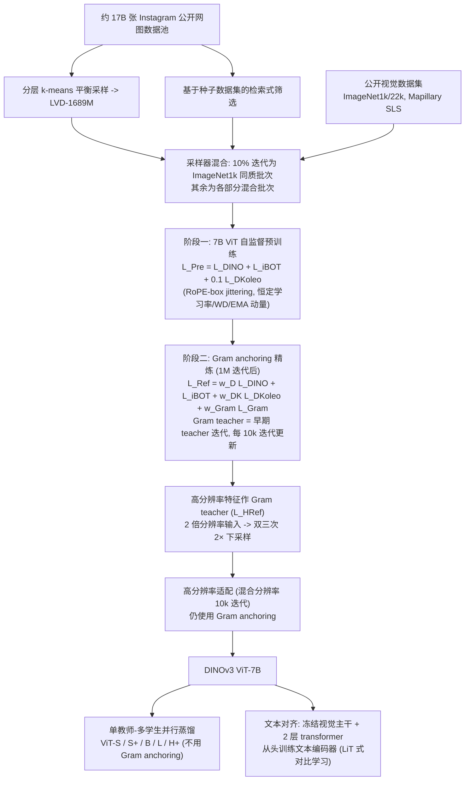
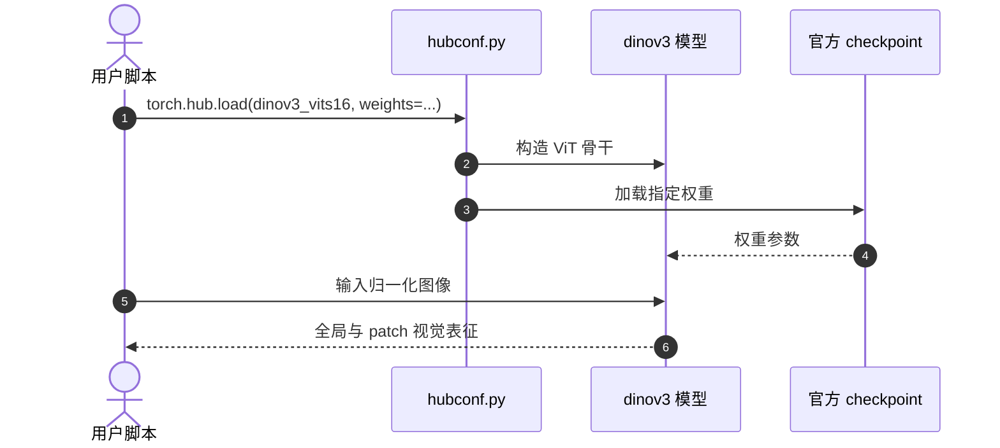

# DINOv3

**DINOv3** 收录于 [Awesome World-Action Models (RCL)](https://github.com/rcl-robotics/Awesome-World-Action-Models) **第 070/564** 篇，分组 **Components of WAMs**。本页已按 DINOv3 官方论文和公开源码补全关键原理、实验与世界模型衔接。

## 一句话定义

RCL Awesome WAM 清单收录（Components of WAMs）；细节以原文 PDF / 项目页为准。

## 英文缩写速查

| 缩写 | 英文全称 | 简要说明 |
|------|----------|----------|
| WAM | World Action Model | 世界预测与动作生成耦合 |
| VLA | Vision-Language-Action | 视觉–语言–动作策略 |
| IDM | Inverse Dynamics Model | 先预测未来再反推动作 |
| WM | World Model | 环境前向预测模型 |

## 为什么重要

- RCL Awesome WAM 清单收录（Components of WAMs）；细节以原文 PDF / 项目页为准。
- 想横向对照同一分组的其他工作，可以从 [RCL Awesome WAM 技术地图](../overview/rcl-awesome-wam-technology-map.md) 逐条展开。
- 顺着列表实体 [Awesome World-Action Models](paper-rcl-wam-robot-learning-control-survey.md) 与站内 WAM / VLA 方法页，可以接回对应的学习主线。

## 流程总览

图依据：论文 §3（3.1 数据准备、3.2 大规模自监督训练）、§4 Gram Anchoring、§5 Post-Training（5.1–5.3）/ Fig.12

## 核心信息

| 字段 | 内容 |
|------|------|
| 编号 | 070/564 |
| 分组 | Components of WAMs |
| 出处 | Transactions on Machine Learning Research |
| 论文 | <https://openreview.net/forum?id=2NlGyqNjns> |
| 代码/项目 | <https://github.com/facebookresearch/dinov3> |
| 子类 / 象限 | 视觉编码器与表征 · 不适用 |

## 核心机制（归纳）

### 策展导读要点

RCL Awesome WAM 清单收录（Components of WAMs）；细节以原文 PDF / 项目页为准。

本页不复述论文公式与完整实验表；若需工程落地，请回到原文并对照站内 [World Action Models（WAM）](../concepts/world-action-models.md) 等概念页。

## 评测与指标

- 本页 **没有搬运** 原文的量化 benchmark 与实机指标。
- 评测口径与具体数值以 [原文 / 项目页](https://openreview.net/forum?id=2NlGyqNjns) 为准。
- 横向对照请回到 [技术地图](../overview/rcl-awesome-wam-technology-map.md) 同分组条目。

## 与其他工作对比

- 本页 **不做** 与具体基线的逐项数值对比；同分组的横向对照请回到 [技术地图](../overview/rcl-awesome-wam-technology-map.md) 的 **Components of WAMs** 分组逐条展开。
- 如果站内已经有这篇的深读页（含机构、实验表与源码运行时序图），请以那一页为准；本页只保留清单要点。
- 与清单内相邻条目孰优孰劣，本页不下结论：清单 Contribution 可能滞后于论文最新版本，差异应以各自原文的问题设定与评测口径为准。

## 结论

**这一页能给你的是「DINOv3」在策展清单里的坐标与要点：够你判断要不要去读原文，但不能替代原文。**

- 可确证的只有清单坐标：分组 **Components of WAMs**，以及 Contribution 点出的问题设定；本页不自行推导新结论。
- 适用边界：本页不能替代原文 PDF；开源状态以项目页实际链接为准（清单可能滞后）。
- 要深读这篇，建议直接从原文入手，再回到下方关联的方法 / 任务页对照。

## 常见误区

1. 不要把 Awesome 条目的 Contribution 当成完整方法证明——它只是策展导读。
2. 若站内已有这篇的深读页，以那一页为准——本页只是清单入口，不含实验数据。

## 源码运行时序图

图仅对应 README 所示公开权重加载与视觉编码调用；并非世界模型推理。

## 工程实践

官方 `facebookresearch/dinov3` README 使用 `torch.hub.load(REPO_DIR, 'dinov3_vits16', source='local', weights=...)` 加载视觉编码器；权重获取与许可证另查 MODEL_CARD、LICENSE。

## 局限与风险

- 尚未完成主论文与附录逐段通读，不作为完整复现指南；数值比较须保持同任务、同评测协议。
- 代码可见不代表依赖、权重、训练实现全部公开，也不代表已执行。

## DINOv3 下游世界模型研究导航

- [GAWM](paper-gawm-compact-latent-world-action-model.md)：冻结视觉表征，直接生成动作块。
- [DUET-DINO](paper-duet-dino.md)：跨视角特征预测与 CEM 规划。
- [PointWorld](paper-sa-2601-03782-pointworld.md)：DINOv3 辅助的 3D 点流动力学。
- [FlowWM](paper-flowwm-feature-space-stochastic-wm.md)：DINOv3 特征空间随机预测。
- [RLA-WM](paper-rcl-2605-07079-learning-visual-feature-based-world-models-via-r.md)：残差潜动作与特征预测。
- [JEPA-WMs](paper-jepa-wms-physical-planning.md)：DINOv3/DINOv2 分任务冻结视觉编码器。
- [DINO-WM](paper-sa-2411-04983-dino-wm-world-models-on-pre-trained-visual-featu.md)：**使用 DINOv2** 的前作。

## DINOv3 世界模型一手资料复核（2026-11-08）

DINOv3 是视觉表征骨干，不输入机器人动作，也不自行预测未来；下游世界模型可以冻结它并提取空间 token。

官方 `facebookresearch/dinov3` README 使用 `torch.hub.load(REPO_DIR, 'dinov3_vits16', source='local', weights=...)` 加载视觉编码器；权重获取与许可证另查 MODEL_CARD、LICENSE。

- [作者论文](https://arxiv.org/abs/2508.10104) · [原文归档](../../sources/papers/rcl_awesome_wam_2508_10104_dinov3.md) · [代码核验记录](../../sources/repos/dinov3-wm-dinov3.md)
- 已核对全文和必要附录；相关源码的公开入口已核查，模型和训练尚未在本环境执行。

## 2026-11-08 原文及附录完整核对

**方法：** **DINOv3 是视觉编码器而非世界模型**。训练以 DINO/iBOT/KoLeo 与 Gram anchoring 保持稠密 patch 特征，7B ViT 教师经蒸馏提供 ViT-S/B/L/H+；下游世界模型各自决定冻结层和预测目标。

**实验：** 论文 ViT-7B/16 的 DAVIS-L J&F=83.3，对比 DINOv2-g/14 的 76.6；ADE20k / 深度等视觉评测不能解释为动作规划成功率。

**局限：** 权重独立许可、输入分辨率与 patch token 影响显存；论文本身没有 action-conditioned transition、动力学或 MPC。

[论文版本 arXiv:2508.10104](https://arxiv.org/abs/2508.10104)。已审阅主要源码入口和官方说明；未实际运行训练或机器人部署。

## 关联页面

- 列表实体：[Awesome World-Action Models（RCL）](paper-rcl-wam-robot-learning-control-survey.md)
- 技术地图：[RCL Awesome WAM 技术地图](../overview/rcl-awesome-wam-technology-map.md)
- 方法/任务：[generative-world-models.md](../methods/generative-world-models.md)、[manipulation.md](../tasks/manipulation.md)

## 参考来源

- [`sources/papers/rcl_awesome_wam_2508_10104_dinov3.md`](../../sources/papers/rcl_awesome_wam_2508_10104_dinov3.md) — 本条目策展摘录
- [`sources/papers/rcl_awesome_wam_catalog.md`](../../sources/papers/rcl_awesome_wam_catalog.md) — 列表总表
- [`sources/repos/awesome-world-action-models-rcl.md`](../../sources/repos/awesome-world-action-models-rcl.md)
- [`docs/PAPERS.md`](https://github.com/RCL-Robotics/Awesome-World-Action-Models/blob/main/docs/PAPERS.md) — 上游论文目录
- 论文：<https://openreview.net/forum?id=2NlGyqNjns>
- [arXiv PDF](https://arxiv.org/pdf/2508.10104)：已通读方法部分（实验与附录以略读为准）：§1 引言、§3–§5（数据、预训练、Gram anchoring、后训练）、§6 评测设置概述

## 推荐继续阅读

- [Awesome World-Action Models (RCL) 仓库](https://github.com/rcl-robotics/Awesome-World-Action-Models)
- [原文](https://openreview.net/forum?id=2NlGyqNjns)
