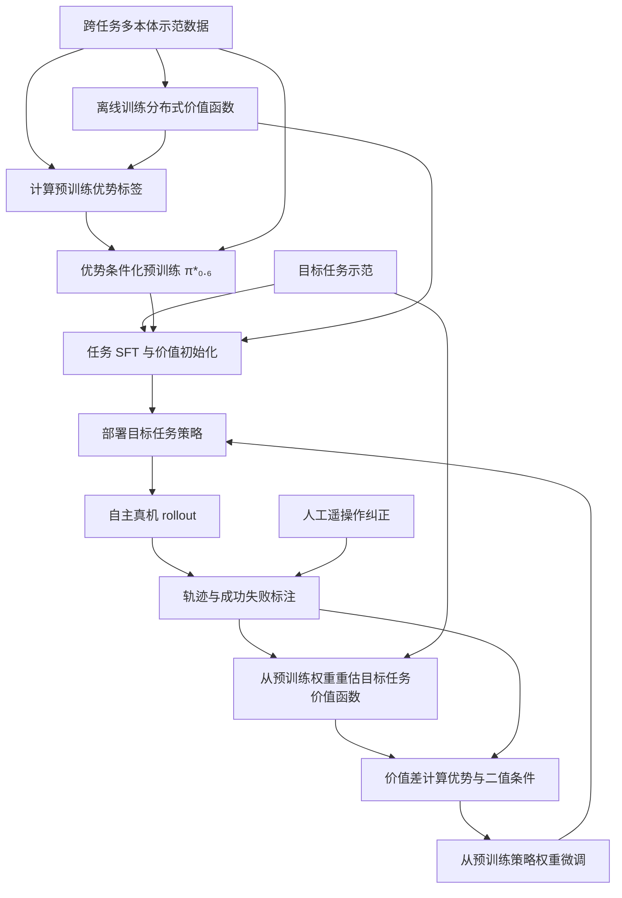

# π\*₀.₆：用经验改进的 VLA

**π\*₀.₆**（*π\*₀.₆: a VLA That Learns From Experience*，[arXiv:2511.14759](https://arxiv.org/abs/2511.14759)，[博客](https://www.pi.website/blog/pistar06)）由 **物理智能（Physical Intelligence）** 提出。方法名 **RECAP**（RL with Experience and Corrections via Advantage-conditioned Policies）：用优势值告诉策略哪些片段该模仿，从而把演示、自主 rollout 和人工纠正放进同一次训练。本页同时是 [RCL Awesome WAM](../overview/rcl-awesome-wam-technology-map.md) 清单第 **265/564** 篇（分组 VLA）在站内对应的那一页。

## 一句话定义

> **不把 VLA 改写成策略梯度，而是用优势条件挑选该模仿的经验，让通才先离线预训练、再上真机变专精。**

## 英文缩写速查

| 缩写 | 英文全称 | 简要说明 |
|------|----------|----------|
| RECAP | RL with Experience and Corrections via Advantage-conditioned Policies | 本文的优势条件训练 |
| VLA | Vision-Language-Action | 被专精的通才策略 |
| KI | Knowledge Insulation | π₀.₆ 骨干与动作专家的训练隔离，见 [KI](./paper-knowledge-insulation.md) |
| SFT | Supervised Fine-Tuning | 目标任务示范微调，示范动作的优势指示器固定为真 |
| AWR | Advantage-Weighted Regression | 消融基线，按优势加权回归而非额外条件输入 |
| CFG | Classifier-Free Guidance | 推理期可改变优势条件强度，但高强度可能使动作激进 |

## 为什么重要

只靠模仿，复杂操作常常停在「有时成功」。可靠性与节拍需要执行结果：失败、纠正和更快的成功轨迹。RECAP 把这些数据写回 π₀.₆，得到的专精模型被 π₀.₇ 当作可蒸馏的高表现行为来源。公司时间轴上它不是 π₀.₇ 的别名。

## 核心原理

**图对齐论文 Algorithm 1 与图 1、图 3**：RECAP 先在示范数据上执行离线 RL 预训练，再针对目标任务收集自主执行及可选纠正。每轮都聚合目标任务数据，价值模型和策略模型从各自**预训练 checkpoint**重新微调，而不是无约束地在前一轮权重上连续增量训练。

### 价值函数与优势条件

- **价值估计**：多任务、语言条件化的分布式价值函数，201 个离散回报 bin；使用约 670M 参数 VLM，估计离任务成功还需要多少步，并把不同任务的值按最大 episode 长度归一化。
- **奖励**：普通时间步记 -1；成功时终止奖励 0，失败时记大额负惩罚。优势估计在下游阶段使用 **N=50 步**的前瞻奖励与价值差，预训练阶段按 episode 回报减当前价值。
- **条件化训练**：对优势与任务阈值做比较得到 (I_t = 1[A_t > \epsilon_{\ell}])。训练既使用无条件数据又使用条件数据，**保留成功与失败轨迹**；人工纠正动作被强制标为正优势。实际目标结合自回归 token 损失与连续 action expert 的 flow matching 损失，不等价于把大 VLA 直接做 PPO 更新。
- **模型结构**：π₀.₆ 使用 Gemma 3 4B、约 860M 参数动作专家（KI 训练），输入图像、本体配置与语言，预测子任务文本及 50 Hz 关节/夹爪动作块；RECAP 增加优势条件字段，不另造一个动作控制头。

## 工程实践

根据论文附录 F，可复用的是**闭环设计**而不是现成开源脚本：

1. 先为每条轨迹保存观测、动作、任务文本、终止成败、介入标记，并统一完成时间和成功率口径。
2. 用包括失败轨迹在内的数据训练价值函数；在每轮更新后计算优势与任务阈值。原文预训练约 30% 示例标正，下游常规设约 40% rollout 为正，T-shirt / shorts 折叠为追求速度仅约 10% 为正。
3. 以 30% 概率丢弃优势条件以同时支持条件与无条件预测；部署时通常选正优势条件。CFG 的高强度可能带来过于激进的动作。
4. 进行目标任务 SFT、真机 rollout、必要时人工接管，重新标注并训练。评测应同时报告 **成功率** 与 **成功次数/小时**，不能只看单次成功演示。

**复现边界**：截至 2026-11-21，[openpi](https://github.com/Physical-Intelligence/openpi) 主仓未发布论文同款 RECAP 价值网络、优势条件训练闭环及 π*₀.₆ 权重；官方项目页未给出可运行训练入口，因此无真实源码可供运行时序分析。

## 评测

论文在 **衣物折叠（常规 T-shirt/短裤、困难的多品类）**、**纸箱装配**、**意式咖啡制作** 三类长时程任务上评测。固定双臂平台各有 6 DoF 机械臂与夹爪；单次任务约 5–15 分钟。图 7–8 展示从纯监督 π₀.₆、离线 RL 预训练、任务 SFT 到完整 RECAP 的对照，指标分开统计：

| 指标 | 作者的口径 | 实验观察 |
|---|---|---|
| Throughput | 每小时成功完成次数，综合计入速度与失败 | 困难衣物和 espresso 的完整 RECAP 相比基线 **提升超过 2 倍** |
| Success rate | 人工按多项成功标准评判 episode | 最难任务的失败率约减少 2 倍；除困难多品类衣物外，最终策略多数任务成功率超过 90% |
| 迭代增益 | 反复采集 rollout 后重估价值与优势 | 常规衣物继续提高吞吐；纸箱装配第二轮后吞吐约提高 2 倍 |
| 优势条件消融 | 同一批真机数据与 AWR、PPO 比较 | 本文优势条件方案在常规衣物折叠吞吐上更好，AWR 易训练出较慢策略 |

论文同时展示 5:30–23:30 咖啡制作、在新家折叠 50 件新衣物、包装厂完成 59 个贴标纸箱等**连续演示**。它们是部署展示，不能与上述标准化对照的计时口径混算。来源为论文 §VI、附录 F 与[官方博客](https://www.pi.website/blog/pistar06)。

## 与其他工作对比

| 工作 | 相对本页 |
|------|----------|
| [π₀.₇](../methods/pi07-policy.md) | 把本页专精 rollout 蒸馏进可提示的通才，不是同一个训练环 |
| [RTC](./paper-real-time-chunking.md) | 咖啡演示用了训练期 chunk 衔接，不改变优势条件本身 |
| [PI Layer](./pi-physical-intelligence-layer.md) | 伙伴现场叙事，数字不能和本文实验表横比 |
| RCL 清单索引 | 本页是深度笔记，清单坐标保留在文首 |

## 结论

**通才 VLA 要提高成功率和节拍，需要一条能吃下失败与纠正的优势条件，而不是再采一轮成功演示。**

- 离线预训练和真机专精是两段，不要只记住最终演示视频
- 优势条件是接口；价值函数、奖励和数据混合决定它学到什么
- π₀.₇ 吸收的是这条专精路线产生的 rollout，二者不要合成一个模型页
- openpi 的监督 `train.py` 不是 RECAP
- 站内关于 arXiv:2511.14759 的内容都集中在这一页

## 源码运行时序图

**不适用（论文官方实现未开放）**。截至 2026-11-21，[openpi#857](https://github.com/Physical-Intelligence/openpi/issues/857) 仍处于 open；官方 [openpi README](https://github.com/Physical-Intelligence/openpi) 未列出 π\*₀.₆ / RECAP 模型、价值网络训练、优势条件后训练或在线环的运行入口。本文 Mermaid 为**论文算法级数据流**，不是声称已验证的开源代码调用时序。

## 局限与风险

- 论文官方完整 RECAP 训练实现与权重未开放；不要把社区非官方复刻或 openpi 的 π₀.₅ 监督微调当作原论文复现。吞吐「翻倍」是作者特定任务和对照内的结果，不是跨实验室榜。
- 人工纠正的质量和何时介入会改变优势标签；这条成本没有在博客标题里单独计价。
- 咖啡演示使用了训练期 RTC（见 [RTC](./paper-real-time-chunking.md) 的后续论文），不要把它算进 RECAP 本身的成功率。

## 关联页面

- [π₀.₇](../methods/pi07-policy.md)
- [Knowledge Insulation](./paper-knowledge-insulation.md)
- [RTC](./paper-real-time-chunking.md)
- [The Physical Intelligence Layer](./pi-physical-intelligence-layer.md)
- [数据飞轮最小闭环](../concepts/embodied-data-flywheel-minimal-closed-loop.md)
- [RCL Awesome WAM 技术地图](../overview/rcl-awesome-wam-technology-map.md)
- [VLA 纵深路线 Stage 5：RL 微调与自改进](../../roadmap/depth-vla.md)

## 参考来源

- [pistar06_arxiv_2511_14759（论文 v2 全文核对归档）](../../sources/papers/pistar06_arxiv_2511_14759.md)
- [RCL 策展摘录](../../sources/papers/rcl_awesome_wam_2511_14759_0-6-a-vla-that-learns-from-experience.md)
- [PI 官网技术文章索引](../../sources/sites/pi-website-technical-articles.md)

## 推荐继续阅读

- [arXiv:2511.14759](https://arxiv.org/abs/2511.14759)
- [博客](https://www.pi.website/blog/pistar06)
- [官方 PDF](https://www.pi.website/download/pistar06.pdf)
- [π₀.₆ 官方模型卡](https://website.pi-asset.com/pi06star/PI06_model_card.pdf)
