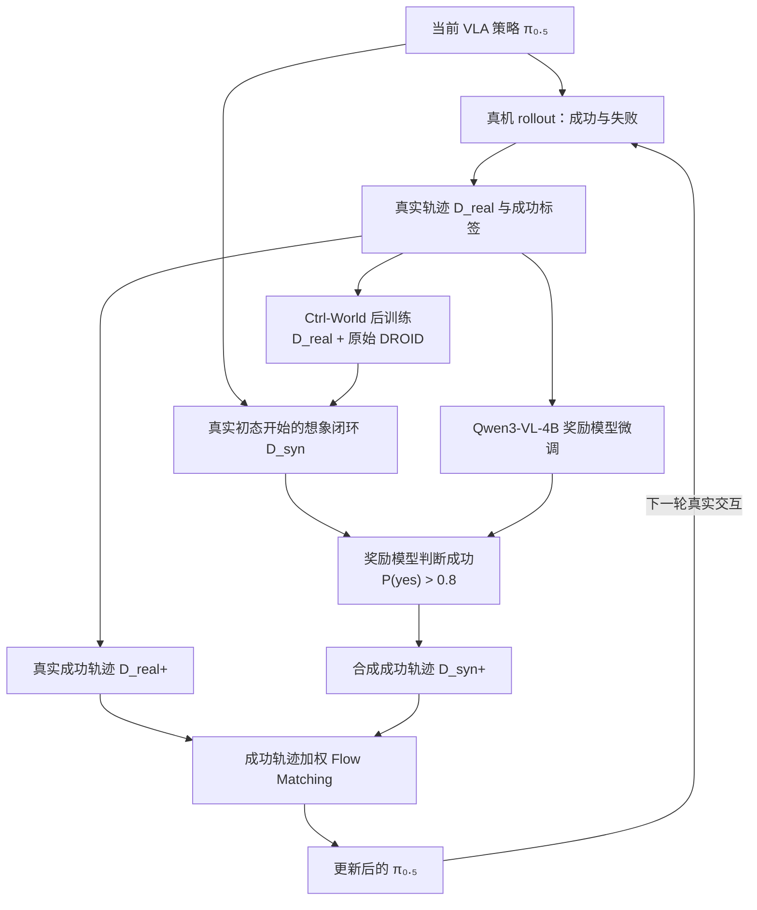
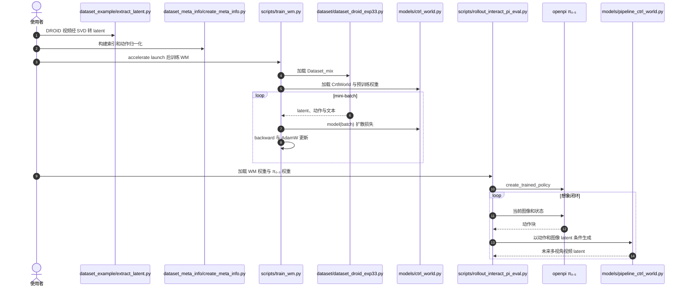

# VLAW：VLA 策略与世界模型迭代协同改进 / Iterative Co-Improvement of Vision-Language-Action Policy and World Model

**VLAW**（Guo et al., [arXiv:2602.12063v2](https://arxiv.org/pdf/2602.12063v2)，ICML 2026）由 Yanjiang Guo、Tony Lee、Lucy Xiaoyang Shi、Jianyu Chen、Percy Liang、Chelsea Finn 提出。作者机构：斯坦福大学（Stanford University）、清华大学（Tsinghua University）。本页从 RCL Awesome WAM 第 516/564 条策展占位原位升级，保留唯一论文身份。

## 一句话定义

**用有限真机策略成功与失败轨迹校准动作条件世界模型，在想象环境内合成并奖励筛选成功轨迹，再微调 VLA 并反复迭代**。这是训练期世界模型辅助策略后训练框架，不等于推理期将视频与动作联合生成的 Joint WAM。

## 英文缩写速查

| 缩写 | 英文全称 | 简要说明 |
|------|----------|----------|
| VLAW | Vision-Language-Action + World Model | 本文双模型协同迭代框架 |
| VLA | Vision-Language-Action | 感知语言指令后输出机器人动作的策略 |
| WM | World Model | 条件于当前视频与动作预测未来多视角视频 |
| FM | Flow Matching | π₀.₅ 的动作生成训练损失 |
| AWR | Advantage-Weighted Regression | 作者从正则化 RL 理解成功轨迹监督的理论联系 |
| DROID | Distributed Robot Interaction Dataset | Ctrl-World 预训练和五类真机操作使用的机器人数据体系 |

## 为什么重要

- **真实失败是世界模型校准信号**：只有成功演示时容易对接触物理与失败后果过度乐观；部署策略的失败 rollout 提供反例。
- **让昂贵真机数据可放大**：少量真实 rollout 更新 WM 后，在想象环境里产生额外候选轨迹，筛出成功片段训练 VLA。
- **把生成式 VLA 后训练转成可操作的数据方案**：无需给 flow-matching 动作策略施加标准 PPO；成功真实与合成轨迹参与加权 FM 监督。

## 核心原理与流程总览

1. **WM 后训练（§4.1，Eq. 1–2）**：在 Ctrl-World 上用 D_real 与原始 DROID 联合视频扩散训练；正、失败结果均参与世界动力学学习，原始数据避免过拟合。
2. **奖励模型（§4.1，Eq. 3）**：首轮对 Qwen3-VL-4B-Instruct 使用真实轨迹成功标签监督，随后以轨迹视频与任务指令预测 yes 的概率；阈值 $\alpha=0.8$（附录 C）。
3. **想象 rollout（§4.2）**：真实初始状态 → VLA 动作 → WM 生成未来视频 → VLA 下一动作；过滤得到 D_syn+。
4. **VLA 更新（§4.2，Eq. 4）**：真实与合成**成功**轨迹的加权 flow-matching 损失，成功权重 1、失败权重 0。§4.3 / 附录 A 的 AWR 联系是正则化 RL 解释，不是将 WM 视频反向传播到机器人。
5. **迭代（Algorithm 1）**：用新策略再次做真机 rollout，重复世界模型校准与策略微调，实验进行了两轮。

## 源码运行时序图

[官方项目页](https://sites.google.com/view/vlaw-arxiv) 只提供标注为 **Code (Post-train WM)** 的 [Ctrl-World 共享代码](https://github.com/Robert-gyj/Ctrl-World)。下图严格限定已公开且核实的 WM 训练和策略—WM 想象闭环入口，**不是完整 VLAW 奖励/策略训练流水线**。

代码核查：[train_wm.py](https://github.com/Robert-gyj/Ctrl-World/blob/main/scripts/train_wm.py)、[rollout_interact_pi_eval.py](https://github.com/Robert-gyj/Ctrl-World/blob/main/scripts/rollout_interact_pi_eval.py) 与 [readme.md](https://github.com/Robert-gyj/Ctrl-World/blob/main/readme.md)。公开入口未包括可验证的 Qwen3-VL 奖励模型训练 → 自动筛选 → π₀.₅ 策略后训练整链，因此不补虚构的源码调用关系。

## 实验与评测

论文五任务：**堆积木、擦除标记、开书、舀取、画圆**；基于 DROID/Franka Panda + Robotiq，两个第三人称相机、一个腕部相机。每任务 25 条专家演示初始化；每轮每任务 50 条真机 rollout 与 500 条合成轨迹；WM 50K 更新步，π₀.₅ 2K 更新步、batch 256，共两轮。

| 指标 | 对照 | VLAW / 在线数据 | 来源与说明 |
|------|------|-----------------|------------|
| 五任务平均真机成功率 | Base 46.0%；Filtered BC-2 75.2% | **86.8%** | 附录 B Table 2 |
| 合成轨迹额外收益 | Filtered BC-2 75.2% | **+11.6 pp** | 相同真实 rollout 预算 |
| Base → 两轮 VLAW | 46.0% | **+40.8 pp** | 按附录 B Table 2 计算 |
| 摘要声称 Base → VLAW | — | **+39.2 pp** | Abstract；与 Table 2 不一致 |
| WM 视频 FVD | 仅专家后训练 99.98 | 在线轨迹后训练 **64.12** | Table 1 |
| 接触失败误判成功 FP | 11 | **1** | Table 1，50 个接触事件 |
| 奖励模型 FP / FN | 8 / 7 | **2 / 12** | 附录 C，40 个标注轨迹，阈值 0.8 |

**数据核验注意：** arXiv v2 摘要的 **39.2 pp** 与附录 B 的 86.8%−46.0%=**40.8 pp** 不一致，论文未在核对处说明差异。引用时保留来源口径；**11.6 pp** 则与 86.8%−75.2% 一致。奖励模型通过提高阈值减少误报，但同时漏掉更多真实成功。

## 结论

**VLAW 的重要贡献是用真机失败校准视频世界模型，再以奖励筛选的想象成功轨迹扩大 VLA 后训练；证据限于五类真机接触操作。**

1. **先测真实失败动力学**：失败 rollout 能明显改善 WM 接触预测，不可只比画面质量。
2. **联合训练真实与合成成功轨迹**：将想象数据收益和同真实预算的 Filtered BC 对照分开。
3. **奖励阈值两面看**：报告 FP 与 FN，不要只报高精度。
4. **数值带版本和表号**：摘要 +39.2 pp / 附录 +40.8 pp 两种口径不可混用。
5. **开源只到 WM 后训练**：不能把共享 Ctrl-World 训练入口视为已公开的完整 VLAW 复现。

## 工程实践

| 模块 | 已核实的入口与实用检查 |
|------|------------------------|
| 数据准备 | DROID latent 提取 + create_meta_info.py；成功失败轨迹标签不可丢 |
| 世界模型 | accelerate launch scripts/train_wm.py；比较接触 FP、长轨迹漂移和 FVD |
| 闭环想象 | scripts/rollout_interact_pi_eval.py；openpi + 两套 checkpoint，注意 JAX 显存预分配 |
| 奖励微调 | 论文 Qwen3-VL-4B，抽 16 帧，200 steps、batch 128；**完整实现未核实开放** |
| 策略微调 | D_real+ 与 D_syn+ 上的 flow-matching；**未见完整官方可运行训练入口** |

## 与其他工作对比

- [Ctrl-World](./paper-ctrl-world.md)（arXiv:2510.10125）重点是可控多视角 WM 与 π 策略想象闭环；VLAW（arXiv:2602.12063）在此基础上加入真机失败数据、奖励筛选与迭代策略后训练。**是两篇不同论文，不能合并节点**。
- **Filtered BC-2** 与 VLAW 使用同一真实数据预算，区别是后者额外混合 WM 合成成功轨迹；从 75.2% 到 86.8% 可归因于论文的这个比较协议，不代表任意新任务都可照搬。
- VLAW 的 WM 用于训练期生成/评估，策略部署时并非必须实时跑视频预测，因此与 **Joint WAM（推理中联合动作/未来）** 有清晰系统边界。
- [WEVO](./paper-wevo-world-model-enabled-vla-loco-manipulation.md)（arXiv:2611.25251）将训练期视频 WM 后训练扩展到 G1 全身移动操作，结合 LEGS play、20 条/任务自主真机轨迹与进度密集 RL；不是 VLAW 的同篇论文，也不是推理期 Joint WAM。

## 局限与风险

- 仅在 DROID/Franka 五类操作任务评测，不提供人形机器人跨本体或开放世界安全证据。
- 真实 rollout 覆盖范围之外，WM 仍可能视觉逼真但动作/接触后果错误。
- 奖励阈值抑制假阳性同时提高假阴性，影响可用合成成功数据规模。
- 完整 VLAW 策略和奖励协同后训练未核实公开，只能部分复现。
- 原文摘要与附录成功率增益存在未解释的 **1.6 pp** 算术差异。

## 关联页面

- [Ctrl-World](./paper-ctrl-world.md) — 原世界模型主论文
- [Generative World Models](../methods/generative-world-models.md) · [VLA](../methods/vla.md) · [Model-Based RL](../methods/model-based-rl.md)
- [Manipulation](../tasks/manipulation.md) — 五类真机操作任务
- [RCL Awesome WAM 技术地图](../overview/rcl-awesome-wam-technology-map.md)
- [VLA 纵深](../../roadmap/depth-vla.md) · [WAM 纵深](../../roadmap/depth-wam.md)

## 参考来源

- [VLAW arXiv v2 原文核对归档](../../sources/papers/vlaw_arxiv_2602_12063.md)
- [VLAW 官方项目页及源码边界](../../sources/sites/vlaw-arxiv.md)
- [Ctrl-World 官方仓库归档](../../sources/repos/ctrl-world.md)
- [RCL Awesome WAM 原策展条目](../../sources/papers/rcl_awesome_wam_2602_12063_vlaw-iterative-co-improvement-of-vision.md)

## 推荐继续阅读

- [VLAW / arXiv:2602.12063v2](https://arxiv.org/pdf/2602.12063v2) · [ICML 2026 PMLR 正式版](https://proceedings.mlr.press/v306/guo26i.html)
- [VLAW 项目主页](https://sites.google.com/view/vlaw-arxiv) · [官方共享 Ctrl-World 代码](https://github.com/Robert-gyj/Ctrl-World)

## Awesome Agentic Robots 导航补充

- **论文入口：** [arXiv:2602.12063](https://arxiv.org/abs/2602.12063)。
- **项目入口：** [VLAW 官方项目页](https://sites.google.com/view/vlaw-arxiv)。
- **清单记录：** `survey_ax_2602_12063`；本次导航沿用主分支核读后的项目地址。
