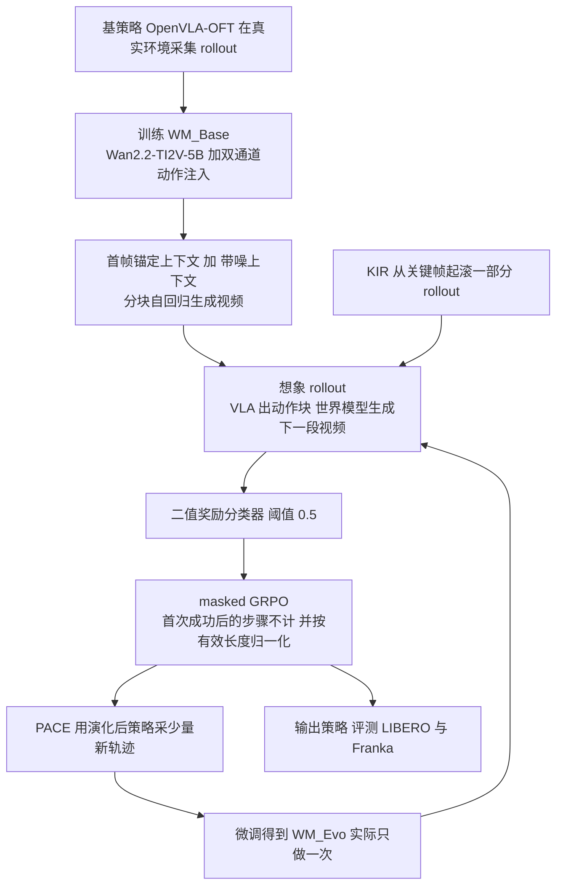

# WoVR

**WoVR: World Models as Reliable Simulators for Post-Training VLA Policies with RL**（[arXiv:2602.13977](https://arxiv.org/abs/2602.13977)，清华、中科院自动化所、中国科学院大学、北京中关村学院、无问芯穹，构建于 RLinf）。同时收录于 [Awesome World-Action Models (RCL)](https://github.com/rcl-robotics/Awesome-World-Action-Models) 第 542/564 篇，分组 WAMs；也在 CoRL 2026 阅读清单中。本页依据 arXiv v1 全文（21 页）写成，来源归档见 [wovr_arxiv_2602_13977.md](../../sources/papers/wovr_arxiv_2602_13977.md)。

## 一句话定义

WoVR 不假设学到的世界模型是忠实模拟器，而是同时在三层限制 RL 与「会幻觉的想象动力学」的相处方式：更稳的动作条件视频世界模型（Wan2.2-TI2V-5B 加双通道动作注入与首帧锚定）、关键帧起滚加成功后 mask 的 GRPO、以及用演化后策略数据单次微调世界模型的 PACE（§4，作者自述）。

## 英文缩写速查

| 缩写 | 英文全称 | 简要说明 |
|------|----------|----------|
| WoVR | World models as reliable simulators for post-training VLA with RL | 本文框架名 |
| VLA | Vision-Language-Action | 视觉-语言-动作策略，本文基策略为 OpenVLA-OFT（§5.2） |
| WM | World Model | 这里指动作条件视频扩散世界模型，充当模拟器 |
| WM-MDP | World Model-MDP | 用世界模型近似转移、奖励模型近似奖励的 MDP（§3.2，式 4） |
| KIR | Keyframe-Initialized Rollouts | 从任务关键中间状态起滚一部分想象 rollout（§4.2） |
| GRPO | Group Relative Policy Optimization | 组内相对优势的策略梯度，本文加 mask 与长度归一化（式 10–11） |
| PACE | Policy-Aligned Co-Evolution | 用演化后策略的少量新轨迹微调世界模型，WM_Base 到 WM_Evo（§4.3） |
| DiT | Diffusion Transformer | 世界模型的去噪主干，每个 block 注入动作（图 3） |
| SR | Success Rate | 任务成功率，本文策略评测主指标（§5） |

## 为什么重要

- 真机在线 RL 要大量并行交互和重置，物理仿真又难对齐真实动力学（§1）；用视频世界模型代替环境，把策略优化与真机交互解耦，是一条被反复尝试的路线（World-Env、WMPO、VLA-RFT 等，§2.3）。
- 作者的论点是这不主要是建模问题而是可靠性问题：闭环自回归误差会累积，策略分布漂移会进一步放大，RL 因此会利用模型误差（§1）。把「幻觉」当成优化信号被污染来处理，为后续 [WoVR+](paper-wovr-plus.md) 与 [HAWMPO](paper-rcl-2609-09941-hawmpo-hallucination-aware-world-model-based-pol.md) 这类工作提供了问题设定（后两者与本文的关系本页未逐篇核对）。
- 作者报告在相同的真实环境轨迹预算（每个 LIBERO suite 2500 条）下，世界模型内 RL 的平均成功率高于直接在真实仿真器上做 GRPO 的基线（Table 2）。注意这是作者在自己设置下的对比，见下文局限。

## 核心原理与流程总览

三层各对应一类误差来源（§4 开头）：模拟器层（世界模型本身）、交互层（怎么用想象 rollout）、对齐层（策略与模拟器的分布偏移）。

图依据：论文 §4、图 2、图 3、图 5。

关键机制（均为论文 §4 自述）：

1. **动作条件世界模型（§4.1）**：Wan2.2-TI2V-5B 作骨干；动作嵌入一路与时间步嵌入融合做 AdaLN-Zero 式调制，另一路替换原交叉注意力里的文本嵌入。训练用 Rectified Flow（式 7），并对非参考的上下文潜变量加扩散噪声，减小训练与闭环推理的差距。
2. **首帧锚定**：每个自回归步的条件是 [o0, 上一块的近期记忆帧]；依据是许多自注意力头会关注首帧（图 4）。
3. **奖励（式 8）**：对世界模型生成的下一帧，由轻量分类器给成功概率，阈值 0.5 得到二值奖励，沿用 HiL-SERL 做法，BCE 训练。
4. **KIR 与 masked GRPO（§4.2）**：一部分 rollout 从关键帧（尤其是当前策略遇到的失败状态）开始；组内相对优势（式 10 为回报减组均值，未除标准差）；首次成功之后的步骤 mask 掉，并按有效步数归一化，使短而关键的片段在梯度中占比更大。
5. **PACE（§4.3）**：先用基策略轨迹训 WM_Base，第一阶段优化后用演化策略的少量新轨迹得到 WM_Evo；作者强调只做一次或极低频，区别于高频更新动力学的经典 model-based RL。

## 工程实践

- **训练预算（§5.2）**：每个 LIBERO suite 共 2500 条真实环境轨迹，其中 1500 条（每任务 150 条）训 WM_Base，之后 1000 条训 WM_Evo；策略优化全程在世界模型内完成，不再碰真实仿真器。基策略按 SimpleVLA-RL 的做法，OpenVLA-OFT 做单轨迹 SFT。
- **世界模型推理（§5.1）**：4 帧上下文加 8 步动作块，每块生成 8 帧；论文称仅用五个扩散步加 3D VAE，吞吐 23.0 FPS（OpenSora 为 7.00）。
- **系统（§4.3 末、附录 A）**：在 RLinf 上把环境后端换成世界模型；用修改版 collocated GPU 分配，生成器与模拟器仅在 rollout 阶段首尾做 offload/onload，避免闭环交互中反复搬运。全部实验使用 8 张 NVIDIA H100（§5）。
- **真机（§5.3）**：Franka Panda，Pick Banana 与 Pick Bread；每任务 10 条遥操作演示预训练基策略，再采 150 条基策略 rollout 训世界模型。
- **代码**：首页标注 [RLinf/RLinf](https://github.com/RLinf/RLinf) 与 HuggingFace 集合 `RLinf/wovr`；WoVR 专属训练脚本是否在该仓库中，本次未核查。项目页：<https://wovr-corl.github.io>（未打开）。

### 主要结果（作者报告，均出自论文表格）

| 项目 | 数字 | 出处 |
|------|------|------|
| 世界模型 512 帧 rollout | LPIPS 0.091，FID 34.252，FVD 68.011，FloLPIPS 0.154；OpenSora 为 0.105 / 38.478 / 89.391 / 0.156 | Table 1 |
| LIBERO 平均成功率 | 基策略 39.9，GRPO(online) 44.6，WMPO 46.2，WoVR 69.2 | Table 2 |
| 分 suite（基策略 到 WoVR） | Spatial 61.5 到 81.5，Object 36.3 到 82.0，Goal 48.2 到 77.5，Long 13.7 到 35.8 | Table 2 |
| 真机平均（每任务 30 次） | 61.7 到 91.7（Banana 14/30 到 28/30，Bread 23/30 到 27/30） | Table 3 |
| 消融（LIBERO-Spatial） | 完整 0.815，去 KIR 0.782，去 PACE 0.710 | Table 5 |
| 世界模型消融（512 帧 FID，Spatial） | 完整 36.687，去参考帧 73.942，单帧记忆 64.501，去加噪上下文 44.712 | Table 4 |

## 评测证据与清单说法的对比核对

CoRL 2026 阅读清单（[Glen Berseth 博客](https://www.fracturedplane.com/blog/2026/11/10/CoRL2026-Reading-List.html)第 037 篇，P1 档，分组 World Models & World Action Models）给出的一句话摘要（作者说由 LLM 据摘要起草）：「Makes world-model RL for VLAs reliable by regulating how the policy uses imperfect imagined rollouts.」排序来自作者个人兴趣模型打分，不是质量评价。

| 清单说法 | 与论文对照 |
|----------|------------|
| 让 VLA 的世界模型 RL 更可靠 | 与论文定位一致：摘要与 §1 把问题定义为「可靠性问题」，即 hallucination 污染优化信号。 |
| 通过约束策略如何使用不完美的想象 rollout | 只覆盖了一部分。论文的调节分三层（§4）：模拟器本身（动作注入、首帧锚定、加噪上下文）、交互协议（KIR、成功后 mask）、对齐（PACE 微调世界模型）。其中模拟器改进与 PACE 是改世界模型，不是约束策略如何使用 rollout；仅 KIR 与 mask GRPO 属于约束使用方式。 |
| 未提及的限定 | 清单摘要没有交代：定量结果主要在 LIBERO 仿真（四个 suite），真机只有两个任务各 30 次试验（Table 3）；增益对比的是作者复现的基线，GRPO(online) 与 WMPO 在同一 2500 条轨迹预算下比较（§5.2）；世界模型需要先用真实环境轨迹训练，并非零真实数据。 |

此外，本页旧版（清单策展版）的流程图写过「奖励模型 ResNet 二值 / Qwen3-VL 稠密」，arXiv v1 全文中没有出现 ResNet 或 Qwen3-VL，也没有稠密奖励，只有「轻量网络」的二值奖励分类器（式 8），该说法已删除，是否出现在项目页或后续版本中未核实。

## 结论

WoVR 用多项 rollout 稳定化和策略分布对齐改进世界模型后训练，但没有消除幻觉。

- 分别核验首帧锚定、关键帧起滚与成功后 mask，并记录有效预测深度。
- 对照 PACE 时对齐额外真实轨迹预算，避免把数据量变化全部归于对齐机制。
- 长时程与接触任务保留真机验证，模型内提升不能直接当作可靠性保证。

## 局限

**论文自己承认的（§7）**：WoVR 减少但没有消除幻觉，尤其在极长时域或高度接触敏感的场景；仍依赖学习得到的奖励模型和有限的真实数据微调，更广的可靠性保证留作未来工作。

**读文时看到的未验证之处（我的判断，不是作者结论）**：

1. 文中 Table 2 只给单一数字，没有种子数、置信区间或方差；摘要写基策略 39.95，表中为 39.9。真机每任务 30 次，Pick Bread 23/30 到 27/30 的差距较小。
2. 基线比较：GRPO(online) 受限于「相同的 2500 条真实轨迹预算」，论文说每次策略更新要近千条轨迹（§5.2），因此这一对比反映的是样本预算下的结果，不是各方法的收敛上限。WMPO 数字是否为作者复现，文中只说「baseline」，未核实复现细节。
3. 消融范围窄：Table 4、5 只在 LIBERO-Spatial 做；去 KIR 的差距是 3.3 个点（0.815 对 0.782），无方差信息，不足以判断显著性。去 PACE 的消融（0.710）等价于「不用 1000 条演化策略轨迹微调世界模型」，因此同时改变了真实数据用量（Table 2 的预算说明里，WM_Evo 的 1000 条属于 2500 条总预算），读者应注意两者混淆。
4. KIR 的关键帧如何选取、占 rollout 的比例、奖励分类器的训练数据与精度，论文正文都没有给出细节；这些对复现很关键。
5. 论文称「sim-to-real transfer」（§5.3），但真机实验的世界模型是用真机 rollout 训练的，并非把仿真训练的策略迁移到真机，该措辞容易误读。
6. 只在 OpenVLA-OFT 上验证，没有展示其他 VLA 骨架或更长时域真实任务。

## 关联页面

- 列表实体：[Awesome World-Action Models（RCL）](paper-rcl-wam-robot-learning-control-survey.md)
- 技术地图：[RCL Awesome WAM 技术地图](../overview/rcl-awesome-wam-technology-map.md)
- 方法：[生成式世界模型](../methods/generative-world-models.md)、[VLA](../methods/vla.md)、[GRPO](../methods/grpo.md)
- 概念：[视频即模拟](../concepts/video-as-simulation.md)、[World Action Models](../concepts/world-action-models.md)
- 任务与基准：[操作](../tasks/manipulation.md)、[LIBERO 基准](libero-benchmark.md)
- 同族与对照论文：[RLinf-VLA](paper-rlinf-vla.md)（WoVR 的底座框架）、[WMPO](paper-sa-2511-09515-wmpo-world-model-based-policy-optimization-for-v.md)（本文的世界模型 RL 基线）、[WoVR+](paper-wovr-plus.md)、[HAWMPO](paper-rcl-2609-09941-hawmpo-hallucination-aware-world-model-based-pol.md)

## 参考来源

- [`sources/papers/wovr_arxiv_2602_13977.md`](../../sources/papers/wovr_arxiv_2602_13977.md) — 本页的全文通读归档（核对范围见其中）
- [`sources/papers/rcl_awesome_wam_2602_13977_wovr-world-models-as-reliable-simulators.md`](../../sources/papers/rcl_awesome_wam_2602_13977_wovr-world-models-as-reliable-simulators.md) — 清单策展摘录
- [`sources/papers/rcl_awesome_wam_catalog.md`](../../sources/papers/rcl_awesome_wam_catalog.md) — 列表总表
- [`sources/repos/awesome-world-action-models-rcl.md`](../../sources/repos/awesome-world-action-models-rcl.md)
- 论文：[arXiv:2602.13977](https://arxiv.org/abs/2602.13977)（[PDF v1](https://arxiv.org/pdf/2602.13977v1)）

## 继续阅读

- [Awesome World-Action Models (RCL) 仓库](https://github.com/rcl-robotics/Awesome-World-Action-Models)
- 项目页：<https://wovr-corl.github.io>
- 站内相邻节点：[WMPO](paper-sa-2511-09515-wmpo-world-model-based-policy-optimization-for-v.md)、[World-Env](paper-sa-2509-24948-world-env-leveraging-world-model-as-a-virtual-en.md)、[VLA-RFT](paper-sa-2510-00406-vla-rft-vision-language-action-reinforcement-fin.md)
