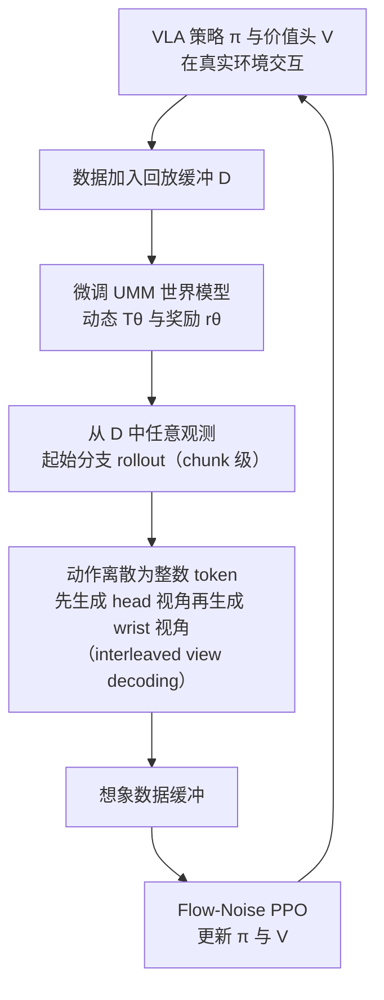

# Towards Practical World Model-based Reinforcement Learning for Vision-Language-Action Models（VLA-MBPO）

**Towards Practical World Model-based Reinforcement Learning for Vision-Language-Action Models**（简称 **VLA-MBPO**，[arXiv:2603.20607](https://arxiv.org/abs/2603.20607)，Zhilong Zhang … Yang Yu，南京大学 / Mila，2026-03）收录于 [Awesome World-Action Models (RCL)](https://github.com/rcl-robotics/Awesome-World-Action-Models) **第 496/564** 篇，分组 **WAMs**。本页已对照论文全文（27 页 PDF）改写，以下数字与结论均标注论文章节 / 表号；来源归档见 [`sources/papers/vla_mbpo_arxiv_2603_20607.md`](../../sources/papers/vla_mbpo_arxiv_2603_20607.md)。

## 一句话定义

**VLA-MBPO 是一套「世界模型内做 RL」的 VLA 后训练框架：用预训练统一多模态模型（UMM，Bagel）同时预测多视角未来画面与任务成败，靠交错视角解码保持视角一致、靠 chunk 级分支 rollout 限制误差累积，再用 Flow-Noise PPO 在想象数据上更新策略（摘要、§3）。**

## 英文缩写速查

| 缩写 | 英文全称 | 简要说明 |
|------|----------|----------|
| VLA | Vision-Language-Action | 视觉–语言–动作策略，本文微调对象为 π0.5 |
| MBPO | Model-Based Policy Optimization | 以短分支 rollout 限制模型误差的 MBRL 思路（Janner et al. 2019），名字被本文沿用 |
| MBRL | Model-Based Reinforcement Learning | 学习环境模型并用想象数据训练策略 |
| WM | World Model | 环境前向预测模型，此处同时预测画面与奖励 |
| UMM | Unified Multimodal Model | 同一模型处理文本、图像理解与生成；本文基座为 Bagel（§3.1） |
| IVD | Interleaved View Decoding | 交错视角解码：先生成 head 视角，再以其为条件生成 wrist 视角（§3.1） |
| PPO | Proximal Policy Optimization | 带裁剪的策略梯度（式 1） |
| GAE | Generalized Advantage Estimation | 广义优势估计，本文改写为 chunk 级（式 4） |
| Flow-Noise | Flow-Noise PPO | π_RL 提出的流匹配策略 PPO 变体，用去噪链的对数似然（式 5） |
| L-MDP | Language-conditioned MDP | 语言条件马尔可夫决策过程，奖励为 {0,1}（§2） |
| WAM | World Action Model | 清单分类：世界预测与动作生成耦合 |

## 为什么重要

- **问题：** 真机上用 RL 微调 VLA 成本高、有安全风险；而把世界模型当模拟器又会遇到像素级建模、多视角一致、稀疏奖励下误差累积三类难点（§1）。
- **作者自述的做法：** 用 UMM 一个模型兼做动力学和奖励，省去「视频模型 + VLM」双模型的工程负担；用分支 rollout 把预测长度压短（§3.1、§3.2）。
- **可核对的证据：** LIBERO 四个子集平均成功率 76.8 提到 85.9（Table 2）；LIBERO-Long 上全 horizon rollout 仅 52.8，分支 rollout 最高 66.8（Table 3）。
- 想横向对照同分组的其他工作，可以从 [RCL Awesome WAM 技术地图](../overview/rcl-awesome-wam-technology-map.md) 展开；同类「世界模型内训 VLA」可对照 [WMPO](paper-sa-2511-09515-wmpo-world-model-based-policy-optimization-for-v.md)（论文 §6 将其列为全 horizon rollout 一类）。
- 顺着列表实体 [Awesome World-Action Models](paper-rcl-wam-robot-learning-control-survey.md) 与站内 WAM / VLA 方法页，可以接回对应的学习主线。

## 流程总览

图依据：论文 §3.1–3.3 / Fig.1、Algorithm 1。注：Algorithm 1 把「真机采集 → 世界模型微调 → 世界模型内 RL」写成依次三阶段，上图的回环是对该流程重复执行的示意，论文未给出外层迭代次数。

## 核心信息

| 字段 | 内容 |
|------|------|
| 编号 | 496/564 |
| 分组 | WAMs |
| 出处 | 清单标注 ICML 2026（PDF 首页只写 Preprint, March 24, 2026） |
| 论文 | <https://arxiv.org/abs/2603.20607> |
| 子类 / 象限 | 策略后训练与WM-RL · 三维多视角建模 · 四象限外 |
| 代码 | 论文全文未给出代码 / 项目页链接 |

## 核心机制

### 1. UMM 世界模型（§3.1）

- **动作 token 化：** 参照 VLA-0，把连续动作离散成整数（文中举例范围 [0,256]）并映射到 UMM 词表，因此无需改结构、保留预训练能力；给定当前观测和 k×d 的动作 token 块，输出 chunk 末帧 s_{t+k} 与 chunk 级奖励 r_θ = Σ γ^(i-1) r(s_{t+i}, l)。
- **跳帧：** UMM 直接预测 chunk 末帧，不生成中间帧（Fig 2），推理更快；Table 1 中推理时间 10 对 Ctrl-World 的 21，正文称约 2 倍（表内无单位）。
- **奖励：** 同一模型输出任务是否完成的 Yes / No（附录 D 提示词）；论文附录把这一支称为「预训练 VLM 作成功检测器」，Fig 1 将其画在统一世界模型内，二者的严格关系文中未展开。

### 2. 交错视角解码（§3.1，式 3，Fig 10）

- head 视角：s^h_{t+k} ~ T(· | s^h_t, s^w_t, a_{t:t+k-1})；wrist 视角：s^w_{t+k} ~ T(· | s^w_t, s^h_{t+k})（按原文式 3 抄录）。
- 用注意力掩码在一个序列内实现（Fig 10）。
- Table 1 消融：去掉 IVD 后 wrist 视角 LPIPS 由 0.254 退到 0.454、PSNR 由 18.76 退到 13.38。
- 附录 E.1 / Fig 12 定性例子：head 视角预测与真值不同时，生成的 wrist 视角与自己预测的 head 视角一致而非与真值一致，作者据此认为两视角物理上自洽。

### 3. chunk 级分支 rollout（§3.2）

- 起点不是初始状态 s0，而是离线数据集中任意观测，并只滚很短的 horizon（Table 5：rollout chunk = 2）；世界模型按 chunk 预测，有效步数再缩为 1/k。
- 论文承认该技术来自状态型简单任务的工作（Park et al. 2025），其贡献是在像素级 VLA 微调中验证。

### 4. 想象数据上的 Flow-Noise PPO（§3.3，式 4–5，Algorithm 1）

- 策略为流匹配 VLA（π0.5），加 MLP 价值头；优势按 chunk 级 GAE：TD 误差为 Σ_{j=1..k} γ^(j-1) r + γ^k V(s_{t+k}) − V(s_t)，折扣用 γ^k λ。
- Flow-Noise 把去噪链各步的转移概率连乘作为动作块的对数似然（式 5）。
- 与既有离线 MBRL 的差别（作者自述）：不加保守正则（认为微调后的 UMM-World 精度足够）、不依赖拒绝采样和 Q 模型；全部任务共用一组超参，唯一主要调整是 LIBERO-Long 的样本量 1280、Update-to-data 50（Table 5）。

### 5. 理论（§4）

- Thm 4.1：步级世界模型 + chunk 级策略 + 全 horizon rollout，价值差随 horizon 近似二次放大，模型误差项系数 O(kγ^k / ((1-γ)(1-γ^k)))。
- Thm 4.2：chunk 级世界模型 + n-chunk 分支 rollout，模型误差项为 O(n/(1-γ))，策略误差项指数衰减；n 增大时模型误差线性增长而策略误差指数下降，需要折中。
- 案例（γ=0.99，k=10）：全 horizon 约 4183 ε_π + 18916 ε_m，n=2 的分支 rollout 约 1710 ε_π + 400 ε_m（系数均省略 r_max，笔者复算与文中一致）。
- 笔者读后补充：上界依赖的 ε_m 是「真实策略分布下」的世界模型误差，本文没有实测 ε_m，所以该案例是上界层面的对比，并不等于实测误差下降（笔者判断）。

## 评测与指标

**世界模型（§5.1，Table 1；LIBERO-Object，每任务 50 条训练轨迹，留出 10 条，rollout 40 步）**

| 模型 | Head LPIPS↓ / PSNR↑ / SSIM↑ | Wrist LPIPS↓ / PSNR↑ / SSIM↑ | 推理时间↓ | 奖励 ACC↑ / F1↑ |
|------|------|------|------|------|
| Ctrl-World | 0.150 / 21.95 / 0.882 | 0.435 / 13.87 / 0.680 | 21 | – |
| Qwen3-VL-8B | – | – | – | 97.0 / 0.841 |
| UMM-World | 0.094 / 23.29 / 0.906 | 0.254 / 18.76 / 0.751 | 10 | 98.4 / 0.861 |
| w/o IVD | 0.116 / 21.71 / 0.895 | 0.454 / 13.38 / 0.559 | 8 | 98.5 / 0.799 |
| w/o PT（随机初始化） | 0.281 / 19.26 / 0.756 | 0.579 / 12.80 / 0.499 | 10 | 94.5 / 0.496 |

**LIBERO 策略（§5.2，Table 2；起点为 π0.5 单轨迹 SFT，评测每任务 50 episode）**

| 方法 | Spatial | Object | Goal | Long | Avg |
|------|------|------|------|------|------|
| π0.5 (SFT) | 78.2 | 88.6 | 85.8 | 54.6 | 76.8 |
| BC (WM) | 80.6 | 89.8 | 85.0 | 48.6 | 76.0 |
| π_RL（同等真机交互预算的在线 RL） | 86.0 | 92.4 | 90.8 | 61.2 | 82.6 |
| IDQL | 79.0 | 92.4 | 86.4 | 52.2 | 77.5 |
| VLA-MBPO | 87.8 | 96.6 | 92.8 | 66.8 | 85.9 |

检索摘要里常见的「96.6」只是 **Object 子集** 成绩，整体平均为 85.9。

**真机（§5.3，附录 C，Fig 5）**

- 平台：ARX-X5 双臂（Plug In、Fold Towel）、Galaxy-R1 全身 21 自由度（Pick Cup、Insert Pen、Wipe Board）；每任务 50 次评测（30 见过 + 20 未见），SFT 示教约 50–100 条，RL 阶段加 50 条 π0.5(SFT) 自采轨迹（附录 C）。
- Fig 5 为无数值标注的柱状图，对比项为 π0.5(SFT)、IDQL、VLA-MBPO；笔者目测 VLA-MBPO 约 34 / 56 / 42 / 54 / 58，SFT 约 6 / 38 / 28 / 30 / 28（Plug In / Fold Towel / Insert Pen / Pick Cup / Wipe Board，百分制，读数有误差）。
- 真机没有 π_RL 等在线 RL 基线。

**消融（§5.4，LIBERO-Long）**：分支 1 / 2 / 4 chunk = 63.9 / 66.8 / 62.9，全 horizon = 52.8（Table 3）；想象样本量越大成功率越高（Fig 6）。作者解释：过短限制探索与轨迹拼接，过长则生成不可靠。

## 工程实践

- **算力（附录 F）：** 8×H100；世界模型在采集数据上训练约 7–8 小时，策略优化约 4–6 小时（标准交互预算）。
- **世界模型超参（Table 4）：** lr 2e-5，交叉熵权重 0.01，MSE 权重 1.0，max latent size 64，timestep shift 4。
- **RL 超参（Table 5）：** 样本量 512（LIBERO-Long 1280），batch 512，rollout chunk 2，actor lr 5e-6，critic lr 1e-4，γ 0.99，GAE λ 0.95，clip 0.1，动作块 H=10，去噪 3 步，噪声水平 0.5，Update-to-data 20（Long 为 50）。
- **数据流：** LIBERO 行为数据为 π0.5 单轨迹 SFT 策略采集的每任务 50 episode（§5.2）；真机为示教 SFT 加少量自采 rollout（附录 C）。
- **提示词（附录 D）：** 世界模型提示让模型「扮演物理模拟器」，输入多视角观测与整数动作序列；奖励提示要求严格输出 Yes. / No.，其中环境描述写的是 LIBERO 工作区。
- **时序：** 控制频率 ARX-X5 为 15 Hz，Galaxy-R1 控制环 100 Hz、数据记录 10 Hz（附录 C）。
- 想动手复现：论文未给出代码，复现需自行搭建 Bagel 微调与 Flow-Noise PPO 管线；PPO 与 GAE 基础见 [ppo.md](../methods/ppo.md)、[gae.md](../methods/gae.md)，动作分块见 [action-chunking.md](../methods/action-chunking.md)。

## 与其他工作对比

| 对照 | 论文的区分点（§1、§3、§6） | 站内页 |
|------|------|------|
| Ctrl-World（视频世界模型） | 多视角一致但不预测奖励；Table 1 中保真度与速度均不及 UMM-World | [paper-ctrl-world.md](paper-ctrl-world.md) |
| WMPO、World-Env、VLA-RFT 等 | 论文称它们依赖全 horizon rollout，易受误差累积影响（§6） | [WMPO](paper-sa-2511-09515-wmpo-world-model-based-policy-optimization-for-v.md) |
| π_RL / RLinf 一类在线 RL | 需要大量真机交互；本文 LIBERO 对比为同等真机数据预算（§5.2） | [paper-rlinf-vla.md](paper-rlinf-vla.md) |
| MBPO / MOPO / MOBILE | 沿用「短分支 rollout」思想，但去掉保守性惩罚（§3.3、§6） | [mbpo.md](../methods/mbpo.md)、[model-based-rl.md](../methods/model-based-rl.md) |
| IDQL | 离线无模型 RL 基线，LIBERO 与真机均作对照 | — |

与清单内相邻条目孰优孰劣，本页不下结论：问题设定与评测口径不同，请回到各自原文。

## 局限与风险

**论文自述（§7、附录 E）：**

- 样本生成仍要大量算力（附录 F）。
- UMM 未在带动作标注的机器人数据上预训练，下游仍需少量数据微调世界模型；未来方向是一次性或零样本泛化。
- 部分可观测失败（附录 E.2 / Fig 13）：机械臂移出 head 视角后，模型无法渲染手臂；转身后首次出现的区域无法凭空生成。
- 大位移 / 大形变失败（附录 E.2 / Fig 14，图题为 large prediction horizon）：Wipe Board 出现 motion collapse（预测近乎静止），Fold Towel 生成不合物理的织物形态。

**笔者的读后判断（论文未写）：**

- 论文没有把接触类误差（抓取滑动、碰撞、摩擦）列为失败模式，也没有针对接触的专门评测；§5.3 反称 Plug In（3 mm 插座）体现了精细接触操作上的提升。二手文章若写「接触预测不准」，在本论文里找不到直接出处，至多是对失败案例的推测。
- 「预测越长越偏离」有间接证据：误差累积论述（§3.2、§4.1）、全 horizon 52.8 低于分支 rollout（Table 3）、4 chunk 低于 2 chunk（Table 3）；但没有逐步误差随 horizon 变化的曲线，Fig 14 展示的也是单次大位移而非长度本身。
- 真机只比较了 π0.5(SFT) 与 IDQL，无在线 RL 基线，且结果是无数值标注的柱状图，「减少真机交互」的量化支撑主要来自 LIBERO（§5.2）。
- 真机每任务只评测 50 次且未给出方差或种子数；LIBERO 同样没有方差报告（笔者判断，文中未见）。
- 奖励为二值成败，且 Table 1 的奖励评测局限于 LIBERO-Object；真机奖励模型的精度文中未单列。
- 理论为上界分析，且依赖作者假设的 ε_m 定义，未与实测误差对应（见「核心机制」第 5 节）。
- 论文正文真机任务名为 Plug Cable，附录写 Plug In，指同一任务（笔者推断）。

## 结论

**VLA-MBPO 的核心贡献是把「UMM 世界模型 + 交错视角解码 + chunk 级分支 rollout + Flow-Noise PPO」拼成一套单一超参的 VLA 世界模型 RL 流程，并在 LIBERO 与五个真机任务上给出相对 SFT 的提升。**

1. 可确证：LIBERO 平均 76.8 → 85.9，Long 54.6 → 66.8（Table 2）；分支 rollout 2 chunk 最佳，全 horizon 明显更差（Table 3）；交错解码与预训练都对世界模型质量有显著贡献（Table 1）。
2. 作者自述但证据较弱：真机泛化与「实用」叙事，依据是五任务的柱状图与单一硬件设置。
3. 适用边界：世界模型仍需下游少量数据微调，生成算力不小；部分可观测与大位移场景会失败。

## 常见误区

1. 把 96.6 当作 LIBERO 总成绩：它是 Object 子集，平均为 85.9（Table 2）。
2. 把「预测越长越偏」当作论文测得的曲线：论文给的是理论上界与 rollout 长度消融，不是误差随步数的曲线。
3. 把「接触预测不准」当作论文结论：论文没有这么说，见上文局限节。
4. 把 Awesome 清单的 Contribution 当成方法证明：以原文与本页标注的章节为准。

## 关联页面

- 列表实体：[Awesome World-Action Models（RCL）](paper-rcl-wam-robot-learning-control-survey.md)
- 技术地图：[RCL Awesome WAM 技术地图](../overview/rcl-awesome-wam-technology-map.md)
- 方法 / 任务：[generative-world-models.md](../methods/generative-world-models.md)、[model-based-rl.md](../methods/model-based-rl.md)、[mbpo.md](../methods/mbpo.md)、[ppo.md](../methods/ppo.md)、[gae.md](../methods/gae.md)、[action-chunking.md](../methods/action-chunking.md)、[vla.md](../methods/vla.md)、[manipulation.md](../tasks/manipulation.md)
- 概念：[flow-matching-embodied-policy.md](../concepts/flow-matching-embodied-policy.md)、[World Action Models（WAM）](../concepts/world-action-models.md)
- 相邻论文：[Ctrl-World](paper-ctrl-world.md)、[WMPO](paper-sa-2511-09515-wmpo-world-model-based-policy-optimization-for-v.md)、[RLinf-VLA](paper-rlinf-vla.md)

## 参考来源

- [`sources/papers/vla_mbpo_arxiv_2603_20607.md`](../../sources/papers/vla_mbpo_arxiv_2603_20607.md) — 论文全文核对归档（核对范围与通读状态见该文件）
- [`sources/papers/rcl_awesome_wam_2603_20607_towards-practical-world-model-based-rein.md`](../../sources/papers/rcl_awesome_wam_2603_20607_towards-practical-world-model-based-rein.md) — 本条目策展摘录
- [`sources/papers/rcl_awesome_wam_catalog.md`](../../sources/papers/rcl_awesome_wam_catalog.md) — 列表总表
- [`sources/repos/awesome-world-action-models-rcl.md`](../../sources/repos/awesome-world-action-models-rcl.md)
- [`docs/PAPERS.md`](https://github.com/RCL-Robotics/Awesome-World-Action-Models/blob/main/docs/PAPERS.md) — 上游论文目录
- 论文：<https://arxiv.org/abs/2603.20607>
- [arXiv PDF](https://arxiv.org/pdf/2603.20607)：已通读全文（含附录 A–F；附录 A–B 证明只核对结论式）

## 推荐继续阅读

- [原文](https://arxiv.org/abs/2603.20607)
- [Awesome World-Action Models (RCL) 仓库](https://github.com/rcl-robotics/Awesome-World-Action-Models)
- [Ctrl-World](paper-ctrl-world.md) 与 [WMPO](paper-sa-2511-09515-wmpo-world-model-based-policy-optimization-for-v.md)：同类世界模型 RL 对照
