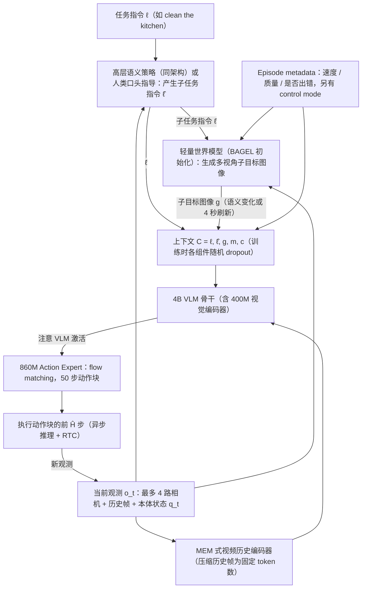

# π0.7：可 steer 的通才机器人基础模型（arXiv:2604.15483）

**π0.7: a Steerable Generalist Robotic Foundation Model with Emergent Capabilities**（Physical Intelligence，[arXiv:2604.15483](https://arxiv.org/abs/2604.15483)，v2）收录于 [Awesome World-Action Models (RCL)](https://github.com/rcl-robotics/Awesome-World-Action-Models) 第 563/564 篇，分组 WAMs。本页依据论文全文通读（见 [来源归档](../../sources/papers/pi07-steerable-generalist_arxiv_2604_15483.md)）。方法系列页见 [π0.7 方法页](../methods/pi07-policy.md)。

## 一句话定义

π0.7 在 π0.6-MEM 架构上给训练样本配上**多样化上下文**（子任务指令、世界模型生成的子目标图像、片段速度 / 质量 / 错误元数据、控制模式），训练时对各分量随机 dropout，使单个约 5B 参数的 VLA 既能吸收次优、失败与非机器人数据，又能在测试时通过提示选择「怎么做」；作者据此报告开箱灵巧任务、指令跟随、跨本体与组合泛化（§I、§V）。

## 英文缩写速查

| 缩写 | 英文全称 | 简要说明 |
|------|----------|----------|
| VLA | Vision-Language-Action | 视觉语言动作策略，π0.7 为约 5B 参数（§IV） |
| VLM | Vision-Language Model | 骨干为 Gemma3 4B，含 400M 视觉编码器（§IV） |
| MEM | Multi-scale Embodied Memory | π0.6-MEM 的视频历史编码器，历史帧压缩为固定 token 数（§VI-B） |
| KI | Knowledge Insulation | VLM 用 FAST token 监督，动作专家梯度不回传 VLM（§III） |
| RTC | Real-Time Action Chunking | 训练期模拟 0 到 12 步推理延迟，让异步控制平滑（§VI-B） |
| CFG | Classifier-Free Guidance | 对元数据做引导以抬高速度 / 质量，β 取 1.3、1.7、2.2（§VII） |
| GC | Goal-Conditioned | 文中 π0.7（GC）指加入世界模型生成子目标图像的版本（§IX-B） |
| SFT / RL specialist | 监督微调 / 强化学习专家 | 对照基线：π0.6 SFT 专家与 π0.6* RL 专家（§IX-A） |

## 为什么重要

- **直指「数据怎么混」的痛点**：作者指出多样的次优数据若直接混训，会让模型把不同模式平均掉（§I）；元数据条件让模型区分高低质量与策略，叠 T 恤实验里无元数据的模型随更大但更差的数据集可能变差，有元数据的持续变好（§IX-E，Fig.18 左）。
- **把专家蒸馏回通才**：用 π0.6* 的 RL 训练 rollout 与评测数据做训练样本，作者称单个 π0.7 在各测试任务上与专家竞争，并在 diverse laundry 与 box building 吞吐上高于 RL 专家（§VI-A、§IX-A，Fig.6）。
- **跨本体零样本折衣**：从未在 UR5e 上收集叠衣数据，π0.7（GC）任务进度 85.6%、成功率 80%，对照 10 名专家操作员首次尝试为 90.9% 与 80.6%（§IX-C，附录 F）。
- **用语言 coaching 教新任务**：逐步语言指令带机器人完成未见长任务，再用 coaching 数据训练高层策略得到自主版本（§IX-D，Fig.14 至 Fig.16）。

## 核心原理与流程总览

图依据：论文 Fig.2、Fig.3、§V、§VI-B 与 §VII（Algorithm 1）。

要点（均出自论文，作者自述）：

1. **上下文四类信息**（§V）：子任务指令 ℓ̂（沿用 π0.5）；多视角子目标图像 g（基座视角利于环境 / 物体结果，腕部视角利于臂 / 夹爪结果）；元数据 m = 速度（episode 步数，500 步分箱）+ 质量（1 到 5 分）+ 错误标记；控制模式 c ∈ {joint, ee}。
2. **世界模型**（§V-B、附录 C）：由 14B 的 BAGEL 初始化，目标是预测子任务片段末帧，训练混入机器人数据、第一视角人视频与开源图像编辑 / 视频数据；作者称网页预训练使其能把语义与物理概念经子目标图像传给策略。
3. **dropout 配方**（§V-E）：子目标只加到 25% 的样本，其中 30% 同时丢子任务指令；元数据整体 15% 丢弃，速度 / 质量 / 错误各 5% 单独丢弃；控制模式不丢。
4. **运行时提示**（§VII）：速度取任务 episode 长度第 15 百分位，质量恒 5，错误恒 false；子目标在 ℓ̂ 变化或 4 秒后异步刷新；对元数据可做 CFG。
5. **动作生成**（§VI-B、§VII）：动作专家固定 50 个动作 token，5 步去噪，每次执行 Ĥ ∈ {15, 25} 步，训练期 RTC 覆盖最长 240ms（50Hz）延迟。

## 工程实践

- **算力**（附录 D）：策略与高层策略各用单张 H100；最小变体推理 38ms（3 相机、5 去噪步），开启 MEM 编码器与子目标图像后最坏 127ms；子目标生成用 4 张 H100 张量并行、8 比特量化与改版 SageAttention，25 去噪步（含文本与图像 CFG）约 1.25 秒，所以子目标与策略异步运行。
- **机器人平台**（§VIII）：双臂移动操作器（2 个 6 DoF 臂）、静态双臂 BiPi、双臂 UR5e（配 Robotiq 夹爪，20Hz，其余 50Hz）、单臂 6 DoF；均为平行夹爪，输出经 PD 控制器，末端控制用数值逆运动学。
- **控制模式**（附录 E）：先前模型在跨本体任务上 EE 控制与关节控制无明显差异，故主实验用关节空间。
- **数据规模与来源**（§VI-A）：见来源归档。论文未给出总数据量表，本页不引用总小时数。
- **开源状态**：论文未给出代码或权重链接，故本页不写 `code:`。想读第三方复现思路可看 [π0.7 方法页](../methods/pi07-policy.md)，但那不是官方实现。

## 评测证据与清单说法的对比核对

本节核对 CoRL 2026 Berseth 阅读清单（第 050/101 条，P1，Oral）对该论文的一句话摘要。该摘要自述由 LLM 据摘要起草，排序是作者按自身兴趣模型打分，不是质量评价。

清单原句：「π0.7: diverse context conditioning (strategy, metadata, subgoal images) makes a generalist steerable and lets it use suboptimal data.」

| 清单说法 | 论文核对 | 结论 |
|----------|----------|------|
| diverse context conditioning（strategy, metadata, subgoal images） | 吻合：上下文含子任务指令、元数据（速度 / 质量 / 错误）、子目标图像与控制模式（§V）。「strategy」在论文中作为「episode quality（strategy metadata）」的口径出现（§I），实际元数据三字段是速度、质量、错误。清单漏了控制模式与更详细的子任务语言。 | 基本吻合 |
| makes a generalist steerable | 论文标题与摘要都称 steerable；证据是元数据 CFG 与运行时提示（§VII）、有无元数据的消融（Fig.7、Fig.18）。「steerable」的量化主要体现在吞吐 / 质量，不是连续可控性的独立评测。 | 吻合 |
| lets it use suboptimal data | 吻合：失败片段、低质量演示、自主评测 rollout 与干预数据进训练，并有有 / 无元数据的 8 模型对照（§VI-A、§IX-E）。 | 吻合 |
| （清单未提）真机与评测口径 | 全部实验为真机（多种平台），无仿真基准；对照对象是作者自家的 π0.5、π0.6、π0.6* 与 MEM 专家，没有他机构模型。 | 清单未涉及，读者需知 |
| （清单未提）「emergent capabilities」 | 论文标题强调涌现能力（跨本体、复杂指代、组合泛化），但 §X 自承无法排除这些技能来自训练数据重混。 | 清单略去了这层限定 |

## 结论

π0.7 展示了以统一提示吸收异质数据并在部署时选择行为的能力，但公开证据尚不足以独立复现。

- 区分子任务指令、子目标图、元数据和控制模式，核对训练 dropout 与部署提示的一致性。
- 把已见、未见及任务本体组合分开统计，技能重混不等同完全新能力。
- 评估生成子目标的算力、延迟和错误传播，并明确代码、权重与数据的未开放边界。

## 局限

作者承认（§X）：
- 未见任务或未见任务 - 机器人组合的成功率在 60% 到 80%，已见任务常超 90%。
- 在如此大的数据集上难以确定任务是否真「未见」，泛化可能主要来自重混已有技能。

笔记者观察（未验证之处，非作者自述）：
- 多数结果只以柱状图呈现，正文给精确数值的仅少数（如折衣对照、§X 的范围），试验次数在主文中未集中交代（我通读未找到）。
- 数据、权重与代码未公开，结果无法外部复现；高层策略与世界模型也只在文中描述。
- 对照基线均为同机构前代模型，跨机构对比缺失。
- 子目标图像生成成本高（附录 D），部署需多卡异步。
- 评测里 π0.7（GC）使用的是世界模型生成的子目标，若世界模型出错对性能的影响文中无单独分析（推测，未在论文中找到）。

## 关联页面

- 方法系列：[π0.7 方法页](../methods/pi07-policy.md)、[VLA](../methods/vla.md)、[Action Chunking](../methods/action-chunking.md)、[Diffusion Policy](../methods/diffusion-policy.md)
- 世界模型与 WAM：[生成式世界模型](../methods/generative-world-models.md)、[World Action Models](../concepts/world-action-models.md)、[RCL Awesome WAM 技术地图](../overview/rcl-awesome-wam-technology-map.md)、[列表实体](paper-rcl-wam-robot-learning-control-survey.md)
- 同系列前作：[π0](paper-pi0.md)、[π0.5](paper-pi05-open-world-vla.md)、[人到机器人迁移](paper-pi-human-to-robot.md)
- 概念与任务：[Foundation Policy](../concepts/foundation-policy.md)、[数据飞轮](../concepts/data-flywheel.md)、[Manipulation](../tasks/manipulation.md)

## 参考来源

- [`sources/papers/pi07-steerable-generalist_arxiv_2604_15483.md`](../../sources/papers/pi07-steerable-generalist_arxiv_2604_15483.md) — 全文通读归档（本页依据）
- [`sources/papers/pi07.md`](../../sources/papers/pi07.md) — 早期 ingest 摘录
- [`sources/papers/rcl_awesome_wam_2604_15483_0-7-a-steerable-generalist-robotic-found.md`](../../sources/papers/rcl_awesome_wam_2604_15483_0-7-a-steerable-generalist-robotic-found.md) — 清单条目摘录
- [`sources/papers/rcl_awesome_wam_catalog.md`](../../sources/papers/rcl_awesome_wam_catalog.md)、[`sources/repos/awesome-world-action-models-rcl.md`](../../sources/repos/awesome-world-action-models-rcl.md)
- 论文：<https://arxiv.org/abs/2604.15483>；项目页：<https://www.pi.website/blog/pi07>

## 继续阅读

- [arXiv PDF](https://arxiv.org/pdf/2604.15483)
- [Awesome World-Action Models (RCL) 仓库](https://github.com/rcl-robotics/Awesome-World-Action-Models)
- [π0.7 方法页](../methods/pi07-policy.md)
