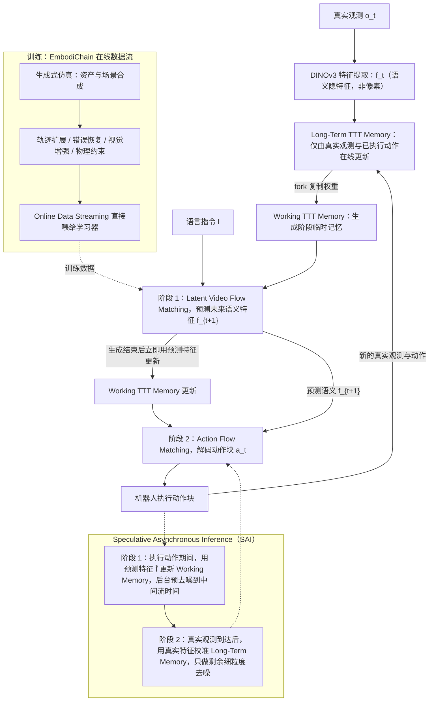

# DexWorldModel

**DexWorldModel: Causal Latent World Modeling towards Automated Learning of Embodied Tasks** 收录于 [Awesome World-Action Models (RCL)](https://github.com/rcl-robotics/Awesome-World-Action-Models) **第 306/564** 篇，分组 **WAMs**。本页是 **清单索引**：给出它在清单中的位置与原文入口，方法细节和量化结果请看原文。

## 一句话定义

DexWorldModel introduces CLWM, which predicts future DINOv3 features and then generates actions conditioned on that prediction. Shared transformer blocks, separate persistent and speculative memories, and asynchronous denoising connect world prediction to robot execution. EmbodiChain supplies synthetic adaptation da...

## 英文缩写速查

| 缩写 | 英文全称 | 简要说明 |
|------|----------|----------|
| WAM | World Action Model | 世界预测与动作生成耦合 |
| VLA | Vision-Language-Action | 视觉–语言–动作策略 |
| IDM | Inverse Dynamics Model | 先预测未来再反推动作 |
| WM | World Model | 环境前向预测模型 |

## 为什么重要

- DexWorldModel introduces CLWM, which predicts future DINOv3 features and then generates actions conditioned on that prediction. Shared transformer blocks, separate persistent and speculative memories, and asynchronous denoising connect world prediction to robot execution. EmbodiChain supplies synthetic adaptation da...
- 想横向对照同一分组的其他工作，可以从 [RCL Awesome WAM 技术地图](../overview/rcl-awesome-wam-technology-map.md) 逐条展开。
- 顺着列表实体 [Awesome World-Action Models](paper-rcl-wam-robot-learning-control-survey.md) 与站内 WAM / VLA 方法页，可以接回对应的学习主线。

## 流程总览

图依据：论文 §3.1–3.3 / Fig.2（TTT Memory）、Fig.3（SAI）与 §4（EmbodiChain）

## 核心信息

| 字段 | 内容 |
|------|------|
| 编号 | 306/564 |
| 分组 | WAMs |
| 出处 | 2026 |
| 论文 | <https://arxiv.org/abs/2604.16484> |
| 子类 / 象限 | 视觉规划与IDM · 潜空间预测与JEPA · Q2 · One Model × IDM |

## 核心机制（归纳）

### 策展导读要点

DexWorldModel introduces CLWM, which predicts future DINOv3 features and then generates actions conditioned on that prediction. Shared transformer blocks, separate persistent and speculative memories, and asynchronous denoising connect world prediction to robot execution. EmbodiChain supplies synthetic adaptation da...

本页不复述论文公式与完整实验表；若需工程落地，请回到原文并对照站内 [World Action Models（WAM）](../concepts/world-action-models.md) 等概念页。

## 评测与指标

- 本页 **没有搬运** 原文的量化 benchmark 与实机指标。
- 评测口径与具体数值以 [原文 / 项目页](https://arxiv.org/abs/2604.16484) 为准。
- 横向对照请回到 [技术地图](../overview/rcl-awesome-wam-technology-map.md) 同分组条目。

## 与其他工作对比

- 本页 **不做** 与具体基线的逐项数值对比；同分组的横向对照请回到 [技术地图](../overview/rcl-awesome-wam-technology-map.md) 的 **WAMs** 分组逐条展开。
- 如果站内已经有这篇的深读页（含机构、实验表与源码运行时序图），请以那一页为准；本页只保留清单要点。
- 与清单内相邻条目孰优孰劣，本页不下结论：清单 Contribution 可能滞后于论文最新版本，差异应以各自原文的问题设定与评测口径为准。

## 结论

**这一页能给你的是「DexWorldModel」在策展清单里的坐标与要点：够你判断要不要去读原文，但不能替代原文。**

- 可确证的只有清单坐标：分组 **WAMs**，以及 Contribution 点出的问题设定；本页不自行推导新结论。
- 适用边界：本页不能替代原文 PDF；开源状态以项目页实际链接为准（清单可能滞后）。
- 要深读这篇，建议直接从原文入手，再回到下方关联的方法 / 任务页对照。

## 常见误区

1. 不要把 Awesome 条目的 Contribution 当成完整方法证明——它只是策展导读。
2. 若站内已有这篇的深读页，以那一页为准——本页只是清单入口，不含实验数据。

## 关联页面

- 列表实体：[Awesome World-Action Models（RCL）](paper-rcl-wam-robot-learning-control-survey.md)
- 技术地图：[RCL Awesome WAM 技术地图](../overview/rcl-awesome-wam-technology-map.md)
- 方法/任务：[generative-world-models.md](../methods/generative-world-models.md)、[manipulation.md](../tasks/manipulation.md)

## 参考来源

- [`sources/papers/rcl_awesome_wam_2604_16484_dexworldmodel-causal-latent-world-modeli.md`](../../sources/papers/rcl_awesome_wam_2604_16484_dexworldmodel-causal-latent-world-modeli.md) — 本条目策展摘录
- [`sources/papers/rcl_awesome_wam_catalog.md`](../../sources/papers/rcl_awesome_wam_catalog.md) — 列表总表
- [`sources/repos/awesome-world-action-models-rcl.md`](../../sources/repos/awesome-world-action-models-rcl.md)
- [`docs/PAPERS.md`](https://github.com/RCL-Robotics/Awesome-World-Action-Models/blob/main/docs/PAPERS.md) — 上游论文目录
- 论文：<https://arxiv.org/abs/2604.16484>
- [arXiv PDF](https://arxiv.org/pdf/2604.16484)：已通读方法部分（实验与附录以略读为准）：§1 引言、§3.1 潜在视频与动作自回归生成、§3.2 TTT 记忆、§3.3 SAI、§4 EmbodiChain

## 推荐继续阅读

- [Awesome World-Action Models (RCL) 仓库](https://github.com/rcl-robotics/Awesome-World-Action-Models)
- [原文](https://arxiv.org/abs/2604.16484)
