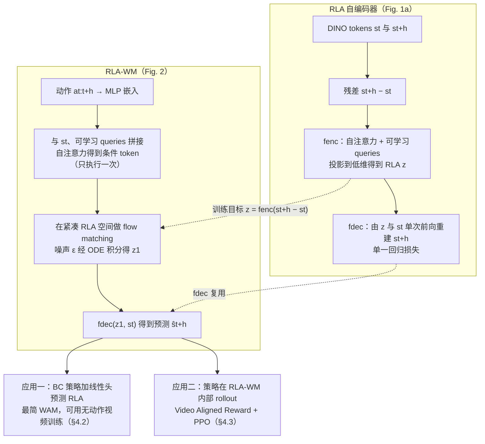
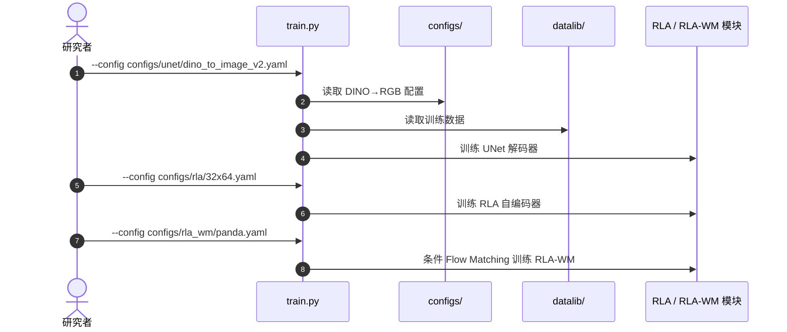

# Learning Visual Feature-Based World Models via Residual Latent Action

**Learning Visual Feature-Based World Models via Residual Latent Action** 收录于 [Awesome World-Action Models (RCL)](https://github.com/rcl-robotics/Awesome-World-Action-Models) **第 415/564** 篇，分组 **WAMs**。本页是 **清单索引**：给出它在清单中的位置与原文入口，方法细节和量化结果请看原文。

## 一句话定义

Building on RLA, we propose *RLA World Model* (RLA-WM), which predicts RLA values via flow matching. RLA-WM outperforms both state-of-the-art feature-based and video-diffusion world models on simulation and real-world datasets, while being orders of magnitude faster than video diffusion.

## 英文缩写速查

| 缩写 | 英文全称 | 简要说明 |
|------|----------|----------|
| WAM | World Action Model | 世界预测与动作生成耦合 |
| VLA | Vision-Language-Action | 视觉–语言–动作策略 |
| IDM | Inverse Dynamics Model | 先预测未来再反推动作 |
| WM | World Model | 环境前向预测模型 |

## 为什么重要

- Building on RLA, we propose *RLA World Model* (RLA-WM), which predicts RLA values via flow matching. RLA-WM outperforms both state-of-the-art feature-based and video-diffusion world models on simulation and real-world datasets, while being orders of magnitude faster than video diffusion.
- 想横向对照同一分组的其他工作，可以从 [RCL Awesome WAM 技术地图](../overview/rcl-awesome-wam-technology-map.md) 逐条展开。
- 顺着列表实体 [Awesome World-Action Models](paper-rcl-wam-robot-learning-control-survey.md) 与站内 WAM / VLA 方法页，可以接回对应的学习主线。

## 流程总览

图依据：论文 §3（Learning Latent Actions on DINO Residuals、RLA World Model）/ Fig. 1a、Fig. 2；两个应用见 §4.2 / Fig. 4 与 §4.3 / Fig. 5。

## 核心信息

| 字段 | 内容 |
|------|------|
| 编号 | 415/564 |
| 分组 | WAMs |
| 出处 | 见清单 / 原文 |
| 论文 | <https://arxiv.org/abs/2605.07079> |
| 代码/项目 | <https://github.com/mlzxy/rla-wm> |
| 子类 / 象限 | 潜空间预测与JEPA · 策略后训练与WM-RL · 四象限外 |

## 核心机制（归纳）

### 策展导读要点

Building on RLA, we propose *RLA World Model* (RLA-WM), which predicts RLA values via flow matching. RLA-WM outperforms both state-of-the-art feature-based and video-diffusion world models on simulation and real-world datasets, while being orders of magnitude faster than video diffusion.

本页不复述论文公式与完整实验表；若需工程落地，请回到原文并对照站内 [World Action Models（WAM）](../concepts/world-action-models.md) 等概念页。

## 评测与指标

- 本页 **没有搬运** 原文的量化 benchmark 与实机指标。
- 评测口径与具体数值以 [原文 / 项目页](https://arxiv.org/abs/2605.07079) 为准。
- 横向对照请回到 [技术地图](../overview/rcl-awesome-wam-technology-map.md) 同分组条目。

## 与其他工作对比

- 本页 **不做** 与具体基线的逐项数值对比；同分组的横向对照请回到 [技术地图](../overview/rcl-awesome-wam-technology-map.md) 的 **WAMs** 分组逐条展开。
- 如果站内已经有这篇的深读页（含机构、实验表与源码运行时序图），请以那一页为准；本页只保留清单要点。
- 与清单内相邻条目孰优孰劣，本页不下结论：清单 Contribution 可能滞后于论文最新版本，差异应以各自原文的问题设定与评测口径为准。

## 结论

**这一页能给你的是「Learning Visual Feature-Based World Models via Residual Latent Action」在策展清单里的坐标与要点：够你判断要不要去读原文，但不能替代原文。**

- 可确证的只有清单坐标：分组 **WAMs**，以及 Contribution 点出的问题设定；本页不自行推导新结论。
- 适用边界：本页不能替代原文 PDF；开源状态以项目页实际链接为准（清单可能滞后）。
- 要深读这篇，建议直接从原文入手，再回到下方关联的方法 / 任务页对照。

## 常见误区

1. 不要把 Awesome 条目的 Contribution 当成完整方法证明——它只是策展导读。
2. 若站内已有这篇的深读页，以那一页为准——本页只是清单入口，不含实验数据。

## 源码运行时序图

流程依据 `docs/training.md` 的公开运行命令；未实测多 GPU 训练。

## 工程实践

官方 README 的 `docs/training.md` 给出三阶段：UNet 解码 DINO→RGB；RLA 自编码器；RLA-WM。总入口 `train.py --config ...`，并提供 `notebooks/inference_demo.ipynb`。

## 局限与风险

- 尚未完成主论文与附录逐段通读，不作为完整复现指南；数值比较须保持同任务、同评测协议。
- 代码可见不代表依赖、权重、训练实现全部公开，也不代表已执行。

## DINOv3 世界模型一手资料复核（2026-11-08）

RLA-WM 用相邻 DINO 特征的残差学习潜动作，再用条件 Flow Matching 预测潜动作或未来表征；视觉预测和动作推断分开训练并结合。

官方 README 的 `docs/training.md` 给出三阶段：UNet 解码 DINO→RGB；RLA 自编码器；RLA-WM。总入口 `train.py --config ...`，并提供 `notebooks/inference_demo.ipynb`。

- [作者论文](https://arxiv.org/abs/2605.07079) · [原文归档](../../sources/papers/rcl_awesome_wam_2605_07079_learning-visual-feature-based-world-mode.md) · [代码核验记录](../../sources/repos/dinov3-wm-rla-wm.md)
- 原文主文及必要附录已核查；代码入口以官方仓库为准，尚未亲自运行训练和评测。

## 2026-11-08 原文与源码完整复核

**方法：** 冻结 DINOv3-L/16 特征，RLA 自编码器压缩相邻 DINO patch 残差，动作条件 Flow Matching 在 **紧凑 RLA** 而非原始百万维 DINO 空间中预测未来，解码重建视觉 token。

**核对结果：** ManiSkill 未来帧 LPIPS 0.071、SSIM 0.931、DINO L1 0.030；SO-101 叠杯 BC 3/20 → BC+RLA 8/20。

**限制：** 世界模型 OOD 幻觉成功：加噪 PushT 模拟器 24.0%，RLA-WM 预测仍为 84.8%；WMRL 需要防止利用模型错误。

全文版本：[arXiv:2605.07079](https://arxiv.org/abs/2605.07079)，未在本环境实际执行训练或真机评测。

## 关联页面

- 列表实体：[Awesome World-Action Models（RCL）](paper-rcl-wam-robot-learning-control-survey.md)
- 技术地图：[RCL Awesome WAM 技术地图](../overview/rcl-awesome-wam-technology-map.md)
- 方法/任务：[generative-world-models.md](../methods/generative-world-models.md)、[manipulation.md](../tasks/manipulation.md)

## 参考来源

- [`sources/papers/rcl_awesome_wam_2605_07079_learning-visual-feature-based-world-mode.md`](../../sources/papers/rcl_awesome_wam_2605_07079_learning-visual-feature-based-world-mode.md) — 本条目策展摘录
- [`sources/papers/rcl_awesome_wam_catalog.md`](../../sources/papers/rcl_awesome_wam_catalog.md) — 列表总表
- [`sources/repos/awesome-world-action-models-rcl.md`](../../sources/repos/awesome-world-action-models-rcl.md)
- [`docs/PAPERS.md`](https://github.com/RCL-Robotics/Awesome-World-Action-Models/blob/main/docs/PAPERS.md) — 上游论文目录
- 论文：<https://arxiv.org/abs/2605.07079>
- [arXiv PDF](https://arxiv.org/pdf/2605.07079)：已通读方法部分（实验与附录以略读为准）：§1 引言、§2 相关工作、§3 方法、§4.1 预测质量评测、§4.2 最简 WAM、§4.3 世界模型内视觉 RL 的动机与图注

## 推荐继续阅读

- [Awesome World-Action Models (RCL) 仓库](https://github.com/rcl-robotics/Awesome-World-Action-Models)
- [原文](https://arxiv.org/abs/2605.07079)
